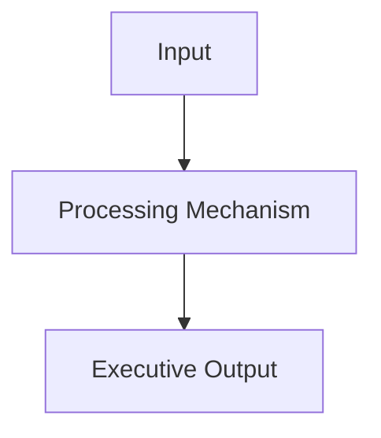

# Canonical Schema & Document Templates (`schema-templates.md`)

Use these templates when generating pages in the **P3MD MBA Knowledge Base**.

---

## 1. Master Weekly Lecture Note (`content/courses/mkX/week-YY/index.md`)

````yaml
---
title: "Week YY: [Topic Headline] — [Subtitle / Core Focus]"
course: "[Full Course Name, e.g. Organizational Behaviour & Managing People]"
course_code: "[MK1 - MK6]"
week: [1 - 14]
module: "[Module Name from Syllabus]"
type: "weekly-lecture"
tags:
  - [MK Code]
  - [primary-domain]
  - [secondary-topic]
  - sbm-itb
---

> [!NOTE] Curricular & Faculty Metadata
> - **Course:** [Course Code] [Course Name] — Week [YY]
> - **Teaching Team:** [Faculty Names & Credentials]
> - **Primary Curricular Spine:** [Slide Deck Name & Slide Count]
> - **Direct Satellites & Problem Sets:**
>   - [[courses/mkX-slug/week-YY/assignment-slug|Assignment Guide Title]]
>   - [[courses/mkX-slug/week-YY/case-slug|Case Study Dossier]]
>   - [[courses/mkX-slug/week-YY/reading-slug|Academic Reading Note]]

## 1. Executive Overview & Foundations of [Topic]

[Core dilemma, why this matters to enterprise leaders, what fails when unaddressed, empirical stakes / statistics.]

---

## 2. Theoretical Architecture & Core Frameworks

[Detailed breakdown of slide deck models, formulas, LaTeX math, and Mermaid process diagrams.]

$$\mathbf{FORMULA = VARIABLES}$$



---

## 3. Managerial Crucible: Indonesian Enterprise & BUMN Context

[Real-world friction: Indonesian corporate governance, traditional trade vs modern trade dynamics, AKHLAK values.]

---

## 4. Cross-Functional Implementation & Strategic Trade-offs

[Analysis of inter-departmental tensions (Marketing vs Finance vs Operations), risk mitigation, and executive debrief.]

---

## 📚 Required Readings & In-Depth Satellites

| Document Title    | Author / Institution | Core Focus / Methodological Contribution | Study Note                                                     |
| :---------------- | :------------------- | :--------------------------------------- | :------------------------------------------------------------- |
| **[Paper Title]** | [Author(s)]          | [1-sentence summary]                     | [[courses/mkX-slug/week-YY/reading-slug\|Open Deep-Dive Note]] |

---

## 📂 Primary Source Media & Digital Archives

| Material Title               |      Media Type       | Direct Cloud Repository                                  |
| :--------------------------- | :-------------------: | :------------------------------------------------------- |
| **[Presentation Title]**     | Presentation (`.pdf`) | `raw/courses/mkX/week-YY/...`                            |
| **[Video Title]**            |    Video (`.mp4`)     | [Stream / Download Video](https://drive.google.com/...)  |
| **[Masterclass Slide Deck]** |    Slides (`.pdf`)    | [Download Official Slides](https://drive.google.com/...) |

---

## 🔗 Knowledge Graph & Curriculum Bridges

- **Featured Frameworks in Knowledge Matrix**:
  - [[concepts/slug|Concept Title]]
- **Theorist & Author Profiles**:
  - [[entities/slug|Author / Theorist]]
- **Next Curricular Module**: Week YY+1: [Next Title] _(Scheduled / Ingestion Pending)_
- Return to **[[courses/mkX-slug/index|MK X Course Overview]]**

````

---

## 2. Dedicated Academic Reading Satellite (`content/courses/mkX/week-YY/reading-[slug].md`)

```yaml
---
title: "Reading: [Article Title]"
author: "[Author Name(s)]"
publication: "[HBR / MIT Sloan / WEF / Journal Name, Year]"
course_code: "[MK1 - MK6]"
week: [1 - 14]
type: "reading-satellite"
tags:
  - [MK Code]
  - reading
  - [topic]
  - [methodology]
---

## 📄 Executive Synopsis & Context

- **Source Reference**: [Full academic citation].
- **Author Background**: [Key credentials, institutional roles].
- **Core Thesis**: [The primary insight and argument].

---

## 🧠 Complete Conceptual Architecture

[Exhaustive breakdown of the authors' model, psychological/business roots, empirical research, and survey findings.]

---

## 🏢 Real-World Executive Case Vignettes

[Every corporate example, CEO crucible, and organization mentioned in the article, fully fleshed out.]

---

## 🛠️ Complete Diagnostic Worksheets & Toolkits

[Step-by-step instructions, prompts, scoring scales, and exercises enabling the student to execute the diagnostic.]

---

## 📊 Comparative Exhibits & Framework Tables

[Markdown tables replicating all exhibits, comparisons, and matrices from the paper.]

---

## 💬 Classroom Cold-Call & Discussion Strategy

### Discussion Question: "[Official Pre-Assignment Question]"
- **Direct Answer**: [Crisp, high-signal response for cold-call recitation].
- **Underlying Mechanism**: [Why the authors take this stance].
- **Contrarian / Critical Perspective**: [Nuanced counter-argument for advanced debate].

---

## 🔗 Knowledge Graph & Bridges

- Master Lecture Note: [[courses/mkX-slug/week-YY/index|Week YY Masterclass]]
- Related Concept: [[concepts/slug|Concept Name]]
- Author Profile: [[entities/slug|Author Name]]
````

---

## 3. Dedicated Business Case Study Note (`content/courses/mkX/week-YY/case-[slug].md`)

```yaml
---
title: "Case Study: [Company Name] — [Case Focus]"
case_publisher: "[Harvard Business School / INSEAD / SBM ITB]"
case_year: [Year]
course_code: "[MK1 - MK6]"
week: [1 - 14]
type: "case-study"
tags:
  - [MK Code]
  - case-study
  - [industry]
  - [functional-area]
---

## 🚨 The Executive Dilemma

[The immediate crisis, decision point, or strategic crossroads facing leadership.]

---

## 🏢 Enterprise & Industry Background

[Business model, competitive landscape, historical evolution, regulatory context.]

---

## 📈 Quantitative Exhibits & Financial Breakdown

[Reconstructed financial statements, operational throughput, unit economics, or market share data.]

---

## ⚖️ Strategic Alternatives Matrix

| Strategic Option | Pros | Cons & Risks | Financial Impact | Organizational Resistance |
| :--- | :--- | :--- | :--- | :--- |
| **Option A: [Name]** | ... | ... | ... | ... |
| **Option B: [Name]** | ... | ... | ... | ... |
| **Option C: [Name]** | ... | ... | ... | ... |

---

## 🎯 Executive Recommendation & Implementation Roadmap

[Selected path, rationale, phased rollout (30-60-90 days), and risk mitigation.]

---

## 🎙️ Classroom Cold-Call & Boardroom Defense

[Anticipated opening questions, data points to cite, and defense against skeptical faculty or board members.]
```

---

## 4. Atomic Business Concept Note (`content/concepts/[slug].md`)

```yaml
---
title: "[Canonical Academic English Name]"
type: "concept"
aliases:
  - "[Indonesian Term 1]"
  - "[Indonesian Term 2]"
  - "[Synonym]"
courses_covered:
  - "[MK1]"
  - "[MK3]"
  - "[Rabuan]"
tags:
  - concept
  - [domain]
  - [mechanism]
---

## 📐 Universal Definition & Conceptual Core

[Universal explanation independent of any specific course, with mathematical formula or Mermaid diagram.]

$$\mathbf{METRIC = \frac{NUMERATOR}{DENOMINATOR}}$$

---

## 🏛️ Multi-Disciplinary Lenses Across the MBA Curriculum

### 1. [Discipline 1, e.g. Organizational Dynamics (MK 1)]
- **Primary Mechanism**: ...
- **Core Insight**: ...
- _Discussed in_: [[courses/mk1-slug/week-01/index|MK 1 Week 01]].

### 2. [Discipline 2, e.g. Capital Strategy & Valuation (MK 2)]
- **Primary Mechanism**: ...
- **Core Insight**: ...

---

## ⚖️ Cross-Functional Boardroom Tensions

[Friction points where departments clash over this concept, e.g. Finance lean inventory vs Ops safety buffer.]

---

## 🚀 Action Learning Project (ALP) Application

> [!TIP] ALP Capstone Alignment
> [How consulting teams apply this mechanism to their partner BUMN project.]

---

## 🔗 Contributing Sessions & References

- Lecture Note: [[courses/mkX-slug/week-YY/index|Week YY]]
- Entity Profile: [[entities/slug|Author / Enterprise]]
- Hub: [[concepts/index|Knowledge Matrix]]
```

---

## 5. Living Entity Profile (`content/entities/[slug].md`)

```yaml
---
title: "[Person or Organization Name]"
type: "entity"
category: "[person | company | institution]"
aliases:
  - "[Short Name / Acronym]"
roles:
  - "[Role 1]"
  - "[Role 2]"
tags:
  - entity
  - [category-tag]
  - [domain]
---

## 👤 Executive / Enterprise Profile

[Authoritative summary of background, credentials, and institutional significance.]

---

## 🧠 Core Philosophy & Contributions

[The principal frameworks, models, or corporate breakthroughs associated with this entity.]

---

## 🎤 Contributions to P3MD MBA

- **Course Appearances**: [[courses/mkX-slug/week-YY/index|Week YY Lecture]]
- **Related Concepts**:
  - [[concepts/slug|Concept 1]]
- **Rabuan Sessions** (if applicable): [[rabuan/YYYY-MM-DD-slug|Session Title]]

---

## 🔗 Traceability & Directory

- Return to **[[entities/index|Entity Directory]]**
- Return to **[[index|MBA Cohort Portal Home]]**
```

---

## 6. Cohort Assignment Guide (`content/courses/mkX/week-YY/assignment-[slug].md`)

Use **Mode A (Pre-Class Brief)** before an assignment deadline so cohort peers get a fast navigation map without spoilers, or **Mode B (Post-Class Debrief)** after the deadline with full worked calculations attributed to **`F9 (Class F / Syndicate 9)`** (for group work) or **`the Portal Maintainer`** (for individual work—never name the maintainer personally).

```yaml
---
title: "MK[X] W[YY] Assignment: [Topic / Case Name]"
type: "assignment-analysis"
course_code: "MK[X]"
week: [1 - 14]
assignment_type: "[Pre-Assignment | Post-Assignment | Syndicate Challenge]"
mode: "[pre-class-brief | post-class-debrief]"
tags:
  - course/mk[x]
  - assignment
  - [discipline-tag]
  - [framework-tag]
date: YYYY-MM-DD
---

> [!NOTE] Assignment Context & Attribution
> - **Course:** MK[X] [Full Course Name] — Week [YY]
> - **Source Prompt:** `raw/courses/mkX/week-YY/[Prompt_File.pdf]`
> - **Reference Attribution:** Analytical synthesis contributed by **F9 (Class F / Syndicate 9)** & **the Portal Maintainer** *(or solely **the Portal Maintainer** for individual assignments; omit if in Pre-Class Brief mode)*
> - **Parent Lecture:** [[courses/mkX-slug/week-YY/index|Week YY Master Lecture Hub]]
> - **Target Case:** [[courses/mkX-slug/week-YY/case-[slug]|Case Study]]

---

## 📋 Part 1: Official Assignment Prompt & Skim Map

- **Executive Objective:** [What the professor tests in this problem set]
- **Target Deliverable:** [Format: Memo, Slide Deck, STP Grid, Financial Sizing]
- **Core Diagnostic Questions & Case Exhibit Map:**
  1. *[Question 1 verbatim]* — **Where to look:** [Case pages / Exhibits / Slide numbers]
  2. *[Question 2 verbatim]* — **Where to look:** [Case pages / Exhibits / Slide numbers]

---

## 💡 Part 2: Reference Solution & Strategic Analysis *(Post-Class Mode Only)*

*(In Pre-Class Mode, replace Part 2 with a **Key Case Tensions & Data Points to Pull** table and remind cohort readers: "Baca case lengkap sebelum syndicate meeting — panduan ini adalah peta navigasi, bukan jawaban akhir.")*

### Question 1: [Problem Title]
- **Analytical Stance:** [Core thesis]
- **Quantitative Model & Calculation:**
  $$\text{Formula} = \text{Variables}$$
- **Reconstructed Data Matrix:**
  | Dimension | Metric | Strategic Implication |
  | :--- | :--- | :--- |
  | ... | ... | ... |

---

## 🔬 Part 3: Methodological Rigor & Key Analytical Nuances

| Analytical Dimension | Baseline Case Intuition | Rigorous Methodological Nuance (F9 / Maintainer Synthesis) |
| :--- | :--- | :--- |
| ... | ... | ... |

---

## 🎙️ Part 4: Classroom Cold-Call & Faculty Debrief Strategy

- **Faculty Angle:** [Where lecturer challenges standard answers]
- **High-Signal Response:** [Concise 30-second cold-call recitation script]
- **Indonesian / BUMN Reality:** [Local market friction, regulatory constraints, channel dynamics]

---

## 🔗 Knowledge Graph & Curriculum Bridges

- Return to **[[courses/mkX-slug/week-YY/index|Week YY Masterclass Hub]]**
- Linked Case: **[[courses/mkX-slug/week-YY/case-[slug]|Case Study]]**
- Applied Concept: **[[concepts/slug|Concept Name]]**
```
