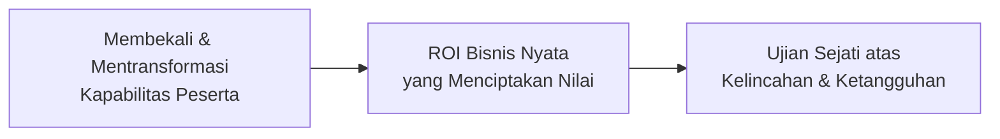
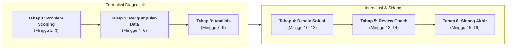

> _"Belajar melalui tantangan bisnis nyata dengan dampak yang terukur."_

**Action Learning Project (ALP)** merupakan pilar eksperiensial utama dalam P3MD MBA. Diterapkan di **10 BUMN mitra**, peserta bekerja dalam kelompok kecil lintas fungsi ($\pm$10 eksekutif) untuk membedah, memodelkan, dan memecahkan dilema strategis berisiko tinggi di bawah kendala komersial yang nyata.

---

## 1. Filosofi Inti & Analogi Tukang Bangunan

> **Analogi Tukang Bangunan:**  
> _"Tukang bangunan yang tahu menggunakan alat, belum tentu bisa membuat rumah. Hanya pengalaman dalam membuat rumah maka ia dapat menggunakan keahliannya."_

### Pertanyaan Evaluatif Utama:

1. **Mengelola Ambiguitas**: Apakah eksekutif mampu menavigasi situasi bisnis yang tidak terstruktur, data yang belum lengkap, dan tuntutan pemangku kepentingan yang berubah-ubah, alih-alih sekadar mengerjakan tugas terstruktur?
2. **Tekanan Waktu Nyata**: Apakah tim mampu berkolaborasi secara solid di bawah tenggat ketat tanpa mengorbankan ketajaman analisis?
3. **Kesiapan Eksekutif**: Apakah peserta siap mengemban mandat korporasi yang lebih luas dan kompleks?

---

## 2. Kriteria Penugasan "Stretch" ALP

Agar memenuhi standar ALP eksekutif, setiap keluaran proyek harus memenuhi lima kriteria utama:

- [x] **Basis Fakta Teruji**: Diagnosis akar masalah yang terperinci dan tidak ambigu, divalidasi melalui data lapangan primer, laporan keuangan, dan wawancara pemangku kepentingan.
- [x] **Trade-Off Strategis yang Eksplisit**: Serangkaian opsi strategis yang saling meniadakan (_mutually exclusive_) beserta pemaparan risiko penurunan dan biaya peluangnya.
- [x] **Rekomendasi Sadar Finansial**: Proyeksi valuasi dan analisis biaya-manfaat berakurasi tinggi (NPV, IRR, kebutuhan CapEx, dan periode pengembalian).
- [x] **Arsitektur Eksekusi**: Peta jalan implementasi taktis mencakup desain organisasi, manajemen perubahan, tata kelola, dan kebutuhan teknologi.
- [x] **Keluaran Siap Eksekusi**: Rekomendasi konkret yang dapat langsung dijalankan oleh direksi atau sponsor BUMN.

---

## 3. Enam Tahap Ber-Gerbang SMART (M2 – M16)

Proyek dijalankan dalam 6 fase bertahap yang dikawal oleh **kriteria SMART** (_Specific, Measurable, Achievable, Relevant, Time-Bound_):

### Rincian Tahap

| Tahap                   |   Linimasa   | Tujuan Utama                                                                                             | Keluaran & Gerbang Utama                                          |
| :---------------------- | :----------: | :------------------------------------------------------------------------------------------------------- | :---------------------------------------------------------------- |
| **1. Problem Scoping**  |  Minggu 2–3  | Penyelarasan formal dengan Project Owner BUMN untuk mengidentifikasi isu bisnis berdampak tinggi.        | Project Charter & Pernyataan Masalah yang Disetujui.              |
| **2. Pengumpulan Data** |  Minggu 4–6  | Wawancara pemangku kepentingan primer, audit data operasional internal, dan survei pasar/pelanggan.      | Fact Pack Komprehensif & Temuan Diagnostik.                       |
| **3. Analisis**         |  Minggu 7–9  | Sintesis multidisiplin yang memadukan strategi, keuangan korporat, SDM/perilaku organisasi, dan operasi. | Analisis Akar Masalah & Hipotesis Penciptaan Nilai.               |
| **4. Desain Solusi**    | Minggu 10–12 | Merumuskan opsi intervensi konkret, pemodelan keuangan, dan uji kelayakan implementasi.                  | Matriks Perbandingan Opsi & Model Business Case.                  |
| **5. Review Coaching**  | Minggu 13–14 | Uji ketahanan rekomendasi bersama coach SBM ITB dan Project Owner perusahaan.                            | Dek Advisory Pra-Sidang & Ringkasan Eksekutif.                    |
| **6. Presentasi Akhir** | Minggu 15–16 | Sidang formal di hadapan pimpinan eksekutif BUMN, mitra kementerian, dan panel penguji SBM ITB.          | Presentasi Direksi Final, Model Keuangan & Playbook Implementasi. |

---

## 4. Gerbang Tonggak & Penyelarasan Mentoring

| Tonggak            | Waktu         | Gerbang Evaluasi                                                                             | Titik Sentuh Mentoring & Imersi                                                                                        |
| :----------------- | :------------ | :------------------------------------------------------------------------------------------- | :--------------------------------------------------------------------------------------------------------------------- |
| **Kick-Off**       | Minggu 2      | Peluncuran angkatan dan penugasan proyek di 10 BUMN mitra.                                   | Penyelarasan awal dengan Project Owner.                                                                                |
| —                  | Minggu 3      | Pemeriksaan Kerangka Proyek                                                                  | **Mentoring Praktisi BUMN 1**                                                                                          |
| —                  | Minggu 4      | Uji Ketajaman Metodologi                                                                     | **Coaching Akademik SBM ITB 1**                                                                                        |
| —                  | Minggu 5      | Persiapan Kerja Lapangan                                                                     | **[[program/alp/business-immersion-1/index\|Business Immersion 1 (Kunjungan Lapangan)]]** (10 Dossier Diagnostik BUMN) |
| **Tonggak 1 (M1)** | **Minggu 6**  | **Gerbang Definisi Masalah & Diagnostik**: Sidang perumusan masalah dan fact pack awal.      | Gerbang Persetujuan Progres Formal.                                                                                    |
| —                  | Minggu 7      | Tinjauan Analitis Tengah Jalan                                                               | **Mentoring Praktisi BUMN 2**                                                                                          |
| —                  | Minggu 8      | Integrasi Akademik Tengah Semester                                                           | **Coaching Akademik SBM ITB 2**                                                                                        |
| —                  | Minggu 11     | Pra-Pemeriksaan Solusi                                                                       | **Business Immersion 2** & **Mentoring BUMN 3**                                                                        |
| **Tonggak 2 (M2)** | **Minggu 12** | **Gerbang Arsitektur Solusi**: Presentasi model bisnis tervalidasi dan imbal hasil keuangan. | Gerbang Solusi Formal.                                                                                                 |
| —                  | Minggu 13–15  | Penciptaan Nilai Komunitas                                                                   | **Eksekusi Proyek Sosial**                                                                                             |
| **Tonggak 3 (M3)** | **Minggu 16** | **Sidang Akhir**: Sidang kapstone eksekutif di hadapan C-Suite BUMN & Panel SBM ITB.         | Sertifikasi Kapstone Akhir.                                                                                            |

---

## 🔗 Sumber Daya Terkait

- Periksa [[program/academic-calendar|Kalender Akademik & Sinkronisasi 16 Minggu]] lengkap
- Jelajahi [[program/learning-journey|Model Pembelajaran 70-20-10]]
- Kembali ke [[program/index|Hub Arsitektur Program]]
