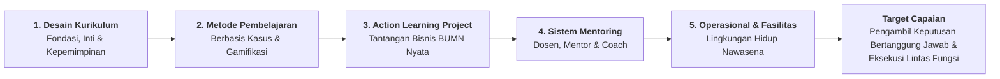

  

    
  

  

    Program Presiden Untuk Pemimpin Masa Depan
    <h2 class="program-crest-title">P3MD Batch I Soedirman</h2>
    
Lambang Korps Resmi &bull; Nilai Kejuangan: <em>Berani &bull; Cepat &bull; Terhormat</em>

  

**P3MD MBA** (_Program Pendidikan Profesional Magister Terapan_) adalah ekosistem kepemimpinan eksekutif yang dirancang oleh **SBM ITB** (_Direktorat Pendidikan Profesional Berkelanjutan_) dalam kolaborasi strategis dengan **Kementerian Pertahanan Republik Indonesia (Kemhan RI)**, **DIKTISAINTEK BERDAMPAK**, dan **Danantara Indonesia** (_Daya Anagata Nusantara_).

Diselenggarakan secara residensial di **Kampus DCU Nawasena**, program ini dibangun di atas arsitektur pengembangan terpadu untuk membentuk pemimpin berintegritas menjadi pengambil keputusan bisnis strategis di bawah etos:

$$\mathbf{LEARN \quad \boldsymbol{\cdot} \quad LEAD \quad \boldsymbol{\cdot} \quad EXECUTE}$$

---

## 🏛️ Cetak Biru & Dokumentasi Program

| Dokumen                                                                                             | Fokus & Wawasan Utama                                                                                                                                                                                  |
| :-------------------------------------------------------------------------------------------------- | :----------------------------------------------------------------------------------------------------------------------------------------------------------------------------------------------------- |
| **[[program/learning-journey\|Alur Pembelajaran & Model 70-20-10]]**                                | 5 pilar transformasi, alokasi sesi (868 eksperiensial, 196 sosial, 112 formal), dan penskalaan dari pleno ke individu ($399 \to 8 \to 40 \to 1$).                                                      |
| **[[program/action-learning-project\|Cetak Biru Action Learning Project (ALP)]]**                   | Analogi Tukang Bangunan, 6 tahap ber-gerbang SMART di 10 BUMN mitra, gerbang tonggak (M1–M3), Imersi BUMN, dan Proyek Sosial.                                                                          |
| **[[program/alp/business-immersion-1/index\|Business Immersion 1 (Kunjungan Lapangan)]]**           | Dossier diagnostik angkatan di 10 BUMN mitra ($N = 385$), benchmarking lintas BUMN, dan perumusan masalah lapangan S&OP.                                                                               |
| **[[program/academic-calendar\|Kalender Akademik & Sinkronisasi]]**                                 | Linimasa induk 16 minggu yang menyelaraskan mata kuliah inti, ujian (UTS M8, UAS M14), Kuliah Tamu CEO, gamifikasi, dan gerbang ALP.                                                                   |
| **[[program/faculty-directory\|Direktori Pengajar & Staf]]**                                        | Direktori lengkap Dosen Utama SBM ITB, pengajar pendamping, dan Asisten Mata Kuliah (beserta kontak langsung) untuk seluruh 6 mata kuliah inti.                                                        |
| **[[rabuan/2026-10-20-anton-upi-dies-natalis-orasi\|Doktrin Komandan: Orasi Dies Natalis UPI 72]]** | Orasi kunci Komandan Program [[entities/anton-palaguna\|Marsma TNI Dr. Anton Palaguna]] tentang 7 langkah mesin perubahan perilaku P3MD, 9 nilai inti, dan tesis karakter _solo flight_.               |
| **[[program/resource-inventory\|Inventaris Sumber Daya & Katalog Arsip Induk]]**                    | Katalog menyeluruh 31 repositori Google Drive, templat slide ALP, 10 dossier pleno Rabuan, matriks ujian komprehensif Tahap 1 (19 esai), keputusan tata kelola, dan perangkat lunak internal angkatan. |
| **[[easter-egg\|Lambang Korps & Sistem Desain Angkatan]]**                                          | Lambang Korps Soedirman resmi, simbolisme heraldik (_Garuda, Bintang, Chevron, Padi-Kapas, Semboyan_), serta arsitektur sistem antarmuka digital.                                                      |

---

## 🧭 Lima Komponen Transformasi

1. **Desain Kurikulum**: 3 blok bangunan — Pembelajaran Fondasional (kelincahan belajar, berpikir strategis, akuntansi), 6 Mata Kuliah Inti lintas 6 sektor BUMN, serta kapabilitas Manajerial/Kepemimpinan/Kewirausahaan.
2. **Metode Pembelajaran**: Paparan terpadu berbasis studi kasus Harvard Business School, simulasi permainan bisnis, dan sesi refleksi berkelanjutan.
3. **Action Learning Project (ALP)**: Keterlibatan langsung pada tantangan bisnis aktual di BUMN dengan dampak bisnis yang terukur.
4. **Sistem Mentoring**: Ekosistem pendampingan 5 lapis (kedalaman akademik, realitas industri BUMN, coaching kepemimpinan, pembinaan karakter/disiplin, dan sponsorship proyek).
5. **Operasional & Fasilitas**: Infrastruktur residensial khusus di Kampus DCU Nawasena yang mendukung imersi belajar-hidup penuh waktu.

---

## 🔗 Navigasi Cepat

- Kembali ke [[index|Beranda Portal Angkatan MBA]]
- Jelajahi [[courses/mk1-organizational-behavior-managing-people/index|MK 1: Organizational Behavior & Managing People]]
- Jelajahi [[courses/mk2-financial-management-strategy/index|MK 2: Financial Management and Strategy]]
- Lihat [[program/academic-calendar|Kalender Sinkronisasi 16 Minggu]] Lengkap
