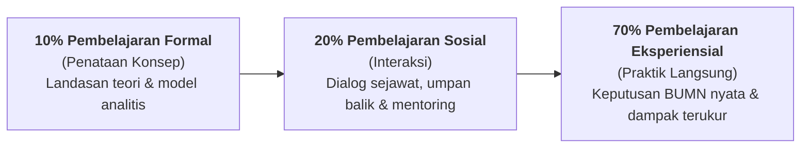
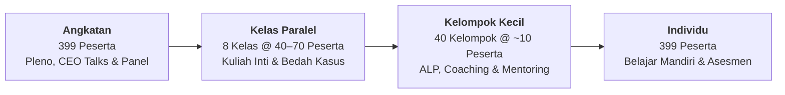

Arsitektur pembelajaran P3MD MBA dirancang oleh **SBM ITB** untuk memadukan kurikulum, metode berbasis kasus, intervensi bisnis nyata, pendampingan berlapis, dan imersi kampus residensial menjadi satu mesin transformasi yang utuh.

---

## 1. Lima Komponen Terpadu untuk Transformasi

_Ekosistem terpadu berjumlah 5 komponen yang dirancang untuk mengubah potensi peserta menjadi pemimpin bisnis strategis yang mampu mengambil keputusan berisiko tinggi dan mengeksekusi secara disiplin._

### Komponen 1: Desain Kurikulum (_3 Blok Bangunan Pembelajaran_)

- **Blok 1 — Foundation Learning**: Kelincahan belajar, komunikasi eksekutif, kehadiran profesional, pemikiran strategis, akuntansi dasar, dan prinsip manajemen.
- **Blok 2 — 6 Mata Kuliah Inti**: Pembelajaran mendalam pada 6 disiplin strategis korporasi (Perilaku Organisasi & Manajemen SDM, Manajemen Keuangan & Strategi, Manajemen Pemasaran, Operasi & Rantai Pasok, Pengambilan Keputusan & Negosiasi, serta Analitik Bisnis) yang dikontekstualisasikan di 6 sektor utama BUMN.
- **Blok 3 — Manajerial, Kepemimpinan, Kewirausahaan**: Pengembangan eksekusi manajerial, kepemimpinan korporasi, dan penciptaan nilai kewirausahaan.

### Komponen 2: Metode Pembelajaran (_Berbasis Kasus & Paparan Terpadu_)

- **Metode Inti**: Studi kasus Harvard Business School, pemecahan masalah kelompok secara intensif, simulasi perilaku, gamifikasi bisnis kompetitif, serta sesi refleksi terstruktur.
- **Penguatan Pembelajaran**: Pra-pembelajaran asinkron di LMS, perencanaan studi dan retrospektif mingguan, BUMN CEO Leader Talks, forum berbagi bisnis, dan kunjungan perusahaan eksekutif.
- **Perspektif Pedagogis**: Sintesis dari _Ketajaman Akademik + Relevansi Bisnis + Konteks Strategis Nasional + Daya Saing Global_.

### Komponen 3: Action Learning Project (_Tantangan Bisnis BUMN Nyata_)

Penugasan langsung tim peserta untuk memecahkan hambatan strategis prioritas tinggi di BUMN mitra dengan ROI terukur dan akuntabilitas ber-gerbang SMART ($Specific, Measurable, Achievable, Relevant, Time-Bound$).

### Komponen 4: Sistem Mentoring (_Arsitektur Dukungan 5 Lapis_)

1. **Dosen SBM ITB**: Kedalaman akademik, ketajaman analitis, dan landasan teori.
2. **Mentor Bisnis BUMN**: Realitas eksekusi industri, dinamika regulasi, dan kondisi pasar.
3. **Business Coaches**: Penyempurnaan pola pikir eksekutif, kelincahan kognitif, dan pertumbuhan kepemimpinan.
4. **Pengasuh**: Penanaman disiplin, keteguhan moral, kepemimpinan etis, dan konsistensi perilaku.
5. **Project Owners (Sponsor BUMN)**: Memastikan keluaran proyek menjawab langsung prioritas utama korporasi.

### Komponen 5: Operasional & Fasilitas (_Infrastruktur Belajar-Hidup_)

- **Operasional Program**: Penjadwalan terpusat, logistik angkatan, fasilitator akademik, pengelolaan LMS, dan pelacakan kinerja.
- **Lingkungan Belajar-Hidup Nawasena**: Fasilitas residensial lengkap di Kampus DCU Nawasena (auditorium akademik, perpustakaan eksekutif, klinik medis 24 jam, ahli gizi khusus, konseling, fasilitas kebugaran & olahraga, serta akomodasi).

---

## 2. Model Alokasi Pembelajaran 70–20–10

Kurikulum ini meninggalkan format konvensional yang berat pada ceramah satu arah, dan menerapkan **model pembelajaran dewasa 70–20–10** yang dikalibrasi untuk membentuk naluri pengambilan keputusan strategis:

### Matriks Lengkap Alokasi Sesi

| Kegiatan                                      | Sesi / Minggu | Total Minggu | Total Sesi Program | Kategori Pedagogis                              |
| :-------------------------------------------- | :-----------: | :----------: | :----------------: | :---------------------------------------------- |
| **Rencana Studi / Rekap Mingguan**            |       2       |      14      |         28         | Pembelajaran Eksperiensial (_Doing_)            |
| **Pra-Pembelajaran (Individu)**               |       2       |      14      |         28         | Pembelajaran Formal (_Structuring_)             |
| **Pra-Pembelajaran (Diskusi Kelompok)**       |      10       |      14      |        140         | Pembelajaran Sosial (_Interacting_)             |
| **Perkuliahan (Dosen SBM ITB)**               |       6       |      14      |         84         | Pembelajaran Formal (_Structuring_)             |
| **Studi Kasus (Analisis Pleno)**              |       2       |      14      |         28         | Pembelajaran Sosial (_Interacting_)             |
| **Studi Kasus (Pemecahan Kelompok Kecil)**    |      10       |      14      |        140         | Pembelajaran Eksperiensial (_Doing_)            |
| **Diskusi Kelompok: ALP**                     |       4       |      14      |         56         | Pembelajaran Eksperiensial (_Doing_)            |
| **Diskusi Kelompok: Proyek Sosial**           |       4       |      14      |         56         | Pembelajaran Eksperiensial (_Doing_)            |
| **Kegiatan Khusus (Seminar / Panel)**         |       2       |      14      |         28         | Pembelajaran Sosial (_Interacting_)             |
| **Kegiatan Khusus (Lokakarya Eksperiensial)** |       6       |      14      |         48         | Pembelajaran Eksperiensial (_Doing_)            |
| **Business Immersion (Residensi Lapangan)**   |      40       |      9       |        360         | Pembelajaran Eksperiensial (_Doing_)            |
| **TOTAL**                                     |               |              |    **996 Sesi**    | **70% Eksperiensial / 20% Sosial / 10% Formal** |

---

## 3. Arsitektur Penskalaan Angkatan: Dari Pleno ke Individu

Pengalaman belajar dipersempit secara terstruktur dari masterclass seluruh angkatan menuju penguasaan individu:

- **Tingkat Angkatan (399 peserta)**: Paparan makro-strategis melalui sesi pleno, kuliah tamu CEO BUMN, diskusi panel eksekutif, dan refleksi bersama.
- **Tingkat Kelas Paralel (8 kelas @ 40–70 peserta)**: Pendalaman akademik pada 6 disiplin bisnis inti, pembahasan kasus Harvard, dan latihan simulasi.
- **Tingkat Kelompok Kecil (40 kelompok @ ~10 peserta)**: Tim eksekusi langsung untuk Action Learning Project (ALP) dan Proyek Sosial, didukung 3 sesi business coaching dan 3 sesi leadership mentoring terstruktur.
- **Tingkat Individu**: Penguasaan pribadi melalui persiapan pra-kuliah, kuis modular, latihan soal kuantitatif, dan laporan sintesis individu.

---

## 🔗 Sumber Daya Terkait

- Jelajahi [[program/action-learning-project|Cetak Biru Action Learning Project (ALP)]]
- Tinjau [[program/academic-calendar|Kalender Induk 16 Minggu]]
- Kembali ke [[program/index|Hub Arsitektur Program]]
