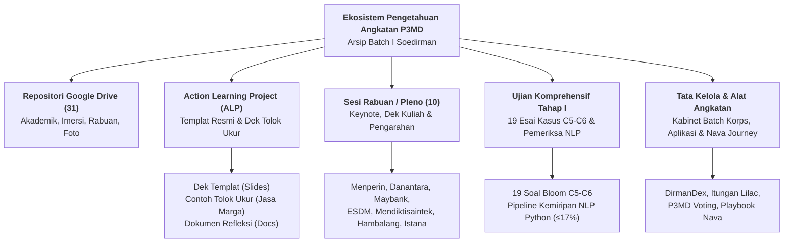
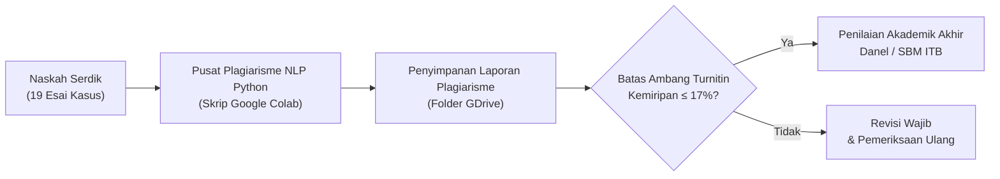
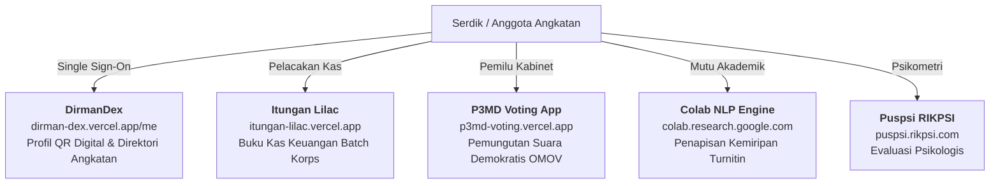
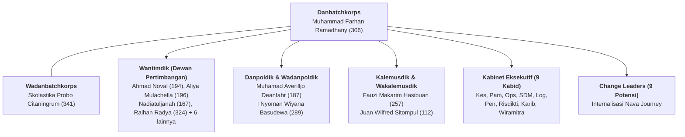

Katalog ini menyajikan inventaris menyeluruh atas seluruh aset digital, repositori Google Drive, templat slide Action Learning Project (ALP), materi kuliah pleno eksekutif (Rabuan), matriks ujian komprehensif, keputusan tata kelola angkatan, aplikasi perangkat lunak internal, serta spreadsheet resmi dari arsip komunikasi **P3MD 2026 Batch 1 Soedirman**.

> [!NOTE]
> **Cakupan Autentikasi & Izin Akses**:
> Banyak folder Google Drive, Google Form, dan Google Spreadsheet memerlukan autentikasi menggunakan kredensial aktif angkatan (`@sbm-itb.ac.id`, `@kemhan.go.id`, atau domain resmi BUMN). Status akses ditandai sesuai ketentuan: **Public**, **SBM ITB Auth**, atau **Internal Cohort**.

---

## 🧭 Arsitektur Sumber Daya Induk

---

## 1. Perangkat Action Learning Project (ALP) & Business Immersion

Action Learning Project (ALP) adalah wahana konsultasi empiris inti di P3MD, tersusun atas Model 4E, Pohon LDP, serta 14 keluaran tonggak formal (ALP-00 hingga ALP-07) di 10 BUMN mitra.

| Nama Aset                               |     Format     | Referensi URL / Berkas Langsung                                                                                                                                                                                      | Deskripsi & Kegunaan                                                                                 |
| :-------------------------------------- | :------------: | :------------------------------------------------------------------------------------------------------------------------------------------------------------------------------------------------------------------- | :--------------------------------------------------------------------------------------------------- |
| **Templat Dek Business Immersion ALP**  | Google Slides  | [Template Deck Pemetaan Business Immersion](https://docs.google.com/presentation/d/1AHpKFl8U6YQQB49KOBgeemv1BAlxNsf1/edit)                                                                                           | Dek presentasi standar resmi untuk pemetaan Business Immersion Fase 2.                               |
| **Dek Contoh Tolok Ukur ALP**           | Google Slides  | [ALP-00 Contoh Pengisian - Jasa Marga TCC](https://docs.google.com/presentation/d/1aK1Tf6oj3-l1yQbxW67uC4dqN5quiWbs/edit)                                                                                            | Contoh rujukan utama angkatan: pemetaan diagnostik Jasa Marga Tollroad Command Center.               |
| **Templat Refleksi Business Immersion** |  Google Docs   | [Template Refleksi Business Immersion](https://docs.google.com/document/d/1yyETDza_cmYShqEms7iY39yo9DfieHE1UYZNmo8kSv8/edit)                                                                                         | Templat standar angkatan untuk pengumpulan refleksi imersi individu dan sindikat mingguan.           |
| **Panduan Teknis ALP Batch 1 (Final)**  |  PDF (1.3 MB)  | [`00004523-Panduan Teknis ALP Batch 1_130826_FINAL.pdf`](<file:///C:/GitHub/MBA/inbox/textdump/WhatsApp%20Chat%20-%20Umum%20(P3MD%202026%20BATCH%201)/00004523-Panduan%20Teknis%20ALP%20Batch%201_130826_FINAL.pdf>) | Manual operasional induk mencakup gerbang tonggak (M1–M3), rubrik penilaian, dan ekspektasi sponsor. |
| **Immersion Master Deck Serdik P3MD**   | PPTX (17.6 MB) | [`00004889-Immersion Master Deck Serdik P3MD.pptx`](<file:///C:/GitHub/MBA/inbox/textdump/WhatsApp%20Chat%20-%20Umum%20(P3MD%202026%20BATCH%201)/00004889-Immersion%20Master%20Deck%20Serdik%20P3MD.pptx>)           | Dek komprehensif berisi profil perusahaan, lokasi kunjungan, SOP keselamatan, dan alokasi sindikat.  |
| **Direktori 40 Mentor BUMN**            |  XLSX (14 KB)  | [`00004893-List 40 Mentor P3MD - BUMN.xlsx`](<file:///C:/GitHub/MBA/inbox/textdump/WhatsApp%20Chat%20-%20Umum%20(P3MD%202026%20BATCH%201)/00004893-List%2040%20Mentor%20P3MD%20-%20BUMN.xlsx>)                       | Daftar lengkap 40 eksekutif korporat yang membimbing sindikat di 10 lokasi BUMN tuan rumah.          |
| **Flipbook Interaktif Pelindo**         |  Aplikasi Web  | [Pelindo Immersion Digital Flipbook](https://publuu.com/flip-book/1188358/2650319)                                                                                                                                   | Orientasi interaktif dan dossier operasional untuk imersi logistik maritim.                          |

---

## 2. Katalog Kuliah Tamu Eksekutif & Pleno (Rabuan)

Seri Rabuan mingguan menghubungkan peserta angkatan dengan Menteri Kabinet, Direktur Utama BUMN, dan akademisi bisnis internasional.

| Tanggal Sesi           | Pembicara Kunci                                                                                                                                | Topik & Fokus Strategis                                                                                                                                        | Materi Presentasi & Bacaan Resmi                                                                                                                                                                                                                                                                                                                                                                                                                                                                                                                | Repositori Tugas & Refleksi                                                                                                        |
| :--------------------- | :--------------------------------------------------------------------------------------------------------------------------------------------- | :------------------------------------------------------------------------------------------------------------------------------------------------------------- | :---------------------------------------------------------------------------------------------------------------------------------------------------------------------------------------------------------------------------------------------------------------------------------------------------------------------------------------------------------------------------------------------------------------------------------------------------------------------------------------------------------------------------------------------- | :--------------------------------------------------------------------------------------------------------------------------------- |
| **2026-06-09**         | **Dony Oskaria** _Wamen BUMN / COO Danantara_                                                                                              | Transformasi BUMN, pembentukan holding investasi Danantara, kelincahan kepemimpinan.                                                                           | [[rabuan/2026-06-09-oskaria-bumn-transformation-danantara\|Dossier Fase 1 (Rekonstruksi)]] Arsip Kurasi Tanya-Jawab                                                                                                                                                                                                                                                                                                                                                                                                                         | [Formulir Pertanyaan](https://forms.gle/ZPLawgLQg9qGFGox6)                                                                         |
| **2026-08-19**         | **Agus Gumiwang Kartasasmita** _Menteri Perindustrian RI_                                                                                  | Arsitektur hilirisasi industri, kemandirian manufaktur, kepemimpinan BUMN strategis.                                                                           | [`00004401-Bahan Menperin.pdf`](<file:///C:/GitHub/MBA/inbox/textdump/WhatsApp%20Chat%20-%20Umum%20(P3MD%202026%20BATCH%201)/00004401-2026-08-18%20Bahan%20Menperin%20terkait%20Kepemimpinan%20BUMN%20final.pdf>) (pra-baca) [`00004413-Tayangan Menperin.pptx`](<file:///C:/GitHub/MBA/inbox/textdump/WhatsApp%20Chat%20-%20Umum%20(P3MD%202026%20BATCH%201)/00004413-Rev05%20Bahan%20Tayangan%20Menperin%20P3MD.pptx>) (30.9 MB)                                                                                                           | [intip.in/PembekalanMenperin](https://intip.in/PembekalanMenperin)                                                                 |
| **2026-08-31**         | **Pak ADH & Pak Hadjar Seti Adji**                                                                                                             | _PeopleMath_ & _From Learner to Transformer for Legacy_: Pemodelan talenta kuantitatif ($PPH, SEC, TAL$), BIM, dan transformasi konstruksi Blue Ocean.         | [[rabuan/2026-09-02-adh-peoplemath\|Dossier Sesi 1 (PeopleMath)]] [[rabuan/2026-08-31-hadjar-from-learner-to-transformer\|Dossier Sesi 2 (Learner to Transformer)]]                                                                                                                                                                                                                                                                                                                                                                          | [Pengumpulan GDrive](https://drive.google.com/drive/folders/1_nGpd8_Pr9E5Qal02DhFYGkNdzIqRCKH)                                     |
| **2026-09-02**         | **Dony Oskaria** _COO BPI Danantara / Kepala BP BUMN_                                                                                      | Direksi sebagai standar, tanggung jawab kedaulatan pilihan, 5 kapabilitas, Single Grade System, 8 aturan BP BUMN, urutan turnaround 4 fase.                    | [[rabuan/2026-09-02-oskaria-directorship-doctrine\|Dossier Fase 2 (Rekonstruksi)]]                                                                                                                                                                                                                                                                                                                                                                                                                                                              | Pembukaan Kampus DCU Nawasena                                                                                                      |
| **2026-09-04**         | **John Robert Powers**                                                                                                                         | Komunikasi eksekutif, protokol korporasi, diplomasi citra profesional.                                                                                         | Manual Pelatihan                                                                                                                                                                                                                                                                                                                                                                                                                                                                                                                                | [Pengumpulan GDrive](https://drive.google.com/drive/folders/1G3VJmRoci8CLE2LvPXKvDcWJKqoBDRBQ)                                     |
| **2026-09-09 (Pagi)**  | **Prof. Dr. Aurik Gustomo** _SBM ITB_                                                                                                      | Memimpin Organisasi Ambidextrous: Menyeimbangkan eksploitasi dengan inovasi eksploratif.                                                                       | [`00004770-Ambidextrous Org.pptx`](<file:///C:/GitHub/MBA/inbox/textdump/WhatsApp%20Chat%20-%20Umum%20(P3MD%202026%20BATCH%201)/00004770-Leading%20an%20Ambidextrous%20Organization%20P3MD%20by%20Aurik%20Gustomo.pptx>) (22.8 MB)                                                                                                                                                                                                                                                                                                              | [Pra-Baca GDrive](https://drive.google.com/drive/folders/1m2l75ugtaA86A7W9Sg4WrfcvFwn0suRR)                                        |
| **2026-09-09 (Siang)** | **Mendiktisaintek**                                                                                                                            | Sinergi pendidikan tinggi, riset ilmiah, dan strategi kedaulatan industri nasional.                                                                            | [`00004771-Deck Mendiktisaintek.pptx`](<file:///C:/GitHub/MBA/inbox/textdump/WhatsApp%20Chat%20-%20Umum%20(P3MD%202026%20BATCH%201)/00004771-20260909%20-%20Deck%20Mendiktisaintek%20P3MD.pptx>) (16.9 MB)                                                                                                                                                                                                                                                                                                                                      | Arsip Angkatan Nawasena                                                                                                            |
| **2026-09-16**         | **Dato' (Dr) Nora Manaf** _Group CHCO Maybank_ **Bahlil Lahadalia** _Menteri ESDM RI_                                               | Sesi 1: Transformasi Organisasi Maybank Melalui SDM & The People Equation. Sesi 2: Kedaulatan Energi, Hilirisasi, dan Ketahanan Sumber Daya.                | [[rabuan/2026-09-16-nora-manaf-people-equation\|Dossier Sesi 1 (The People Equation)]] [`00004747-ToR Nora & Bahlil.pdf`](<file:///C:/GitHub/MBA/inbox/textdump/WhatsApp%20Chat%20-%20Umum%20(P3MD%202026%20BATCH%201)/00004747-ToR%20P3MD%20Phase%202-Bpk%20Bahlil%20and%20Dato%20Nora.pdf>) [`00004749-Maybank Case.pdf`](<file:///C:/GitHub/MBA/inbox/textdump/WhatsApp%20Chat%20-%20Umum%20(P3MD%202026%20BATCH%201)/00004749-Global%20Case%20People-%20Maybank%20Organisational%20Transformation%20Through%20Human%20Resources.pdf>) | [Pengumpulan GDrive](https://drive.google.com/drive/folders/1wN7QE-Z1IoBghhP1DW-N6OmqlhkzO76z)                                     |
| **2026-09-23**         | **Sahala Situmorang** _CFO Danantara_ **Ir. Syamsul** _Stafsus KemenPU RI_                                                          | Sesi 1: Disiplin Keuangan, Alokasi Modal, Kualitas ROI, Aset Tak Berwujud (Waktu/Atensi/Reputasi). Sesi 2: Nature in Motion (FEW Nexus, Hexa-Helix, PU608). | [`00004838-Nature in Motion PU.pdf`](<file:///C:/GitHub/MBA/inbox/textdump/WhatsApp%20Chat%20-%20Umum%20(P3MD%202026%20BATCH%201)/00004838-Artikel%20-%20Nature%20in%20Motion%20PU%20%20(23%20September%202026).pdf>) [`00004839-Financial Discipline.pdf`](<file:///C:/GitHub/MBA/inbox/textdump/WhatsApp%20Chat%20-%20Umum%20(P3MD%202026%20BATCH%201)/00004839-Artikel%20-%20Memimpin%20Dengan%20Financial%20Discipline%20Managing%20Director%20Finance%20Danantara%20(23%20September%202026).pdf>)                                       | [Pengumpulan GDrive](https://drive.google.com/drive/folders/1YdBxE5zNT3A-wvG01O0jCkfO3MxTzGOs)                                     |
| **2026-10-01**         | **Prof. Edward Buckingham** _Monash University_ **Prof. Irwan Meilano** _Wakil Rektor ITB_                                          | Strategi Global, Pemodelan Risiko Geopolitik, dan Kepemimpinan Riset Akademik.                                                                                 | [Profil Dosen Monash](https://www.monash.edu/business/our-people/edward-buckingham2)                                                                                                                                                                                                                                                                                                                                                                                                                                                            | [Pengumpulan GDrive](https://drive.google.com/drive/folders/1jIiiD-c2XwpleXde8gUUjyUUczl8Z-zg)                                     |
| **2026-10-21**         | **Dosen Kasus Eksekutif**                                                                                                                      | Refleksi Video: Tantangan Sosioekonomi Terkini dan Mandat Transformasional.                                                                                    | [Prompt Kasus Video YouTube](https://www.youtube.com/watch?v=4pDyQcCj5MM)                                                                                                                                                                                                                                                                                                                                                                                                                                                                       | [Pengumpulan GDrive](https://drive.google.com/drive/folders/1Xgxz1sdhk6_rbAYubDOzWkaLaXiHkvnK)                                     |
| **2026-10-31**         | **H.E. Prabowo Subianto** _Presiden Republik Indonesia_                                                                                    | Taklimat Hambalang: Kepemimpinan, Pasal 33 UUD 1945, Tata Kelola BUMN Jangka Panjang, Pengelolaan Kekayaan Nasional.                                           | [`00005221-Daftar Pertanyaan Hambalang.pdf`](<file:///C:/GitHub/MBA/inbox/textdump/WhatsApp%20Chat%20-%20Umum%20(P3MD%202026%20BATCH%201)/00005221-DAFTAR_PERTANYAAN_DALAM_AGENDA_HAMBALANG__SABTU_31_OKTOBER_2026_P3MD.pdf>) [`00005217-Pembagian Bis Hambalang.pdf`](<file:///C:/GitHub/MBA/inbox/textdump/WhatsApp%20Chat%20-%20Umum%20(P3MD%202026%20BATCH%201)/00005217-Pembagian%20Bis%20Hambalang%2031%20Oktober%20(Fix%20Final).docx.pdf>)                                                                                           | [Formulir Kurasi Tanya-Jawab](https://docs.google.com/forms/d/e/1FAIpQLSdeTxezYzJx40cY-YNQxmnPhVFQM2o734k0LnarSREfvul6_g/viewform) |
| **2026-11-03**         | **H.E. Prabowo Subianto** _Presiden Republik Indonesia_                                                                                    | Pengarahan Istana Merdeka: Tata Negara Institusional, Etika Administrasi Publik, Mandat Antikorupsi.                                                           | [`00005256-Daftar Pertanyaan Istana.pdf`](<file:///C:/GitHub/MBA/inbox/textdump/WhatsApp%20Chat%20-%20Umum%20(P3MD%202026%20BATCH%201)/00005256-DAFTAR_PERTANYAAN_DALAM_AGENDA_ISTANA_SELASA_3_NOVEMBER_2026_P3MDI.pdf>) [`00005248-Pembagian Bis Istana.pdf`](<file:///C:/GitHub/MBA/inbox/textdump/WhatsApp%20Chat%20-%20Umum%20(P3MD%202026%20BATCH%201)/00005248-Pembagian%20Bis%20menuju%20Istana%20Negara%203%20November%202026.pdf>)                                                                                                  | Folder Pengarahan Presiden Danel                                                                                                   |
| **2026-11-04**         | **Jenderal Polisi Suyudi Ario Seto** _Kapolri_ **Prof. Dr. Yassierli** _Menaker RI_ **Angga Raka Prabowo** _Wamenkomdigi RI_ | Keynote multipanel: Penegakan hukum & antinarkoba di BUMN, K3 dan modal manusia, kedaulatan digital, serta _Mindset_ Carol Dweck.                              | [`00005262-Pertanyaan Kapolri.pdf`](<file:///C:/GitHub/MBA/inbox/textdump/WhatsApp%20Chat%20-%20Umum%20(P3MD%202026%20BATCH%201)/00005262-Daftar%20Pertanyaan%20Rabuan%20Bapak%20Kapolri_Lemusdik%20P3MDI.pdf>) [`00005264-Mindset Carol Dweck.pdf`](<file:///C:/GitHub/MBA/inbox/textdump/WhatsApp%20Chat%20-%20Umum%20(P3MD%202026%20BATCH%201)/00005264-20231124092918-Mindset_The_New_Psychology_of_Success.pdf>)                                                                                                                        | [Formulir Kurasi Tanya-Jawab](https://intip.in/PertanyaanRabuan4November26)                                                        |

---

## 3. Kurikulum Akademik & Arsitektur Ujian Komprehensif Tahap I

Penutup formal Tahap 1 mewajibkan setiap Serdik menyelesaikan ujian komprehensif 19 esai (tingkat Bloom C5–C6) yang diselenggarakan pada 05–06 September 2026.

### Matriks Ujian Esai Komprehensif Tahap I

Disarikan langsung dari [`00004589-Serdik_Soal_Ujian_Tahap_I_P3MD.pdf`](<file:///C:/GitHub/MBA/inbox/textdump/WhatsApp%20Chat%20-%20Umum%20(P3MD%202026%20BATCH%201)/00004589-Serdik_Soal_Ujian_Tahap_I_P3MD.pdf>):

| No. | Kode Mata Kuliah &amp; Judul Modul                          | Materi Referensi Sumber             | Tingkat Kognitif | Pernyataan Masalah Kasus Inti                                                                     |
| :-: | :---------------------------------------------------------- | :---------------------------------- | :--------------: | :------------------------------------------------------------------------------------------------ |
| 01  | **Pengelolaan Sumber Daya Nasional untuk Hanneg**           | `UU NO 23 UTK HANNEG.pptx`          |      C5–C6       | Sinergi sumber daya nasional dan logistik pertahanan dalam doktrin Sishankamrata.                 |
| 02  | **Ilmu Medan dan Navigasi Darat**                           | `UKRI 2026(1).pptx`                 |      C5–C6       | Analisis peta topografi, kompas siang/malam, orientasi medan, dan interpolasi koordinat.          |
| 03  | **Crisis Leadership I: Banjir Lahar Agam**                  | `PPT_Crisis Leadership(2).pptx`     |      C5–C6       | Komando tanggap darurat, manajemen logistik bencana lahar dingin Agam-Tanah Datar.                |
| 04  | **Peraturan Penghormatan Militer (PPM) &amp; Disiplin**     | `PERPANG NO 57 TAHUN 2018.pdf`      |      C5–C6       | Disiplin hierarkis militer dan implementasinya pada tata kelola integritas eksekutif.             |
| 05  | **UU No. 23/2019: Tata Kelola Komcad**                      | `TATA KELOLA KOMCAD.pptx`           |      C5–C6       | Mekanisme mobilisasi dan demobilisasi Komponen Cadangan di lingkungan BUMN strategis.             |
| 06  | **UUD NRI 1945: Demokrasi Ekonomi (Pasal 33)**              | `UUD 1945 PASAL 33.pptx`            |      C5–C6       | Penguasaan cabang produksi vital oleh negara untuk kemakmuran rakyat vs efisiensi pasar.          |
| 07  | **Teori dan Konsepsi Kepemimpinan TNI**                     | `KEPEMIMPINAN TNI.pptx`             |      C5–C6       | Sebelas Azas Kepemimpinan TNI dalam memimpin transformasi korporasi berisiko tinggi.              |
| 08  | **Strategic Decision Making dalam Krisis Kompleks**         | `STRATEGIC DECISION MAKING.pptx`    |      C5–C6       | Pengambilan keputusan bawah tekanan tinggi saat terjadi kegagalan sistem dan informasi asimetris. |
| 09  | **Sapta Marga sebagai Pedoman Nilai**                       | `DOKTRIN TRI DHARMA EKA KARMA.pdf`  |      C5–C6       | Internalisasi Sapta Marga dan Sumpah Prajurit dalam menegakkan etika kepemimpinan nasional.       |
| 10  | **Pancasila sebagai Dasar Negara &amp; Identitas**          | `PANCASILA IDENTITAS NASIONAL.pptx` |      C5–C6       | Mengatasi polarisasi sosial dan penguatan kohesi kebangsaan di era disrupsi digital.              |
| 11  | **Moral Courage &amp; Moral Reasoning**                     | `ETIKA DAN MORALITAS.pptx`          |      C5–C6       | Keberanian moral menolak instruksi melawan hukum dan perlindungan whistleblowing.                 |
| 12  | **Kepemimpinan Lapangan (Field Leadership)**                | `KEPEMIMPINAN LAPANGAN.pptx`        |      C5–C6       | Komando operasional di garis depan, _leading by example_, dan menjaga moril satuan.               |
| 13  | **Integrity Assessment &amp; Behavior Red Flags**           | `INTEGRITAS ANTI-FRAUD.pptx`        |      C5–C6       | Deteksi dini tanda-tanda kecurangan manajerial, conflict of interest, dan audit kepatuhan.        |
| 14  | **Hak Asasi Manusia &amp; Hukum Humaniter Internasional**   | `HAM DAN HUKUM HUMANITER.pptx`      |      C5–C6       | Kepatuhan terhadap _Geneva Conventions_ dalam Operasi Militer Selain Perang (OMSP).               |
| 15  | **Emotional Intelligence: Leading with Wisdom**             | `KECERDASAN EMOSIONAL.pptx`         |      C5–C6       | Regulasi diri, empati lintas generasi, dan resolusi konflik internal dalam organisasi BUMN.       |
| 16  | **Crisis Leadership II: Longsor Tambang Tulabolo**          | `KASUS BENCANA TAMBANG.pptx`        |      C5–C6       | Manajemen evakuasi darurat, komunikasi publik krisis, dan audit K3 tambang mineral rakyat.        |
| 17  | **Bhinneka Tunggal Ika &amp; Integrasi Kebangsaan**         | `WAWASAN NUSANTARA.pptx`            |      C5–C6       | Merajut keragaman kultural tenaga kerja BUMN dalam mendukung proyek strategis nasional.           |
| 18  | **Nilai Dasar Bela Negara (4-O)**                           | `BELA NEGARA KARAKTER.pptx`         |      C5–C6       | Konsepsi Olah Rasa, Olah Pikir, Olah Jiwa, Olah Raga dalam ketahanan pribadi pemimpin.            |
| 19  | **Active Listening, Negotiation &amp; Corporate Diplomacy** | `Active Listening & Diplomacy.pptx` |      C5–C6       | Negosiasi multipihak, diplomasi korporat global, dan mitigasi sengketa bisnis internasional.      |

### Arsitektur Verifikasi Plagiarisme

- **Pusat Skrip (Google Colab)**: [Pemeriksa Tugas NLP Colab](https://colab.research.google.com/drive/1Bx64Ly6AqTfkHTwq1zc4JHLnWTJahR1H) — Dirancang oleh Serdik Ahmad Noval (194 | PFLP | Inalum).
- **Penyimpanan Laporan (Google Drive)**: [Drive Pemeriksaan Plagiarisme](https://drive.google.com/drive/u/0/folders/1YbKgSou6XhmCr1CLD2dRWy_ahzQ3HFDi).
- **Ambang Kebijakan**: Indeks kemiripan Turnitin $\le 17\%$. Pengumpulan yang melebihi ambang memicu revisi wajib sebelum pengumpulan resmi ke Danel.

---

## 4. Direktori Induk Repositori Google Drive (31 Repositori)

| No. | Nama Repositori                     | Kategori / Alur Kerja |  Tanggal   | URL Langsung                                                                                         | Deskripsi &amp; Isi                                                             |
| :-: | :---------------------------------- | :-------------------- | :--------: | :--------------------------------------------------------------------------------------------------- | :------------------------------------------------------------------------------ |
| 01  | **Phase 1 Slides &amp; Quizzes**    | Akademik / Tahap 1    | 2026-09-05 | [Tautan Folder](https://drive.google.com/drive/folders/1_jR4jYAgsqf_D6j_-blRAR0-uuj58SN8)            | Drive induk utama seluruh slide, panduan belajar, dan latihan kuis Tahap 1.     |
| 02  | **Phase 1 Slides Mirror**           | Akademik / Tahap 1    | 2026-09-05 | [Tautan Folder](https://drive.google.com/drive/u/0/mobile/folders/1YtrgK5O2tZmn1fBKh3524ySrJVuwA_jk) | Repositori cermin versi mobile untuk materi presentasi Tahap 1.                 |
| 03  | **Phase 2 Learning Hub**            | Akademik / Tahap 2    | 2026-09-03 | [Tautan Folder](https://bit.ly/4xgdryE)                                                              | Drive kurikulum induk Nawasena untuk mata kuliah dan modul Fase 2.              |
| 04  | **Prof. Aurik Pre-Reading**         | Kuliah Tamu           | 2026-09-08 | [Tautan Folder](https://drive.google.com/drive/folders/1m2l75ugtaA86A7W9Sg4WrfcvFwn0suRR)            | Materi pra-baca wajib untuk sesi Ambidextrous Org Prof. Aurik Gustomo.          |
| 05  | **NLP Plagiarism Reports**          | Penapisan Akademik    | 2026-09-06 | [Tautan Folder](https://drive.google.com/drive/u/0/folders/1YbKgSou6XhmCr1CLD2dRWy_ahzQ3HFDi)        | Penyimpanan log pemeriksaan kemiripan otomatis dan kartu skor Turnitin.         |
| 06  | **Nawasena Archive Backup**         | Pengetahuan Angkatan  | 2026-09-28 | [Tautan Folder](https://drive.google.com/drive/folders/1GWCdtVY6H57r6feJquK89QoDUeOXO-i9)            | Arsip gabungan dokumen, jadwal, dan pengumuman angkatan Nawasena.               |
| 07  | **Testimoni Pengasuh Drive**        | Tradisi Angkatan      | 2026-08-19 | [Tautan Folder](https://drive.google.com/drive/folders/1r2pnLspWhyt4-vcHZvr84BA1qvhcPWaw)            | Testimoni tertulis anonim untuk 12 Komandan Elemen Pengasuh.                    |
| 08  | **Maybank &amp; ESDM Reflection**   | Tugas Pleno           | 2026-09-16 | [Tautan Folder](https://drive.google.com/drive/folders/1wN7QE-Z1IoBghhP1DW-N6OmqlhkzO76z)            | Folder pengumpulan tugas pleno Dato' Nora Manaf &amp; Bahlil Lahadalia.         |
| 09  | **Danantara &amp; PU Reflection**   | Tugas Pleno           | 2026-09-23 | [Tautan Folder](https://drive.google.com/drive/folders/1YdBxE5zNT3A-wvG01O0jCkfO3MxTzGOs)            | Pengumpulan tugas sesi Sahala Situmorang (CFO DAM) &amp; Ir. Syamsul (PU).      |
| 10  | **Monash &amp; ITB Reflection**     | Tugas Pleno           | 2026-10-01 | [Tautan Folder](https://drive.google.com/drive/folders/1jIiiD-c2XwpleXde8gUUjyUUczl8Z-zg)            | Pengumpulan tugas keynote Prof. Edward Buckingham &amp; Prof. Irwan Meilano.    |
| 11  | **Video Reflection 21 Okt**         | Tugas Pleno           | 2026-10-21 | [Tautan Folder](https://drive.google.com/drive/folders/1Xgxz1sdhk6_rbAYubDOzWkaLaXiHkvnK)            | Unggahan refleksi studi kasus video untuk sesi 21 Oktober.                      |
| 12  | **Taklimat Presiden Drive**         | Tugas Pleno           | 2026-11-06 | [Tautan Folder](https://drive.google.com/drive/folders/1LXhzm5VPKIh6G6C46oP8eyY0d2dFv9zL)            | Pengumpulan refleksi Taklimat Hambalang &amp; Istana Merdeka.                   |
| 13  | **ALP 1 Immersion Reflection**      | Proyek Lapangan       | 2026-10-08 | [Tautan Folder](https://drive.google.com/drive/folders/1bxbyWtEtXrXUiUmelUn9HV9-NA7cFnpF)            | Refleksi diagnostik dari kunjungan awal di 10 BUMN mitra.                       |
| 14  | **BI REF 1 (BRI Microfinance)**     | Proyek Lapangan       | 2026-10-16 | [Tautan Folder](https://drive.google.com/drive/folders/1tNrHmhLAc9lV9NPO-A70etq8gxuQm_ff)            | Refleksi Business Immersion 1: pembiayaan mikro BRI dan inklusi keuangan.       |
| 15  | **BI REF 2 (Pupuk Indonesia)**      | Proyek Lapangan       | 2026-10-23 | [Tautan Folder](https://drive.google.com/drive/folders/1dJ9EUNczDfYYBFxCdfnPl-7kU3Gz8TJj)            | Refleksi Business Immersion 2: rantai pasok pupuk PT Pupuk Indonesia.           |
| 16  | **Pupuk Indonesia Reference**       | Referensi Lapangan    | 2026-10-23 | [Tautan Folder](https://drive.google.com/drive/folders/1FRPIXljwg_cs7GtF5yNRA4T5ibigz9ha)            | Dek presentasi resmi dari manajemen PT Pupuk Indonesia.                         |
| 17  | **BI REF 3 Submissions**            | Proyek Lapangan       | 2026-10-30 | [Tautan Folder](https://drive.google.com/drive/folders/1WqChWPropZbWwUVkZ-LiJlmEtisQVRBh)            | Drive pengumpulan refleksi Business Immersion 3.                                |
| 18  | **BI REF 4 Submissions**            | Proyek Lapangan       | 2026-11-06 | [Tautan Folder](https://drive.google.com/drive/folders/1I5zWh0HzvOxhgwO_vQNHS8UwRgYh4K9w)            | Drive pengumpulan refleksi Business Immersion 4.                                |
| 19  | **Positive Impact Reflection**      | Kapstone Program      | 2026-11-01 | [Tautan Folder](https://drive.google.com/drive/folders/1SS25LepWkdXjhAqjQwfkOceBRd_Jp6Ys)            | Refleksi program menyeluruh mengenai dampak sosial dan kontribusi nasional.     |
| 20  | **Element &amp; Group Submissions** | Tata Kelola / Masuk   | 2026-05-26 | [Tautan Folder](https://drive.google.com/drive/folders/1mdmS6cegmVsuaITRWC5J46p54ztqWSP3)            | Repositori awal berkas elemen dan CV Serdik.                                    |
| 21  | **Resume Template Drive**           | Administrasi          | 2026-05-27 | [Tautan Folder](https://drive.google.com/drive/folders/1_APm5nzZXeZ6lfd9VPKVv6hYwDpA5-dI)            | Format CV standar dan templat profil onboarding angkatan.                       |
| 22  | **Formation Official Photos**       | Dokumentasi           | 2026-05-28 | [Tautan Folder](https://drive.google.com/drive/folders/1f3vm2c7I77mhStjUjWgskKAuZig-7J52)            | Foto resmi formasi resimen pada masa pelatihan awal.                            |
| 23  | **Serdik Candid Photo Gallery**     | Dokumentasi           | 2026-05-28 | [Tautan Folder](https://drive.google.com/drive/folders/19qG0IPOcoD5lRbHwN4CawyUa3iemKtfQ)            | Galeri foto dokumentasi aktivitas harian Serdik.                                |
| 24  | **Group Photo Archive**             | Dokumentasi           | 2026-05-28 | [Tautan Folder](https://drive.google.com/drive/folders/1CZ481Dc7gL55ZO2KTl9ScQbpx2PQtCf7)            | Foto resolusi tinggi kelompok batalyon dan peleton.                             |
| 25  | **Afternoon PT Photos**             | Pembinaan Jasmani     | 2026-08-05 | [Tautan Folder](https://drive.google.com/drive/folders/1kSsMFR8vAkQQwbW91PqXOnSdunsYgVNn)            | Dokumentasi foto pembinaan fisik sore hari.                                     |
| 26  | **Pengasuh Video Tributes**         | Tradisi Angkatan      | 2026-08-19 | [Tautan Folder](https://drive.google.com/drive/folders/1iK2nQ29Sb1tDoDzwrmAhdtcu35le-76m)            | Video apresiasi singkat dan impersonasi untuk para Pengasuh.                    |
| 27  | **Danbatch Holiday Tasks**          | Pengembangan Diri     | 2026-08-24 | [Tautan Folder](https://drive.google.com/drive/folders/1mzD6CxInErZWK51I5QdOoVHaODxxClQV)            | Umpan balik anonim dan esai belajar mandiri liburan atas arahan Danbatch Anton. |
| 28  | **Parental Reflection Letters**     | Karakter (Binkar)     | 2026-08-27 | [Tautan Folder](https://drive.google.com/drive/folders/1myos_YCVfhcGUdAfatkkfpIpOnxgjPIr)            | Surat refleksi karakter tulisan tangan dari orang tua dan keluarga.             |
| 29  | **Batch Korps Prelim Votes**        | Pemilihan Tata Kelola | 2026-10-04 | [Tautan Folder](https://drive.google.com/drive/folders/1BvaQPXu2tBMKqsyOAUgFKohfnBgEafGL)            | Berkas nominasi awal dan verifikasi pemilih jabatan kabinet.                    |
| 30  | **Batch Korps Nomination Audits**   | Pemilihan Tata Kelola | 2026-10-04 | [Tautan Folder](https://drive.google.com/drive/folders/1ZE2OcND4mbjWnVc1-3MUt3_XmzC9FfOR)            | Catatan verifikasi nominasi kabinet eksekutif.                                  |
| 31  | **Batch Korps Portfolios**          | Pemilihan Tata Kelola | 2026-10-05 | [Tautan Folder](https://drive.google.com/drive/folders/1yvywWfasj5qz8B1IW57aTLLJ75vwCqgr)            | Dek visi, portofolio, dan manifesto kepemimpinan kandidat.                      |

---

## 5. Registri Induk Google Docs, Sheets & Presentations

| Kategori Aset           | Judul Aset                        | Format | URL Langsung                                                                                                                 | Konteks &amp; Tujuan Strategis                                                    |
| :---------------------- | :-------------------------------- | :----: | :--------------------------------------------------------------------------------------------------------------------------- | :-------------------------------------------------------------------------------- |
| **Google Presentation** | **Tahap 1 Exam Prep Deck**        | Slides | [Preparation Berganda Deck](https://docs.google.com/presentation/d/13AhyyJO2WOXvBRUQLHmRYZxy7G55ar37/edit)                   | Dek presentasi multimodul untuk persiapan ujian Tahap 1 dan belajar kelompok.     |
| **Google Presentation** | **ALP Business Immersion Master** | Slides | [Template Deck Pemetaan](https://docs.google.com/presentation/d/1AHpKFl8U6YQQB49KOBgeemv1BAlxNsf1/edit)                      | Templat induk angkatan untuk keluaran diagnostik business immersion.              |
| **Google Presentation** | **Jasa Marga Benchmark Model**    | Slides | [Jasa Marga TCC Deck](https://docs.google.com/presentation/d/1aK1Tf6oj3-l1yQbxW67uC4dqN5quiWbs/edit)                         | Standar tolok ukur emas: pemetaan diagnostik ALP-00 operasi jalan tol.            |
| **Google Document**     | **Immersion Reflection Template** |  Docs  | [Business Immersion Doc](https://docs.google.com/document/d/1yyETDza_cmYShqEms7iY39yo9DfieHE1UYZNmo8kSv8/edit)               | Templat standar angkatan untuk mengumpulkan refleksi imersi mingguan.             |
| **Google Spreadsheet**  | **Komcad Armed Services Choice**  | Sheets | [Komcad Matra Tracker](https://docs.google.com/spreadsheets/d/1Dzy7wzBEolFx0clowfJ8mBwqCIDAszVnMQeduCo80fU/edit?usp=sharing) | Lembar pelacakan matra (Darat / Laut / Udara) berdasarkan asal BUMN.              |
| **Google Spreadsheet**  | **SBM ITB Research FGD Schedule** | Sheets | [SBM ITB FGD Schedule](https://docs.google.com/spreadsheets/d/1RAj_v5pvr6Mx_7ovA9HEtJJgfrTr_mkzQ8de7rDXNTE/edit?gid=0#gid=0) | Jadwal dan pembagian peserta wawancara riset kualitatif SBM ITB.                  |
| **Google Spreadsheet**  | **Cohort Master Biodata Tracker** | Sheets | [Cohort Biodata Master](https://docs.google.com/spreadsheets/d/1kctxJvxXD12r3DHzm1so2XXqCve_eqOjVy5isTFGFYw/edit)            | Direktori lengkap 399 Serdik lintas elemen, kelompok, dan BUMN.                   |
| **Google Spreadsheet**  | **Minlog Command Roster**         | Sheets | [Minlog Command Roster](https://docs.google.com/spreadsheets/d/11iUcvEpL0aiJnkWYlyi3YljoPLWnQZIUymDMIkerZjI/edit)            | Daftar piket, alokasi staf logistik, dan penugasan administratif.                 |
| **Google Spreadsheet**  | **Kaporlap Gear Inventory**       | Sheets | [Kaporlap Gear Inventory](https://docs.google.com/spreadsheets/d/1uLIsE-CnIXoKhcMlxT32Pv3MgNKCiwhkk3ZHRxQfOFw/edit)          | Log distribusi perlengkapan lapangan, seragam, sepatu, dan perlengkapan pribadi.  |
| **Google Spreadsheet**  | **Immersion Rooming Allocation**  | Sheets | [Immersion Rooming Master](https://docs.google.com/spreadsheets/d/1K8AZDkwLXHXdmDsvWrGBk2Ib0thS8CD7nm4ojRdJzs8/edit)         | Pembagian kamar residensial di Nawasena dan penginapan selama kunjungan lapangan. |
| **Google Spreadsheet**  | **Dining &amp; Fasting Schedule** | Sheets | [Fasting &amp; Dining Roster](https://docs.google.com/spreadsheets/d/1Vrp6hf2raM-pXwOVYnbVZhWCm5XGjGJ_kdHVWWwyiw0/edit)      | Perencanaan konsumsi angkatan, preferensi diet, dan koordinasi puasa.             |

---

## 6. Alat Digital, Aplikasi Web & Portal Internal

Angkatan mengembangkan dan mengoperasikan sejumlah aplikasi web internal untuk memperlancar operasional, pemungutan suara, dan transparansi keuangan:

1. **DirmanDex**: `https://dirman-dex.vercel.app/me`
   - _Pembuat:_ Ahmad Noval (Serdik 194 | PFLP | PT Indonesia Asahan Aluminium).
   - _Fitur:_ Lencana digital, profil kode QR, direktori kontak Serdik langsung, dan pemetaan elemen.
2. **Itungan Lilac**: `https://itungan-lilac.vercel.app/`
   - _Pengelola:_ Jabalnur (Bendahara Batch Korps | Serdik 128) & Adiva Hardja.
   - _Fitur:_ Arus kas masuk/keluar dana angkatan secara waktu nyata, penganggaran acara, dan bukti faktur.
3. **P3MD Voting App**: `https://p3md-voting.vercel.app`
   - _Fitur:_ Platform pemungutan suara kriptografis one-man-one-vote (OMOV) terautentikasi akun `@sbm-itb.ac.id` untuk pemilihan Danbatchkorps dan Lemusdik.
4. **Mesin Plagiarisme Tugas NLP Kustom**: `https://colab.research.google.com/drive/1Bx64Ly6AqTfkHTwq1zc4JHLnWTJahR1H`
   - _Mesin:_ Analisis tumpang-tindih token Python dan skoring semantik TF-IDF untuk memastikan kepatuhan Turnitin sebelum pengumpulan resmi.
5. **Portal Asesmen Pusat Psikologi RIKPSI**: `https://puspsi.rikpsi.com`
   - _Tujuan:_ Platform asesmen psikometri resmi untuk pemetaan profil kepemimpinan awal.

---

## 7. Media & Rekaman Resmi

### Repositori SharePoint & Video Angkatan

- **Pusat Rekaman Kuliah Angkatan (SharePoint)**:
  `https://muglopi-my.sharepoint.com/:f:/g/personal/mugstudio_muglopi_onmicrosoft_com/IgCHxBgpZlC_TbBF0d_rx_RYASdYZP11smgUVmJDjDGocXI?e=tU1zoc`  
  _Berisi rekaman multikamera sesi pleno keynote dan tinjauan pelatihan militer._
- **Himne Paduan Suara Serdik**:
  [`00004860-Tujuh Belas - P3MD.m4a`](<file:///C:/GitHub/MBA/inbox/textdump/WhatsApp%20Chat%20-%20Umum%20(P3MD%202026%20BATCH%201)/00004860-Tujuh%20Belas%20-%20P3MD.m4a>) (3.9 MB)  
  _Lagu paduan suara orisinal yang direkam oleh Serdik P3MD Batch 1 Soedirman._

### Siaran YouTube & Prompt Video Terkurasi

| Judul Video                             | URL Langsung                                                        | Tanggal Siar | Deskripsi                                                            |
| :-------------------------------------- | :------------------------------------------------------------------ | :----------: | :------------------------------------------------------------------- |
| **Taklimat Presiden Prabowo Subianto**  | [Siaran Langsung YouTube](https://www.youtube.com/live/P9VLfvhctUE) |  2026-05-27  | Pidato kunci Presiden pada peresmian P3MD.                           |
| **Leadership Motivation &amp; Mindset** | [Video YouTube](https://youtu.be/PsAgtEo22ac)                       |  2026-06-09  | Prompt video eksekutif untuk introspeksi kepemimpinan.               |
| **Cohort Training Drill Review 1**      | [Video YouTube](https://youtu.be/NLnKstw2Z7A?si=NO89H7d9oEA8LSiU)   |  2026-08-05  | Evaluasi latihan baris-berbaris peleton dan disiplin lapangan.       |
| **Cohort Physical Conditioning Drill**  | [Video YouTube](https://youtu.be/oc-636Oeivw?si=IroWMeXV7bCYpG5i)   |  2026-08-11  | Tinjauan pelatih atas ketahanan fisik dan keseragaman formasi.       |
| **Dorm Standard: Duvet Setup Protocol** | [Video YouTube](https://youtu.be/oMCQ63MtN8E?si=yV5sF_T_874y1qJ-)   |  2026-10-17  | Protokol standar tata tempat tidur untuk lipatan selimut barak.      |
| **Dorm Standard: Bed Making Protocol**  | [Video YouTube](https://youtu.be/XdfFGTsTofw?si=hZn_R0wIxvdPWQfc)   |  2026-10-17  | Protokol militer standar untuk ketegangan seprai dan inspeksi barak. |
| **Executive Case Prompt Reflection**    | [Video YouTube](https://www.youtube.com/watch?v=4pDyQcCj5MM)        |  2026-10-21  | Prompt studi kasus untuk diskusi model bisnis Rabuan.                |

---

## 8. Tata Kelola Korps Angkatan & Sistem Pembinaan Karakter

### Arsitektur Kabinet Kerja Batch Korps

Divalidasi dari [`00005235-Struktur Batch Korps Sementara Waktu.pdf`](<file:///C:/GitHub/MBA/inbox/textdump/WhatsApp%20Chat%20-%20Umum%20(P3MD%202026%20BATCH%201)/00005235-Struktur%20Batch%20Korps%20Sementara%20Waktu.pdf>) dan [`00005239-Grand Design Kabinet Kerja Batch Korps P3MDI.pdf`](<file:///C:/GitHub/MBA/inbox/textdump/WhatsApp%20Chat%20-%20Umum%20(P3MD%202026%20BATCH%201)/00005239-Grand%20Design%20Kabinet%20Kerja%20Batch%20Korps%20P3MDI.pdf>):

- **Danbatchkorps**: Muhammad Farhan Ramadhany (Serdik 306)
- **Wadanbatchkorps**: Skolastika Probo Citaningrum (Serdik 341)
- **Wantimdik (Dewan Pertimbangan Pendidikan)**: Ahmad Noval (194), Aliya Mulachella (196), Nadiatuljanah (167), Raihan Radya Cholil (324), Romario Dion (086), Daniel Parsaoran (037), Dimas Satria Dwi Putra (154), Ilham Noor Rahman (009), Owais Suryo Hadi Kusumo (014), Muhammad Hadian Arief (109).
- **Danpoldik & Wadanpoldik**: Muhamad Averilljo Deanfahr Bachtiar (187) & I Nyoman Wiyana Basudewa (289).
- **Sekretaris I & II**: Andrew (207) & Ayu Chotibah (253).
- **Bendahara**: Jabalnur (128).
- **Kalemusdik & Wakalemusdik**: Fauzi Makarim Hasibuan (257) & Juan Wilfred Sitompul (112).
- **Change Champion Binkar**: Muhammad Odivio Octhursa Youhan (163).
- **9 Change Leaders (9 Potensi Inti)**:
  1. _Inas Haida Yusfi (396)_
  2. _Auditia Anwar (150)_
  3. _Adib Aulia Syamsu (250)_
  4. _Nazwa Adlina Nasution (217)_
  5. _Avisenna Abimanyu (300)_
  6. _Cahya Farhan Muhammad (239)_
  7. _Erlinda Argyanti (240)_
  8. _Yudistira (096)_
  9. _Fakhrur Ismail Hidayat (034)_
- **Komandan Resimen**: Dangrupkorps 1 (Muhammad Hasan Fatahuddin Noor - 101), Dangrupkorps 2 (Marvel Adam Dieza - 131), Dangrupkorps 3 (Muhammad Rafi Amrullah - 171), Dangrupkorps 4 (Iraisa Farasila - 110).

### Sistem Pembinaan Karakter Nava Journey

Disarikan dari [`00003915-Playbook Guide Nava Journey.pdf`](<file:///C:/GitHub/MBA/inbox/textdump/WhatsApp%20Chat%20-%20Umum%20(P3MD%202026%20BATCH%201)/00003915-Playbook%20Guide%20Nava%20Journey.pdf>):

- **Kutipan Harian**: Aforisma kepemimpinan inspiratif yang membumikan 9 Potensi Inti.
- **6 Tugas Khusus**:
  1. _Book Discussion_: Seminar kritis sejawat membedah buku kepemimpinan strategis.
  2. _Direct Social Action_: Inisiatif pemberdayaan masyarakat secara nyata.
  3. _Peer Teaching_: Sesi pengajaran lintas disiplin di dalam sindikat.
  4. _Buddy Support_: Dukungan moral, psikologis, dan akademik antarteman.
  5. _Solo Physical Training_: Latihan kebugaran dan disiplin diri secara mandiri.
  6. _Renungan Soedirman_: Kontemplasi malam atas etos perjuangan Jenderal Soedirman.
- **Portal Pengumpulan**: Formulir `bit.ly/4fuS4nf` & Materi Inti `bit.ly/4w96EXB`.

### Pelayaran Imersi Laut (KRI WSH-991)

Disarikan dari [`00004112-LIFERAFT 2026 KRI WSH-991 P3MD.pdf`](<file:///C:/GitHub/MBA/inbox/textdump/WhatsApp%20Chat%20-%20Umum%20(P3MD%202026%20BATCH%201)/00004112-LIFERAFT%202026%20KRI%20WSH-991%20P3MD.pdf>):

- Tanggal pelayaran: 20 Juli 2026 di atas kapal bantu rumah sakit **KRI Dr. Wahidin Sudirohusodo-991** dari Kodiklat menuju Bali.
- Delegasi di atas kapal: Wamenhan RI (Marsekal TNI Purn Donny Ermawan), Marsdya TNI Koesworo, Marsma TNI Anton Pallaguna, Marsma TNI Nyono Sugondo, Kolonel Marinir Achmad Hadi Alhasny.
- Produksi budaya pendamping: Pementasan Drama Musikal pada Bali Deck Reception ([`00003358-Struktur Produksi Drama Musikal P3MD.pdf`](<file:///C:/GitHub/MBA/inbox/textdump/WhatsApp%20Chat%20-%20Umum%20(P3MD%202026%20BATCH%201)/00003358-Struktur%20Produksi%20Drama%20Musikal%20P3MD.pdf>), `https://forms.gle/YomG5nr5rD7bdXddA`).

---

## 9. Dek Kementerian & Tautan Singkat Pengarahan VIP

| Judul / Dek Pengarahan                | URL Tautan Singkat                                                           |  Tanggal   | Deskripsi                                                                            |
| :------------------------------------ | :--------------------------------------------------------------------------- | :--------: | :----------------------------------------------------------------------------------- |
| **Pembekalan Menteri Pertahanan**     | [intip.in/PembekalanMenhan](https://intip.in/PembekalanMenhan)               | 2026-08-03 | Orientasi strategis mengenai postur pertahanan nasional, geopolitik, dan nilai bela. |
| **Pembekalan Menteri Pertanian**      | [intip.in/PembekalanMentan](https://intip.in/PembekalanMentan)               | 2026-08-18 | Kedaulatan pangan nasional, pengembangan lumbung pangan, dan rantai pasok pertanian. |
| **Pembekalan Menteri Perindustrian**  | [intip.in/PembekalanMenperin](https://intip.in/PembekalanMenperin)           | 2026-08-19 | Peta jalan industri nasional, kapasitas manufaktur, dan hilirisasi bernilai tambah.  |
| **Dokumenter &amp; Klip Tuplatsar**   | [intip.in/TUPLATSAR/](https://intip.in/TUPLATSAR/)                           | 2026-08-23 | Video dokumenter dan cuplikan foto resmi upacara penutupan pelatihan militer.        |
| **Formulir Pengumpulan Nava Journey** | [bit.ly/4fuS4nf](https://bit.ly/4fuS4nf)                                     |   Aktif    | Portal pengumpulan log karakter harian bagi Serdik.                                  |
| **Materi Inti Nava Journey**          | [bit.ly/4w96EXB](https://bit.ly/4w96EXB)                                     |   Aktif    | Playbook, rubrik, dan bahan bacaan untuk Binkar.                                     |
| **Pakta Integritas Serdik**           | [bit.ly/PAKTAINTEGRITASDANKONTRAK](https://bit.ly/PAKTAINTEGRITASDANKONTRAK) | 2026-05-25 | Pakta integritas hukum dan kontrak beasiswa di bawah Kemhan &amp; Danantara.         |
| **Dashboard Keuangan Batch Korps**    | [bit.ly/dashboard-keuangan-p3md](https://bit.ly/dashboard-keuangan-p3md)     |   Aktif    | Buku kas publik yang mencatat kontribusi dan belanja angkatan.                       |
| **Pemetaan Magang Soedirman**         | [bit.ly/PEMETAANMAGANGSOEDIRMAN](https://bit.ly/PEMETAANMAGANGSOEDIRMAN)     | 2026-10-19 | Preferensi penempatan magang korporat dan SBM ITB.                                   |
| **Ulasan Kualitas Katering**          | [bit.ly/ReviewCateringP3MD](https://bit.ly/ReviewCateringP3MD)               |   Aktif    | Formulir evaluasi kualitas konsumsi dan gizi harian.                                 |
| **Evaluasi Katering Bulanan**         | [bit.ly/EvaluasiCateringP3MD](https://bit.ly/EvaluasiCateringP3MD)           | 2026-11-09 | Survei umpan balik kinerja dan kualitas katering bulanan.                            |
| **Proyek Sosial Beasiswa Sudirman**   | [s.id/PendataanBeasiswaSudirman](https://s.id/PendataanBeasiswaSudirman)     | 2026-10-14 | Inisiatif sosial angkatan: pemetaan beasiswa pendidikan dan seleksi penerima.        |

---

## 10. Registri Induk Google Form & Portal Tanya-Jawab

| URL Formulir                                                                                          |  Tanggal   | Tujuan &amp; Konteks Utama                                              |
| :---------------------------------------------------------------------------------------------------- | :--------: | :---------------------------------------------------------------------- |
| `https://forms.gle/zXsJKqbZrGphAhMH9`                                                                 | 2026-07-25 | Presensi Keberangkatan Pesiar Kodiklat TNI.                             |
| `https://docs.google.com/forms/d/e/1FAIpQLSfyaEpqAR652DzXoRMLxf1rk0rgCoQPsA7FYjVPr780d_suEw/viewform` | 2026-08-03 | Survei Konsep &amp; Bakat Persembahan Tupdik Latsarmil.                 |
| `https://forms.gle/qVM1fQrHS1Yqmgoz8`                                                                 | 2026-08-05 | Perumusan Nilai-Nilai Latihan RPS dan Widya Bhakti.                     |
| `https://forms.gle/osJU729JBNrhbKBP7`                                                                 | 2026-08-05 | Survei Kebutuhan Pelatihan Tambahan &amp; Fasilitas Barak.              |
| `https://forms.gle/Y1buwNyfQqBh8QLY8`                                                                 | 2026-08-06 | Pendaftaran Kegiatan Rohani &amp; Bintal Serdik.                        |
| `https://forms.gle/WuPzG5VBKMGxCQFg8`                                                                 | 2026-08-09 | Pemetaan Anggota Paduan Suara &amp; Orkestra Upacara.                   |
| `https://forms.gle/YeafGoGEr7eh5ZJF9`                                                                 | 2026-08-11 | Pendataan Ukuran Pakaian Dinas Upacara (PDU) &amp; Baju Batik.          |
| `https://forms.gle/UeTSXAi9RK88Gcco7`                                                                 | 2026-08-11 | Konfirmasi Kehadiran Tamu Undangan Keluarga Tupdik.                     |
| `https://forms.gle/hjrgpJn1HhJmFvx89`                                                                 | 2026-08-12 | Kuisioner Evaluasi Pelatih &amp; Instruktur Militer.                    |
| `https://forms.gle/pkq532eLzVrAqkEMA`                                                                 | 2026-08-15 | Pendataan Logistik Transportasi Kepulangan Cuti Tahap 1.                |
| `https://forms.gle/pDPtBwxtFaxBoY5c7`                                                                 | 2026-08-15 | Form Klaim Reimbursement Tiket &amp; Transportasi Dinas.                |
| `https://docs.google.com/forms/d/e/1FAIpQLScc5MaMG8DtQiSSVV-33-YY1ZFx73B5qz7ckuEvfI_3iBu5OQ/viewform` | 2026-08-24 | Survei Kepuasan Fasilitas Mess &amp; Dapur Kodiklat.                    |
| `https://forms.gle/x7RhrJYvLFQg5DhN8`                                                                 | 2026-08-26 | Pendataan Status Kesehatan &amp; Riwayat Cidera Serdik Pasca-Latsarmil. |
| `https://forms.gle/AqQjLJSpx1WxJqaq9`                                                                 | 2026-08-27 | Konfirmasi Titik Kumpul Keberangkatan Menuju Kampus Nawasena.           |
| `https://forms.gle/Zv4oEk9kKpHjTwsh6`                                                                 | 2026-09-05 | Form Konfirmasi Penyelesaian Ujian Komprehensif Tahap 1.                |
| `https://forms.gle/Vb7kL8pC1a2Z8xNm9`                                                                 | 2026-09-12 | Presensi Kehadiran Kuliah Perdana SBM ITB di Nawasena.                  |
| `https://forms.gle/MdemNG6eydxy9Mdx7`                                                                 | 2026-10-22 | Survei Minat Proyek Sosial &amp; Pengabdian Masyarakat.                 |
| `https://forms.gle/cPQX6gLPmxJNqQWm6`                                                                 | 2026-10-25 | Pemetaan Kebutuhan Mentor Tambahan untuk ALP.                           |
| `https://forms.gle/ieVLvxCwAc7uuEGaA`                                                                 | 2026-10-25 | Evaluasi Fasilitas Laboratorium Komputer &amp; Koneksi Wi-Fi Nawasena.  |
| `https://forms.gle/W5xHqCjHKLpDRCaE6`                                                                 | 2026-10-26 | Registrasi Sesi Konseling &amp; Bimbingan Psikologis.                   |
| `https://forms.gle/MXqryP7uMkZ42Q2J7`                                                                 | 2026-10-26 | Pendataan Anggota Tim Penulis Buku Bunga Rampai P3MD.                   |
| `https://docs.google.com/forms/d/e/1FAIpQLSfm7NaJmAfyrcprALVcYi4Y2jLqoWq9H7PJjNmuqiYT7A0A2g/viewform` | 2026-10-28 | Survei Rekomendasi Destinasi Kunjungan Industri Tahap 2.                |
| `https://docs.google.com/forms/d/e/1FAIpQLSdeTxezYzJx40cY-YNQxmnPhVFQM2o734k0LnarSREfvul6_g/viewform` | 2026-10-30 | Kurasi Pertanyaan Resmi Taklimat Presiden di Hambalang.                 |
| `https://forms.gle/ibtJqYNgH8ApVzVW9`                                                                 | 2026-11-03 | Kurasi Pertanyaan Resmi Pengarahan Presiden di Istana Merdeka.          |
| `https://intip.in/PertanyaanRabuan4November26`                                                        | 2026-11-04 | Kurasi Pertanyaan Rabuan: Kapolri, Menaker, Wamenkomdigi.               |
| `https://forms.gle/3NXNX7nfov8CsgAy7`                                                                 | 2026-11-04 | Form Konfirmasi Pembagian Kelompok BUMN Immersion Lanjutan.             |
| `https://forms.gle/377EjRNvxKs7dsGE9`                                                                 | 2026-11-05 | Kuisioner Evaluasi Dosen Tamu SBM ITB.                                  |
| `https://forms.cloud.microsoft/r/aqxUNGG7dv`                                                          | 2026-10-18 | Registrasi Partisipan Business Immersion Pelindo.                       |
| `https://docs.google.com/forms/d/e/1FAIpQLSfOruU9CuihhwqEWcZJY2n5303UyGAvdMufhIynHVHlbYjq_Q/viewform` | 2026-10-20 | Registrasi Partisipan Business Immersion Telkom Indonesia.              |

---

## 🔗 Referensi Silang Basis Pengetahuan

- Jelajahi [[program/action-learning-project\|Arsitektur Action Learning Project (ALP)]]
- Tinjau temuan diagnostik lapangan di [[program/alp/business-immersion-1/index\|Business Immersion 1 (Kunjungan Lapangan)]]
- Periksa [[program/academic-calendar\|Kalender Sinkronisasi Induk 16 Minggu]]
- Lihat kontak dosen utama di [[program/faculty-directory\|Direktori Pengajar & Staf]]
- Kembali ke [[program/index\|Tata Kelola & Arsitektur Program]]
