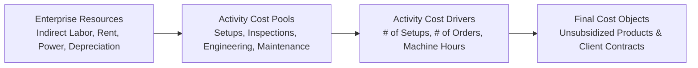
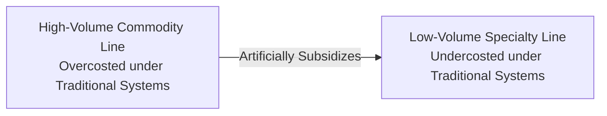

## 📐 Universal Mechanism & Operational Architecture

**Activity-Based Costing (ABC)** is an advanced cost accounting methodology designed to eliminate the severe distortions caused by traditional volume-based overhead allocation. Rather than arbitrarily spreading indirect costs across products using single metrics (such as Direct Labor Hours or Machine Hours), ABC recognizes the causal chain:

$$\mathbf{\text{Resources}} \longrightarrow \mathbf{\text{Activities}} \longrightarrow \mathbf{\text{Cost Drivers}} \longrightarrow \mathbf{\text{Cost Objects (Products/Services)}}$$

---

## 🔢 The Four-Level Activity Hierarchy

To prevent cost distortion, activities are classified into a four-tier hierarchical architecture based on what triggers resource consumption:

| Activity Level             | Definition & Operational Scope                                                          | Exemplar Activities                                                                        | Typical Cost Drivers                              |
| :------------------------- | :-------------------------------------------------------------------------------------- | :----------------------------------------------------------------------------------------- | :------------------------------------------------ |
| **1. Unit-Level**          | Performed each time an individual unit is manufactured.                                 | Direct machine power, raw material cutting, packaging carton stamping                      | Machine hours, direct labor hours, kilowatt hours |
| **2. Batch-Level**         | Performed each time a production run or batch is initiated, independent of unit volume. | Machine recalibration, setup adjustments, material movement, shipment packing              | Number of setups, material moves, purchase orders |
| **3. Product-Sustaining**  | Performed to support an entire product line regardless of batches or units.             | Product design engineering, CAD testing, marketing collateral, regulatory certification    | Engineering hours, change orders, testing cycles  |
| **4. Facility-Sustaining** | Incurred to sustain overall plant capacity and infrastructure.                          | Factory security, plant lighting, facility insurance, executive plant manager compensation | Factory square meters, direct labor headcounts    |

---

## 🏢 The Cross-Subsidization Discovery

When an enterprise implements Activity-Based Costing, it almost invariably discovers **Product Cross-Subsidization**:

$$\mathbf{\text{Traditional Volume Costing Trap}}: \quad \text{Overheads} \propto \text{Direct Labor or Machine Hours}$$

- **High-Volume Standard Products** run smoothly in massive batches, consuming few setups or engineering hours per unit. Yet traditional systems burden them with the majority of factory overhead.
- **Low-Volume Custom Products** demand frequent setups, intensive engineering revisions, and repeated quality inspections. Traditional systems allocate them minuscule overhead shares, masking severe operational losses.

### Executive Action Mandate

Upon discovering true ABC margins, leadership must:

1. **Re-price Complex Lines**: Increase prices on customized or low-volume runs to reflect true setup and engineering resource drain.
2. **Defend the High-Volume Core**: Lower prices on high-volume standard goods to prevent low-cost competitors from poaching profitable baseline volume.
3. **Impose Complexity Fees**: Implement minimum order quantities (MOQs) and explicit change-order surcharges to induce customer efficiency.

---

## 🔗 Curricular Bridges

- Master Course Note: [[courses/mk2-financial-management-strategy/week-05/index|MK2 Week 05: Cost Analysis, CVP & ABC]]
- Empirical Case Study: [[courses/mk2-financial-management-strategy/week-05/case-nirmala-print-abc|Nirmala Print & Packaging ABC Case]]
- Foundational Precursor: [[concepts/job-order-costing|Job-Order Costing Architecture]]
