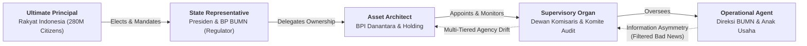

## 💡 First-Principles Intuition & Conceptual Core

Whenever one person (the **Principal**) hires another person (the **Agent**) to manage an asset or make decisions on their behalf, a fundamental friction emerges: the Agent controls day-to-day operational information, while the Principal bears the ultimate financial consequences.

$$\mathbf{\text{\ldquo An agent spending someone else\text{'}s money on someone else\text{'}s behalf rarely exercises the same vigilance as an owner spending their own capital.\rdquo}}$$

Consider an everyday analogy: Imagine owning a thriving restaurant and hiring a professional general manager so you can move to another city.

- **Your goal (Principal)**: Maximize long-term restaurant profit, food quality, and brand reputation.
- **Manager's temptation (Agent)**: Hire relatives onto the payroll, avoid firing lazy staff to stay popular, buy expensive espresso machines for personal prestige, or conceal declining customer reviews until problems explode.

In private corporations, **Michael Jensen and William Meckling (1976)** formalized this friction as **Agency Theory**, showing that divergence of interests, information asymmetry, and differing risk appetites inevitably generate **Agency Costs**.

In State-Owned Enterprises (BUMN), **Andrei Shleifer and Robert Vishny (1994)** demonstrated that this problem is vastly more complex: the ownership chain is **multi-tiered** (Citizens $\rightarrow$ President/Government $\rightarrow$ Holding/Danantara $\rightarrow$ Board $\rightarrow$ Subsidiary Management), and managers face competing demands from both commercial markets and political mandates.

---

## 🔍 Prerequisite & Jargon Decoder

| Terminology                   | Plain-English Meaning                                                                                        | Governance & Economic Role                                                               |
| :---------------------------- | :----------------------------------------------------------------------------------------------------------- | :--------------------------------------------------------------------------------------- |
| **Principal**                 | The ultimate owner who supplies capital and bears residual risk.                                             | In private firms: shareholders. In BUMN: the Indonesian public represented by the State. |
| **Agent**                     | The executive or manager delegated authority to operate the enterprise.                                      | Board of Directors (_Direksi_) and subsidiary executives.                                |
| **Information Asymmetry**     | The operational gap where agents know far more about factory costs, risks, and failures than distant owners. | Fuels "bad news filtering" (_asal bapak senang_) up the hierarchy.                       |
| **Agency Costs**              | The total economic friction caused by delegating control.                                                    | Sum of Monitoring Costs + Bonding Costs + Residual Loss.                                 |
| **Politicians & Firms Model** | **Shleifer & Vishny (1994)** framework analyzing bargaining between politicians and SOE managers.            | Explains how unpriced non-commercial mandates blur accountability for inefficiency.      |

---

## ⚙️ Structural Anatomy of the Mechanism

Jensen and Meckling (1976) decompose **Total Agency Costs** ($C_{\text{agency}}$) into three distinct components:

$$C_{\text{agency}} = C_{\text{monitoring}} + C_{\text{bonding}} + L_{\text{residual}}$$

Where:

1. **Monitoring Expenditures ($C_{\text{monitoring}}$)**: Costs paid by the Principal to observe, audit, and constrain the Agent (e.g., independent Commissioners, Audit Committees, BPK/BPKP audits, integrated ERP/SIINas data reporting).
2. **Bonding Expenditures ($C_{\text{bonding}}$)**: Costs borne by the Agent to credibly guarantee alignment with the Principal (e.g., transparent KPI scorecards, _Business Judgment Rule_ risk dossiers, conflict-of-interest disclosures).
3. **Residual Loss ($L_{\text{residual}}$)**: The remaining dollar value lost when, despite monitoring and bonding, the Agent's decisions still deviate from the Principal's optimal outcome.

### The Multi-Tiered BUMN Agency Multiplier

When an agency chain has $n$ hierarchical layers between the citizen-owner and the operating subsidiary, each layer introduces an attenuation factor $\alpha_i \in (0, 1)$ on information fidelity and accountability:

$$\text{Accountability Fidelity} = \prod_{i=1}^{n} \alpha_i$$

If a 5-layer ownership structure preserves 85% accountability clarity at each handoff ($\alpha_i = 0.85$), end-to-end fidelity drops to $0.85^5 \approx \mathbf{44.4\%}$ unless countered by strict data transparency and explicit mandate separation.

---

## 🧮 Micro-Numerical Toy Example: Monitoring vs. Residual Loss

Consider a BUMN subsidiary with **Rp 1,000 billion** in annual procurement spend.

1. **Weak Governance Regime (Low Monitoring)**:
   - The holding spends only **Rp 1 billion** on basic annual compliance audits ($C_{\text{monitoring}} = 1\text{B}$) and **Rp 0** on digital procurement traceability ($C_{\text{bonding}} = 0$).
   - Because of information asymmetry and unmonitored vendor discretion, procurement inflation and suboptimal contracting cause a 4% efficiency leak ($L_{\text{residual}} = \mathbf{\text{Rp } 40 \text{ billion}}$).
   - **Total Agency Cost**: $1 + 0 + 40 = \mathbf{\text{Rp } 41 \text{ billion}}$.

2. **Strong Governance Architecture (Active Owner + Single Source of Truth)**:
   - The holding invests **Rp 6 billion** in real-time ERP integration, independent audit committee access, and whistleblower protection ($C_{\text{monitoring}} = 6\text{B}$), plus **Rp 2 billion** in executive KPI alignment and risk-review protocols ($C_{\text{bonding}} = 2\text{B}$).
   - Procurement leakage drops from 4% to 0.5% ($L_{\text{residual}} = \mathbf{\text{Rp } 5 \text{ billion}}$).
   - **Total Agency Cost**: $6 + 2 + 5 = \mathbf{\text{Rp } 13 \text{ billion}}$.
   - **Net Sovereign Value Saved**: $41\text{B} - 13\text{B} = \mathbf{\text{Rp } 28 \text{ billion}}$ saved annually from a single subsidiary.

---

## 🏛️ Strategic Relevance for Indonesian BUMN Governance

In his August 18, 2026 P3MD monograph, Minister [[entities/agus-gumiwang-kartasasmita|Dr. Agus Gumiwang Kartasasmita]] highlights three structural remedies to neutralize multi-tiered agency costs in Indonesia:

1. **Separating Regulator from Owner (OECD 2024 Alignment)**:  
   Under **UU No. 1/2025**, **UU No. 16/2025**, and **Perpres No. 105/2025**, **BP BUMN** acts strictly as regulator and policy supervisor, while **[[entities/danantara|BPI Danantara]]** exercises concentrated commercial ownership—eliminating the historical conflict where a ministry simultaneously regulated markets and managed operations.
2. **Explicit Commercial vs. Public Mandate Accounting (Shleifer & Vishny Remedy)**:  
   Every [[concepts/pso-commercial-duality|public service obligation (PSO)]] must have explicit targets, transparent cost calculation, and separate fiscal compensation so managers cannot hide commercial inefficiency behind social mandates.
3. **Eliminating Information Asymmetry via "One Number, One Source"**:  
   True governance is not thick compliance binders—it is the speed at which **bad news reaches the boardroom without distortion**, paired with [[concepts/psychological-safety|Psychological Safety]] so frontline staff report operational risks early.
