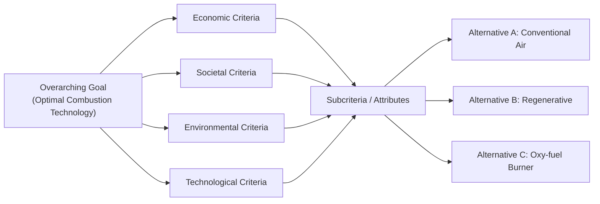

## 🧭 Executive Overview

The **Analytic Hierarchy Process (AHP)** is a structured multi-criteria decision-making methodology formulated by mathematician **Thomas L. Saaty** in the late 1970s (_The Analytic Hierarchy Process_, McGraw-Hill, 1980). AHP decomposes complex, unstructured decisions into a multi-tier hierarchy consisting of the overarching goal, evaluation criteria, subcriteria, and decision alternatives.

Unlike ordinal rating methods, AHP measures subjective preferences on a **ratio scale** using pairwise comparisons. By computing the **principal eigenvector** of reciprocal judgment matrices, AHP mathematically synthesizes relative priority weights while calculating an objective **Consistency Ratio ($CR$)** to detect and control inconsistencies in human judgment.

---

## 🔢 Saaty's Fundamental 1–9 Comparison Scale

Decision makers evaluate the relative importance or preference between elements $A_i$ and $A_j$ using Saaty's 9-point fundamental scale:

| Intensity of Importance ($a_{ij}$) | Definition                 | Qualitative Meaning in Practice                                                                        |
| :--------------------------------: | :------------------------- | :----------------------------------------------------------------------------------------------------- |
|               **1**                | Equal Importance           | Two activities contribute equally to the objective.                                                    |
|               **3**                | Moderate Importance        | Experience and judgment slightly favor activity $i$ over $j$.                                          |
|               **5**                | Strong Importance          | Experience and judgment strongly favor activity $i$ over $j$.                                          |
|               **7**                | Very Strong / Demonstrated | Activity $i$ is favored very strongly over $j$; dominance demonstrated in practice.                    |
|               **9**                | Extreme / Absolute         | Evidence favoring $i$ over $j$ is of the highest possible order of affirmation.                        |
|           **2, 4, 6, 8**           | Intermediate Values        | Compromise needed between two adjacent judgment values.                                                |
|    **Reciprocals ($1/a_{ij}$)**    | Inverse Judgment           | If element $i$ has rating $a_{ij}$ relative to $j$, then element $j$ has rating $a_{ji} = 1 / a_{ij}$. |

---

## 📐 Mathematical Foundations & Priority Vector Derivation

Pairwise judgments form an $n \times n$ positive reciprocal matrix $\mathbf{A}$:

$$\mathbf{A} = \begin{bmatrix} 1 & a_{12} & \cdots & a_{1n} \\ 1/a_{12} & 1 & \cdots & a_{2n} \\ \vdots & \vdots & \ddots & \vdots \\ 1/a_{1n} & 1/a_{2n} & \cdots & 1 \end{bmatrix} \quad \text{where } a_{ij} > 0 \quad \text{and } a_{ji} = \frac{1}{a_{ij}}$$

### 1. Principal Priority Vector ($w$)

Under perfect consistency, $\mathbf{A} \mathbf{w} = n \mathbf{w}$. With human subjective judgment, matrix $\mathbf{A}$ contains perturbations, leading to the principal eigenvalue formulation:

$$\mathbf{A} \mathbf{w} = \lambda_{\max} \mathbf{w}$$

Where $\lambda_{\max} \ge n$ is the principal eigenvalue, and $\mathbf{w} = [w_1, w_2, \dots, w_n]^T$ is the normalized principal right eigenvector representing relative priority weights:

$$\sum_{i=1}^{n} w_i = 1.0$$

### 2. Operational Approximation (Geometric Mean / Column Normalization)

In practical executive settings, the priority vector is calculated via normalized geometric row means:

$$w_i = \frac{\left( \prod_{j=1}^{n} a_{ij} \right)^{1/n}}{\sum_{k=1}^{n} \left( \prod_{j=1}^{n} a_{kj} \right)^{1/n}}$$

Or by normalizing columns and averaging across rows:

$$w_i = \frac{1}{n} \sum_{j=1}^{n} \frac{a_{ij}}{\sum_{k=1}^{n} a_{kj}}$$

---

## ⚖️ Consistency Validation: The $CR < 0.10$ Rule

A critical advantage of AHP over other multi-criteria techniques is its internal error-detection metric. Human preferences are not automatically transitive (e.g., preferring $A > B$ by 2 and $B > C$ by 2 does not guarantee $A > C$ by exactly 4).

### 1. Principal Eigenvalue Estimation ($\lambda_{\max}$)

Estimate $\lambda_{\max}$ by multiplying matrix $\mathbf{A}$ by priority vector $\mathbf{w}$ and computing the average ratio:

$$\lambda_{\max} = \frac{1}{n} \sum_{i=1}^{n} \frac{(\mathbf{A} \mathbf{w})_i}{w_i}$$

### 2. Consistency Index ($CI$)

The departure of $\lambda_{\max}$ from $n$ measures the magnitude of inconsistency:

$$CI = \frac{\lambda_{\max} - n}{n - 1}$$

When judgments are perfectly consistent, $\lambda_{\max} = n$ and $CI = 0$.

### 3. Random Consistency Index ($RI$)

Saaty established baseline empirical $RI$ values generated from thousands of random reciprocal matrices of order $n$:

| Order ($n$) |  1   |  2   |  3   |  4   |  5   |    6     |  7   |  8   |  9   |  10  |
| :---------: | :--: | :--: | :--: | :--: | :--: | :------: | :--: | :--: | :--: | :--: |
|  **$RI$**   | 0.00 | 0.00 | 0.58 | 0.90 | 1.12 | **1.24** | 1.32 | 1.41 | 1.45 | 1.49 |

### 4. Consistency Ratio ($CR$)

The ratio of observed inconsistency to expected random inconsistency:

$$CR = \frac{CI}{RI}$$

> [!IMPORTANT]
> **The 10% Consistency Hurdle**:
>
> - If **$CR \le 0.10$ (10%)**, judgment consistency is acceptable; priorities can be synthesized.
> - If **$CR > 0.10$**, judgments are excessively random or contradictory; pairwise comparisons must be re-evaluated and revised by the decision maker.

---

## 💼 Cross-Curricular Application & Real-World Synthesis

- **[[courses/mk5-decision-making-negotiation/week-07/index|MK5 Week 07 (Analytic Hierarchy Process)]]**: Applied to **Pertamina Kilang Nusantara** evaluating three sustainable combustion technologies (Conventional Air, Regenerative Burner, Oxy-fuel Burner) across 6 main criteria ($CI = 0.0777, CR = 0.0626 < 0.10$) and 28 subcriteria.
- **[[concepts/simple-multi-attribute-rating-technique|SMART]]**: Contrasted with SMART; AHP is preferred when criteria trade-offs involve complex subjective ratios, while SMART is preferred for transparent linear swing scoring.
- **[[concepts/value-focused-thinking|Value-Focused Thinking (VFT)]]**: VFT criteria hierarchies provide the clean conceptual taxonomy required to construct AHP pairwise matrices.
- **[[courses/mk5-decision-making-negotiation/mid/index|Mid-Term Examination Synthesis]]**: AHP serves as an advanced multi-attribute Decision Analysis (DA) framework for multi-stakeholder enterprise capital evaluations.
