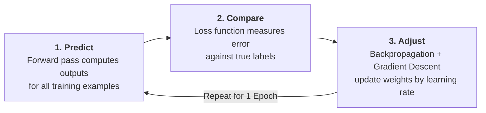
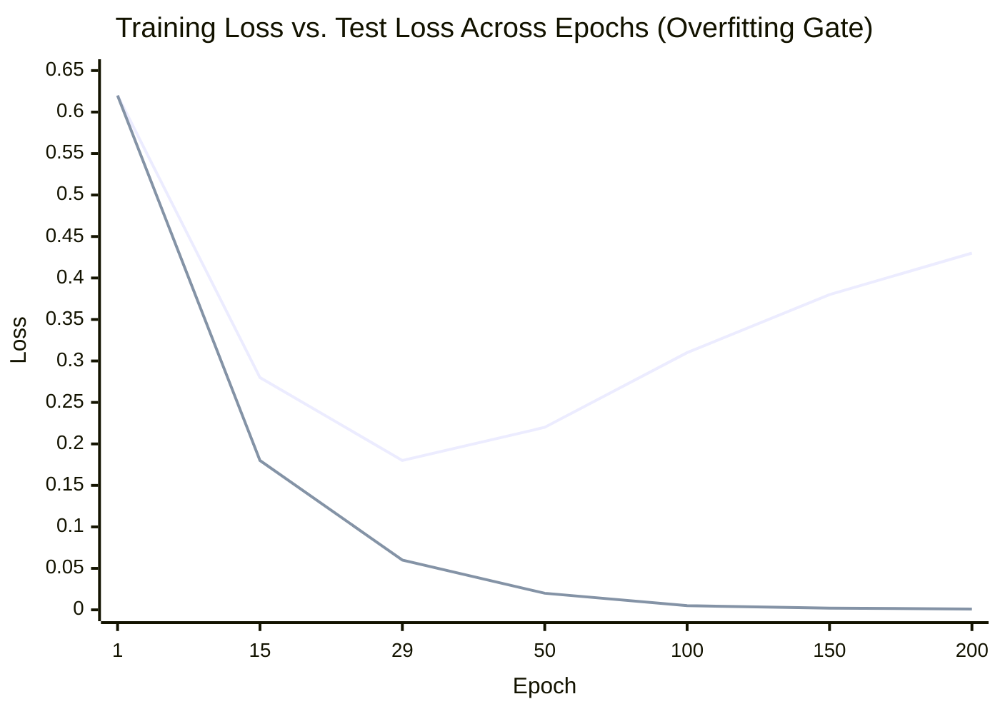

An **Artificial Neural Network (ANN)** is a computational model inspired by biological neurons that learns non-linear patterns from data by stacking layers of simple mathematical units, measuring prediction errors with a **loss function**, and iteratively adjusting connection **weights** through **backpropagation** and **gradient descent**.

---

## 💡 First-Principles Intuition & Conceptual Core

Imagine trying to separate safe operating conditions from dangerous equipment failures on a factory floor chart using only **one straight ruler**. If failures only happen when temperature is too high, one straight line works. But if an oven fails whenever temperature or fan speed drifts too far from the center—in _any_ direction—no single straight line can enclose the circular safe zone.

An Artificial Neural Network solves this by hiring a **committee of simple inspectors**. Each hidden neuron draws one straight boundary line. By combining four or more straight lines through an output neuron, the network encloses a polygon around the safe operating zone—handling complex, curved, or multi-sided business rules without engineers writing explicit `if/else` thresholds.

### 🔑 Prerequisite Concepts & Jargon Decoder

- **Neuron (Node)**: The basic building block that receives numerical inputs, computes a weighted sum plus a bias, and passes the result through an activation function.
- **Weight ($w_i$)**: A learned multiplier that controls how strongly a specific input influences a neuron's output (positive, negative, or near zero).
- **Bias ($b$)**: A learned offset added to the weighted sum that shifts where a neuron's decision boundary sits, independent of the input values.
- **Activation Function ($\phi$)**: A non-linear transformation (such as ReLU, Sigmoid, or Tanh) applied after the weighted sum. Without it, stacking 100 layers mathematically collapses into a single straight line.
- **Layer (Input / Hidden / Output)**: Vertical columns of neurons. Input layers hold raw features; hidden layers extract intermediate patterns; output layers produce final probabilities or values.
- **Loss Function ($L$)**: A scorecard measuring how far the network's predictions are from actual ground-truth outcomes.
- **Backpropagation**: The calculus-based credit-assignment algorithm (chain rule) that traces the loss backward from the output layer to compute how much each individual weight contributed to the error.
- **Epoch**: One complete pass over the entire training dataset.
- **Learning Rate ($\eta$)**: The step size used by gradient descent when nudging weights to reduce loss.
- **Overfitting**: When a network memorizes noise in the training data—driving training loss near zero while test loss rises on unseen cases.

---

## 📐 Structural Anatomy & Single-Neuron Mechanics {#neuron-mechanics}

Every artificial neuron executes a two-step calculation—first a linear combination ($z$), then a non-linear activation ($a$):

$$z = \sum_{i=1}^{n} w_i x_i + b \qquad \text{and} \qquad a = \phi(z)$$

Common activation functions govern how $z$ is transformed before passing to the next layer:

| Activation Function              | Mathematical Form                             | Output Range  | Primary Managerial / Modeling Role                                                                            |
| :------------------------------- | :-------------------------------------------- | :-----------: | :------------------------------------------------------------------------------------------------------------ |
| **ReLU** (Rectified Linear Unit) | $\phi(z) = \max(0, z)$                        | $[0, \infty)$ | Default for hidden layers; zeroes out negative signals while letting positive signals pass linearly.          |
| **Sigmoid**                      | $\phi(z) = \frac{1}{1 + e^{-z}}$              |   $(0, 1)$    | Squashes scores into probabilities for binary classification outputs (e.g., failure vs. normal).              |
| **Tanh**                         | $\phi(z) = \frac{e^z - e^{-z}}{e^z + e^{-z}}$ |   $(-1, 1)$   | Zero-centered hidden-layer alternative useful when negative and positive activations carry symmetric meaning. |

### ⚙️ 10-Second Micro-Example (Bakery Oven Sensor Neuron)

Suppose a hidden neuron monitors two bakery oven sensors: temperature deviation ($x_1 = 6^\circ\text{C}$) with weight $w_1 = 0.5$, fan speed deviation ($x_2 = -4\%$) with weight $w_2 = -0.25$, and bias $b = -2$:

1. **Weighted Sum + Bias**: $z = (6 \times 0.5) + (-4 \times -0.25) + (-2) = 3.0 + 1.0 - 2.0 = 2.0$.
2. **ReLU Activation**: Since $2.0 > 0$, $\text{ReLU}(2.0) = \mathbf{2.0}$. If instead $z$ had been $-1.0$, ReLU would output $\mathbf{0}$.

---

## 🔄 Training Dynamics: Backpropagation, Learning Rate & Overfitting {#training-dynamics}

An untrained neural network starts with random weights and poor predictions. Training improves those weights across repeated **epochs** using a three-stage feedback loop:

### Learning Rate ($\eta$) Sensitivity

Gradient descent updates each weight in the opposite direction of the loss slope: $w_{\text{new}} = w_{\text{old}} - \eta \frac{\partial L}{\partial w}$. Choosing $\eta$ creates three distinct behaviors:

- **Too Small** (e.g., $0.00001$): Weight updates crawl down the loss valley, wasting compute time and stalling before convergence.
- **Suitable** (e.g., $0.03$): Steps descend smoothly and settle at the minimum loss.
- **Too Large** (e.g., $3.0$): Steps overshoot the valley walls, causing loss to bounce erratically or diverge.

### Early Stopping & The Overfitting Curve

As training continues across epochs, **training loss** steadily falls toward zero. However, **test loss** (measured on unseen validation data) falls only up to an optimal point before climbing back up as the network memorizes training noise:

Managers must evaluate neural networks **by out-of-sample test performance and early stopping** (e.g., stopping at Epoch 29 above), never by training accuracy or by attempting to manually interpret millions of individual weights.

---

## 🔗 Related Coursework

- [[courses/mk6-business-analytics/week-11/index|MK6 Week 11: Deep Learning & Neural Network Foundations]]
- [[courses/mk6-business-analytics/week-11/assignment-deep-learning-concept-map|Session 11 Assignment Brief: Deep Learning Concept Map]]
- [[concepts/convolutional-neural-network|Convolutional Neural Networks (CNN) & Transfer Learning]]
