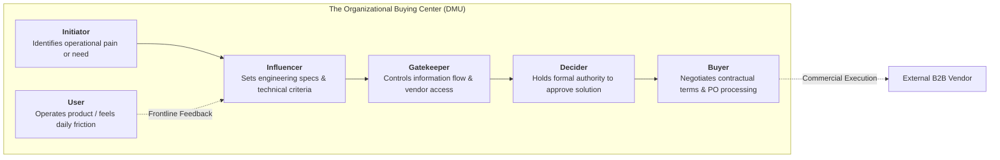

## 📐 Universal Definition & Conceptual Core

The **Organizational Buying Center** (also termed the **Decision-Making Unit / DMU**), formalized by Frederick E. Webster Jr. and Yoram Wind (1972), defines the informal, cross-functional decision-making group within an enterprise responsible for evaluating, negotiating, and authorizing high-stakes business-to-business (B2B) acquisitions.

Unlike B2C consumer purchasing—which is frequently individual, emotionally driven, and fast-cycle—B2B organizational buying is characterized by **derived demand, high financial risk, formal compliance protocols, multiple decision criteria, and lengthy multi-stakeholder approval cycles**.

The Buying Center comprises six distinct behavioral roles, which may reside in different departments or be concentrated within key executive figures:

---

## 🔬 Buy Classes & Behavioral Mechanics

Webster and Wind classify enterprise procurement into three distinct **Buy Classes**, which govern the size, risk profile, and composition of the Buying Center:

| Dimension                      | Straight Rebuy                     | Modified Rebuy                                       | New Task                                            |
| :----------------------------- | :--------------------------------- | :--------------------------------------------------- | :-------------------------------------------------- |
| **Operational Trigger**        | Routine inventory replenishment    | Specification change, dissatisfaction, or price hike | Unprecedented strategic need or technological shift |
| **Financial / Risk Exposure**  | Minimal; pre-approved budget       | Moderate; vendor audit required                      | High to catastrophic; board-level visibility        |
| **Buying Center Size**         | 1–2 actors (Procurement / Buyer)   | 3–5 actors (Users, Engineering, Purchasing)          | 6+ actors across executive leadership               |
| **Decision Timeframe**         | Instantaneous / Automated EDI      | Days to Weeks                                        | Months to Years                                     |
| **Primary Decision Criterion** | Price, delivery reliability, terms | Better performance, cost reduction                   | Strategic fit, vendor viability, total risk         |

### The Six Buying Center Roles Defined

1. **Initiator**: The individual or unit that first recognizes that an operational bottleneck, equipment breakdown, or strategic initiative requires an external solution.
2. **User**: The frontline staff or engineering teams who will physically interact with the acquired product or software daily. Their buy-in determines post-implementation success.
3. **Influencer**: Technical specialists, engineers, consultants, or compliance officers who define specifications, establish technical thresholds, and eliminate non-compliant bids.
4. **Gatekeeper**: Procurement analysts, administrative assistants, or technical screening committees who filter sales inquiries and control access to key executives.
5. **Decider**: The ultimate executive (e.g., VP Operations, CFO, Board Committee) with the fiduciary authority to commit corporate capital.
6. **Buyer (Purchasing Agent)**: The procurement professional responsible for vendor qualification, competitive bidding, contract negotiations, and formal purchase order issuance.

$$\mathbf{\text{B2B Perceived Value} = \frac{\text{Total Business Benefits (Operational + Financial + Strategic)}}{\text{Total Cost of Ownership (Capex + Opex + Switching + Implementation)}}}$$

---

## 🏛️ Multi-Disciplinary Lenses Across the MBA Curriculum

### 1. Marketing Management (MK3)

In [[courses/mk3-marketing-management/week-04/index|MK3 Week 04]] and the **PT Wijaya Karya (WIKA) EPC Case**, B2B marketing revolves around navigating the client's complex DMU (e.g., PT Aneka Tambang / MIND ID mining leadership vs ministry regulators). A vendor targeting only the procurement Buyer will lose to a competitor who shaped the Influencer's engineering specifications or addressed the CFO Decider's balance-sheet constraints. In [[courses/mk3-marketing-management/week-06/index|MK3 Week 06]] (HubSpot), mid-market enterprise sales fail when software vendors treat the CEO as a solo buyer without empowering the "Marketing Mary" User.

### 2. Organizational Behavior & Power Dynamics (MK1)

The formal org chart rarely reflects the real influence in a Buying Center. As examined in [[courses/mk1-organizational-behavior-managing-people/week-07/index|MK1 Week 07: Power & Politics]], actors leverage French and Raven's [[concepts/french-and-raven-power-bases|Power Bases]]—such as _Expert Power_ (technical Influencers) or _Informational Power_ (secretarial Gatekeepers)—to derail or champion procurement bids regardless of formal hierarchy.

### 3. Operations & Sourcing (MK4)

In operations and supply chain management, the Buying Center acts as the institutional interface for supplier evaluation, vendor scorecards, and multi-sourcing strategies. Aligning procurement criteria with production scheduling minimizes inventory stock-outs and operational bottlenecks.

---

## ⚠️ Strategic Pitfalls & Boundary Conditions

1. **The "Single Buyer" Illusion**: Pitching high-ticket enterprise contracts exclusively to procurement officers while neglecting the frontline operational Users who sabotage adoption.
2. **Gatekeeper Bypass Trap**: Attempting an end-run around internal gatekeepers to pitch the CEO directly, which frequently alienates mid-level managers who torpedo the project during diligence.
3. **Over-Indexing on Price**: Assuming all B2B buyers optimize for the lowest bid. In mission-critical industrial EPC or enterprise software, switching costs and execution risk far outweigh purchase price.

---

## 🔗 Related Knowledge Hubs

- [[courses/mk3-marketing-management/week-04/index|MK3 Week 04: B2B Marketing & Organizational Buying]]
- [[concepts/french-and-raven-power-bases|French and Raven Power Bases]]
- [[concepts/customer-perceived-value|Customer Perceived Value (CPV)]]
- [[entities/pt-wijaya-karya|PT Wijaya Karya (Persero) Tbk]]
