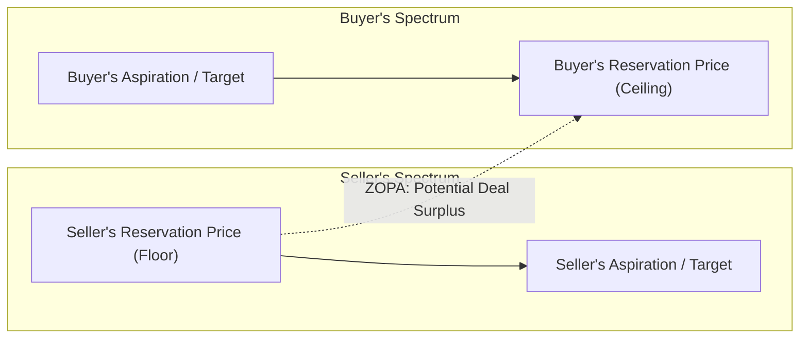
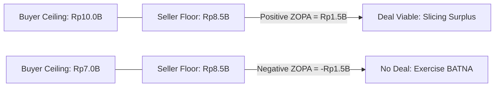

## 🧭 Executive Overview

**BATNA (Best Alternative to a Negotiated Agreement)** and **ZOPA (Zone of Possible Agreement)** form the structural foundation of strategic negotiation theory, originating in _Getting to Yes_ (Fisher, Ury, & Patton, 1981) and _The Art and Science of Negotiation_ (Raiffa, 1982).

Negotiators often commit two costly strategic errors: settling for terms inferior to what they could achieve independently, or walking away from mutually advantageous agreements due to pride, misperception, or emotional anchoring. BATNA and ZOPA replace subjective intuition with a rigorous quantitative framework grounded in walkaway thresholds, reservation prices, and cooperative surplus creation.

---

## 📐 Definitions & Core Parameters

| Strategic Dimension           | Formal Definition                                                                         | Operational Calculation                                                                      | Practical Managerial Rule                                                                              |
| :---------------------------- | :---------------------------------------------------------------------------------------- | :------------------------------------------------------------------------------------------- | :----------------------------------------------------------------------------------------------------- |
| **BATNA**                     | Best course of action a party can execute unilaterally without the counterpart's consent. | Best outside offer or fallback operational alternative.                                      | **Dynamic Leverage**: Protect and actively cultivate alternative options before entering negotiations. |
| **Reservation Price ($RP$)**  | The walkaway point; the absolute threshold beyond which a negotiator walks away.          | $RP = \text{BATNA Value} \pm \text{Transaction Costs} \pm \text{Idiosyncratic Preferences}$. | **Strict Boundary**: Never reveal your exact $RP$; never accept a deal that violates your $RP$.        |
| **Target / Aspiration Point** | The realistic ideal outcome a negotiator strives to capture.                              | Established via benchmarking, competitive comps, and market data.                            | **Anchoring Guide**: Focus mental attention on your aspiration, not merely your walkaway point.        |
| **ZOPA**                      | The overlap between the reservation prices of negotiating parties.                        | $\text{ZOPA} = [RP_{\text{Seller}}, RP_{\text{Buyer}}]$.                                     | A deal is structurally viable if and only if $\text{ZOPA} \ge 0$.                                      |

---

## 🧮 Mathematical Architecture of ZOPA & Cooperative Surplus

Let $RP_B$ represent the Buyer's maximum reservation price (ceiling) and $RP_S$ represent the Seller's minimum reservation price (floor).

### 1. Positive ZOPA ($\text{ZOPA} > 0$)

When the buyer's maximum willingness to pay exceeds the seller's minimum acceptable threshold ($RP_B \ge RP_S$):

$$\text{Total Cooperative Surplus} = RP_B - RP_S$$

$$\text{ZOPA Interval} = \left[ RP_S, RP_B \right]$$

Any settlement price $P^* \in [RP_S, RP_B]$ generates positive utility for both parties:

- **Buyer's Surplus**: $S_B = RP_B - P^*$
- **Seller's Surplus**: $S_S = P^* - RP_S$
- **Total Surplus Captured**: $S_B + S_S = RP_B - RP_S$

### 2. Negative ZOPA ($\text{ZOPA} < 0$)

When the seller's reservation price exceeds the buyer's ceiling ($RP_S > RP_B$):

$$RP_S - RP_B > 0 \implies \text{No Deal Zone}$$

Rational parties must exercise their respective BATNAs. Reaching an agreement under a negative ZOPA destroys economic value for at least one participant.

---

## 🔄 Distributive Bargaining vs. Integrative Value Creation

Negotiation dynamics operate across two distinct strategic dimensions:

| Strategy Dimension          | Primary Paradigm                                                | Core Tactical Levers                                                                                | ZOPA Interaction                                                                                       |
| :-------------------------- | :-------------------------------------------------------------- | :-------------------------------------------------------------------------------------------------- | :----------------------------------------------------------------------------------------------------- |
| **Distributive Bargaining** | _"Slicing the Pie"_ (Zero-Sum single-issue transaction).        | Anchoring with ambitious first offers, managing concessions, concealing reservation prices.         | Fixed ZOPA; parties battle over the distribution of existing surplus.                                  |
| **Integrative Negotiation** | _"Expanding the Pie"_ (Value-creating multi-issue partnership). | Logrolling (trading low-cost items for high-value gains), unbundling issues, contingency contracts. | **Expands the ZOPA**: Shifts reservation boundaries outward through mutually complementary trade-offs. |

### The Integrative Logrolling Equation

When parties hold divergent valuations across issues $X$ and $Y$ ($\Delta U_{A}(X) > \Delta U_{A}(Y)$ while $\Delta U_{B}(Y) > \Delta U_{B}(X)$):

$$\Delta U_{\text{Total}} = \left( U_{A}(X) - U_{A}(Y) \right) + \left( U_{B}(Y) - U_{B}(X) \right) > 0$$

Trade-offs create net new economic value, effectively transforming a narrow or negative distributive ZOPA into an expansive win-win agreement.

---

## 💼 Cross-Curricular Application & Real-World Synthesis

- **[[courses/mk5-decision-making-negotiation/week-08/index|MK5 Week 08 (Negotiation Foundations)]]**: Strategic foundation for executive negotiations, exploring Fisher, Ury, Patton's _Getting to Yes_ and Leigh Thompson's behavioral bargaining research.
- **[[concepts/value-focused-thinking|Value-Focused Thinking (VFT)]]**: Uncovering counterparts' underlying fundamental objectives enables logrolling and ZOPA expansion.
- **[[courses/mk5-decision-making-negotiation/week-01/case-viral-nation|Case: Viral Nation]]**: Evaluating acquisition buyout offers ($CA\$80M–120M$) against the founders' independent growth BATNA.
- **[[courses/mk4-operations-supply-chain-management/week-02/index|MK4 Supply Chain Strategy]]**: Supplier contract bargaining, vendor SLA negotiations, and long-term procurement partnerships.
