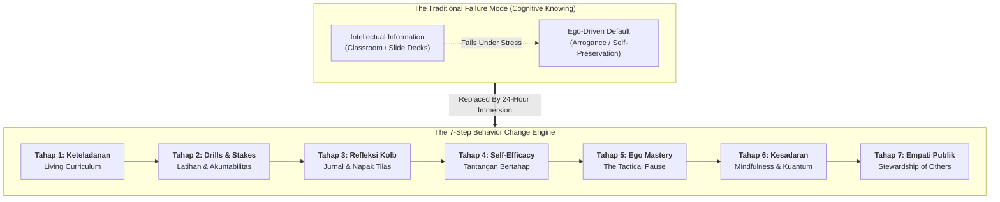

## 💡 First-Principles Intuition & Conceptual Core

Human organizations persistently fall into a dangerous cognitive trap: **confusing intellectual comprehension with behavioral execution**. An executive can read a hundred treatises on corporate ethics, score 100% on compliance examinations, and articulate sophisticated corporate governance frameworks—yet when under extreme operational stress, default instantaneously to self-protective arrogance, administrative defensiveness, or short-term expediency.

Knowing what is virtuous does not trigger virtue. Knowing an operational rule once does not create an operational habit. Furthermore, a habit practiced solely under the gaze of an auditor or superior remains an artificial performance rather than an internal compass.

The **Behavior Change Engine (_Mesin Pengubah Perilaku_)** is a 24-hour immersion pedagogical architecture engineered by **[[entities/anton-palaguna|Marsma TNI Dr. Anton Palaguna]]** for the **Program Presiden untuk Pemimpin Masa Depan (P3MD)**. Drawing from elite combat aviation training (the Qualified Flying Instructor framework) and behavioral psychology, it posits that authentic behavioral transformation occurs only when cognitive understanding is forged through experiential crucible, deliberate reflection, ego dismantling, and emotional self-regulation until the mentor's voice becomes the leader's internal operating code.

### 🔑 Prerequisite Concepts & Jargon Decoder

- **Internalized Voice (_Suara yang Berpindah_)**: The state in which an instructor's ethical and technical standards guide the pupil's hands and mind even when the instructor is physically absent from the cockpit.
- **Cognitive-Behavioral Gap**: The wide gulf between what an executive rationally endorses in calm settings and how they react when subjected to fatigue, public scrutiny, or existential threat.
- **Experiential Reflection (David Kolb Cycle)**: The cognitive discipline wherein raw physical experience is processed through intentional retrospection, conceptualized into principle, and re-tested in subsequent action.
- **The Tactical Pause (_Jeda Sebelum Respons_)**: The deliberate micro-interval between receiving an emotional stimulus and deploying an executive decision, neutralising impulsive ego defense.

---

## 📐 Universal Mechanism & Mathematical Architecture

In executive character formation, behavioral permanence is governed by the ratio of consistent immersion and accountability relative to cognitive resistance:

$$\mathbf{\Delta \text{Behavior}} = \frac{\text{Role Modeling} \times \sum (\text{Drills} \times \text{Accountability}) \times \text{Reflection}}{\text{Ego Friction} + \text{Inconsistency Penalty}}$$

### ⚙️ Mechanics & Structural Anatomy:

- **Numerator (The Drivers)**:
  - **Role Modeling ($\text{Keteladanan}$)**: Acts as the primary scalar multiplier. A single consistent act by leadership reinforces a hundred spoken directives; conversely, a single act of leadership hypocrisy cancels years of sermons.
  - **Drills $\times$ Accountability**: Repetitive real-stakes simulations where non-compliance has immediate, measurable, and unavoidable consequences.
  - **Reflection**: The deliberate synthesis of failure or strain into new mental models via daily journaling and physical pilgrimages.
- **Denominator (The Drag & Decay)**:
  - **Ego Friction**: The instinctive psychological urge to defend self-image, blame subordinates, or claim credit.
  - **Inconsistency Penalty**: Mixed signals from governing authorities that allow participants to revert to their "factory default" (_settingan awal_).
- **Mental-Math Micro-Example**:
  A 2-day outbound character workshop ($t = 48\text{ hrs}$) offers negligible drill repetition ($\text{Drills} \approx 2$) and zero long-term accountability, meaning participants revert to baseline immediately upon returning home. In contrast, an 11-month 24-hour immersion program ($t = 330\text{ days}$) with constant pengasuh supervision drives the habit loop past conscious friction into automatic cognitive wiring.

---

## 🏛️ The Seven Operational Levers

| Step  | Indonesian Dimension                                       | Operational Mechanism                                                                                  | Executive Implementation                                                                                                               |
| :---: | :--------------------------------------------------------- | :----------------------------------------------------------------------------------------------------- | :------------------------------------------------------------------------------------------------------------------------------------- |
| **1** | **Keteladanan** (_Role Modeling_)                          | Human beings learn primarily through visual observation rather than verbal lecture.                    | Mentors and managers must embody four simultaneous archetypes: parent, elder sibling, trusted peer, and firm commander.                |
| **2** | **Latihan & Akuntabilitas** (_Drills & Stakes_)            | Values remain abstract until tested against clear, non-negotiable operational boundaries.              | Define unambiguous behavioral standards; attach calibrated, immediate rewards and disciplinary consequences to every deviation.        |
| **3** | **Refleksi** (_Experiential Reflection_)                   | Experiential activity alone does not produce wisdom without disciplined internal synthesis.            | Mandatory structured daily journaling; rigorous debriefs of operational crises (e.g., historical route marches and field simulations). |
| **4** | **Self-Efficacy** (_Progressive Mastery_)                  | Confidence without discipline is dangerous; true resilience is built through graduated adversity.      | Subject teams to escalating time-constrained stressors; engineer early "small wins" backed by precise, unvarnished feedback.           |
| **5** | **Pengendalian Emosi** (_Ego Mastery_)                     | Executives cannot choose external crises, but have complete sovereignty over their emotional response. | Train leaders to detect symptoms of ego inflation, recognize defensive patterns, and enforce the tactical pause before communicating.  |
| **6** | **Identitas & Berkesadaran** (_Mindful Quantum Awareness_) | Deep character requires alignment between identity, purpose, and universal physical/spiritual laws.    | Incorporate contemplative silence and mindfulness; align intellectual analysis with somatic and emotional composure.                   |
| **7** | **Kepedulian & Empati** (_Public Empathy_)                 | Competence and character must ultimately be directed outward toward societal welfare.                  | Require direct field immersion into vulnerable communities to cultivate visceral empathy for public stakeholders.                      |

---

## ⚖️ Multi-Disciplinary Lenses Across the MBA Curriculum

### 1. Organizational Behaviour & Managing People (MK 1)

- **Primary Mechanism**: Connects directly with [[concepts/emotional-intelligence|Emotional Intelligence (Goleman)]], [[concepts/self-awareness|Self-Awareness]], and [[concepts/values-congruence|Values Congruence]].
- **Core Insight**: Culture is not what a CEO writes on the office wall; culture is the behavior that leaders tolerate, model, and penalize on a Tuesday morning when revenue is down.

### 2. State-Owned Enterprise Transformation & Danantara Strategy (Rabuan)

- **Primary Mechanism**: Corporate governance failures across BUMN infrastructure, financial holding companies, and commodity giants are rarely technical failures—they are failures of character where high-IQ executives deployed competence without moral restraint.
- **Core Insight**: As state enterprises undergo consolidation under BP Danantara, building executive benches requires shifting from superficial credentialism to the **Competence-Character-Care Triad**.

---

## 🚀 Action Learning Project (ALP) Application

> [!TIP] ALP Capstone Alignment
> During the Business Immersion across partner BUMNs (Pertamina, PLN, Pelindo, Telkom, InJourney, SIG, etc.), student consulting teams frequently uncover operational resistance to new digital workflows or risk governance frameworks.
>
> Rather than prescribing additional training seminars or standard operating procedure (SOP) manuals (which address only the cognitive layer), fellows should deploy the **Behavior Change Engine**:
>
> 1. Audit whether department heads actively demonstrate the new workflow (**Keteladanan**).
> 2. Institute small daily simulations with transparent operational consequences (**Latihan & Akuntabilitas**).
> 3. Create psychologically safe debrief sessions where teams analyze friction points without fear of reprisal (**Refleksi & Trust Space**).

---

## 🔗 Contributing Sessions & References

- **Plenary & Masterclass**: [[rabuan/2026-10-20-anton-upi-dies-natalis-orasi|Special Livestream Session: Commander Anton's UPI Oration]]
- **Architect & Theorist**: [[entities/anton-palaguna|Marsma TNI Dr. Anton 'Sioux' Palaguna]]
- **Related Concepts**:
  - [[concepts/emotional-intelligence|Emotional Intelligence]]
  - [[concepts/self-awareness|Self-Awareness]]
  - [[concepts/values-congruence|Values Congruence]]
  - [[concepts/psychological-safety|Psychological Safety]]
  - [[concepts/growth-mindset|Growth Mindset]]
- **Programmatic Spine**: [[program/index|P3MD Program Architecture & Governance]]
- **Hub**: [[concepts/index|Knowledge Matrix (Core Business Concepts)]]
