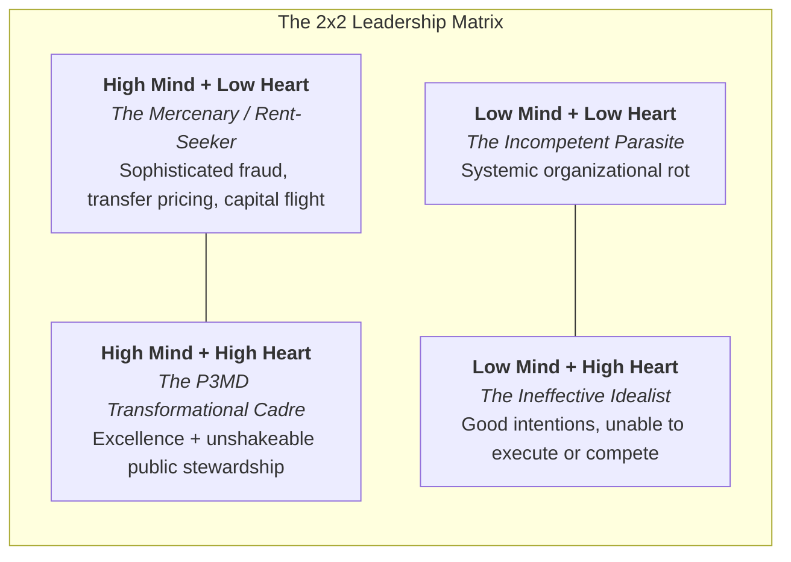
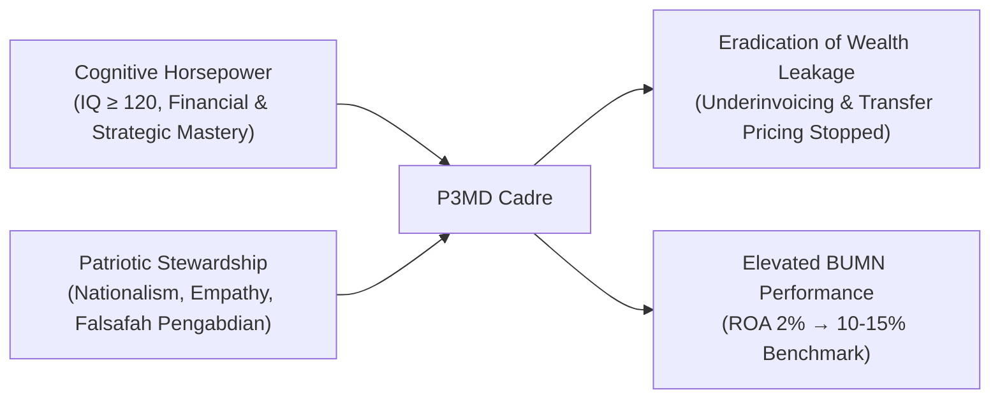

## 🎯 Executive Summary & The Core Dilemma

The **Best Mind and Best Heart** doctrine is the founding philosophy of the **Program Presiden untuk Pemimpin Masa Depan (P3MD Batch I Soedirman)**, articulated by **[[entities/prabowo-subianto|President Prabowo Subianto]]** during his foundational taklimat at Padepokan Garuda Yaksa, Hambalang.

The framework resolves a historic crisis in state-owned enterprise (BUMN) governance: the divergence between intellectual competence and ethical loyalty. For decades, elite corporations and state bodies recruited candidates solely on cognitive markers or technical credentials. However, empirical corporate history proves that **high cognitive power unmoored from ethical stewardship produces sophisticated rent-seeking rather than public value**.

---

## 🧠 The 4-Layer Pedagogical Anatomy

### Layer 1: Plain-English Intuition & Everyday Analogy

Imagine the navigation of a high-speed vessel through treacherous reefs. The **Best Mind** is the engine and sonar system: it computes trajectories, reads tidal flows, and calculates optimal velocity. The **Best Heart** is the compass and the loyalty of the captain to the home port. If a ship has a powerful engine and precise radar but a treacherous or self-serving captain, it does not reach the home harbor safely; it sails to a foreign port to sell the cargo for personal gain.

In state enterprise governance, a manager with a brilliant mind ($\text{IQ} \ge 120$) who lacks love for the nation will engineer subtle export underinvoicing, offshore transfer pricing, and sweetheart procurement contracts. Intelligence without patriotic devotion turns into weaponized extraction.

---

### Layer 2: Prerequisite & Jargon Decoder

- **Best Mind ($\text{Cognitive Capital}$)**: Measured during the P3MD national selection by an intelligence quotient ($\text{IQ} \ge 120$), strategic reasoning, quantitative literacy, and rapid analytical synthesis.
- **Best Heart ($\text{Ethical & Patriotic Stewardship}$)**: Active empathy for the socio-economic condition of the Indonesian people, loyalty to the republic, humility, and moral integrity that refuses personal enrichment at public expense.
- **The ENA Model (_École Nationale d'Administration_)**: The elite French post-graduate institution created in 1945 by Charles de Gaulle to forge senior civil servants and state industrial directors imbued with fierce republican devotion and rigorous technocratic skill.
- **Principal-Agent Problem in SOEs**: The economic dilemma where public enterprise managers (agents) exploit information asymmetry to pursue personal perks, prestige, or illicit rent at the expense of the citizens (principals).

---

### Layer 3: Structural Mechanism & Academic Foundations

The doctrine draws upon the work of historical sociologist **Liah Greenfeld** (_The Spirit of Capitalism: Nationalism and Economic Growth_):

$$\text{Economic Sustenance \& Leapfrogging} = f(\text{Technocratic Competence}) \times \mathbf{\text{Nationalism}}$$

Greenfeld's central thesis demonstrates that modern economic growth across England, the United States, Germany, and Japan was stimulated and sustained fundamentally by nationalism: the competitive national pride that refuses to allow one's homeland to fall behind or be exploited by foreign interests.

In the military-academic pedagogical doctrine formalized by **[[entities/anton-palaguna|Marsma TNI Dr. Anton Palaguna]]**, this internal compass is forged through the **[[concepts/behavior-change-engine|Behavior Change Engine]]** and physical-intellectual immersion: turning passive knowledge into internalized behavioral instinct.

---

### Layer 4: Micro-Numerical BUMN Reality Check

Consider the consolidated BUMN asset base:

$$\text{Total BUMN Assets} \approx \$600\text{ Billion}$$

Under historical managerial lethargy and governance leaks:

$$\text{Current Net Income} = \$600\text{B} \times 2\% = \$12\text{ Billion/year}$$

If a cadre imbued with the **Best Mind & Best Heart** elevates operational productivity to commercial benchmarks ($10\%$ return on assets):

$$\text{Target Net Income} = \$600\text{B} \times 10\% = \$60\text{ Billion/year}$$

$$\Delta \text{Value Created for the Republic} = \$48\text{ Billion/year}$$

This $\$48\text{ Billion}$ annual differential directly funds national health, universal education, modern defense capability, and rural wealth redistribution through initiatives like the **Koperasi Desa Merah Putih** and **Makan Bergizi Gratis**.

---

## 🔗 Cross-Curricular Lattice

- **Core Sessions**:
  - [[rabuan/2026-05-24-prabowo-taklimat-hambalang|Taklimat Presiden Prabowo Subianto di Hambalang (24 Mei 2026)]]
  - [[rabuan/2026-05-20-prabowo-kem-ppkf-rapbn-2027|Pidato Kerangka Ekonomi Makro & PPKF RAPBN 2027 (20 Mei 2026)]]
  - [[rabuan/2026-10-20-anton-upi-dies-natalis-orasi|Doktrin Kepemimpinan Marsma Anton Palaguna (Dies Natalis UPI)]]
- **Foundational Entities**:
  - [[entities/prabowo-subianto|Jenderal TNI (Purn.) H. Prabowo Subianto Djojohadikusumo]]
  - [[entities/anton-palaguna|Marsma TNI Dr. Anton 'Sioux' Palaguna]]
  - [[entities/danantara|BPI Danantara]]
- **Sibling Concepts**:
  - [[concepts/behavior-change-engine|Behavior Change Engine]]
  - [[concepts/tough-and-agile-learner|Tough & Agile Learner (TAL)]]
  - [[concepts/peoplemath-framework|PeopleMath Framework & PPH Architecture]]
