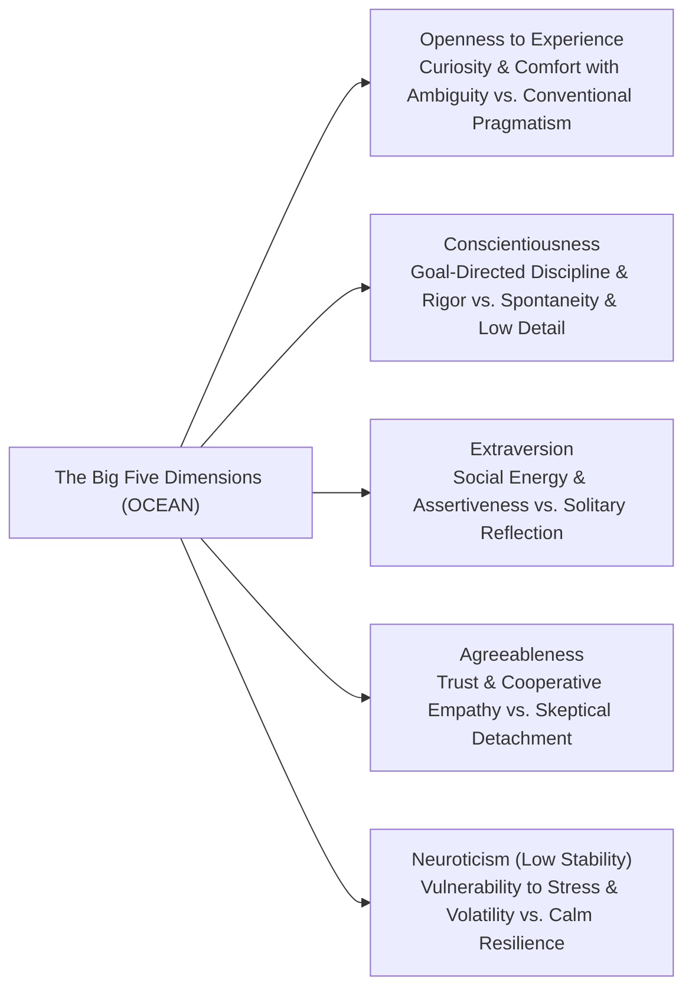
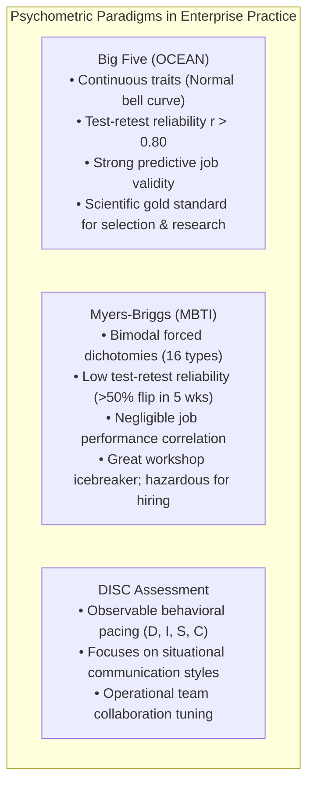

## 📐 Universal Definition & Conceptual Core

The **Big Five Personality Model** (or **Five-Factor Model / OCEAN**) represents the empirical gold standard of contemporary trait psychology and organizational behavior. Derived through decades of cross-cultural lexical analysis and factor analysis by Costa, McCrae, and Goldberg, the framework posits that human personality variance across all societies clusters into five continuous, statistically independent dimensions:

$$\mathbf{P}_{\text{individual}} = \begin{bmatrix} \text{Openness to Experience (O)} \\ \text{Conscientiousness (C)} \\ \text{Extraversion (E)} \\ \text{Agreeableness (A)} \\ \text{Neuroticism / Emotional Stability (N)} \end{bmatrix}$$

Unlike typology instruments that categorize humans into rigid forced-choice buckets (e.g. MBTI types like ENTJ or ISFP), the Five-Factor Model measures personality along continuous Gaussian distributions where most individuals sit near the median (ambiverts).

---

## 🏛️ Empirical Workplace Validity & Diagnostic Dimensions

| Dimension                                 | Low End Spectrum                                       | High End Spectrum                                            | Empirical Organizational Validity                                                                                                           |
| :---------------------------------------- | :----------------------------------------------------- | :----------------------------------------------------------- | :------------------------------------------------------------------------------------------------------------------------------------------ |
| **Openness to Experience**                | Pragmatic, conventional, prefers familiar routines.    | Highly curious, creative, embraces novelty and ambiguity.    | Strongly predicts strategic innovation, adaptability to change, and creative problem solving.                                               |
| **Conscientiousness**                     | Impulsive, spontaneous, disorganized, flexible.        | Disciplined, organized, persistent, methodically thorough.   | **Single strongest psychometric predictor of overall job performance** across occupational categories ($r \approx 0.22 - 0.31, p < 0.001$). |
| **Extraversion**                          | Reserved, reflective, quiet, independent task focus.   | Outgoing, energetic, socially assertive, excitement-seeking. | Predicts sales performance, executive presence, and initial leadership emergence.                                                           |
| **Agreeableness**                         | Competitive, challenging, skeptically detached, blunt. | Empathetic, cooperative, trusting, seeks group harmony.      | Critical for team psychological safety and citizenship behavior; moderate levels optimal for tough executive restructuring decisions.       |
| **Emotional Stability (Low Neuroticism)** | Reactive, anxious, volatile, prone to imposter stress. | Calm, emotionally resilient, steady under acute crisis.      | Predicts performance in volatile, high-stress operational environments (trading floors, turnaround restructuring, emergency operations).    |

---

## ⚖️ Psychometrics: The Big Five vs. MBTI vs. DISC

### The Executive Risk of Typological Profiling

Executives must avoid the trap of **personality pigeonholing**—using personality assessments as an excuse for dysfunctional behavior (_"I am naturally low in Conscientiousness, so I miss deadlines"_). While personality traits reflect enduring baseline preferences, professional maturity demands **behavioral flexibility**: the disciplined capacity to flex outside one's default trait preferences when enterprise governance demands it.

---

## 🏛️ Multi-Disciplinary Lenses Across the MBA Curriculum

### 1. Organizational Behaviour & Individual Differences (MK 1)

- In [[courses/mk1-organizational-behavior-managing-people/week-02/index|MK 1 Week 02]], the Big Five serves as the theoretical anchor distinguishing surface-level demographic diversity from deep-level psychological diversity.
- In [[courses/mk1-organizational-behavior-managing-people/week-02/reading-the-great-divide|Great Teams Are About Personalities, Not Just Skills]], Dave Winsborough and Tomas Chamorro-Premuzic leverage personality profiling to optimize complementary team roles.

### 2. Team Dynamics & Psychological Safety (MK 1 Week 05)

- Trait composition directly dictates team conflict. Teams high in Agreeableness risk sliding into **Area Seram** (prioritizing harmony over performance norms), whereas teams with extreme Conscientiousness paired with low Agreeableness require explicit [[concepts/psychological-safety|Psychological Safety]] protocols to avoid paralyzing friction.

---

## 🔗 Contributing Sessions & References

- Master Lecture: [[courses/mk1-organizational-behavior-managing-people/week-02/index|MK 1 Week 02: Who Am I at Work?]]
- Foundational Reading: [[courses/mk1-organizational-behavior-managing-people/week-02/reading-the-great-divide|Reading: Great Teams Are About Personalities, Not Just Skills]]
- Related Concepts:
  - [[concepts/self-awareness|The Self-Awareness Triad]]
  - [[concepts/psychological-safety|Psychological Safety]]
- Directory: [[concepts/index|Knowledge Matrix]]
