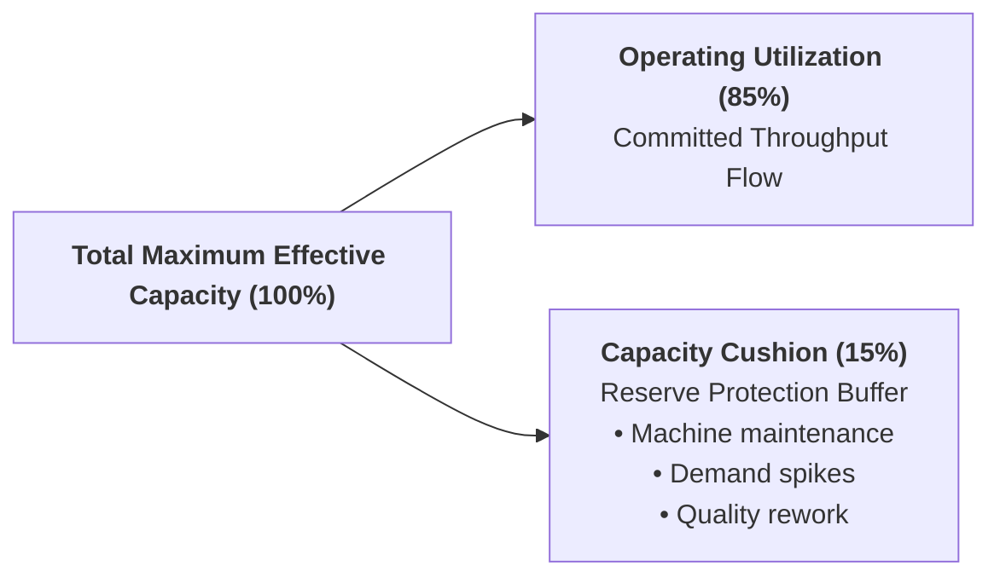
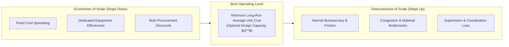

**Strategic Capacity Planning** determines the long-term size, timing, and technological capability of an enterprise's physical, human, and system resources to support its competitive strategy.

A central metric in capacity management is the **Capacity Cushion**—the amount of reserve capacity an organization maintains to handle unexpected demand surges, process breakdowns, and market volatility without deteriorating customer lead times or service quality.

---

## 🏛️ Mathematical Foundations: Utilization & Cushion

Capacity utilization measures the intensity with which an operating asset is deployed relative to its maximum sustainable effective output:

$$\mathbf{\text{Capacity Utilization Rate} = \frac{\text{Actual or Expected Output Rate}}{\text{Maximum Effective Design Capacity}} \times 100\%}$$

The **Capacity Cushion ($C$)** is defined mathematically as the inverse reserve buffer:

$$\mathbf{\text{Capacity Cushion } (C) = 100\% - \text{Capacity Utilization Rate} = \frac{\text{Design Capacity} - \text{Average Demand}}{\text{Design Capacity}} \times 100\%}$$

---

## ⚖️ Strategic Capacity Cushion Policies

Depending on industry characteristics, cost structures, and competitive priorities, organizations adopt one of three distinct cushion stances:

| Cushion Policy                                          | Target Cushion Level | Industry Context & Operational Rationale                                                                                                                                               | Primary Operational Risk                                                                                   |
| :------------------------------------------------------ | :------------------: | :------------------------------------------------------------------------------------------------------------------------------------------------------------------------------------- | :--------------------------------------------------------------------------------------------------------- |
| **Large Cushion** _(Expansionist / Lead)_           |  **$15\% - 30\%$+**  | Fast-growing markets, capital goods with high customer penalty costs, critical public health services, and high customer-contact service systems where waiting queues are intolerable. | High fixed depreciation costs, underutilized assets, and depressed return on invested capital ($ROIC$).    |
| **Moderate Cushion** _(Match Strategy)_             |   **$5\% - 15\%$**   | Mature manufacturing markets, predictable seasonal swings, and multi-product lines capable of shared changeovers.                                                                      | Vulnerability to sudden macro demand shifts; requires accurate forecasting.                                |
| **Small / Negative Cushion** _(Conservative / Lag)_ | **$< 5\%$ or $0\%$** | Capital-intensive continuous process industries (petrochemicals, bulk commodity shipping, paper mills) where fixed assets are exorbitant and marginal unit margins are thin.           | Severe bottlenecking, lost customer orders, catastrophic overtime expenses, and exponential queue blowups. |

> [!CAUTION] The Non-Linear Congestion Trap (Kingman's Formula Insight)
> In service systems—such as container terminals in [[entities/pt-pelabuhan-indonesia|Pelindo TPKS]] or rail junctions in [[entities/pt-kereta-api-indonesia|KAI Manggarai]]—operating with near-zero capacity cushion triggers an **exponential explosion in waiting times**:
> $$\mathbf{W_q \propto \frac{\rho}{1 - \rho} \times \left(\frac{c_a^2 + c_s^2}{2}\right)}$$
> As utilization ($\rho$) moves from $80\%$ to $95\%$ to $99\%$, queue length and dwell delays do not increase linearly; they approach infinity.

---

## 🧭 Economies and Diseconomies of Scale

Strategic capacity decisions involve selecting the optimal scale of facilities to minimize the long-run average cost per unit:

$$\mathbf{\text{LRAC}(Q) = \frac{\text{Total Fixed Capital Costs}(Q) + \text{Total Operating Costs}(Q)}{Q}}$$

- **Economies of Scale**: As production volume increases toward the Best Operating Level ($Q^*$), average unit costs decline because heavy fixed capital investments (e.g., container gantry cranes, rail tracks) are spread over more output units.
- **Diseconomies of Scale**: Operating beyond $Q^*$ forces average unit costs upward due to spatial congestion, excessive queueing, dispatch complexity, and bureaucratic communication breakdown.

---

## 🔗 Cross-Curricular Connections

- **Financial Linkage**: Capacity investments drive capital expenditure (CapEx) schedules, asset turnover ratios, and break-even points in MK2.
- **Queuing & Little's Law**: Intersects directly with [[concepts/queuing-theory|Queuing Theory]] and [[concepts/littles-law|Little's Law: $L = \lambda W$]].
- **Course Anchor**: Applied in [[courses/mk4-operations-supply-chain-management/week-05/index|MK4 Week 05: Strategic Capacity Planning]] and the [[courses/mk4-operations-supply-chain-management/week-05/case-pelindo-tpks-capacity|Pelindo TPKS Semarang Case Dossier]].
