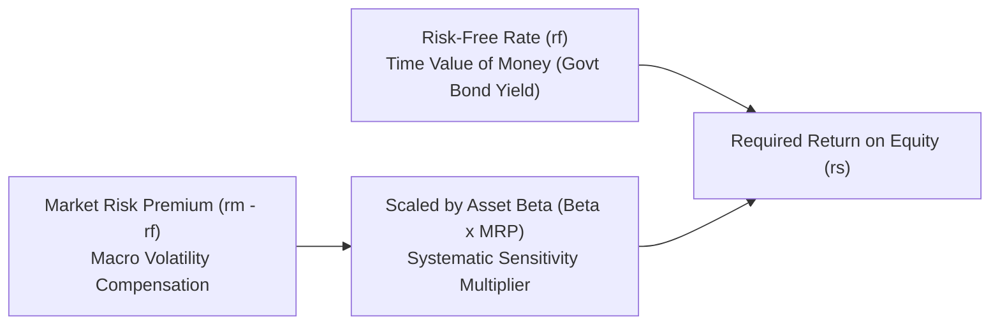

## 📐 Universal Mechanism & Theoretical Foundations

Developed independently by William Sharpe, John Lintner, and Jan Mossin in the 1960s, the **Capital Asset Pricing Model (CAPM)** formalizes the relationship between the systematic risk of an asset and its required rate of return in efficient capital markets.

The central insight of modern portfolio theory is that **capital markets compensate investors solely for bearing systematic (market) risk**, because unsystematic (firm-specific) risk can be eliminated at zero cost through portfolio diversification.

---

## 🔢 Mathematical Formulation & The Security Market Line (SML)

$$\mathbf{r_i = r_{\text{RF}} + \beta_i \times \big(r_M - r_{\text{RF}}\big)}$$

Where:

- $r_i$: Required rate of return on security $i$.
- $r_{\text{RF}}$: Risk-Free Rate (yield on sovereign government bonds with maturity matching the investment horizon, e.g., 10-year Indonesian SUN).
- $r_M$: Expected return on the broad market portfolio (e.g., IDX Composite / IHSG).
- $(r_M - r_{\text{RF}})$: **Market Risk Premium (MRP)** demanded for holding equity assets over risk-free bonds.
- $\beta_i$ (Beta): Metric of systematic co-movement between the asset's returns and the market:

$$\mathbf{\beta_i = \frac{\text{Cov}(r_i, r_M)}{\sigma_M^2} = \frac{\rho_{i,M} \times \sigma_i}{\sigma_M}}$$

---

## 🏢 Beta Regimes Across Economic Sectors

| Beta Classification            | Quantitative Range | Economic Behavior                                                                    | Exemplar Indonesian Industries                                          |
| :----------------------------- | :----------------: | :----------------------------------------------------------------------------------- | :---------------------------------------------------------------------- |
| **Defensive / Low Volatility** |   $\beta < 1.0$    | Returns fluctuate less than the broad market; resilient cash flows during downturns. | Consumer staple foods (Indofood), pharmaceuticals, regulated utilities. |
| **Market Neutral**             |   $\beta = 1.0$    | Moves in direct linear lockstep with the broad market index.                         | Diversified mutual funds, large banking conglomerates (Bank Mandiri).   |
| **Aggressive / Cyclical**      |   $\beta > 1.0$    | Magnifies macroeconomic expansions and contractions; high operational leverage.      | Heavy mining (PTBA), property developers, technology startups.          |

---

## 🔗 Curricular Bridges

- Master Course Note: [[courses/mk2-financial-management-strategy/week-08/index|MK2 Week 08: Risk, Return & Cost of Capital]]
- Practical Problem Set: [[courses/mk2-financial-management-strategy/week-08/assignment-risk-return-wacc|Estimating Sovereign Risk, Beta & Enterprise WACC]]
- Connected Hurdle: [[concepts/weighted-average-cost-of-capital|Weighted Average Cost of Capital (WACC)]]
