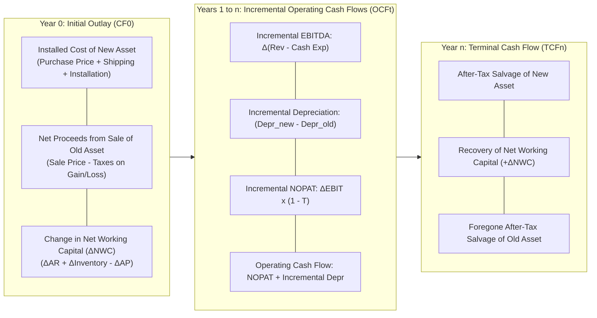

The **Capital Budgeting Cash Flows Architecture** provides the standard quantitative framework in corporate finance for projecting relevant incremental cash flows when evaluating major capital investment or equipment replacement decisions. Rather than relying on accounting net income—which includes non-cash accruals and historical sunken costs—capital budgeting isolates **incremental after-tax cash flows** across three distinct chronological stages: **Initial Outlay ($CF_0$)**, **Operating Cash Flows ($OCF_t$)**, and **Terminal Cash Flow ($TCF_n$)**.

---

## 💡 1. Intuition & Everyday Analogy

Imagine operating a fleet of commercial delivery vans.

- When deciding whether to replace an older diesel van with a high-efficiency electric delivery van, you do not evaluate the total company earnings.
- You ask strictly **incremental** questions:
  1. _What cash leaves my pocket today?_ Buying the new van and charging station, minus whatever cash I get from selling the old van, plus the cash tied up in spare parts inventory (**Initial Outlay**).
  2. _What extra cash enters my pocket each year?_ Fuel savings and reduced maintenance minus driver training, adjusted for corporate taxes and depreciation tax shields (**Incremental Operating Cash Flow**).
  3. _What cash do I recover at the end of year 5?_ Selling the used electric van for salvage and liquidating the spare parts inventory, minus the foregone salvage value of the old van (**Terminal Cash Flow**).

If the present value of those net incremental cash inflows exceeds the initial cash out-of-pocket discounted at your [[concepts/weighted-average-cost-of-capital|Weighted Average Cost of Capital (WACC)]], the replacement creates economic value.

---

## 🔍 2. Prerequisite & Jargon Decoder

| Term                                         | Definitional Meaning in Financial Modeling                                                                                                                     | Common Modeling Error / Trap                                                                                               |
| :------------------------------------------- | :------------------------------------------------------------------------------------------------------------------------------------------------------------- | :------------------------------------------------------------------------------------------------------------------------- |
| **Incremental Cash Flow**                    | The additional net cash flow the firm receives if and only if it undertakes the project: $\Delta CF = CF_{\text{with project}} - CF_{\text{without project}}$. | Including allocated corporate overhead (e.g. CEO salary) that does not change whether the project is accepted or rejected. |
| **Sunk Cost**                                | An expenditure that has already been incurred and cannot be recovered regardless of the project decision.                                                      | Factoring historical R&D or past purchase price into the Go/No-Go decision rule.                                           |
| **Opportunity Cost**                         | The cash flow that could be generated by an asset already owned by the firm if it were not used in the proposed project.                                       | Treating an existing factory floor or old machinery as "free" because the company already owns it.                         |
| **Net Working Capital ($\Delta\text{NWC}$)** | Additional operational liquidity (Accounts Receivable + Inventory $-$ Accounts Payable) required to support higher sales.                                      | Forgetting that NWC tied up at $t=0$ is fully recovered (liquidated) as a cash inflow at $t=n$.                            |
| **Depreciation Tax Shield**                  | The cash savings generated because depreciation is a tax-deductible non-cash expense: $\text{Tax Shield} = \text{Depreciation} \times T$.                      | Subtracting depreciation from cash flows without adding it back to net income.                                             |

---

## 🏛️ 3. Structural Anatomy of the 3-Stage Cash Flow Timeline

### 1. Stage 1: Initial Investment ($CF_0$)

$$
CF_0 = - \Big[ (\text{Cost}_{\text{new}} + \text{Installation}) - (\text{Sale Price}_{\text{old}} - T \times (\text{Sale Price}_{\text{old}} - \text{Book Value}_{\text{old}})) + \Delta\text{NWC} \Big]
$$

### 2. Stage 2: Incremental Operating Cash Flow ($OCF_t$)

$$
OCF_t = (\Delta\text{Revenues} - \Delta\text{Cash Expenses}) \times (1 - T) + (\Delta\text{Depreciation}) \times T
$$

Alternatively expressed as:

$$
OCF_t = \text{NOPAT}_t + \Delta\text{Depreciation}_t = (\Delta\text{EBIT}_t \times (1 - T)) + \Delta\text{Depreciation}_t
$$

### 3. Stage 3: Terminal Cash Flow ($TCF_n$)

$$
TCF_n = (\text{Salvage}_{\text{new}} - T \times (\text{Salvage}_{\text{new}} - \text{BV}_{\text{new}, n})) + \Delta\text{NWC} - (\text{Salvage}_{\text{old}} - T \times (\text{Salvage}_{\text{old}} - \text{BV}_{\text{old}, n}))
$$

---

## 🔢 4. Micro-Numerical Toy Example & Evaluation Rules

### Scenario: The Mini-Widget Replacement

A firm evaluates replacing a legacy cutter with a modern robotic unit:

- New Machine Cost: $\$100{,}000$, Installation: $\$0$. 5-year life, straight-line depreciation to $\$0$ ($\$20{,}000/\text{yr}$).
- Old Machine: Book Value $= \$0$. Can be sold today for $\$20{,}000$.
- Additional NWC required at $t=0$: $\$10{,}000$ (recovered at $t=5$).
- Annual operating cost savings: $\$30{,}000/\text{yr}$.
- Tax rate: $T = 30\%$. WACC: $r = 10\%$.
- Salvage at $t=5$: New machine sold for $\$10{,}000$; Old machine would have zero salvage.

#### Step 1: Initial Outlay ($CF_0$)

- Cost of New: $-\$100{,}000$
- Old Machine Sale: $+\$20{,}000$
- Tax on Old Machine Gain ($30\% \times (\$20{,}000 - \$0)$): $-\$6{,}000$
- After-tax proceeds from Old: $\$14{,}000$
- Working Capital Outflow: $-\$10{,}000$
  $$
  CF_0 = -100{,}000 + 14{,}000 - 10{,}000 = -\$96{,}000
  $$

#### Step 2: Annual Operating Cash Flow ($OCF_{1-5}$)

- Cost Savings (Incremental EBITDA): $+\$30{,}000$
- Incremental Depreciation: $+\$20{,}000$ (New) $- \$0$ (Old) $= \$20{,}000$
- Incremental EBIT: $\$30{,}000 - \$20{,}000 = \$10{,}000$
- Taxes ($30\%$): $-\$3{,}000$
- NOPAT: $\$7{,}000$
- Add back Depreciation: $+\$20{,}000$
  $$
  OCF = \$7{,}000 + \$20{,}000 = \$27{,}000\text{ per year}
  $$

#### Step 3: Terminal Cash Flow ($TCF_5$)

- Salvage New: $\$10{,}000$
- Tax on Gain ($30\% \times (\$10{,}000 - \$0)$): $-\$3{,}000$
- After-tax salvage New: $\$7{,}000$
- Recovery of NWC: $+\$10{,}000$
  $$
  TCF_5 = \$7{,}000 + \$10{,}000 = \$17{,}000
  $$
  Total Year 5 Cash Flow $= OCF_5 + TCF_5 = \$27{,}000 + \$17{,}000 = \$44{,}000$.

#### Step 4: Capital Budgeting Hurdle Evaluation

Timeline of Net Cash Flows:

$$
CF_0 = -\$96{,}000, \quad CF_1 = \$27{,}000, \quad CF_2 = \$27{,}000, \quad CF_3 = \$27{,}000, \quad CF_4 = \$27{,}000, \quad CF_5 = \$44{,}000
$$

Discounting at $r = 10\%$:

$$
\text{NPV} = -96{,}000 + \frac{27{,}000}{1.10} + \frac{27{,}000}{1.10^2} + \frac{27{,}000}{1.10^3} + \frac{27{,}000}{1.10^4} + \frac{44{,}000}{1.10^5}
$$

$$
\text{NPV} = -96{,}000 + 24{,}545 + 22{,}314 + 20{,}285 + 18{,}441 + 27{,}321 = \mathbf{+\$16{,}906}
$$

Decision: $\text{NPV} > 0$ and $\text{IRR} \approx 16.2\% > 10\% \rightarrow$ **Accept Replacement Project**.

---

## 🔗 Related Knowledge Bridges

- Master Curricular Hub: [[courses/mk2-financial-management-strategy/week-09/index|MK2 Week 09: Capital Budgeting Techniques and Cash Flows]]
- Hurdle Rate Theory: [[concepts/weighted-average-cost-of-capital|Weighted Average Cost of Capital (WACC)]]
- Fundamental Mathematics: [[concepts/time-value-of-money|Time Value of Money (TVM)]]
- Cohort Pre-Class Guide: [[courses/mk2-financial-management-strategy/week-09/assignment-capital-budgeting-cash-flows|Capital Budgeting Cash Flows Problem Guide]]
- Return to [[concepts/index|Knowledge Matrix (Concepts Hub)]]
