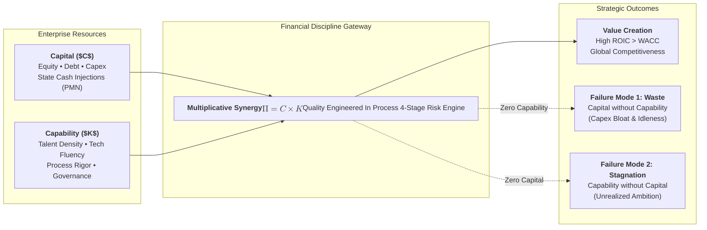
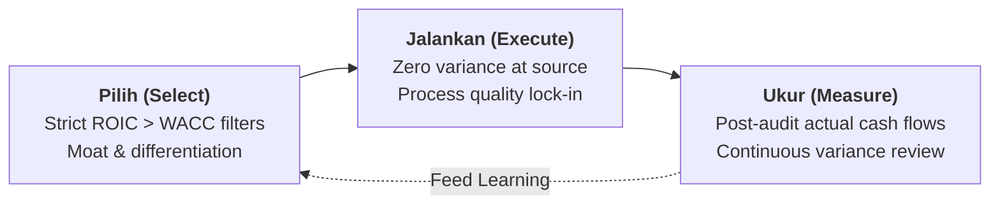
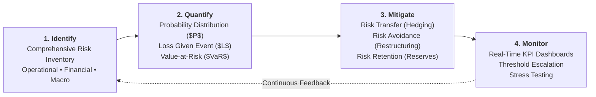

## 💡 First-Principles Intuition & Conceptual Core

In enterprise leadership and public asset stewardship, a dangerous myth persists: that solving large strategic challenges is primarily a question of securing more budget. Executives routinely claim, _"If only the Ministry or the Board granted us Rp 5 trillion in capital injections, we would dominate the market."_

Yet corporate history across global conglomerates and Indonesian state-owned enterprises (BUMN) proves that massive capital infusions frequently evaporate without producing durable competitive advantage.

The **Capital-Capability Synergy Framework**, codified by [[entities/sahala-situmorang|Sahala Tua Paulus Situmorang]] (Managing Director Finance / CFO of [[entities/danantara|PT Danantara Asset Management]]), asserts that sustainable corporate productivity is never an additive sum of balance-sheet resources. It is a strict **multiplicative function**:

$$\mathbf{\text{Productivity} = f(\text{Capital} \times \text{Capability})}$$

### The Two Critical Failure Modes

1. **Capital Without Capability ($\text{Capital} > 0, \text{Capability} \approx 0$)**:
   - _"Modal tanpa kapabilitas hanya menjadi belanja (spending/expense)."_
   - When massive capital is poured into an organization lacking rigorous engineering capabilities, digital execution, or project management discipline, capital does not generate wealth—it merely inflates overhead, accumulates depreciating hardware, and enriches rent-seeking suppliers.
2. **Capability Without Capital ($\text{Capability} > 0, \text{Capital} \approx 0$)**:
   - _"Kapabilitas tanpa modal berhenti sebagai potensi (dormant potential)."_
   - World-class talent, proprietary patents, or brilliant operational blueprints remain theoretical curiosities if enterprise leaders cannot allocate balance-sheet capital or negotiate structured project finance.

---

### 🔑 Prerequisite Concepts & Jargon Decoder

- **Financial Discipline for Non-Finance Leaders**: The strategic mindset where operational, technical, and human resource leaders make daily decisions grounded in cash-flow realities: understanding how their unit generates revenue, consumes working capital, and delivers returns above capital costs.
- **Timing Asymmetry**: A foundational financial axiom stating that a strategically correct operational decision executed at the incorrect market window results in catastrophic capital impairment. Being three years too early in capital deployment is financially indistinguishable from being completely wrong.
- **Process Quality vs. Inspection Quality**: The principle that quality must be structurally engineered into the operational architecture at every workflow milestone, rather than checked retroactively by quality control inspectors or external auditors at the exit gate.
- **Risk Quantification**: The non-negotiable discipline of converting vague qualitative apprehensions into quantified monetary probabilities and loss exposures. Risks that are merely described in prose without mathematical exposure models are never truly managed.
- **The 4-Stage Risk Quantification Census**: While **100.0% ($n=381$)** of the P3MD cohort recognized Return on Investment (ROI) as a mandatory capital threshold, **11.5% ($n=44$)** explicitly emphasized monetary risk quantification, and **21.5% ($n=82$)** anchored operational stability in Total Quality Management (TQM).

---

## 🔄 TQM & The "Pilih – Jalankan – Ukur" Execution Loop

To prevent capital from dissolving into operational waste, financial discipline operationalizes Total Quality Management (TQM) through a closed 3-step loop:

1. **Pilih (Strategic Selection)**: Rejecting projects that fail to establish sustainable economic differentiation (_"Yang penting berbeda meskipun sedikit"_). Resisting the "hold on a second" temptation of expanding without verified execution readiness.
2. **Jalankan (Disciplined Execution)**: Engineering quality directly into operational workflows. Preventing a defect at source costs $1\times$, while fixing an operational failure downstream costs up to $100\times$.
3. **Ukur (Quantitative Measurement)**: Measuring variance against baseline cash-flow projections and holding business unit leaders accountable for capital turnover.

---

## 📐 The 4-Stage Risk Management Engine

Enterprise survival and value compounding require leaders to systematically execute the four-stage risk governance cycle:

### Mechanics & Structural Anatomy

| Stage           | Operational Action                                                                                                                                            | Critical Leadership Test                                                             | Common Failure Mode                                                       |
| :-------------- | :------------------------------------------------------------------------------------------------------------------------------------------------------------ | :----------------------------------------------------------------------------------- | :------------------------------------------------------------------------ | --------------------------------------------------------------------- |
| **1. Identify** | Map every operational, supply chain, credit, and regulatory risk point across the enterprise value chain.                                                     | Candor and [[concepts/psychological-safety                                           | psychological safety]]; unearthing hidden organizational vulnerabilities. | Ignoring "inconvenient" risks due to hierarchy or executive optimism. |
| **2. Quantify** | Assign monetary values: $\text{Expected Loss} = P(\text{Event}) \times \text{Exposure at Default} \times \text{Loss Severity}$.                               | Forcing rigorous mathematical modeling rather than vague color-coded matrices.       | Leaving risks unquantified in descriptive prose (_"risiko sedang"_).      |
| **3. Mitigate** | Select precise capital responses: **Transfer** (insurance, derivatives), **Avoid** (contract renegotiation), or **Retain** (balance-sheet liquidity buffers). | Deciding which residual risks the enterprise has the competitive capability to bear. | Blindly accepting unhedged commodity or foreign exchange exposures.       |
| **4. Monitor**  | Establish dynamic early warning indicators tracked weekly in executive operational reviews.                                                                   | Rapid operational intervention before breach thresholds become irreversible.         | Reviewing static audit binders only once a year.                          |

---

## 🏛️ Multi-Disciplinary Lenses Across the MBA Curriculum

### 1. Capital Strategy & Corporate Valuation (MK 2)

- **Primary Mechanism**: Capital allocation, Economic Value Added (EVA), and Return on Invested Capital (ROIC).
- **Core Insight**: Leaders must recognize where their firm earns economic rent. Discretionary investments are justified only when $\text{ROIC} > \text{WACC}$; deploying capital into businesses returning less than capital costs destroys economic equity regardless of revenue growth.
- _Discussed in_: [[courses/mk2-financial-management-strategy/index|MK 2: Financial Management & Strategy]].

### 2. Operations & Process Quality (MK 4)

- **Primary Mechanism**: Built-in quality, mistake-proofing (Poka-Yoke), and variance reduction.
- **Core Insight**: In manufacturing, energy, and infrastructure logistics, preventing a defect at the process origin costs $1\times$, detecting it at inspection costs $10\times$, and fixing it after customer failure costs $100\times$. Financial discipline is fundamentally operational quality discipline.
- _Discussed in_: [[courses/mk4-operations-supply-chain-management/index|MK 4: Operations & Supply Chain Management]].

### 3. Decision Making & Negotiation (MK 5)

- **Primary Mechanism**: [[concepts/decision-tree-analysis|Decision Tree Analysis]] and Expected Monetary Value (EMV).
- **Core Insight**: Executive choices under extreme uncertainty must evaluate probability-weighted payoffs and worst-case downside exposure, preventing ruin risk.
- _Discussed in_: [[courses/mk5-decision-making-negotiation/index|MK 5: Problem Solving, Decision Making and Negotiation]].

---

## ⚖️ Cross-Functional Boardroom Tensions

- **Commercial Expansion vs. Balance-Sheet Prudence**: Business development directors advocate aggressive debt-funded acquisitions to capture market share, while CFOs demand stress-tested cash-flow covenants and capability proof before releasing capital.
- **Compliance Police vs. Business Enabler**: Finance divisions often fall into bureaucratic friction, becoming "departments of no," instead of partnering with engineering to structure risk-mitigated funding vehicles.

---

## 🚀 Action Learning Project (ALP) Application

> [!TIP] ALP Capstone Guidance for BUMN Consulting Teams
>
> 1. **Conduct a Capital-Capability Audit**: Before proposing a digital transformation or new manufacturing line, evaluate whether the client enterprise possesses the human capital, data infrastructure, and incentive structures required to absorb the technology.
> 2. **Map the 4-Stage Risk Matrix**: Quantify the bottom-line downside of your strategic recommendation under unfavorable currency, interest rate, and commodity price scenarios.
> 3. **Validate Timing Dependencies**: Structure project milestones into gated tranches, conditioning subsequent capital disbursements on verified capability benchmarks.

---

## 🔗 Contributing Sessions & References

- **Rabuan Plenary Notes**:
  - [[rabuan/2026-09-23-sahala-financial-discipline|Rabuan: Memimpin dengan Financial Discipline]] (Sahala Tua Paulus Situmorang)
  - [[rabuan/2026-09-23-syamsul-infrastruktur|Rabuan: Nation in Motion — Infrastruktur Penggerak Pertumbuhan]] (Dipl.-Ing. Syamsul Bachri Yusuf)
- **Entity Profiles**:
  - [[entities/sahala-situmorang|Sahala Tua Paulus Situmorang, S.E.Ak., M.B.A.]]
  - [[entities/danantara|Danantara Indonesia (PT Danantara Asset Management)]]
- **Knowledge Matrix Directory**:
  - Return to **[[concepts/index|Knowledge Matrix (Master Concept Index)]]**
