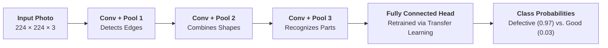

A **Convolutional Neural Network (CNN)** is a specialized deep learning architecture designed for grid-structured data such as images. Instead of connecting every pixel to every neuron, a CNN slides small, reusable **filters** across local pixel neighborhoods to build **feature maps**, compresses spatial dimensions through **pooling**, and often leverages **transfer learning** to adapt pre-trained visual knowledge to domain-specific business tasks with limited labeled photos.

---

## 💡 First-Principles Intuition & Conceptual Core

Think of inspecting 20,000 bread packages a day on a conveyor belt. A standard fully connected neural network tries to memorize every single pixel coordinate independently—if a torn seal shifts two millimeters to the left, it looks like a completely unfamiliar image.

A CNN works like a **sliding magnifying glass**. First, a small $3 \times 3$ stencil glides over the entire photo looking for simple local clues—such as vertical edges—regardless of where they appear. Next layers combine edges into shapes, shapes into packaging parts (seals, labels, dents), and finally a compact classifier outputs the probability that the pack is defective.

### 🔑 Prerequisite Concepts & Jargon Decoder

- **Image as a Number Grid**: A $224 \times 224$ color photo is a 3D matrix of $224 \times 224 \times 3 = 150{,}528$ pixel intensity numbers (Red, Green, and Blue channels).
- **Convolution**: The operation of sliding a small weight matrix (**filter**) step-by-step across an image, multiplying overlapping pixel values by filter weights, and summing them into a single score.
- **Filter (Kernel)**: A small learnable grid of weights (e.g., $3 \times 3 \times 3 = 27$ weights) reused across every position in the image to detect a specific visual pattern such as a vertical edge or corner.
- **Feature Map**: The 2D output grid produced by sliding one filter across an image, highlighting _where_ that specific pattern appears.
- **Pooling (Max Pooling)**: A downsampling step that keeps only the largest value in each small block (e.g., $2 \times 2$), shrinking the feature map by $4\times$ and making detection robust to slight shifts.
- **Transfer Learning**: Taking a CNN already trained on a massive general dataset (e.g., ImageNet's $1.2\text{ million}$ photos across $1{,}000$ classes), freezing its early edge/shape layers, and retraining only the final classification layers on a small business dataset (e.g., a few hundred product photos).
- **Saliency Heatmap & Shortcut Learning**: A visual diagnostic showing which pixels drove the CNN's decision—exposing "shortcut learning" when a model relies on background lighting or camera blur instead of the actual defect.

---

## 📐 Parameter Efficiency & Convolution Math {#cnn-mechanics}

Connecting a $224 \times 224$ RGB image ($150{,}528$ numbers) to just $1{,}000$ neurons in a standard fully connected layer requires:

$$150{,}528 \times 1{,}000 \approx \mathbf{150\text{ million weights}}$$

By contrast, a single $3 \times 3$ color filter uses **weight sharing** across all spatial positions, requiring only:

$$3 \times 3 \times 3 = \mathbf{27\text{ weights per filter}}$$

### ⚙️ 10-Second Micro-Example (Vertical Edge Filter & Max Pooling)

Suppose a $3 \times 3$ vertical-edge filter $K = \begin{bmatrix} -1 & 0 & 1 \\ -1 & 0 & 1 \\ -1 & 0 & 1 \end{bmatrix}$ lands on a $3 \times 3$ image patch $P = \begin{bmatrix} 1 & 1 & 1 \\ 1 & 1 & 1 \\ 1 & 1 & 8 \end{bmatrix}$ (where $1$ is dark background and $8$ is a bright edge):

1. **Convolution Sum (Row by Row)**: $(1 - 1) + (1 - 1) + (8 - 1) = 0 + 0 + 7 = \mathbf{7}$. Where dark pixels on the left meet bright pixels on the right, the filter outputs high positive values (e.g., $21$ on a full vertical edge); on uniform patches, it outputs $0$.
2. **2×2 Max Pooling**: Given a $2 \times 2$ feature map block $\begin{bmatrix} 0 & 7 \\ 0 & 14 \end{bmatrix}$, max pooling keeps $\max(0, 7, 0, 14) = \mathbf{14}$—shrinking a $4 \times 4$ map into a $2 \times 2$ map while preserving the strongest edge signal even if the object shifts by one pixel.

---

## 🏗️ Hierarchical Architecture & Transfer Learning Pipeline {#hierarchical-cnn}

Because early layers learn universal visual primitives (edges, textures, shapes) that apply equally to dogs, cars, or industrial packaging, **transfer learning** lets enterprises achieve high accuracy (such as $96.0\%$ on $400$ test bread-pack photos) using only a few hundred labeled images per class—provided engineers audit **saliency heatmaps** to confirm the model inspects the defect rather than background lighting shortcuts.

---

## 🔗 Related Coursework

- [[courses/mk6-business-analytics/week-11/index|MK6 Week 11: Deep Learning & Neural Network Foundations]]
- [[courses/mk6-business-analytics/week-11/assignment-deep-learning-concept-map|Session 11 Assignment Brief: Deep Learning Concept Map]]
- [[concepts/artificial-neural-network|Artificial Neural Networks & Backpropagation]]
