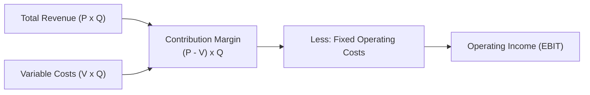

## 📐 Universal Mechanism & Strategic Architecture

**Cost-Volume-Profit (CVP) Analysis** models how operating profits react to changes in product selling prices, sales volume, unit variable costs, and fixed cost structures. CVP provides executive management with a rigorous quantitative framework for setting pricing strategies, determining break-even volume, and evaluating financial operating risk.

---

## 🔢 Mathematical Formulation

### 1. Contribution Margin & Break-Even Point

$$\mathbf{\text{Unit Contribution Margin (CM)}} = P - V \qquad \mathbf{\text{CM Ratio}} = \frac{P - V}{P}$$

$$\mathbf{\text{Break-Even Point in Units (BEP}_{\text{units}}\text{)}} = \frac{\text{Total Fixed Costs}}{P - V} = \frac{\text{Fixed Costs}}{\text{Unit CM}}$$

$$\mathbf{\text{Break-Even Point in Revenue (BEP}_{\text{\$}}\text{)}} = \frac{\text{Total Fixed Costs}}{\text{CM Ratio}}$$

### 2. Target Operating Income Target

$$\mathbf{Q_{\text{target}} = \frac{\text{Fixed Costs} + \text{Target Operating Income}}{\text{Unit CM}}}$$

### 3. Degree of Operating Leverage (DOL)

The multiplier measuring how percentage fluctuations in revenue ripple into percentage swings in operating income:

$$\mathbf{\text{DOL} = \frac{\text{Total Contribution Margin}}{\text{Operating Income (EBIT)}} = \frac{Q \times (P - V)}{[Q \times (P - V)] - \text{Fixed Costs}}}$$

$$\mathbf{\% \Delta \text{Operating Income}} = \text{DOL} \times \% \Delta \text{Sales Revenue}$$

---

## 🏢 Executive Trade-offs: Variable vs Fixed Cost Structures

| Operational Dimension        | Variable-Cost Dominant Structure                             | Fixed-Cost Dominant Structure (Capital-Intensive)                              |
| :--------------------------- | :----------------------------------------------------------- | :----------------------------------------------------------------------------- |
| **Typical Sectors**          | Retail trade, services, outsourced manufacturing             | Heavy mining (PTBA), telecom infrastructure (TLKM), semiconductor fabs         |
| **Break-Even Point**         | **Low BEP**: Low fixed overhead reduces downside loss risk   | **High BEP**: Substantial fixed burden requires massive volume to break even   |
| **Operating Leverage (DOL)** | **Low DOL**: Profit expands gradually with volume            | **High DOL**: Massive profit surge once sales surpass the break-even threshold |
| **Downside Resilience**      | High flexibility; costs drop automatically when demand falls | Vulnerable; fixed depreciation and interest persist during recessions          |

---

## 🔗 Curricular Bridges

- Master Course Note: [[courses/mk2-financial-management-strategy/week-05/index|MK2 Week 05: Cost Analysis, CVP & ABC]]
- Empirical Case Study: [[courses/mk2-financial-management-strategy/week-05/case-alpine-ridge-cvp|Alpine Ridge Outfitters CVP Case]]
- Complementary Framework: [[concepts/activity-based-costing|Activity-Based Costing]]
