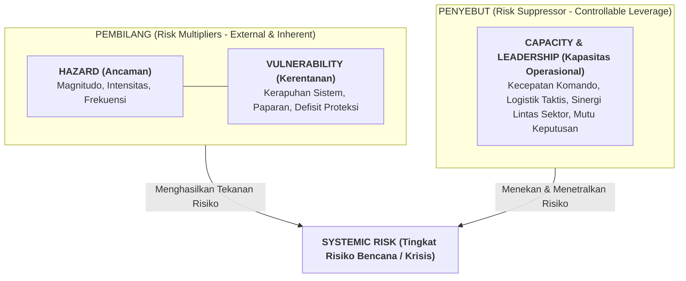
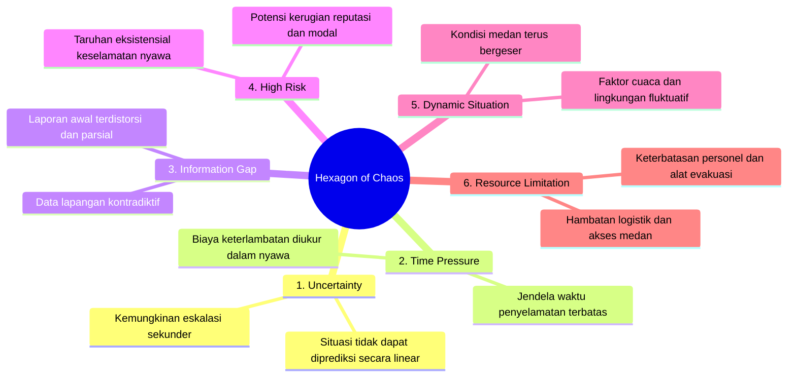
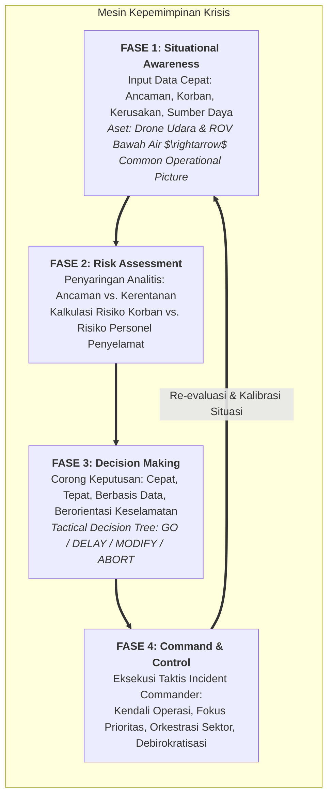
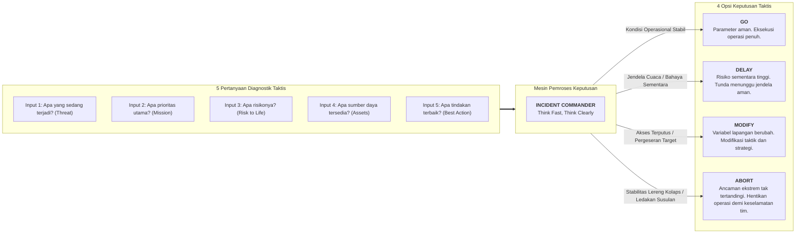
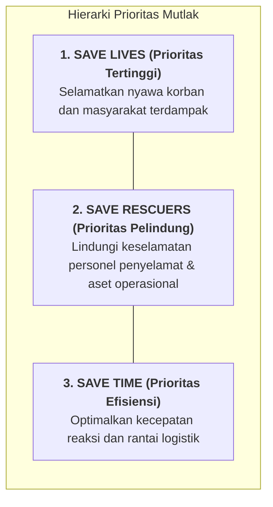
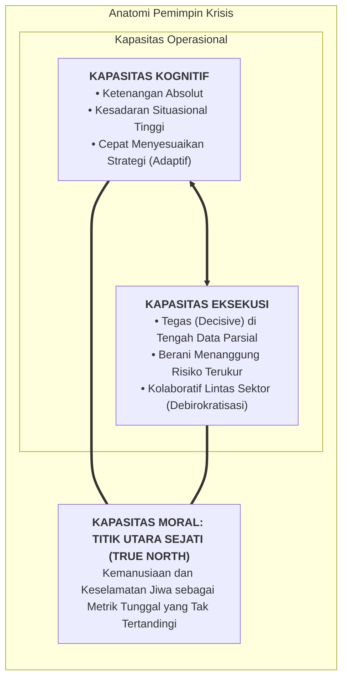
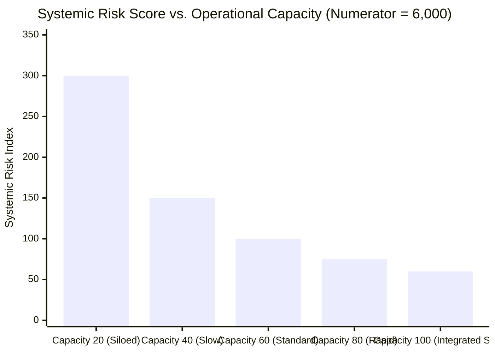

## 1. Executive Summary & Plain-English Intuition

In routine business operations, managers operate within stable environments characterized by predictable market cycles, rich datasets, established standard operating procedures (SOPs), and deliberate review cadences. In sharp contrast, a **crisis**—whether a natural disaster, a sudden catastrophic infrastructure collapse, a severe cyber-breach, or an acute liquidity shock—shatters baseline assumptions. Under extreme conditions, leaders face the **Hexagon of Chaos**: incomplete information, compressed decision windows, escalating systemic risks, dynamic variables, and acute resource shortages.

The **Crisis Leadership Framework** is a systematic operational doctrine for exercising command under extreme uncertainty. First codified in high-stakes search-and-rescue (SAR) and military aviation operations by [[entities/kusworo|Marsdya TNI (Purn) Kusworo, S.E., M.M.]] (Kepala BASARNAS 2023–2026), the framework posits that while technology, capital, and regulatory frameworks facilitate crisis response, **the cognitive, execution, and moral capacity of the leader ultimately determines organizational survival and human safety**.

### Everyday Analogy: The Routine Flight vs. The Dual-Engine Flameout

Consider commercial aviation:

- **Routine Management**: When an aircraft cruises at 35,000 feet on autopilot, the flight crew monitors performance dashboards, conducts fuel balance checks, and logs routine waypoint reports. Every action follows a printed checklist with ample time for deliberative review.
- **Crisis Leadership**: If a flock of birds simultaneously destroys both engines at 3,000 feet over a densely populated metropolis (such as US Airways Flight 1549 on the Hudson River), procedural checklists cannot substitute for rapid operational synthesis. The captain must assess altitude, airspeed, and glide ratio within seconds, establish an unyielding moral priority (save human lives), execute an irrevocable decision (water landing), and orchestrate cabin crew and regional rescue teams.

In corporate and state enterprise governance, a sudden currency devaluation, critical supply chain seizure, or catastrophic facility explosion represents that exact dual-engine flameout. Routine managerial deliberation freezes; crisis leadership must engage.

---

## 2. Prerequisite & Jargon Decoder

To operate the crisis leadership engine without cognitive ambiguity, executives must master several core operational terms:

| Operational Term                     | Military & SAR Definition                                                                                                                                                                                                               | Corporate & BUMN Governance Equivalent                                                                                                                               |
| :----------------------------------- | :-------------------------------------------------------------------------------------------------------------------------------------------------------------------------------------------------------------------------------------- | :------------------------------------------------------------------------------------------------------------------------------------------------------------------- |
| **Hazard ($H$)**                     | A physical event, phenomenon, or human activity that may cause loss of life, injury, property damage, or environmental destruction (e.g., volcanic eruption, flash flood, seismic rupture).                                             | External systemic shocks: sudden regulatory bans, commodity price collapses, geopolitical embargoes, or critical infrastructure outages.                             |
| **Vulnerability ($V$)**              | The conditions determined by physical, social, economic, and environmental factors which increase the susceptibility of a community or system to the impact of hazards (e.g., settlements on steep slopes, fragile wooden dwellings).   | Internal balance-sheet fragilities: excessive short-term foreign debt, single-supplier dependencies, unhedged foreign exchange exposures, or legacy IT architecture. |
| **Capacity ($C$)**                   | The combination of all strengths, attributes, and resources available within an organization or community that can be deployed to reduce disaster risk (e.g., trained SAR personnel, heavy excavation equipment, drone reconnaissance). | Organizational resilience: liquidity cushions, dynamic operational redundancy, rapid-response crisis committees, and decisive leadership command.                    |
| **Situational Awareness (SA)**       | The perception of environmental elements and events with respect to time or space, the comprehension of their meaning, and the projection of their status in the near future.                                                           | Enterprise risk visibility: real-time treasury monitoring, supply chain inventory tracking, and operational field status intelligence.                               |
| **Common Operational Picture (COP)** | A single identical display of relevant operational data shared across all responding echelons and external agencies to ensure unified tactical execution.                                                                               | A unified executive crisis dashboard shared between holding company board members, subsidiary managing directors, regulators, and emergency teams.                   |
| **Hot Zone**                         | The immediate high-danger geographical sector where the acute hazard is active and life-threatening forces persist (e.g., active landslide path, toxic gas plume).                                                                      | The epicenter of operational failure: compromised bank servers during a ransomware attack, a ruptured pipeline valve, or an insolvent operating subsidiary.          |
| **Incident Commander (IC)**          | The designated individual responsible for all incident activities, including the development of strategies and tactics and the ordering and release of operational resources.                                                           | The crisis task force leader with plenary delegated authority to execute decisions without waiting for standard bureaucratic committee approvals.                    |

---

## 3. Structural Anatomy of the Mechanism

### 3.1 The Fundamental Risk Reduction Equation

Disaster management and crisis leadership rest upon a core mathematical relationship derived from United Nations Disaster Relief Organization (UNDRO) principles and operationalized by Basarnas:

$$\text{Risk} = \frac{\text{Hazard} \times \text{Vulnerability}}{\text{Capacity}}$$

Where:

- $\text{Hazard}\ (H)$ represents the severity, magnitude, and probability of the threat.
- $\text{Vulnerability}\ (V)$ represents the exposure and systemic susceptibility of the assets or population.
- $\text{Capacity}\ (C)$ represents the collective operational capability, speed, and leadership effectiveness deployed against the threat.

#### Analytical Mechanics:

1. **The Inherent Multiplier ($H \times V$)**: When an extreme hazard strikes a highly vulnerable target, risk scales quadratically or exponentially. For example, a heavy rainstorm ($H = 4$) striking an uninhabited granite mountain ($V = 1$) yields a modest numerator ($4 \times 1 = 4$). The same storm striking a densely populated, informal hillside gold mine with deforested soil ($V = 9$) generates an explosive numerator ($4 \times 9 = 36$).
2. **The Sovereign Denominator ($C$)**: In the immediate onset of a crisis, an organization cannot instantly alter the external hazard ($H$ is dictated by nature or market forces) nor instantly re-engineer legacy infrastructure ($V$ is structurally fixed in the short term). **The only mathematical lever available to the crisis leader to prevent total catastrophe is to dramatically expand operational and command capacity ($C$) in the denominator.** Doubling capacity cuts realized systemic risk in half.

---

### 3.2 The Hexagon of Chaos

When a crisis erupts, the operating environment is characterized by six simultaneous stressors:

---

### 3.3 The 4-Phase Crisis Leadership Engine

To overcome the Hexagon of Chaos, the leader activates an integrated, continuous command cycle:

---

### 3.4 The Tactical Decision Tree Engine (GO / DELAY / MODIFY / ABORT)

At the heart of Phase 3 lies a rigorous decision tree that synthesizes five diagnostic inputs through a tactical decision processor:

---

### 3.5 The Inverted Pyramid of Absolute Priorities

When multiple demands compete for attention in the heat of an emergency, crisis leadership imposes an immutable priority hierarchy:

> [!IMPORTANT] The Rescuer Safety Axiom
> While saving victims' lives is the ultimate mission, sending rescuers into suicidal conditions without acceptable risk mitigation violates the priority hierarchy. Dead or incapacitated rescuers save no lives; they only increase the casualty count and consume vital extraction capacity.

---

### 3.6 The Three Pillars of a Crisis Leader

---

## 4. Micro-Numerical Toy Example: Risk Suppression Under Fire

To illustrate the mathematical mechanism of the Disaster Equation ($\text{Risk} = \frac{H \times V}{C}$), let us model an emergency response scenario using standardized operational severity indices (scaled from 1 to 100):

### Scenario Setup: Flash Flood Threat to Downstream BUMN Asset

- **Asset**: Critical Hydroelectric Dam & Downstream Worker Township operated by a state enterprise.
- **Hazard ($H$)**: Torrential monsoon rainfall and upstream volcanic debris dam breach $\rightarrow$ Hazard Index $H = 80$.
- **Vulnerability ($V$)**: Worker housing located in the secondary flood basin with single-lane access road $\rightarrow$ Vulnerability Index $V = 75$.
- Baseline Inherent Hazard/Vulnerability Numerator:
  $$\text{Numerator} = H \times V = 80 \times 75 = 6,000$$

### Case A: Bureaucratic Response (Low Capacity)

Under routine managerial governance, local officials await formal inter-agency letters, communications are siloed, and no drone reconnaissance is deployed:

- Response Capacity Index $C_A = 20$ (slow mobilization, fragmented radio contact, incomplete data).
- Realized Systemic Risk:
  $$\text{Risk}_A = \frac{6,000}{20} = 300\quad \text{(Critical Catastrophe Level $\rightarrow$ High Casualties)}$$

### Case B: Crisis Leadership Response (High Capacity via Basarnas Protocol)

The Incident Commander immediately deploys aerial drones to map the upstream surge, activates the Common Operational Picture, coordinates military transport, debureaucratizes decision paths, and orders precautionary mass evacuation:

- Enhanced Capacity Index $C_B = 100$ (drone-guided COP, 15-minute alert cycle, prepositioned rubber boats, active Incident Command System).
- Realized Systemic Risk:
  $$\text{Risk}_B = \frac{6,000}{100} = 60\quad \text{(Managed Operational Risk $\rightarrow$ Zero Fatalities, Controlled Asset Extraction)}$$

**Pedagogical Insight**: The external natural threat ($H = 80$) and the geographical layout ($V = 75$) were identical in both cases. **A five-fold increase in command capacity ($C: 20 \rightarrow 100$) produced an 80% reduction in realized systemic risk.**

---

## 5. Corporate & State Enterprise (BUMN) Applications

While developed in the crucible of national search and rescue, the Crisis Leadership Framework directly translates to state-owned enterprise (BUMN) governance:

| Crisis Leadership Phase            | National SAR Operative Application                                                                                          | BUMN Executive & Boardroom Application                                                                                                                         |
| :--------------------------------- | :-------------------------------------------------------------------------------------------------------------------------- | :------------------------------------------------------------------------------------------------------------------------------------------------------------- |
| **Phase 1: Situational Awareness** | Rapid deployment of aerial drones and underwater ROVs to construct a real-time Common Operational Picture (COP).            | Enterprise telemetry: instant reconciliation of cash positions, foreign exchange exposure, supply chain inventory, and cyber-firewall breach logs.             |
| **Phase 2: Risk Assessment**       | Evaluating the risk of secondary landslides against the survivability of miners trapped in collapsed shafts.                | Stress-testing debt service coverage ratios (DSCR), liquidity burn rates, and vendor solvency under severe macro-shock scenarios.                              |
| **Phase 3: Decision Making**       | Applying the Tactical Decision Tree to order a **MODIFY** or **ABORT** on mountain recovery teams due to lightning hazards. | Boardroom decision to halt non-essential capital expenditure (DELAY), renegotiate syndicated bond covenants (MODIFY), or divest a toxic foreign asset (ABORT). |
| **Phase 4: Command & Control**     | Incident Commander cutting across bureaucratic agency boundaries between TNI, Polri, BPBD, and Basarnas.                    | CEO forming an empowered, flat Crisis Executive Directorate with plenary authority to override standard procurement red tape to maintain vital operations.     |
| **Pillar 3: Moral True North**     | Uncompromising prioritization of human lives over equipment recovery or media public relations.                             | Protecting employee safety and national public interest (Pasal 33 UUD 1945) over short-term quarterly EBITDA margins during systemic disruptions.              |

---

## 6. Directory Lattice & Cross-Curricular Bridges

- **Foundational Masterclass Dossier**: [[rabuan/2026-06-22-kusworo-crisis-leadership|Foundation Plenary: Crisis Leadership — Leading Under Pressure: Decide Fast, Act Right, Save Lives]]
- **Keynote Flag Officer**: [[entities/kusworo|Marsdya TNI (Purn) Kusworo, S.E., M.M.]]
- **Complementary Strategic & Operational Frameworks**:
  - [[concepts/kepner-tregoe-problem-analysis|Kepner-Tregoe Problem Analysis & Decision Making]]
  - [[concepts/growth-mindset|Growth Mindset & Adaptive Capacity]]
  - [[concepts/pso-commercial-duality|PSO vs Commercial Viability Duality]]
  - [[concepts/public-administration-paradigms|Public Administration Paradigms & State Enterprise Governance]]
- **Return to**: [[concepts/index|Concept Directory]] | [[rabuan/index|Rabuan Executive Archive]]
