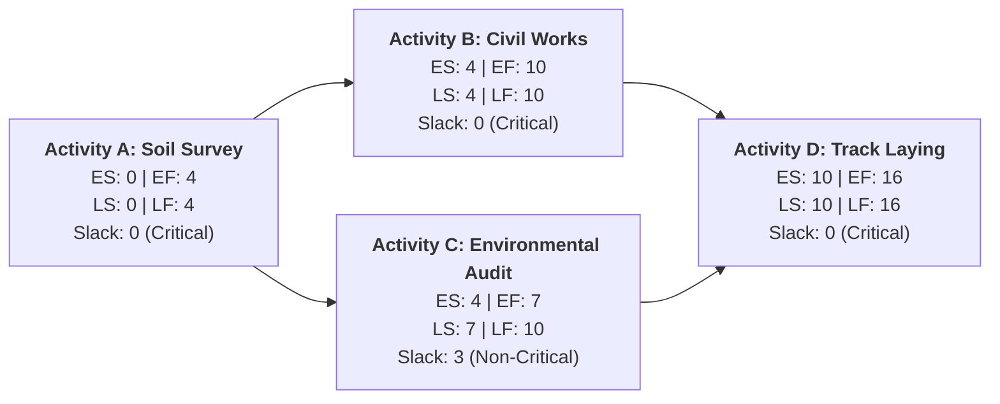
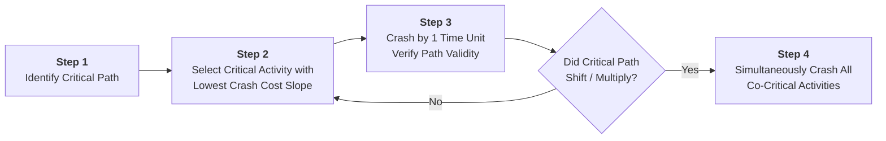

The **Critical Path Method (CPM)** and the **Program Evaluation and Review Technique (PERT)** are foundational quantitative scheduling and network management models used to plan, schedule, monitor, and control complex, multi-activity capital projects.

Developed respectively by DuPont/Remington Rand (CPM, deterministic) and the US Navy Special Projects Office / Booz Allen Hamilton (PERT, probabilistic), the combined methodology identifies the longest continuous sequence of dependent activities that dictates the minimum possible calendar duration of a project.

---

## 🏛️ Activity Network Architecture: Activity-on-Node (AON)

In modern project management, activities are represented as nodes interconnected by precedence relationship arrows:

Each activity node tracks four temporal boundary markers:

| Notation  | Parameter Name | Mathematical Computation Rule                                                                                                                             |
| :-------- | :------------- | :-------------------------------------------------------------------------------------------------------------------------------------------------------- |
| **ES**    | Early Start    | Maximum Early Finish of all immediate predecessors: $ES_j = \max_{i \in \text{Pred}(j)} \{ EF_i \}$ ($ES = 0$ for start activities).                      |
| **EF**    | Early Finish   | Early Start plus expected activity duration: $EF_j = ES_j + t_j$.                                                                                         |
| **LF**    | Late Finish    | Minimum Late Start of all immediate successors: $LF_i = \min_{k \in \text{Succ}(i)} \{ LS_k \}$ ($LF = \text{Project Deadline}$ for terminal activities). |
| **LS**    | Late Start     | Late Finish minus expected activity duration: $LS_i = LF_i - t_i$.                                                                                        |
| **Slack** | Total Float    | Allowed delay without extending project completion: $\text{Slack}_i = LS_i - ES_i = LF_i - EF_i$.                                                         |

> [!IMPORTANT] The Golden Rule of the Critical Path
> An activity is on the **Critical Path** if and only if its Total Slack equals zero:
> $$\mathbf{\text{Critical Condition:}\quad \text{Slack}_i = 0 \iff ES_i = LS_i \quad\text{and}\quad EF_i = LF_i}$$
> Any delay in a critical activity directly delays the final completion date of the entire project.

---

## 📐 Probabilistic PERT Three-Point Estimation

When individual task durations are subject to uncertainty—such as tunneling and land acquisition in mega-projects like [[entities/pt-kereta-cepat-indonesia-china|Whoosh KCIC]]—PERT applies a **Beta Distribution** derived from three estimator points:

1. **Optimistic duration ($a$)**: Minimum duration under ideal, flawless conditions.
2. **Most likely duration ($m$)**: Modal duration under normal, typical conditions.
3. **Pessimistic duration ($b$)**: Maximum duration under severe adverse conditions (excluding acts of God).

### Expected Duration & Variance Formulations

$$\mathbf{\mu_t = \frac{a + 4m + b}{6}} \qquad\qquad \mathbf{\sigma_t^2 = \left(\frac{b - a}{6}\right)^2}$$

For the overall project duration ($T$), assuming independent activities along the critical path:

$$\mathbf{\mu_{\text{project}} = \sum_{i \in \text{Critical}} \mu_i} \qquad\qquad \mathbf{\sigma_{\text{project}} = \sqrt{\sum_{i \in \text{Critical}} \sigma_i^2}}$$

### Probability of Meeting Project Target Date ($D$)

Applying the Central Limit Theorem, the completion probability is evaluated using the standard normal variate ($Z$):

$$\mathbf{Z = \frac{D - \mu_{\text{project}}}{\sigma_{\text{project}}}} \implies P(T \le D) = \Phi(Z)$$

---

## ⚡ Project Crashing: Time-Cost Trade-Offs

When project delivery must be accelerated to meet contractual deadlines or national mandates, managers "crash" activities by injecting overtime, additional crews, or specialized machinery:

$$\mathbf{\text{Crash Cost per Unit of Time (Cost Slope)} = \frac{\text{Crash Cost} - \text{Normal Cost}}{\text{Normal Time} - \text{Crash Time}} = \frac{\Delta C}{\Delta T}}$$

---

## 🔗 Cross-Curricular Connections

- **Capital Budgeting**: Project cash outflows tie to NPV schedules and interest during construction in MK2.
- **Operations Control**: Intersects with [[concepts/toyota-production-system|Lean Operations]] and Eliyahu Goldratt’s Critical Chain Project Management (CCPM buffer theory).
- **Course Anchor**: Applied in [[courses/mk4-operations-supply-chain-management/week-04/index|MK4 Week 04: Project Management]] and the [[courses/mk4-operations-supply-chain-management/week-04/case-whoosh-kcic|Whoosh KCIC Case Dossier]].
