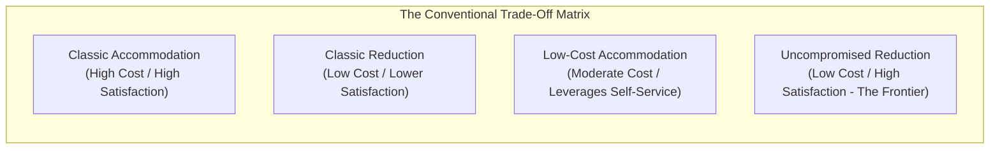
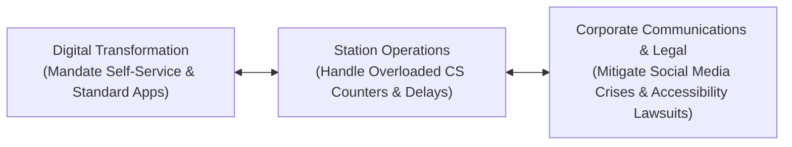

## 📐 Universal Definition & Conceptual Core

**Customer-Introduced Variability** is the operational friction and performance variance injected into a service production system because **the customer actively participates in the creation and delivery of the service**.

Articulated comprehensively by **Frances X. Frei** (Harvard Business Review, 2006, _"Breaking the Trade-Off Between Efficiency and Service"_) and incorporated into standard operations theory by Jacobs & Chase (Chapter 9), this framework challenges the conventional assumption that companies must always choose between **high operational efficiency** (low cost, low accommodation) and **high customer satisfaction** (high cost, high accommodation).

Instead, by diagnosing the precise **type of variability** introduced by customers, operations leaders can deploy targeted management strategies that eliminate operational chaos without compromising customer satisfaction.

```mermaid
flowchart LR
    subgraph Types["5 Types of Customer-Introduced Variability"]
        direction TB
        V1["Type 1: Arrival Variability<br/>(When customers arrive)"]
        V2["Type 2: Request Variability<br/>(What customers ask for)"]
        V3["Type 3: Capability Variability<br/>(What customers are able to do)"]
        V4["Type 4: Effort Variability<br/>(How much effort customers exert)"]
        V5["Type 5: Subjective Preference Variability<br/>(How customers interpret service)"]
    end

    subgraph Strategies["4 Strategic Accommodation Architectures"]
        direction TB
        S1["Classic Accommodation<br/>(Absorb variability with extra labor & buffers)"]
        S2["Low-Cost Accommodation<br/>(Leverage low-cost labor or customer self-service)"]
        S3["Classic Reduction<br/>(Force customers into standardized molds via rules)"]
        S4["Uncompromised Reduction<br/>(Design procedures so variability causes no harm)"]
    end

    Types ==>|"Operational Response Strategy"| Strategies
```

---

## 🔍 The Five Dimensions of Customer Variability

| Variability Dimension         | Root Cause & Definition                                                                                                             | Enterprise Challenge                                                                                                     | Classic Industry Example                                                                                              |
| :---------------------------- | :---------------------------------------------------------------------------------------------------------------------------------- | :----------------------------------------------------------------------------------------------------------------------- | :-------------------------------------------------------------------------------------------------------------------- |
| **1. Arrival Variability**    | Customers do not arrive at uniform, predictable intervals; demand surges during peak seasons or specific hours.                     | Overloading server capacity, long queue buildup, idle capacity during troughs.                                           | Morning rush hour at railway stations; lunch rushes at restaurants; holiday flight bookings.                          |
| **2. Request Variability**    | Customers demand customized, idiosyncratic service solutions rather than standard packages.                                         | Highly unpredictable transaction times; inability to standardize operating workflows.                                    | Hotel guests requesting specific room views or customized amenities; bank clients with multi-currency loans.          |
| **3. Capability Variability** | Customers differ drastically in their knowledge, physical dexterity, digital literacy, and skill to perform required service tasks. | Slow transaction cycles; frequent system errors; customer frustration during self-service.                               | Elderly passengers navigating smartphone boarding apps; patients struggling to describe medical symptoms.             |
| **4. Effort Variability**     | Customers vary in how much effort and diligence they apply to completing self-service duties.                                       | Incomplete forms; abandoned shopping carts; neglected return of equipment.                                               | Shoppers leaving grocery carts scattered in parking lots; passengers forgetting identification documents.             |
| **5. Subjective Preference**  | Customers apply different emotional, personal, and cultural criteria to evaluate the same objective service encounter.              | One customer perceives staff friendliness as professional warmth, while another views it as intrusive or unprofessional. | Direct eye contact, informal greetings, or automated kiosk interactions perceived differently by demographic cohorts. |

---

## 🛠️ The Four Strategic Management Approaches

Frei classifies organizational responses into four archetypal strategies:

### 1. Classic Accommodation (High Cost, High Service)

- **Mechanism**: The company absorbs customer variability by deploying surplus frontline staff, buffering slack capacity, and cross-training workers.
- **Trade-Off**: Outstanding customer experience, but significantly inflated operating expenditure ($OPEX$).
- _Example_: High-end private banks deploying personal relationship managers to handle all paperwork for wealthy clients.

### 2. Low-Cost Accommodation (Low Cost, High Service)

- **Mechanism**: The company accommodates customer diversity by utilizing low-cost labor, offshore call centers, or customer self-service automation.
- **Trade-Off**: Accommodates variation without ballooning payroll, but requires clear user interfaces and training.
- _Example_: Fast-food chains using self-service touchscreen kiosks with multi-language support.

### 3. Classic Reduction (Low Cost, Compromised Service)

- **Mechanism**: The company forces customers into narrow, standardized molds through strict reservation windows, rigid menus, financial penalties, or service restrictions.
- **Trade-Off**: Drastically cuts operating costs and stabilizes capacity planning, but alienates customers who value flexibility.
- _Example_: Budget airlines charging steep fees for luggage or boarding pass printing at the airport.

### 4. Uncompromised Reduction (Low Cost, High Service — The Efficiency Frontier)

- **Mechanism**: The company re-engineers operating procedures and customer environments using deep customer behavioral insight so that **customer variability is rendered harmless without penalizing the customer**.
- **Trade-Off**: Requires sophisticated service design, behavioural nudges, and intelligent automation.
- _Example_: Redbox charging automated per-day rental fees so DVD return effort is self-regulating; airlines sending proactive WhatsApp boarding reminders with 1-click boarding pass downloads.

---

## 🚉 The Managerial Crucible: Capability Variability in Public Transport

In large-scale public transportation systems—exemplified by **PT Kereta Api Indonesia (Persero)**:

> [!WARNING] The Peak-Hour Capability Spike
> While average travelers may be digitally literate daily commuters, **holiday peak travel (Eid al-Fitr, year-end holidays) systematically concentrates infrequent, rural, and elderly passengers**.
>
> When KAI introduces biometric Face Recognition Boarding Gates, this cohort encounters an acute **capability barrier**:
>
> - Their physical e-KTP microchips may be degraded or unreadable.
> - They may not own a modern smartphone or understand the Access by KAI registration flow.
> - They travel with extended family, requiring manual assistance.
>
> **Operational Consequence**: If the process design forces unregistered passengers into an on-site customer service queue at 6:00 AM on departure day, **capability variability instantly paralyzes station throughput**, creating massive passenger backlogs regardless of how fast the automated gates operate.

---

## 🏛️ Multi-Disciplinary Lenses Across the MBA Curriculum

### 1. Operations & Supply Chain Management (MK 4)

- **Primary Mechanism**: Queuing dynamics, stochastic arrival models, and bottleneck capacity buffering.
- **Core Insight**: Service processes cannot maintain high capacity utilization ($>85\%$) without queuing explosions when arrival and service-time variability are high (Kingman's formula).
- _Discussed in_: [[courses/mk4-operations-supply-chain-management/week-06/index|MK 4 Week 06 (Process Design & Analysis)]].

### 2. Marketing Management (MK 3)

- **Primary Mechanism**: Customer segment differentiation and service accessibility.
- **Core Insight**: Failing to accommodate capability differences damages brand equity and triggers public backlash on social media, especially for public utilities and state-owned enterprises.

### 3. Organizational Behaviour & Human Capital (MK 1)

- **Primary Mechanism**: Frontline staff emotional resilience and empathy training.
- **Core Insight**: Service workers dealing with capability-constrained customers require high emotional intelligence, patience, and diagnostic problem-solving skills rather than rigid procedural enforcement.

---

## ⚖️ Cross-Functional Boardroom Tensions

1. **Digital Standardization vs. Inclusivity**:
   Digital teams push for 100% self-service mobile app adoption to eliminate ticket counter costs, whereas Operations must manage the chaos when non-tech-savvy passengers show up at the station without credentials.
2. **Punitive Enforcement vs. Customer Empathy**:
   Strict policies (e.g., admitting unregistered passengers only 10 minutes before departure) spark immediate public outrage, viral social media crises, and regulatory scrutiny.

---

## 🚀 Action Learning Project (ALP) Application

> [!TIP] ALP Capstone Alignment: De-risking Customer Variability in BUMN Services
> When designing digital transformation roadmaps for partner BUMNs (such as **KAI**, **Bank Mandiri**, **PLN**, or **Pos Indonesia**):
>
> 1. **Categorize the Inflow**: Audit the customer base across the 5 variability types. What percentage of users represent high capability variability (elderly, low digital literacy, disabled)?
> 2. **Implement Uncompromised Reduction**: How can the onboarding process be simplified (e.g., optical character recognition, automated bank verification, assisted community kiosks) so capability limitations do not bottleneck transactions?
> 3. **Preserve a Dignified Low-Cost Accommodation Path**: Never treat the manual fallback path as an unstaffed afterthought; design it with explicit capacity standards and dignified service levels.

---

## 🔗 Contributing Sessions & References

- Master Lecture Note: [[courses/mk4-operations-supply-chain-management/week-06/index|MK 4 Week 06: Process Design, Analysis & Little's Law]]
- Case Study: [[courses/mk4-operations-supply-chain-management/week-06/case-kai-gambir-gate|PT Kereta Api Indonesia (Persero): One Second at the Gambir Gate]]
- Theorist Profile: [[entities/richard-b-chase|Richard B. Chase]]
- Related Concepts:
  - [[concepts/service-blueprinting|Service Blueprinting]]
  - [[concepts/service-system-design-matrix|Service-System Design Matrix]]
  - [[concepts/customer-order-decoupling-point|Customer Order Decoupling Point]]
- Master Hub: [[concepts/index|Knowledge Matrix]]
