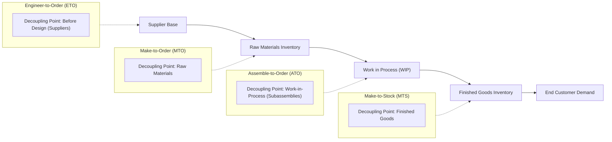

## 📐 Universal Definition & Conceptual Core

The **Customer Order Decoupling Point (CODP)**—often termed the **order penetration point**—is the specific location within a supply chain or operational process where **independent, forecast-driven activities** are separated from **customer-driven, order-specific activities**.

At the decoupling point, inventory (in manufacturing) or pre-processed information assets (in services) are positioned to act as a buffer, enabling upstream operations to execute smoothly on forecast without waiting for individual customer demand, while downstream operations fulfill customer orders with customized speed.

### The Four Classic Production Environments

As formulated by Jacobs & Chase (Chapter 7), the strategic positioning of the decoupling point establishes four primary operating archetypes:

| Production Archetype        | Location of Decoupling Point         | Operational Characteristics                                                                                                      | Real-World Example                                                |
| :-------------------------- | :----------------------------------- | :------------------------------------------------------------------------------------------------------------------------------- | :---------------------------------------------------------------- |
| **Make-to-Stock (MTS)**     | Finished Goods Inventory             | Production is 100% forecast-driven; customer served immediately off the shelf; highest inventory holding cost.                   | Packaged foods, retail clothing, consumer electronics             |
| **Assemble-to-Order (ATO)** | Standard Subassembly Modules (WIP)   | Subassemblies built to forecast; final assembly triggered by specific order; combines fast delivery with broad customization.    | Dell personal computers (17 modules yield 384 configurations)     |
| **Make-to-Order (MTO)**     | Raw Materials Inventory              | Fabrication begins only after order receipt; customized dimensions; longer customer wait time; minimal finished goods inventory. | Commercial aircraft (Boeing, Airbus), custom industrial machinery |
| **Engineer-to-Order (ETO)** | Supplier Base / Engineering Capacity | Product design and engineering specifications created jointly with customer prior to procurement and manufacturing.              | Satellite manufacturing (Lockheed Martin), bridge construction    |

### The Strategic Trade-Off

The positioning of the decoupling point represents an inevitable strategic trade-off:

$$\mathbf{\text{Closer to Customer}} \implies \uparrow \text{Response Speed} \quad \text{and} \quad \uparrow \text{Inventory Carrying \& Conversion Cost}$$

$$\mathbf{\text{Further Upstream}} \implies \downarrow \text{Capital Tied Up in Stock} \quad \text{and} \quad \uparrow \text{Customer Lead Time}$$

Moving the decoupling point downstream shortens lead time but dramatically inflates inventory risk, because finished goods carry the cumulative cost of raw materials, labor, and machine processing. Moving it upstream trades delivery speed for financial flexibility.

---

## 🔄 Decoupling-Point Logic Applied to Service Systems

While classical operations literature defines the decoupling point in terms of physical inventory buffers, modern service operations extend this logic to **informational and credential buffers**:

> [!NOTE] The Informational Decoupling Point in Services
> Unlike physical products, **service capacity is perishable**—an empty train seat, hotel bed, or consultant hour cannot be stored today and sold tomorrow.
>
> However, **customer identity, account registration, and prerequisite documentation CAN be buffered.**

$$\mathbf{\text{Identity Enrollment}} \longrightarrow \left[ \begin{array}{c} \textbf{Verified Biometric} \\ \textbf{Record (Buffer)} \end{array} \right] \longrightarrow \mathbf{\text{Real-Time High-Speed Verification}}$$

In service architectures (such as [[entities/pt-kereta-api-indonesia|PT Kereta Api Indonesia's]] Face Recognition Boarding Gate):

1. **Decoupled Operation (Upstream / Off-Peak)**: The passenger registers their biometric profile via a mobile application days or weeks before travel. Identity enrollment is completed asynchronously and buffered in the database below the line of visibility.
2. **Coupled Operation (Downstream / Station Peak)**: The passenger passes through the automated gate in **1 second**. The physical station encounter is decoupled from the complex data-capture process.
3. **The System Failure**: When an unregistered passenger arrives at the station during holiday peak hours, the decoupling buffer collapses. The slow, variable registration process is forced into the live station encounter, turning the customer service desk into an acute bottleneck.

---

## 🏛️ Multi-Disciplinary Lenses Across the MBA Curriculum

### 1. Operations & Supply Chain Management (MK 4)

- **Primary Mechanism**: Buffering variability and decoupling cycle times between sequential workstations.
- **Core Insight**: Upstream uncoupling protects downstream high-throughput assets from demand spikes and customer capability variability.
- _Discussed in_: [[courses/mk4-operations-supply-chain-management/week-06/index|MK 4 Week 06 (Process Design & Analysis)]].

### 2. Financial Management & Strategy (MK 2)

- **Primary Mechanism**: Working capital optimization and cash-conversion-cycle acceleration.
- **Core Insight**: Pushing the CODP from Make-to-Stock to Assemble-to-Order reduces inventory carrying costs, mitigates obsolescence write-downs, and frees up operating cash flow.

### 3. Marketing Management (MK 3)

- **Primary Mechanism**: Order-to-delivery lead time competitive advantage.
- **Core Insight**: Customers evaluate brand value through order fulfillment responsiveness. Positioning the decoupling point must match the customer's tolerance for lead time (the $P:D$ ratio).

---

## ⚖️ Cross-Functional Boardroom Tensions

1. **Lead Time vs. Working Capital**:
   Commercial teams lobby for finished goods stock at every regional distribution center (MTS) to capture every sale, while Finance mandates just-in-time postponement (MTO) to minimize balance-sheet exposure.
2. **Standardization vs. Mass Customization**:
   Operations prefers rigid Make-to-Stock lines for maximum equipment utilization; Marketing seeks modular Assemble-to-Order configurations to satisfy niche market segments.
3. **Digital Self-Service vs. On-Site Friction**:
   In enterprise services, corporate boards mandate automated boarding gates without realizing that unless registration is decoupled into digital pre-travel channels, customer service counters will experience catastrophic queue collapse during demand surges.

---

## 🚀 Action Learning Project (ALP) Application

> [!TIP] ALP Capstone Alignment: BUMN Supply Chain & Process Postponement
> In enterprise capstone projects across Indonesian BUMNs:
>
> - **Industrial & Manufacturing (Krakatau Steel, PTPN, Pupuk Indonesia)**: Audit where raw commodity processing can be decoupled from specialized packaging or chemical blending (postponement strategy).
> - **Logistics & Ports (Pelindo, KAI Logistik)**: Evaluate container yard buffering to decouple maritime berth scheduling from domestic rail and trucking dispatch.
> - **Service & Digital Platforms (Bank Mandiri, Telkomsel)**: Audit customer onboarding workflows to decouple KYC verification from the transactional checkout path.

---

## 🔗 Contributing Sessions & References

- Master Lecture Note: [[courses/mk4-operations-supply-chain-management/week-06/index|MK 4 Week 06: Process Design, Analysis & Little's Law]]
- Case Study: [[courses/mk4-operations-supply-chain-management/week-06/case-kai-gambir-gate|PT Kereta Api Indonesia (Persero): One Second at the Gambir Gate]]
- Theorist Profile: [[entities/richard-b-chase|Richard B. Chase]]
- Related Concepts:
  - [[concepts/service-blueprinting|Service Blueprinting]]
  - [[concepts/service-system-design-matrix|Service-System Design Matrix]]
  - [[concepts/littles-law|Little's Law]]
- Master Hub: [[concepts/index|Knowledge Matrix]]
