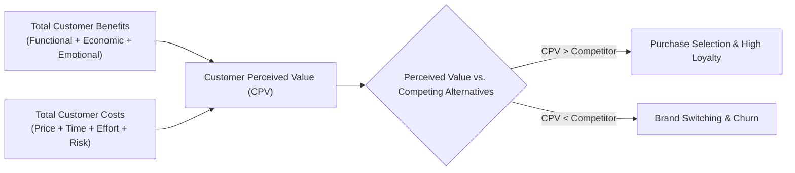

## 📐 Universal Definition & Conceptual Core

**Customer Perceived Value (CPV)** is the customer's evaluation of the difference between all the benefits and all the costs of a market offering relative to perceived alternatives. It represents the foundational cornerstone of modern customer-value driven marketing management.

Consumers and enterprise buyers do not judge products based purely on objective engineering specifications or cost of manufacturing; rather, they evaluate the complete bundle of economic, functional, emotional, and social utilities weighed against the total monetary and non-monetary outlays required to obtain and use the offering.

$$\mathbf{CPV = Total\ Customer\ Value\ (TCV) - Total\ Customer\ Cost\ (TCC)}$$

Where:

- $\mathbf{Total\ Customer\ Value} = V_{\text{functional}} + V_{\text{economic}} + V_{\text{emotional}} + V_{\text{social}}$
- $\mathbf{Total\ Customer\ Cost} = C_{\text{monetary}} + C_{\text{time}} + C_{\text{energy}} + C_{\text{psychological\ risk}}$

---

## 🔬 Longitudinal Value Dynamics: SaaS Unit Economics & B2B Contracts

In recurring revenue and long-cycle enterprise relationships, CPV shifts from a one-time transaction calculation into **Customer Lifetime Value ($\text{CLV}$)** and **Net Value Retention**:

$$\mathbf{\text{CLV} = \frac{\text{Average Monthly Recurring Revenue (ARPU)} \times \text{Gross Margin \%}}{\text{Monthly Churn Rate}}}$$

$$\mathbf{\text{LTV : CAC Ratio} = \frac{\text{Customer Lifetime Value}}{\text{Customer Acquisition Cost}} \ge 3.0\times \text{ (Institutional Benchmark)}}$$

- When $\text{CPV}$ is negative or declining post-onboarding, **Customer Churn increases**, collapsing $\text{CLV}$ and rendering acquisition marketing unsustainable.
- In **B2B Industrial Markets** (e.g., [[concepts/b2b-buying-center|EPC Contracting]]), $C_{\text{psychological\ risk}}$ represents the risk of contractor bankruptcy, delay penalties, and regulatory audits. Total Customer Cost is dominated by execution risk rather than initial tender price.

---

## 🏛️ Multi-Disciplinary Lenses Across the MBA Curriculum

### 1. Marketing Management (MK3)

- **Consumer Goods (Week 01 & Week 08):** In low-income mass markets (such as Northeast Brazil or rural Indonesia), CPV is dominated by **risk elimination** and **sensory feedback** (e.g., persistent fragrance in laundry detergent). In [[courses/mk3-marketing-management/week-08/index|MK3 Week 08]] (PT Kereta Api Indonesia), CPV shifts as passenger stations eliminate physical grime and ticket scalping friction.
- **SaaS & B2B Expansion (Week 04 & Week 06):** In [[courses/mk3-marketing-management/week-06/index|MK3 Week 06]] (HubSpot Inbound Marketing), micro-enterprises (_Owner Ollie_) experience low CPV because they lack the technical staff to utilize advanced Web 2.0 tools, creating chronic churn. Conversely, mid-market firms (_Marketing Mary_) extract massive functional CPV, justifying premium software tiers. In [[courses/mk3-marketing-management/week-04/index|MK3 Week 04]] (WIKA EPC), clients evaluate contractor CPV through balance sheet staying power and engineering track records.

### 2. Operations & Supply Chain Management (MK4)

- **Primary Mechanism:** The service blueprint and customer touchpoints dictate the non-monetary costs ($C_{\text{time}}$ and $C_{\text{energy}}$). Process bottlenecks directly degrade perceived value even if the core product is high quality.
- _Discussed in:_ [[courses/mk4-operations-supply-chain-management/week-06/index|MK4 Week 06: Process Design & Analysis]].

### 3. Financial Management & Strategy (MK2)

- **Primary Mechanism:** Sustainable growth rates and working capital efficiency are constrained by customer payment terms. A high CPV offering commands pricing power, accelerating cash collection cycles and expanding operating margins.

---

## ⚖️ Cross-Functional Boardroom Tensions

In executive committees, CPV frequently triggers friction between commercial and financial leaders:

- **Marketing vs. Finance:** Marketing seeks to augment customer value through enhanced packaging, high-grade fragrance, and generous service guarantees. Finance views these additions as direct cost-of-goods-sold (COGS) inflators that compress gross margins unless offset by an immediate price premium.
- **The Value Seeker Dilemma:** In bottom-of-the-pyramid markets, cutting quality to reduce shelf price often backfires. Impoverished consumers are extreme value seekers whose scarce funds cannot tolerate product failure.

---

## 🚀 Action Learning Project (ALP) Application

> [!TIP] ALP Capstone Alignment
> When consulting for Indonesian State-Owned Enterprises (BUMNs) such as PT Kereta Api Indonesia (Persero) or PT Bank Mandiri (Persero) Tbk, teams must map the full CPV equation for Tier 2 and Tier 3 citizen users. Identify non-monetary friction points (registration delays, queues, complex apps) that undermine government digital transformation initiatives despite heavily subsidized pricing.

---

## 🔗 Contributing Sessions & References

- Lecture Notes:
  - [[courses/mk3-marketing-management/week-01/index|MK3 Week 01: Creating Customer Value & Engagement]]
  - [[courses/mk3-marketing-management/week-06/index|MK3 Week 06: Market Segmentation & Target Market Selection]]
  - [[courses/mk3-marketing-management/week-08/index|MK3 Week 08: Services Marketing & STP Strategy]]
- Case Satellites:
  - [[courses/mk3-marketing-management/week-01/case-unilever-indonesia-2026|Unilever Indonesia Case]]
  - [[courses/mk3-marketing-management/week-04/case-wika-epc-champion|WIKA EPC Champion Program Case]]
  - [[courses/mk3-marketing-management/week-06/case-hubspot-inbound-indonesia|HubSpot Inbound Marketing Case]]
- Hub Directory: [[concepts/index|Knowledge Matrix]]
