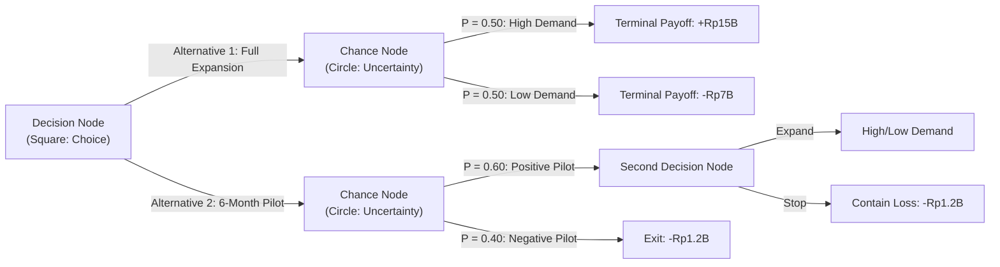
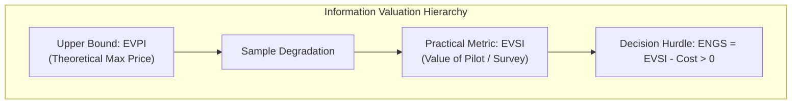

## 🧭 Executive Overview

**Decision Tree Analysis (DTA)** is a graphical and mathematical framework for structuring, evaluating, and optimizing sequential decision problems under risk and uncertainty (Raiffa, 1968; Goodwin & Wright, 2000).

A decision tree maps the chronological sequence of choices controlled by the decision maker and random events controlled by nature. By systematically computing **Expected Monetary Value (EMV)** or expected utility through **backward induction (rollback)**, decision makers identify the optimal policy path while explicitly valuing risk-mitigation options such as market pilots, exploratory testing, and staged capital deployment.

---

## 🧱 Anatomy of a Decision Tree

Decision trees are composed of standard chronological elements progressing from left (root decision) to right (terminal outcomes):

| Element           |      Graphic Symbol      | Meaning & Operational Rules                                                        | Mathematical Processing                                                                                         |
| :---------------- | :----------------------: | :--------------------------------------------------------------------------------- | :-------------------------------------------------------------------------------------------------------------- |
| **Decision Node** |    $\square$ (Square)    | Point of strategic choice directly controlled by the decision maker.               | **Maximization**: Select the branch yielding highest expected value: $\max_k \left\{ \mathbb{E}[V_k] \right\}$. |
| **Chance Node**   |   $\bigcirc$ (Circle)    | State of Nature (SON) governed by external probability distributions.              | **Expectation**: Compute probability-weighted average: $\mathbb{E}[V] = \sum p_i \cdot V_i$.                    |
| **Branch**        | $\longrightarrow$ (Line) | Alternative action pathway or mutually exclusive state realization.                | Associated with either an immediate expenditure or conditional probability $P(\theta_j \mid \cdot)$.            |
| **Terminal Node** |   $\triangle$ / Value    | Cumulative net payoff resulting from the specific historical sequence of branches. | Net cash flow, NPV, or multi-attribute utility: $V = \text{Revenues} - \text{Total Costs}$.                     |

---

## 🧮 Mathematical Engine: The Rollback Algorithm (Backward Induction)

Evaluation proceeds strictly from right to left (**backward induction**), folding back the tree from terminal endpoints to the initial root:

### 1. Folding Back Chance Nodes

At any chance node $j$ with $m$ mutually exclusive states of nature $\theta_1, \theta_2, \dots, \theta_m$, compute the Expected Monetary Value:

$$\text{EMV}(j) = \sum_{k=1}^{m} P(\theta_k) \cdot V(j, \theta_k) \quad \text{where } \sum_{k=1}^{m} P(\theta_k) = 1.0$$

### 2. Pruning Decision Nodes

At any decision node $i$ with $r$ alternative choices $A_1, A_2, \dots, A_r$, select the branch that maximizes net expected return and prune inferior branches:

$$\text{EMV}^*(i) = \max_{k \in \{1, \dots, r\}} \left\{ \text{EMV}(A_k) - C(A_k) \right\}$$

Where $C(A_k)$ is the direct capital expenditure or testing cost incurred to activate alternative $A_k$.

---

## 💎 Valuation of Information: EVPI and EVSI

A vital executive capability of decision trees is calculating the maximum price an organization should pay for research, market tests, or consultants.

### 1. Expected Value of Perfect Information (EVPI)

EVPI establishes the theoretical upper ceiling on information value by assuming uncertainty can be eliminated entirely before choosing:

$$\text{EVPI} = \text{EMV}_{\text{with Perfect Information}} - \text{EMV}_{\text{without Information}}$$

Where:

$$\text{EMV}_{\text{with Perfect Information}} = \sum_{k=1}^{m} P(\theta_k) \cdot \max_{j} \left\{ V(A_j, \theta_k) \right\}$$

$$\text{EVPI} \ge 0 \quad \text{always holds; imperfect information cannot exceed EVPI.}$$

### 2. Expected Value of Sample Information (EVSI)

Real-world intelligence (pilot projects, surveys, seismic tests) is never perfect; it carries diagnostic error rates. EVSI measures the expected net gain from imperfect sample information:

$$\text{EVSI} = \text{EMV}_{\text{with Sample Test}} - \text{EMV}_{\text{baseline (No Test)}}$$

$$\text{Expected Net Gain of Sampling (ENGS)} = \text{EVSI} - C_{\text{sample}}$$

A pilot project or feasibility study is economically rational if and only if $\text{ENGS} > 0$.

---

## 💼 Cross-Curricular Application & Real-World Synthesis

- **[[courses/mk5-decision-making-negotiation/week-06/index|MK5 Week 06 (Decision Tree Analysis)]]**: Applied to **IndoPorta Logistics SubHolding** evaluating the **Ambon Cold Chain Hub** investment dilemma (Direct Commercial Launch vs. 6-Month Pilot under cold chain utilization volatility).
- **[[concepts/critical-path-method|Critical Path Method & PERT]]**: Decision trees integrate probabilistic completion milestones and crashing trade-offs in capital project management.
- **[[concepts/capacity-cushion|Capacity Cushion & Strategic Planning]]**: Quantifying risk-adjusted returns when sizing port, factory, or fleet capacity ahead of uncertain demand.
- **[[courses/mk5-decision-making-negotiation/mid/index|Mid-Term Examination Synthesis]]**: Decision trees represent a primary methodology for the quantitative Decision Analysis (DA) component of executive examination submissions.
