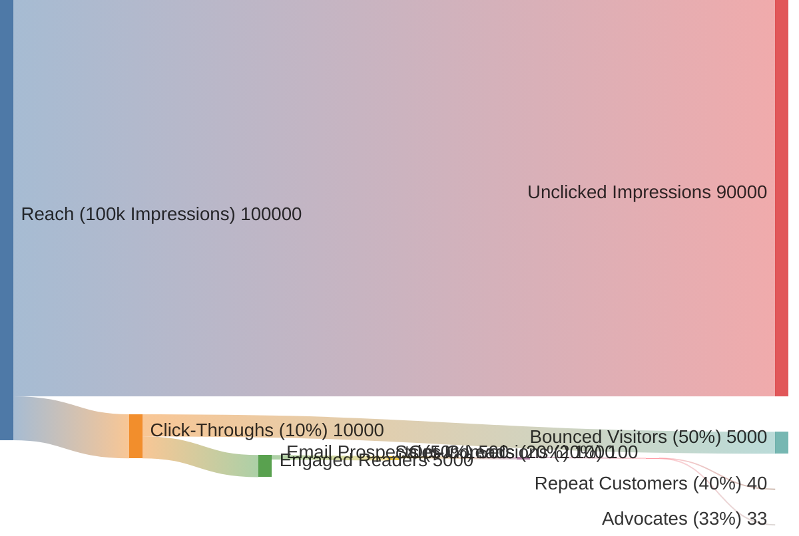
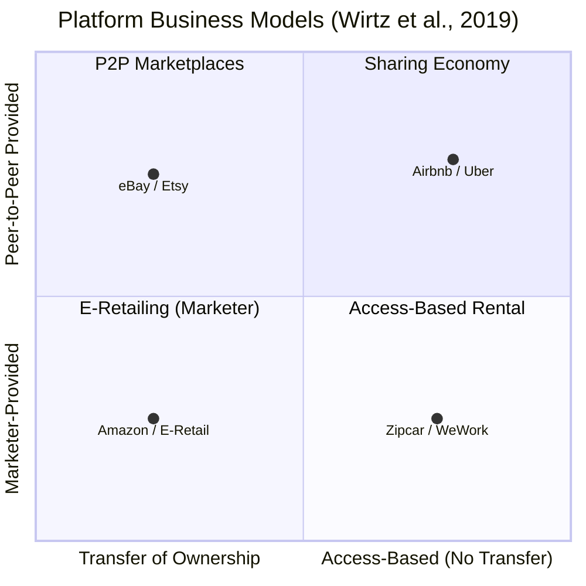

The **Digital Marketing Funnel & Platform Ecosystem** framework models how enterprises acquire, convert, retain, and turn online visitors into brand advocates across **Paid, Owned, and Earned (POE)** digital channels, while orchestrating multi-sided platform ecosystems that connect producers, complementors, and consumers.

---

## 💡 First-Principles Intuition & Conceptual Core

Think of a physical flagship store on a busy street. Thousands of pedestrians walk past the window (**Top of Funnel / Reach**), a fraction step inside to browse (**Click-Throughs**), half of those glance around and leave immediately (**Bounce Rate**), a smaller group asks a salesperson for a brochure (**Leads**), and only a handful reach the cashier (**Sales Conversions**). Digital marketing makes every single step of that walk-in journey measurable down to the individual click—allowing managers to diagnose exactly which stage leaks customers and optimize return on marketing spend.

### 🔑 Prerequisite Concepts & Jargon Decoder

- **TOFU / MOFU / BOFU**: Top of Funnel (awareness & traffic), Middle of Funnel (engagement & lead capture), and Bottom of Funnel (sales conversion, repeat purchase, and advocacy).
- **Click-Through Rate (CTR)**: The share of people who see an ad or search result and actually click through to the landing page.
- **Bounce Rate**: The percentage of website visitors who leave after viewing only one page without interacting further.
- **Retargeting / Remarketing**: Serving tailored follow-up ads to visitors who previously browsed a site without purchasing, keeping the brand top-of-mind across multiple touchpoints.
- **Two-Sided Platform Ecosystem**: A digital intermediary (such as an e-commerce marketplace or ride-hailing app) that does not hold physical inventory itself, but orchestrates governance and value co-creation between independent service providers and customers.

---

## 📐 Universal Mechanism & Funnel Conversion Math {#tofu-mofu-bofu-economics}

Total paying customers ($N_{\text{sales}}$) generated from an initial digital reach ($N_{\text{reach}}$) equal the multiplicative product of step-by-step survival rates across the funnel:

$$\mathbf{N_{\text{sales}} = N_{\text{reach}} \times \text{CTR} \times (1 - \text{Bounce}) \times \text{CR}_{\text{lead}} \times \text{CR}_{\text{prospect}} \times \text{CR}_{\text{close}}}$$

### ⚙️ Mechanics & Structural Anatomy

- **Multiplicative Pipeline (Numerator Chain)**: Each percentage rate acts as a sequential gate. Improving any single leaky gate—such as halving a $50\%$ bounce rate through faster landing pages—doubles downstream leads and sales without spending an extra rupiah on top-of-funnel ads.
- **Retention & Advocacy Multiplier**: Post-purchase nurturing converts one-time buyers into repeat customers and organic advocates, lowering blended **Customer Acquisition Cost (CAC)** over time.
- **10-Second Micro-Example (SBM ITB Funnel Benchmark)**: Starting with $100{,}000$ ad impressions at $10\%$ CTR yields $10{,}000$ clicks. A $50\%$ bounce rate leaves $5{,}000$ readers; $20\%$ opt in as $1{,}000$ leads; $50\%$ engage as $500$ prospects; and $20\%$ close into $\mathbf{100}$ sales ($0.1\%$ end-to-end conversion), which subsequently yield $40$ repeat buyers ($40\%$) and $33$ brand advocates ($33\%$).



---

## 📡 Paid, Owned, and Earned (POE) Media Architecture {#paid-owned-earned-media}

Digital marketing investments span three distinct, overlapping media classes:

```mermaid
venn-beta
  A["Owned Media<br/>(Website, CRM, Apps, Blogs)"]
  B["Paid Media<br/>(Search Ads, Social Ads, Display)"]
  C["Earned Media<br/>(WOM, Influencers, Reviews)"]
```

| Media Type       | Core Digital Assets                                                                            | Primary Strategic Role                                                          | Key Managerial Risk                                                             |
| :--------------- | :--------------------------------------------------------------------------------------------- | :------------------------------------------------------------------------------ | :------------------------------------------------------------------------------ |
| **Owned Media**  | Corporate website, mobile apps, CRM email lists, owned social handles, marketplace storefronts | Full control over brand narrative, first-party customer data, and conversion UX | Slow organic traffic buildup; requires ongoing SEO and UX maintenance           |
| **Paid Media**   | Search ads (PPC), social media ads, display banners, affiliate marketing, paid endorsements    | Immediate scale, targeted audience reach, and retargeting lift                  | Rising auction CPCs; traffic stops the moment ad spend pauses                   |
| **Earned Media** | Word-of-mouth, editorial press, organic influencer reviews, Google My Business ratings         | High consumer credibility and low-cost advocacy amplification                   | Zero direct control; vulnerable to public negative reviews if fulfillment fails |

---

## 🌐 Platform Ecosystems & Digital Strategy Frameworks {#platform-ecosystems}

Drawing on **Wirtz et al. (2019)**, digital platforms differ along two structural axes: **who provides the core resource** (peer-to-peer vs. marketer-provided) and **whether ownership transfers** (sale vs. temporary access):



In **Kannan & Li (2019)**, digital technologies continuously reshape five touchpoint environments—**Collaborators**, **Context**, **Competitors**, **Customers**, and **Two-Sided Platforms**—allowing firms to pair **Market Research** with dynamic 4Ps execution to build **Customer Equity**, **Brand Equity**, and **Firm Value**.

---

## 🏛️ Multi-Disciplinary Lenses Across the MBA Curriculum

### 1. Marketing Management (MK 3)

- **Primary Mechanism**: Aligning SEO, one-step checkout UX, CRM segmentation, and retargeting across the digital funnel to convert passive browsers into repeat buyers.
- _Discussed in_: [[courses/mk3-marketing-management/week-11/index|MK 3 Week 11: Place (Channel) & Digital Marketing]] and [[courses/mk3-marketing-management/week-11/case-zenxin-organic-digital-retail|Zenxin Organic Case]].

### 2. Applied Business Analytics (MK 6)

- **Primary Mechanism**: Measuring funnel attribution, heat-map clickstream behavior, and sentiment from earned reviews using [[concepts/social-media-text-analytics|Social Media Text Analytics]].

### 3. Financial Management (MK 2)

- **Primary Mechanism**: Evaluating digital channel ROI by comparing paid acquisition cost ($\text{CAC}$) against [[concepts/freemium-pricing-model|Customer Lifetime Value (LTV)]] and repeat-order basket economics.

---

## 🔗 Contributing Sessions & References

- Lecture Hub: [[courses/mk3-marketing-management/week-11/index|MK 3 Week 11: Place (Channel) & Digital Marketing]]
- Case Dossier: [[courses/mk3-marketing-management/week-11/case-zenxin-organic-digital-retail|Zenxin Organic — Brick & Mortar to Digital Retail]]
- Entity Profile: [[entities/hubspot|HubSpot, Inc.]]
- Hub: [[concepts/index|Knowledge Matrix]]
