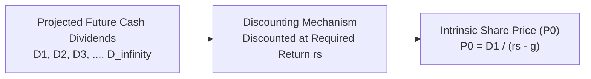

## 📐 Universal Mechanism & Theoretical Principle

The **Dividend Discount Model (DDM)** is the foundational intrinsic valuation framework for equity securities. It establishes that the theoretical economic value of a common share equals the **present value of all future cash dividends** expected to be distributed by the issuing corporation across an infinite horizon, discounted at the investor's required rate of return on equity.

$$\mathbf{P_0 = \sum_{t=1}^{\infty} \frac{D_t}{(1 + r_s)^t}}$$

Where:

- $P_0$: Current intrinsic value per share.
- $D_t$: Expected dividend per share in period $t$.
- $r_s$: Required rate of return on common equity (derived via CAPM or market hurdle).

---

## 🔢 Mathematical Formulations

### 1. Constant Growth Model (Gordon Growth Model)

When dividends are expected to grow perpetually at a constant annual rate ($g$), where required return exceeds growth ($r_s > g$):

$$\mathbf{P_0 = \frac{D_1}{r_s - g} = \frac{D_0 \times (1 + g)}{r_s - g}}$$

$$\mathbf{\text{Expected Equity Return}} = \hat{r}_s = \underbrace{\frac{D_1}{P_0}}_{\text{Dividend Yield}} + \underbrace{g}_{\text{Capital Gains Yield}}$$

### 2. Multi-Stage (Non-Constant / Supernormal) Growth Model

For growth companies expanding rapidly before transitioning to a mature steady state:

$$\mathbf{P_0 = \sum_{t=1}^N \frac{D_t}{(1 + r_s)^t} + \frac{P_N}{(1 + r_s)^N}}$$

Where the **Horizon Value / Terminal Value ($P_N$)** at the end of the supernormal period ($N$) is computed as:

$$\mathbf{P_N = \frac{D_{N+1}}{r_s - g_n} = \frac{D_N \times (1 + g_n)}{r_s - g_n}}$$

---

## 🏢 Managerial Applications & Theoretical Boundaries

| Application Domain                                              | DDM Strength                                                                                  | Model Limitation / Boundary                                                                       |
| :-------------------------------------------------------------- | :-------------------------------------------------------------------------------------------- | :------------------------------------------------------------------------------------------------ |
| **Dividend-Paying Blue Chips** (e.g., Banking, FMCG, Utilities) | Directly models actual shareholder cash distributions; highly disciplined.                    | Inapplicable to non-dividend paying growth stocks or high-reinvestment tech firms.                |
| **Dividend Policy Signalling**                                  | Highlights the trade-off between current dividend payouts and retained earnings reinvestment. | Extremely sensitive to minor inputs in perpetual growth ($g$) and required return ($r_s$).        |
| **Terminal Value Heaviness**                                    | Captures mature steady-state enterprise value through terminal capitalization.                | In multi-stage models, terminal value ($P_N$) often constitutes $>75\%$ of total intrinsic value. |

---

## 🔗 Curricular Bridges

- Master Course Note: [[courses/mk2-financial-management-strategy/week-07/index|MK2 Week 07: Applications of TVM]]
- Practical Problem Set: [[courses/mk2-financial-management-strategy/week-07/assignment-bond-stock-valuation|Fixed-Income & Equity DDM Problem Sets]]
- Cost of Capital Driver: [[concepts/capital-asset-pricing-model|Capital Asset Pricing Model (CAPM)]]
