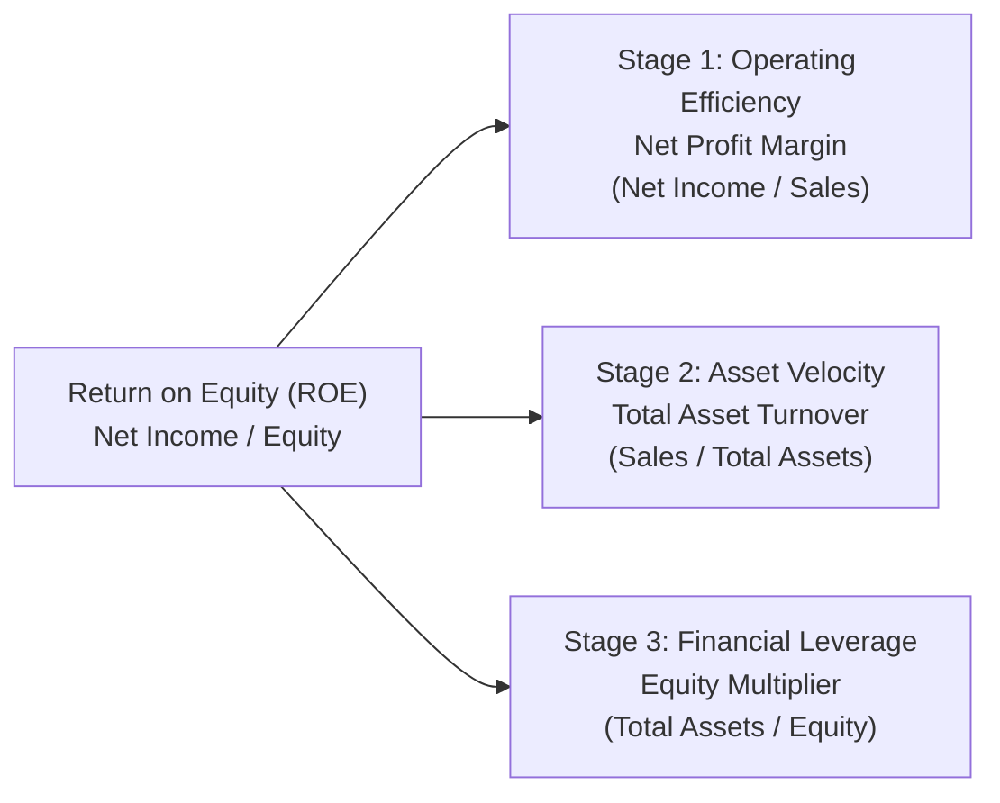

## 💡 First-Principles Intuition: The Engine of Shareholder Return

Before looking at any accounting formula, consider a fundamental business question: _How does an enterprise actually make money for its owners?_

Suppose you invest Rp 100,000,000 of your personal savings (your **Equity**) into starting a business. At the end of the year, the business hands you Rp 20,000,000 in clean profit. Your **Return on Equity (ROE)** is $20\%$.

A simple $20\%$ figure, however, tells you nothing about _how_ that profit was produced. Was it because:

1. You sold your product at an extraordinarily high profit margin? (e.g., a luxury boutique).
2. You sold items at razor-thin margins, but turned your inventory over with lightning speed? (e.g., a high-volume supermarket).
3. Or did you borrow massive bank loans, magnifying tiny profits with high debt risk? (e.g., an over-leveraged real estate fund).

In 1914, Donaldson Brown at the DuPont Corporation invented a mathematical breakthrough: by multiplying and dividing by Sales and Total Assets, you unpack ROE into three independent operational levers: **Operating Profitability**, **Asset Velocity**, and **Financial Leverage**.

### 🔑 Prerequisite Concepts & Jargon Decoder

- **Return on Equity (ROE)**: The percentage return earned on every rupiah of shareholder capital invested ($\text{Net Income} / \text{Shareholders' Equity}$).
- **Net Income (Bottom Line)**: The accounting profit surviving after all operating expenses, supplier bills, interest on debt, and government taxes have been paid.
- **Sales / Revenue (Top Line)**: The total cash value of goods or services invoiced to customers during the year.
- **Total Assets**: Everything the business owns and mobilizes to operate (factories, machinery, inventory, accounts receivable, and bank cash).
- **Equity**: The net worth of the owners inside the firm ($\text{Total Assets} - \text{Total Liabilities}$).

---

## 🔢 Mathematical Decomposition

### 1. The 3-Stage DuPont Identity

Mathematically, the identity inserts $\text{Sales}$ and $\text{Assets}$ as algebraic bridge terms:

$$\mathbf{\text{ROE} = \left(\frac{\text{Net Income}}{\text{Sales}}\right) \times \left(\frac{\text{Sales}}{\text{Assets}}\right) \times \left(\frac{\text{Assets}}{\text{Equity}}\right)}$$

Notice how $\text{Sales}$ and $\text{Assets}$ cancel out algebraically, leaving $\text{Net Income} / \text{Equity}$. Yet keeping them visible reveals the 3 distinct business engines:

$$\mathbf{\text{ROE} = \underbrace{\text{Net Profit Margin}}_{\text{Operating Cost Discipline}} \times \underbrace{\text{Total Asset Turnover}}_{\text{Capital Velocity}} \times \underbrace{\text{Equity Multiplier}}_{\text{Debt Gearing}}}$$

#### ⚙️ Structural Mechanics & Variable Anatomy:

- **Net Profit Margin ($\text{Net Income} / \text{Sales}$)**:
  - _Numerator_: Higher profit per sale expands ROE.
  - _Denominator_: Sales volume. If sales rise but net income stagnates due to rising costs, margin shrinks.
- **Total Asset Turnover ($\text{Sales} / \text{Assets}$)**:
  - _Numerator_: Revenue throughput generated.
  - _Denominator_: Total capital tied up in physical buildings, machines, and inventory. A smaller asset base generating high sales creates superior asset turnover.
- **Equity Multiplier ($\text{Assets} / \text{Equity}$)**:
  - Measures the proportion of assets funded by debt. An equity multiplier of $1.0\text{x}$ means zero debt ($100\%$ equity). An equity multiplier of $2.0\text{x}$ means half of all assets are financed by creditors.
  - _Leverage Hazard_: While higher debt boosts ROE during good years, it also multiplies insolvency risk during downturns.

#### 10-Second Mental-Math Micro-Example:

- Profit Margin: $5\%$ ($0.05$)
- Asset Turnover: $2.0\text{x}$ (turns assets twice a year)
- Equity Multiplier: $2.0\text{x}$ ($50\%$ debt funded)
  $$\text{ROE} = 0.05 \times 2.0 \times 2.0 = \mathbf{0.20 \text{ (20.0% Return on Equity)}}.$$

### 2. The 5-Stage Extended DuPont Identity

To separate operating performance from financing structure and government tax policy, the 5-stage identity isolates interest expenses and corporate taxation:

$$\mathbf{\text{ROE} = \underbrace{\left(\frac{\text{Net Income}}{\text{EBT}}\right)}_{\text{Tax Retention}} \times \underbrace{\left(\frac{\text{EBT}}{\text{EBIT}}\right)}_{\text{Interest Burden}} \times \underbrace{\left(\frac{\text{EBIT}}{\text{Sales}}\right)}_{\text{Operating Margin}} \times \underbrace{\left(\frac{\text{Sales}}{\text{Assets}}\right)}_{\text{Asset Turnover}} \times \underbrace{\left(\frac{\text{Assets}}{\text{Equity}}\right)}_{\text{Equity Multiplier}}}$$

1. **Tax Retention Factor ($\text{NI}/\text{EBT}$)**: 1 minus the effective corporate income tax rate.
2. **Interest Burden Factor ($\text{EBT}/\text{EBIT}$)**: The drag imposed by interest charges on operating earnings (values below 1.0 indicate debt service drag).
3. **Operating Margin ($\text{EBIT}/\text{Sales}$)**: Pure operational profitability prior to financing structure.

---

## 🏢 Enterprise Applications & Managerial Crucible

| Strategic Scenario                                                      | DuPont Diagnosis                                                                                | Executive Prescriptive Action                                                         |
| :---------------------------------------------------------------------- | :---------------------------------------------------------------------------------------------- | :------------------------------------------------------------------------------------ |
| **High Margin, Low Turnover** (e.g., Luxury Goods, Specialty Chemicals) | High profit margin compensates for slow inventory turns.                                        | Protect pricing power and intellectual property; avoid volume discount dilution.      |
| **Low Margin, High Turnover** (e.g., Supermarkets, Bulk Mining)         | Thin margins generate high ROE purely through rapid cash collection and asset velocity.         | Relentlessly optimize supply chain logistics and minimize inventory holding days.     |
| **High Leverage Illusion** (Distressed Firms)                           | ROE appears elevated, but is artificially propped up by an expanding Equity Multiplier ($A/E$). | Deleverage debt obligations before a macroeconomic shock breaches solvency covenants. |

---

## 🔗 Curricular Bridges

- Master Course Note: [[courses/mk2-financial-management-strategy/week-02/index|MK2 Week 02: Financial Statement Analysis]]
- Empirical Case Study: [[courses/mk2-financial-management-strategy/week-02/case-ptba-ratio-analysis|PTBA DuPont & Ratio Diagnostic]]
- Related Concept: [[concepts/sustainable-growth-rate|Sustainable Growth Rate]]
