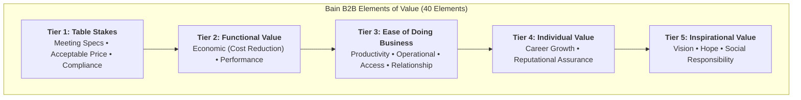

## 📐 Universal Definition & Conceptual Core

Developed by Eric Almquist, John Senior, Nicolas Bloch, Jamie Cleghorn, and Lori Sherer of Bain & Company (Harvard Business Review, 2016 & 2018), the **Elements of Value** frameworks extend Abraham Maslow’s hierarchy of needs into rigorous analytical taxonomies of customer value creation across both consumer (B2C) and enterprise (B2B) markets.

### The Two Value Architectures

#### 1. The B2C Value Pyramid (30 Elements across 4 Tiers)

- **Functional (14 Elements):** Saves time, simplifies, reduces effort, reduces cost, quality, sensory appeal. Quality is the non-negotiable bedrock.
- **Emotional (10 Elements):** Reduces anxiety, rewards me, badge value, design/aesthetics, wellness.
- **Life-Changing (5 Elements):** Provides hope, self-actualization, motivation, belonging.
- **Social Impact (1 Element):** Self-transcendence.

#### 2. The B2B Value Pyramid (40 Elements across 5 Tiers)

- **Table Stakes:** Meeting specifications, acceptable pricing, regulatory compliance, and ethical standards.
- **Functional Value:** Economic metrics (cost reduction, revenue growth) and operational performance (scalability, product quality).
- **Ease of Doing Business:** Reducing operational friction, enhancing responsiveness, simplifying integration, and stabilizing supply chains.
- **Individual Value:** Addressing personal buyer motivations—career enhancement, anxiety reduction, and reputational security (_"Nobody ever got fired for buying IBM"_).
- **Inspirational Value:** Purpose, sustainability, market vision, and social responsibility.

---

## 🏛️ Multi-Disciplinary Lenses Across the MBA Curriculum

### Marketing Management (MK3)

- **B2C Consumer Dynamics (Week 01 & Week 08):** In consumer packaged goods, delivering multiple elements correlates directly with superior Net Promoter Scores (NPS) and repeat purchase. In [[courses/mk3-marketing-management/week-01/index|MK3 Week 01]] and the [[courses/mk3-marketing-management/week-01/case-unilever-indonesia-2026|Unilever Indonesia Case]], _Sensory Appeal_ (_wangi_) operates simultaneously as functional efficacy and social esteem. In [[courses/mk3-marketing-management/week-08/index|MK3 Week 08]] (PT Kereta Api Indonesia), service tangibilization elevates rail travel from basic mobility (_Saves Time_) to experiential dignity (_Reduces Anxiety_).
- **B2B SaaS & Enterprise Positioning (Week 04 & Week 06):** In [[courses/mk3-marketing-management/week-04/index|MK3 Week 04]] (WIKA EPC) and [[courses/mk3-marketing-management/week-06/index|MK3 Week 06]] (HubSpot Inbound Marketing), vendors frequently fail because they pitch exclusively to Table Stakes (pricing, specifications) while ignoring the _Ease of Doing Business_ and _Individual Career Risk_ elements that drive executive sign-off in the [[concepts/b2b-buying-center|B2B Buying Center]].

---

## ⚖️ Cross-Functional Boardroom Tensions

- **Marketing vs. Commercial Realism:** Marketing teams often claim their products deliver top-tier "Life-Changing" or "Inspirational" value (e.g., claiming a budget detergent "Provides Hope"). In reality, unless lower-tier functional elements (stain removal, cost per wash) or B2B table stakes are flawlessly executed, high-concept emotional claims are rejected by customers as cynical marketing puffery.

---

## 🚀 Action Learning Project (ALP) Application

> [!TIP] ALP Capstone Alignment
> BUMN consulting teams should audit public sector digital platforms (e.g., PLN Mobile, Livin' by Mandiri, Access by KAI) against the 30 B2C Elements of Value, and state industrial procurement against the 40 B2B Elements. Identify whether state enterprises are trapped competing solely on functional utility (_Reduces Cost_, _Saves Time_) or whether they can cultivate emotional and relational elements (_Reduces Anxiety_, _Ease of Doing Business_) to defend enterprise market share.

---

## 🔗 Contributing Sessions & References

- Lecture Hubs:
  - [[courses/mk3-marketing-management/week-01/index|MK3 Week 01: Creating Customer Value & Engagement]]
  - [[courses/mk3-marketing-management/week-06/index|MK3 Week 06: Market Segmentation & Target Market Selection]]
  - [[courses/mk3-marketing-management/week-08/index|MK3 Week 08: Services Marketing & STP Strategy]]
- Case Analyses:
  - [[courses/mk3-marketing-management/week-01/case-unilever-indonesia-2026|Unilever Indonesia Case]]
  - [[courses/mk3-marketing-management/week-06/case-hubspot-inbound-indonesia|HubSpot Inbound Marketing Case]]
- Hub Directory: [[concepts/index|Knowledge Matrix]]
