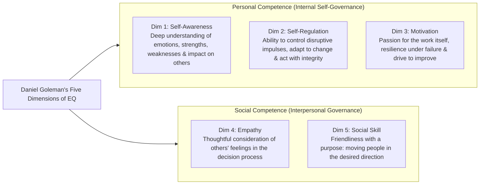
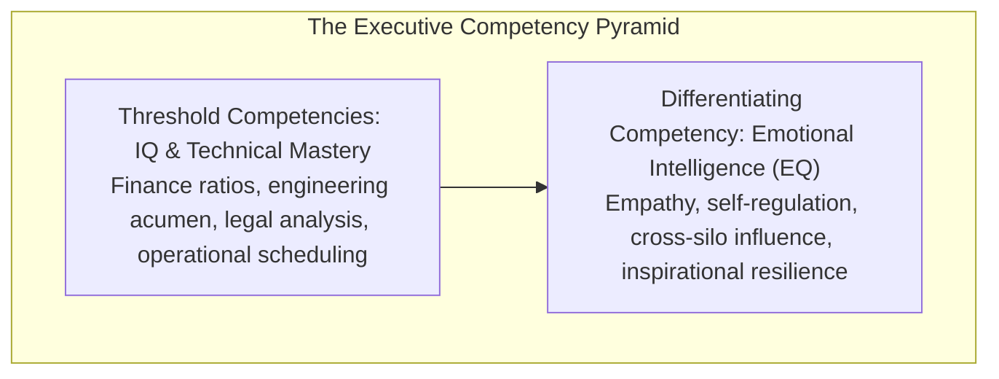

## 📐 Universal Definition & Conceptual Core

Popularized by psychologist and journalist **Daniel Goleman** (1995, 1998 _"What Makes a Leader?"_, Harvard Business Review), **Emotional Intelligence (EQ)** is the capacity to recognize, understand, manage, and harness emotions in oneself and in interpersonal relationships.

Goleman’s empirical research across hundreds of global corporations demonstrated that while intellectual quotient (IQ) and technical knowledge are baseline **threshold capabilities** (entry requirements for executive roles), **Emotional Intelligence accounts for nearly 90% of the difference** between average managers and star corporate leaders in senior executive ranks.

$$\mathbf{\text{Executive Effectiveness}} = \underbrace{\text{IQ} + \text{Technical Expertise}}_{\text{Threshold Competencies}} + \underbrace{\mathbf{\text{Emotional Intelligence (EQ)}}}_{\text{Differentiating Competencies (90\% of Delta)}}$$

---

## 🏛️ The Five Core Dimensions of Executive EQ

| Dimension              | Definition & Operational Mechanism                                                                                                                   | Hallmarks in Executive Behavior                                                                                          | Failure Mode when Absent                                                                                              |
| :--------------------- | :--------------------------------------------------------------------------------------------------------------------------------------------------- | :----------------------------------------------------------------------------------------------------------------------- | :-------------------------------------------------------------------------------------------------------------------- |
| **1. Self-Awareness**  | The ability to accurately perceive one's own emotional state, realistic self-assessment, and understanding how one's moods affect subordinates.      | Self-confidence, realistic self-deprecation, comfortable discussing limitations, thirst for constructive feedback.       | Arrogance, unexamined blind spots, catastrophic defensiveness (_"The Smartest Guy in the Room"_ syndrome).            |
| **2. Self-Regulation** | The capacity to channel and redirect disruptive emotional impulses, manage cognitive stress, and maintain moral equilibrium under crisis.            | Trustworthiness, integrity, comfort with ambiguity, measured and thoughtful responses instead of volatile outbursts.     | Volatile rage, blame-shifting, panic decisions during market shocks, creating toxic fear cultures.                    |
| **3. Motivation**      | An intrinsic drive to achieve for the sake of accomplishment, mastery, and enterprise purpose rather than purely money or title.                     | High energy, passion to learn, relentless curiosity, unwavering optimism in the face of setbacks.                        | Mercenary opportunism, cynicism, burnout when external bonus incentives are compressed.                               |
| **4. Empathy**         | The ability to sense and understand the emotional makeup of other people and skillfully calibrate corporate decisions to stakeholders' perspectives. | Expertise in retaining talent, cross-cultural sensitivity, coaching orientation, customer-centric insight.               | Tone-deaf corporate reorganizations, employee disengagement, inability to grasp frontline employee resistance.        |
| **5. Social Skill**    | Proficiency in managing relationships, building coalitions, finding common ground, and persuading diverse interest groups.                           | Effectiveness in leading change, persuasiveness, extensive network, natural catalyst for cross-functional collaboration. | Brilliant technical isolation, inability to mobilize teams, failure to translate strategy into coordinated execution. |

---

## ⚖️ Threshold vs. Differentiating Competencies

- **Threshold Competencies**: Without IQ and functional skill, an individual cannot enter the corporate management suite. However, because nearly all peers in executive roles possess high IQ and technical credentials, IQ ceases to differentiate top performance.
- **Differentiating Competencies**: When technical capability is equal, the leader who masters empathy, self-regulation, and inspirational communication rallies the organization, eliminates silo friction, and unlocks discretionary effort.

---

## 🏛️ Multi-Disciplinary Lenses Across the MBA Curriculum

### 1. Transformative Leadership & Turnaround (MK 1 Week 04)

- In [[courses/mk1-organizational-behavior-managing-people/week-04/index|MK 1 Week 04]], Daniel Goleman's EQ framework is paired with **Carol Dweck's [[concepts/growth-mindset|Growth Mindset]]** to explain Satya Nadella's multi-hundred-billion-dollar turnaround at Microsoft. Nadella replaced Steve Ballmer’s aggressive, low-empathy stack ranking system with an empathy-led culture of _learn-it-alls_.

### 2. High-Performing Teams & Psychological Safety (MK 1 Week 05)

- Empathy and self-regulation are the foundational preconditions for **[[concepts/psychological-safety|Psychological Safety]]** (Amy Edmondson) and constructive **[[concepts/transactional-analysis|Transactional Analysis (Adult-Adult transactions)]]**.

---

## 🔗 Contributing Sessions & References

- Master Lecture: [[courses/mk1-organizational-behavior-managing-people/week-04/index|MK 1 Week 04: Leadership & Culture Transformation]]
- Foundational Reading: [[courses/mk1-organizational-behavior-managing-people/week-04/reading-what-makes-a-leader|Reading: What Makes a Leader? (Daniel Goleman)]]
- Clinical Case Study: [[courses/mk1-organizational-behavior-managing-people/week-04/case-satya-nadella-microsoft|Case: Satya Nadella at Microsoft]]
- Related Concepts:
  - [[concepts/self-awareness|The Self-Awareness Triad]]
  - [[concepts/growth-mindset|Growth Mindset & Adaptive Enterprise Culture]]
  - [[concepts/psychological-safety|Psychological Safety in Teams]]
- Directory: [[concepts/index|Knowledge Matrix]]
