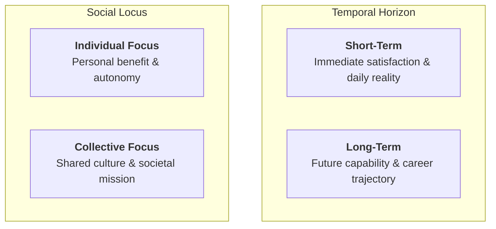
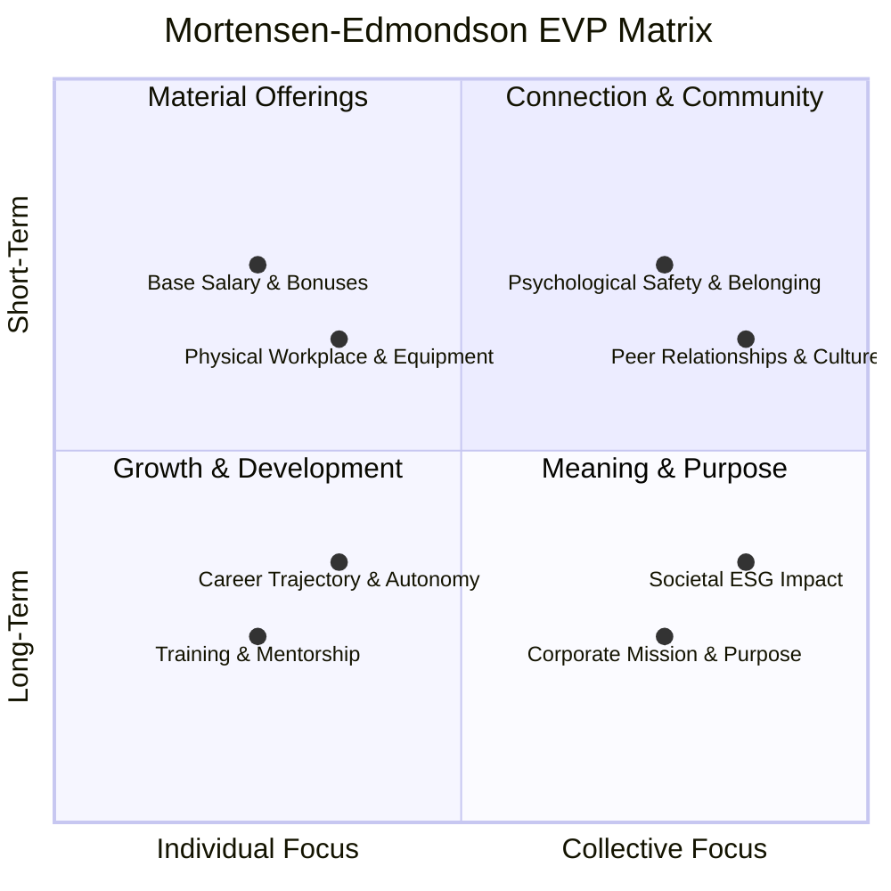
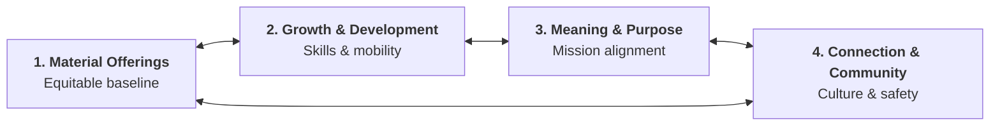

The **Employee Value Proposition (EVP)** is the comprehensive ecosystem of tangible and intangible rewards, development opportunities, social relationships, and organizational purpose that an enterprise provides in exchange for an employee's skills, effort, and commitment.

---

## 1. Executive Summary & Core Dilemma

In competitive labor markets, organizations frequently fall into the **"Material Offerings Trap"**—treating talent acquisition and retention as a transactional bidding war over compensation, sign-on bonuses, and superficial perks. While material incentives are the easiest managerial lever to pull, empirical evidence demonstrates they provide the weakest and most transient foundation for long-term organizational commitment.

Pioneered by [[courses/mk1-organizational-behavior-managing-people/week-10/reading-mortensen-rethink-evp|Mark Mortensen and Amy C. Edmondson (2023)]], the modernized EVP model conceptualizes value as an interdependent system spanning four core factors across two structural dimensions:

1. **Temporal Horizon:** Short-Term vs. Long-Term value creation.
2. **Social Locus:** Individual vs. Collective experience.

---

## 2. The 4-Factor Integrated EVP Matrix

The Mortensen–Edmondson matrix maps employee value into four distinct quadrants, demonstrating that an over-reliance on any single quadrant creates systemic organizational dysfunction:

### Comparative Factor Dimensions

| Factor                     | Orientation | Focus      | Key Levers                                                                       | Vulnerability if Over-Indexed                                                               |
| :------------------------- | :---------- | :--------- | :------------------------------------------------------------------------------- | :------------------------------------------------------------------------------------------ |
| **Material Offerings**     | Short-Term  | Individual | Base pay, bonuses, stock options, remote perks, physical facilities.             | Sparks bidding wars; attracts mercenary talent; high turnover when competitors offer +10%.  |
| **Growth & Development**   | Long-Term   | Individual | Skills training, mentorship, internal mobility, credentialing, promotion tracks. | Train-and-lose syndrome: employees build market value then exit if compensation lags.       |
| **Connection & Community** | Short-Term  | Collective | Psychological safety, peer trust, inclusive team dynamics, mutual respect.       | Inward-looking club culture; risk of complacency and inability to confront low performance. |
| **Meaning & Purpose**      | Long-Term   | Collective | Societal mission, ESG commitments, customer impact, ethical alignment.           | "Purpose washing" cynicism; employee burnout and exploitation ("passion tax").              |

---

## 3. The Systemic Interdependence Mandate

A sustainable EVP operates as an **interdependent ecosystem**, not a cafeteria menu of independent perks. Adjusting one quadrant inevitably reverberates across the other three:

### The Cautionary Tale: Systemic Collapse at UNICEF

In their Harvard Business Review study, Mortensen and Edmondson analyze the crisis at **UNICEF**:

- **The Imbalance:** UNICEF possessed an exceptionally powerful mission (**Meaning & Purpose**) that attracted globally passionate humanitarians willing to accept moderate salaries (**Material Offerings**).
- **The Breakdown:** Internal operational pressure, emergency deployments, and toxic management hierarchies severed psychological safety and peer trust (**Connection & Community**), while career progression was opaque (**Growth & Development**).
- **The Outcome:** Mission-driven passion transformed into bitter burnout, internal bullying scandals, and reputational trauma. A noble organizational purpose cannot compensate for a toxic daily culture or stunted personal growth.

---

## 4. Managerial Execution: "Changing the Conversation"

Leaders seeking to operationalize an integrated EVP must alter their talent acquisition and onboarding dialogues:

1. **Move from "What Do You Want?" to "What Do We Need Together?"**:
   - Asking candidates what they want yields immediate, transactional demands (more pay, less supervision).
   - Leaders must frame the relationship around mutual commitments: what resources and development the enterprise provides, and what performance rigor the mission requires.
2. **Realistic Job Previews (RJP)**:
   - Present authentic operational challenges alongside organizational strengths during recruitment. Candidates who self-select into transparent cultures exhibit significantly higher post-hire retention and satisfaction.
3. **Continuous Periodic Tuning**:
   - Employee needs evolve across career stages. An entry-level analyst prioritizes _Growth & Development_; a mid-career manager with dependents values _Material Stability_ and _Community_; a senior executive seeks _Organizational Impact_.

---

## 🔗 Related Portals

- Core Lecture: [[courses/mk1-organizational-behavior-managing-people/week-10/index|Week 10: Strategic Talent Acquisition & Employer Branding]]
- Academic Reading: [[courses/mk1-organizational-behavior-managing-people/week-10/reading-mortensen-rethink-evp|Mortensen & Edmondson (2023) HBR Dossier]]
- Pre-Class Brief: [[courses/mk1-organizational-behavior-managing-people/week-10/assignment-pre-assignment-brief|Cohort Pre-Class Brief: EVP & Talent Acquisition]]
- Return to [[concepts/index|Concept Lattice Index]]
