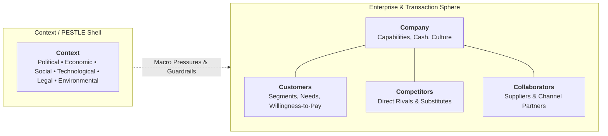

## 📐 Universal Definition & Conceptual Core

The **5C Environmental Analysis Framework** is an analytical architecture used in strategic marketing and corporate strategy to evaluate the internal and external operational landscape before making resource allocation, market entry, or positioning decisions. Originally synthesized in academic business research and popularized in modern marketing management (Kotler & Keller; Harvard Business School), the model dissects the business environment into five interdependent vectors:

1. **Company (Internal Capabilities & Cost Structure)**: The enterprise's unique competencies, proprietary assets, capacity limits, cash reserves, cultural readiness, and cost curves.
2. **Customers (Demand Architecture & Jobs to be Done)**: Target market segments, purchasing power, decision criteria, unmet pains, shopping channels, and price sensitivity.
3. **Competitors (Rivalry Dynamics & Market Structure)**: Direct, indirect, and future substitute rivals, their market share concentration, relative cost structures, and competitive vulnerabilities.
4. **Collaborators (Upstream & Downstream Partners)**: Suppliers, marketing intermediaries, third-party logistics (3PL) providers, retail distributors, financial institutions, and technology partners.
5. **Context (Macroenvironmental PESTLE Vectors)**: Political, Economic, Social, Technological, Legal, and Environmental forces shaping regulatory guardrails and macro consumer trends.

---

## 🔬 Evidentiary Tagging & Analytical Mechanics

A frequent failure mode in strategic analysis is treating unverified opinions, management hopes, and teaching-case assumptions as empirical facts. The rigorous standard of 5C analysis requires explicit **Evidentiary Tagging** across every registered observation:

|    Tag    | Evidentiary Status        | Definition & Verification Requirement                                                                                  |
| :-------: | :------------------------ | :--------------------------------------------------------------------------------------------------------------------- |
| **`[V]`** | **Verified Fact**         | Traceable reported financial data, audited statement, official government census, or measured historical performance.  |
| **`[E]`** | **Case-Writer Estimate**  | Explicitly estimated, modelled, or projected by industry analysts or academic case writers without external audit.     |
| **`[I]`** | **Illustrative Scenario** | Pedagogical construct, hypothetical sensitivity range, or classroom exercise rule.                                     |
| **`[U]`** | **Unclear / Unverified**  | Conflicting anecdotal claim, self-serving management assertion, or missing baseline metric requiring primary research. |

### Mathematical Interaction: Willingness-to-Pay and Value Creation

The 5C framework evaluates the feasibility of capturing value through the economic relationship between Willingness-to-Pay ($\text{WTP}$), Price ($\text{P}$), and Unit Cost ($\text{C}$):

$$\mathbf{\text{Customer Surplus} = \text{WTP} - \text{P}} \quad \vert \quad \mathbf{\text{Producer Margin} = \text{P} - \text{C}} \quad \vert \quad \mathbf{\text{Total Economic Value} = \text{WTP} - \text{C}}$$

- **Company Lever**: Lowers unit cost $\text{C}$ through operational efficiency or raises $\text{WTP}$ via branding.
- **Competitor Pressure**: Compresses $\text{P}$ toward $\text{C}$ unless differentiated.
- **Collaborator Power**: Demands trade margins, absorbing a portion of $(\text{P} - \text{C})$.
- **Context Constraints**: Shifts macro inflation and consumer disposable income, lowering baseline $\text{WTP}$.

---

## 🏛️ Multi-Disciplinary Lenses Across the MBA Curriculum

### 1. Marketing Management (MK3)

In [[courses/mk3-marketing-management/week-02/index|MK3 Week 02]], the 5C framework anchors environmental scanning. It reconciles micro forces (suppliers, distributors, rival brands) with macro megatrends (e.g., Indonesian FMCG sachetization, digital payment adoption, modern vs traditional trade). In [[courses/mk3-marketing-management/week-06/index|MK3 Week 06]], 5C dictates whether a SaaS startup targets micro-enterprises or mid-market firms based on customer support capacity.

### 2. Organizational Behavior & Leadership (MK1)

The **Company** pillar cannot be evaluated strictly through balance sheet assets. In [[courses/mk1-organizational-behavior-managing-people/week-06/index|MK1 Week 06]], organization capabilities depend on [[concepts/psychological-safety|Psychological Safety]], organizational design, and employee alignment. A strategy that demands rapid cross-functional agility fails if corporate hierarchy suppresses frontline initiative.

### 3. Operations & Supply Chain Management (MK4)

The **Collaborators** and **Context** pillars link directly to supplier lead times, capacity bottlenecks, and the [[concepts/customer-order-decoupling-point|Customer Order Decoupling Point]]. When external context shifts (e.g., port congestion, logistics disruption), internal operational buffers determine survival.

---

## ⚠️ Strategic Pitfalls & Boundary Conditions

1. **Static Checklist Fallacy**: Listing 5C points as independent bullets without analyzing their dynamic feedback loops (e.g., competitor price cuts triggering retailer margin demands).
2. **Internal Bias (Over-Weighting Company)**: Allocating 80% of executive attention to internal strengths while ignoring collaborator channel power or customer friction.
3. **PESTLE Paralysis**: Listing global macro context that has zero actionable impact on the firm's immediate target segment.

---

## 🔗 Related Knowledge Hubs

- [[courses/mk3-marketing-management/week-02/index|MK3 Week 02: Analyzing the Marketing Environment]]
- [[concepts/customer-perceived-value|Customer Perceived Value (CPV)]]
- [[concepts/elements-of-value|Elements of Value]]
