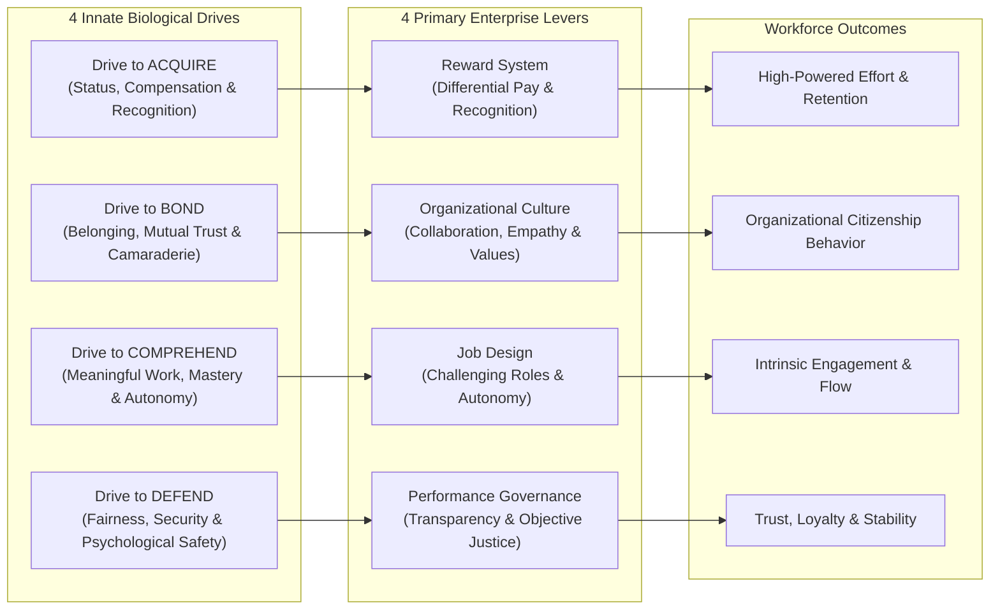

## 📐 Universal Mechanism & Theoretical Core

The **Four-Drive Model of Employee Motivation** provides an evolutionary and neuropsychological framework explaining what drives human behavior in organizations and how managerial systems convert human biological needs into sustainable enterprise performance.

Pioneered by Harvard Business School professors **Paul R. Lawrence** and **Nitin Nohria** (2002, _Driven: How Human Nature Shapes Our Choices_) and empirically validated in corporate environments by **Nitin Nohria, Boris Groysberg, and Linda-Eling Lee** (Harvard Business Review, 2008, _"Employee Motivation: A Powerful New Model"_), the theory posits that human motivation is governed by four innate, hardwired biological drives:

1. **Drive to Acquire ($d_{Ac}$)**: The primal desire to obtain scarce physical goods (food, shelter, assets) and intangible social commodities (status, title, recognition, influence, promotional advancement).
   - _Primary Organizational Lever_: **The Reward & Compensation System** (performance bonuses, merit pay differentiation, equity, competitive base pay).
2. **Drive to Bond ($d_{Bo}$)**: The evolutionary drive to form meaningful social connections, experience belonging, develop reciprocal loyalty, and forge collective identity with a tribe or team.
   - _Primary Organizational Lever_: **Organizational Culture** (psychological safety, collaboration norms, shared core values, cross-silo teamwork).
3. **Drive to Comprehend ($d_{Co}$)**: The fundamental human curiosity to understand the world, master complex skills, solve challenging puzzles, and perform work that has identifiable purpose and intrinsic meaning.
   - _Primary Organizational Lever_: **Job Design & Role Architecture** (job autonomy, skill variety, challenging assignments, clear task significance).
4. **Drive to Defend ($d_{De}$)**: The reactive evolutionary drive to protect oneself, one's family, property, ideas, status, and social standing against external threats, arbitrary authority, and injustice.
   - _Primary Organizational Lever_: **Performance Management & Resource Allocation Governance** (fair, transparent evaluation, dispute resolution mechanisms, organizational justice).

### The Non-Substitutability Principle & Mathematical Formulation

The critical breakthrough of the Four-Drive Model is that human motivation behaves as a **multiplicative system rather than an additive balance sheet**. Each drive is independent; fulfilling one drive does not compensate for neglecting another.

$$\text{Holistic Motivation Index} \approx \prod_{k \in \{Ac, Bo, Co, De\}} \text{Satisfaction}(Drive_k)$$

_Empirical Findings from Nohria, Groysberg, & Lee (2008)_ across Fortune 500 enterprises revealed:

- **All Four Drives Fulfillled**: When an enterprise performs well across all four organizational levers, overall employee engagement, satisfaction, and commitment reach the **88th percentile**.
- **The Compensation Trap**: When an enterprise scores in the 90th percentile on the reward system (Drive to Acquire) but performs poorly on culture, job design, or fairness (Drives to Bond, Comprehend, or Defend), employee engagement is capped at the **56th percentile**. High monetary compensation cannot purchase authentic loyalty or intrinsic engagement if employees feel isolated, intellectually stifled, or subjected to arbitrary managerial bias.

---

## 🏛️ Multi-Disciplinary Lenses Across the MBA Curriculum

### 1. Organizational Behavior & Human Motivation at Work (MK 1)

- **Master Lecture Hub**: [[courses/mk1-organizational-behavior-managing-people/week-03/index|Week 03: Motivation & Human Behavior at Work]].
- **Foundational Reading**: [[courses/mk1-organizational-behavior-managing-people/week-03/reading-employee-motivation-powerful-new-model|Reading: Employee Motivation — A Powerful New Model (Nohria et al.)]].
- **The Rudi dan Kana Clinical Case Diagnostic**: In [[courses/mk1-organizational-behavior-managing-people/week-03/case-rudi-dan-kana|Case Study: Rudi dan Kana]], the Four-Drive Model exposes why Rudi's high-pressure management style caused catastrophic voluntary attrition despite offering top-of-market compensation:
  - _Acquire_: Over-indexed on individual bonuses, creating zero-sum internal rivalries.
  - _Bond_: Completely destroyed through public shaming and toxic division between favorites and scapegoats.
  - _Comprehend_: Stifled by micro-management and rigid commands, eliminating employee problem-solving autonomy.
  - _Defend_: Severely threatened by unpredictable emotional volatility and opaque performance evaluation.
- **Cohort Assignment Synthesis**: [[courses/mk1-organizational-behavior-managing-people/week-03/assignment-post-four-drives|F9 Post-Class Debrief: Four-Drive Framework Diagnostic]].

### 2. PeopleMath & Human Capital Architecture (MK 1 & Rabuan)

- **Masterclass Context**: [[rabuan/2026-09-02-adh-peoplemath|Rabuan 01: PeopleMath — Produktivitas Berkualitas & Strategi Tough & Agile Learner]] ([[entities/agus-dwi-handaya|Agus Dwi Handaya]], MD Human Capital PT Danantara Asset Management).
- **Mapping the Four Drives to [[concepts/peoplemath-framework|PeopleMath Architecture]]**:
  - _Drive to Acquire $\Longleftrightarrow$ Receiving Factors ($Rr$ / RF)_: Managing extrinsic compensation, equitable salary banding, and fair incentives provides the baseline security required before higher motivation can activate.
  - _Drive to Bond & Comprehend $\Longleftrightarrow$ Giving Factors ($Gr$ / GF) & 3N Learning Engine_: Sustained motivation requires psychological purpose ($M$) and active cognitive expansion via the 3N Individu loop ($IDS$: _Nyerap, Ngulang, Ngerefleksi_) supported by [[concepts/tough-and-agile-learner|Tough & Agile Learner]] capability.
  - _Drive to Defend $\Longleftrightarrow$ Psychological Safety & Leader Treatment ($Tr$)_: Fostering an environment where employees report errors and ask for help depends on the 3N Leader ($EL$: _Nagih, Nata, Nuntun_) maintaining high human treatment ($Tr$) and systemic integrity ($In$).

---

## ⚖️ Cross-Functional Boardroom Tensions

- **CFO (Cost Containment) vs. CHRO (Holistic Incentives)**: CFOs frequently treat workforce expenditure as a line-item expense to be minimized or rely strictly on formulaic sales bonuses (Acquire). CHROs recognize that without investing in culture (Bond), leadership development (Comprehend), and fair grievance mechanisms (Defend), turnover costs and productivity leaks far exceed the cost of talent programs.
- **Short-Term Bonus Maximization vs. Long-Term Institutional Defense**: When managerial incentives reward short-term financial engineering (Acquire), executives may slash maintenance, fire experienced staff, or suppress critical risk warnings, violently threatening the institutional Drive to Defend and destroying enterprise resilience.

---

## 🚀 Action Learning Project (ALP) BUMN Application

> [!TIP] Applying the Four Drives in Indonesian State-Owned Enterprises (BUMN)
> Managing human capital in Indonesian state-owned enterprises presents unique motivational dynamics across the four drives:
>
> 1. **Drive to Acquire (Civil Service Parity vs Commercial Incentive)**: Historically, BUMN base salaries were anchored to civil service scales, leading to talent poaching by private tech and banking multinationals. Modern BUMN holding models (Danareksa, Mandiri, Pertamina) have introduced performance-linked variable bonuses and Long-Term Incentive Plans (LTIP).
> 2. **Drive to Bond (BUMN AKHLAK & National Purpose)**: BUMNs possess a natural advantage in the Drive to Bond and Comprehend: employees take immense patriotic pride in nation-building (_Bakti BUMN_), electrifying rural areas (PLN), or financing national infrastructure (Mandiri/BRI). The national **AKHLAK** values program acts as an overarching cultural glue.
> 3. **Drive to Defend (Job Security vs Performance Accountability)**: Traditional BUMN cultures offered lifetime employment security, which over-satisfied Drive to Defend at the expense of Drive to Acquire and Comprehend (creating complacency). Enterprise transformation requires shifting from "tenure-based defense" to "procedural justice defense"—guaranteeing that merit and competence, rather than political connections (_titipan_), dictate executive promotion.

---

## 🔗 Contributing Sessions & References

- **Master Course Hub**: [[courses/mk1-organizational-behavior-managing-people/index|MK 1: Organizational Behaviour & Managing People]]
- **Master Weekly Lecture**: [[courses/mk1-organizational-behavior-managing-people/week-03/index|Week 03: Motivation & Human Behavior at Work]]
- **Foundational HBR Reading**: [[courses/mk1-organizational-behavior-managing-people/week-03/reading-employee-motivation-powerful-new-model|Reading: Employee Motivation — A Powerful New Model]]
- **Clinical Case Dossier**: [[courses/mk1-organizational-behavior-managing-people/week-03/case-rudi-dan-kana|Case Study: Rudi dan Kana]]
- **F9 Assignment Analysis**: [[courses/mk1-organizational-behavior-managing-people/week-03/assignment-post-four-drives|F9 Post-Class Debrief: Four-Drive Framework Diagnostic]]
- **Executive Plenary**: [[rabuan/2026-09-02-adh-peoplemath|Rabuan 01: PeopleMath Executive Masterclass (Agus Dwi Handaya)]]
- **Featured Executive Profile**: [[entities/agus-dwi-handaya|Agus Dwi Handaya]]
- **Related Mechanisms**:
  - [[concepts/peoplemath-framework|PeopleMath Framework & PPH Architecture]]
  - [[concepts/tough-and-agile-learner|Tough & Agile Learner (TAL)]]
- **Knowledge Matrix Hub**: [[concepts/index|Knowledge Matrix]]
