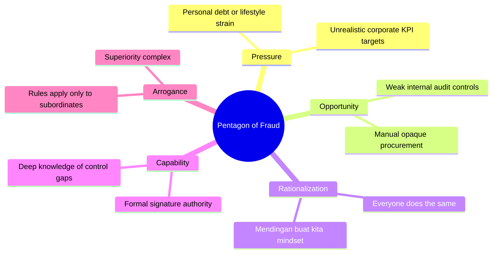
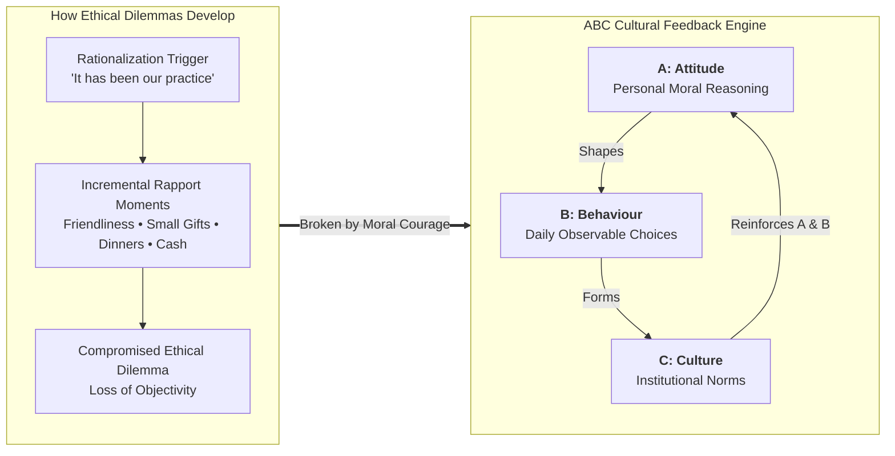

## 💡 First-Principles Intuition & Conceptual Core

Anti-corruption efforts fail whenever organizations treat integrity purely as a test of individual willpower. In reality, corporate fraud and bribery behave like a **combustible chemical reaction**: even normally law-abiding professionals compromise their standards when external pressure, weak internal controls, normalized peer excuses, and unchecked authority converge.

Think of a state-owned procurement manager overseeing a Rp 100 billion infrastructure tender. No one wakes up intending to commit a crime. Instead, ethical erosion begins with **small, socially normalized favors**—a vendor lunch, a holiday hamper, a paid golf outing—justified as _"everyone does the same"_ until the manager owes a reciprocal favor that distorts vendor selection. **Anti-Corruption Governance** replaces reliance on personal heroism with structural safeguards: closing control gaps, outlawing conflict-of-interest gifts, and quantifying the true societal damage of every leaked rupiah.

### 🔑 Prerequisite Concepts & Jargon Decoder

- **Pentagon of Fraud**: Five interacting drivers behind corrupt acts—**Pressure** (financial or KPI stress), **Opportunity** (weak system controls), **Rationalization** (moral self-justification), **Capability** (positional authority and system knowledge to bypass rules), and **Arrogance** (entitlement and belief that rules do not apply to oneself).
- **Gratification (_Gratifikasi_)**: Any gift, hospitality, discount, travel facility, or benefit received by a public official or BUMN executive; under Indonesian law (`Peraturan KPK RI No. 2/2019`), anything tied to one's official position or contrary to duty must be rejected or reported within 30 working days.
- **LHKPN (_Laporan Harta Kekayaan Penyelenggara Negara_)**: Mandatory public asset and wealth disclosure administered by KPK as an early-warning detector against unexplained wealth spikes, hidden kickbacks, or illicit enrichment.
- **Economic Multiplier**: The ripple effect by which one rupiah of productive public investment generates multiple rupiahs of downstream wages, supplier revenue, and tax receipts—value permanently destroyed when capital is diverted into rent-seeking.

---

## 📐 Structural Anatomy & Social Cost of Corruption

Most observers measure corruption solely by the cash stolen—the **tip of the iceberg**. In **Teori Biaya Sosial Korupsi**, delivered by **[[entities/amir-arief|Amir Arief (KPK)]]**, the true economic damage of corruption spans four distinct cost layers:

$$\mathbf{\text{SC}_{\text{corruption}} = C_{\text{explicit}} + C_{\text{anticipation}} + C_{\text{reaction}} + C_{\text{implicit}}}$$

### ⚙️ Mechanics & Structural Anatomy

- **Explicit Cost ($C_{\text{explicit}}$)**: The direct nominal value of state or corporate funds embezzled, inflated through mark-ups, or lost to kickbacks—whether enjoyed personally or diverted to third parties.
- **Anticipation Cost ($C_{\text{anticipation}}$)**: Preventive institutional expenditure required to deter corruption before it happens—anti-corruption education, compliance portals, and bureaucratic reform designed to separate _"corruption out of necessity"_ from _"corruption out of greed."_
- **Reaction Cost ($C_{\text{reaction}}$)**: Ex-post enforcement outlays—forensic audits, financial intelligence tracing (PPATK), investigation (KPK), prosecution, and judicial trials.
- **Implicit Cost ($C_{\text{implicit}}$)**: Hidden macroeconomic drag—forgone _opportunity costs_ (including future debt-interest burdens triggered by past corrupt borrowing) and the lost _economic multiplier_ between a clean economy and a corrupted one.

### 🧮 10-Second Micro-Numerical Walkthrough

Suppose a BUMN subsidiary awards an inflated vendor contract containing a **Rp 10 billion** explicit procurement kickback ($C_{\text{explicit}} = 10\text{B}$):

1. Preventing repeat leakage forces **Rp 2 billion** in emergency ERP controls and compliance training ($C_{\text{anticipation}} = 2\text{B}$).
2. Forensic investigation, legal defense, and court proceedings consume **Rp 3 billion** in institutional resources ($C_{\text{reaction}} = 3\text{B}$).
3. Delayed project completion, higher debt-service spreads, and a lost $1.5\times$ regional infrastructure multiplier forfeit **Rp 15 billion** in downstream economic output ($C_{\text{implicit}} = 15\text{B}$).
4. **Total Social Cost**: $10 + 2 + 3 + 15 = \mathbf{\text{Rp 30 billion}}$—meaning every **Rp 1** stolen inflicts **Rp 3** of broader economic destruction.

### The Slippery Slope & ABC Cultural Feedback Loop

Ethical failures rarely occur in one dramatic leap; they accumulate through **incremental rapport** until a leader is trapped in a compromise, reinforced by the **Attitude–Behaviour–Culture (ABC)** loop:

---

## 🏛️ Multi-Disciplinary Lenses Across the MBA Curriculum

### 1. Organizational Behavior & Power Dynamics (MK 1)

- **Whistleblowing & Psychological Safety**: In [[courses/mk1-organizational-behavior-managing-people/week-05/index|MK 1 Week 05]] and [[courses/mk1-organizational-behavior-managing-people/week-07/index|MK 1 Week 07]], subordinates remain silent about procurement anomalies when they fear retaliation. Combining **[[concepts/psychological-safety|Psychological Safety]]** with encrypted reporting channels (`kws.kpk.go.id`) turns passive bystanders into active defenders of integrity.
- **Values Congruence**: [[courses/mk1-organizational-behavior-managing-people/week-01/index|MK 1 Week 01]] shows that stated corporate slogans collapse when KPI systems reward short-term volume over [[concepts/values-congruence|Values Congruence]].

### 2. Financial Discipline & Agency Governance (MK 2)

- **Capital Leakage & Agency Costs**: In [[courses/mk2-financial-management-strategy/week-01/index|MK 2 Week 01]], **[[concepts/agency-theory|Agency Theory]]** explains how information asymmetry between state owners ([[entities/danantara|BPI Danantara]]) and subsidiary agents creates residual loss. Digitalized end-to-end procurement and LHKPN verification sharply reduce monitoring friction and protect [[concepts/weighted-average-cost-of-capital|ROIC > WACC]] capital discipline.

### 3. B2B Procurement & Public Turnaround (MK 3)

- **Procurement Gates & Turnaround**: In [[courses/mk3-marketing-management/week-04/index|MK 3 Week 04]] (WIKA B2B), public procurement officers face strict BPKP/LKPP anti-corruption scrutiny; in [[courses/mk3-marketing-management/week-08/index|MK 3 Week 08]] (PT KAI), eliminating ticket scalping and kickbacks via digitalized ticketing and zero-tolerance WBS was essential to reversing an Rp 83.5B loss.

### 4. Rational Governance & AKHLAK Institutionalization (MK 5)

- **AKHLAK _Amanah_ & WBS SLAs**: In [[courses/mk5-decision-making-negotiation/week-02/index|MK 5 Week 02]], institutionalizing the **Amanah** core value requires operational KPIs—such as resolving Whistleblowing System (WBS) investigations in $< 14$ days—rather than decorative posters.

---

## 🚀 Action Learning Project (ALP) Application

> [!TIP] The KPK Trisula Audit for BUMN Capstones
> When diagnosing operational bottlenecks in partner BUMNs during ALP Stage 2–3, apply KPK's **Trisula Strategy** alongside process redesign:
>
> 1. **Education (_"Don't want to corrupt"_)**: Align leadership _tone from the top_ and **9 Anti-Corruption Values** (_JUMAT BERSEPEDA KK_) with daily incentives.
> 2. **Prevention (_"Can't corrupt"_)**: Digitize manual handoffs (e-procurement, automated weighbridges, digital allocation verification) to eliminate discretionary _Opportunity_.
> 3. **Enforcement (_"Dare not corrupt"_)**: Enforce transparent audit trails, LHKPN compliance, and protected whistleblowing channels.

---

## 🔗 Contributing Sessions & References

- **Primary Foundation Plenary**: [[rabuan/2026-06-12-amir-arief-moral-courage|Moral Courage & Moral Reasoning (Amir Arief / KPK)]]
- **Character Adjudication Companion**: [[rabuan/2026-11-12-operasi-integritas-soedirman|Operasi Integritas Soedirman (OIS P3MD 2026)]]
- **Related Concepts**: [[concepts/the-integrity-triangle|The Integrity Triangle]] | [[concepts/values-congruence|Values Congruence]] | [[concepts/agency-theory|Agency Theory]] | [[concepts/psychological-safety|Psychological Safety]]
- **Speaker Profile**: [[entities/amir-arief|Amir Arief, SST., SH., M.Si., Ak., CA, CFE.]]
- **Hub**: [[concepts/index|Knowledge Matrix]]
