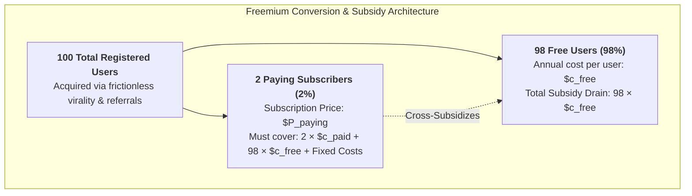

The **Freemium Pricing Model** is a digital business and monetization architecture where a proprietary product or service is provided free of charge at a functional baseline, while premium features, capacity, advanced functionality, or enterprise administrative controls are gated behind paid subscription tiers.

---

## 1. Plain-English Intuition & Everyday Analogy

Imagine a high-end gym located in the center of a dense business district. To get people through the front door, the gym announces that anyone can enter, use the cardio running tracks, and access the locker rooms completely free forever.

Nine out of ten people who enter use only the free cardio track and never spend a single dollar. However, one out of ten runners eventually wants access to personal trainers, private Olympic lifting suites, recovery saunas, and corporate executive lockers. The gym charges that tenth customer $\$150$ per month.

Because digital software has an **infinitesimal marginal reproduction cost** (unlike physical gym lockers), digital businesses can support millions of free users. The massive free tier acts not as an act of charity, but as an **organic customer acquisition engine** that eliminates marketing acquisition friction, builds viral word-of-mouth networks, and creates a large conversion funnel for high-margin paying tiers.

---

## 2. Prerequisite & Jargon Decoder

| Industry Concept                        | Plain-English Executive Meaning                                                                                                                     |
| :-------------------------------------- | :-------------------------------------------------------------------------------------------------------------------------------------------------- |
| **Marginal Cost of Serving ($MC$)**     | The incremental hosting, bandwidth, and customer service cost required to support one additional active free user.                                  |
| **Free-to-Paid Conversion Rate ($CR$)** | The percentage of registered active free users who upgrade to a recurring paid tier ($\text{typically } 1\% - 4\%$).                                |
| **Customer Acquisition Cost (CAC)**     | Total sales and marketing expenditures divided by the number of new paying customers acquired.                                                      |
| **Customer Lifetime Value (LTV)**       | The cumulative gross margin contribution generated by a paying subscriber over their entire relationship with the firm.                             |
| **Feature Fencing / Gating**            | The strategic boundaries (storage capacity, speed, security, collaboration tools) that divide free utility from paid value.                         |
| **Cross-Subsidization Ratio**           | The mathematical reality that each paying customer's subscription price must cover their own cost _plus_ the aggregate cost of multiple free users. |

---

## 3. Structural Anatomy of the Mechanism

The viability of a freemium business model is governed by the **Cross-Subsidization Break-Even Condition**:

$$P_{\text{paying}} \ge \frac{C_{\text{fixed}} + N_{\text{free}} \cdot c_{\text{free}} + N_{\text{paying}} \cdot c_{\text{paying}}}{N_{\text{paying}}}$$

Where:

- $P_{\text{paying}}$ is the price charged to a paying customer.
- $N_{\text{paying}}$ and $N_{\text{free}}$ are the respective user volumes.
- $c_{\text{paying}}$ and $c_{\text{free}}$ are the annual direct hosting/support costs per user.
- $C_{\text{fixed}}$ represents corporate overhead and platform software development.

### Expressed via the Conversion Rate ($CR = \frac{N_{\text{paying}}}{N_{\text{total}}}$):

$$\text{Subsidized User Burden: } \theta = \frac{N_{\text{free}}}{N_{\text{paying}}} = \frac{1 - CR}{CR}$$

If an enterprise operates at a $2\%$ conversion rate ($CR = 0.02$):

$$\theta = \frac{1 - 0.02}{0.02} = 49$$

> [!IMPORTANT] The 49:1 Cross-Subsidization Reality
> Every single paying customer must generate sufficient margin to cover their own server footprint **plus the ongoing infrastructure costs of 49 free users**. If the marginal cost of a free user rises, or if conversion falls below $1\%$, the model turns cash-negative and faces catastrophic insolvency.

---

## 4. Micro-Numerical Toy Example

Consider a cloud SaaS startup evaluating whether a $\$10$/month ($\$120$/year) subscription price covers operating costs:

- **Total Registered Users:** $1,000,000$
- **Conversion Rate:** $2\%$ ($N_{\text{paying}} = 20,000$; $N_{\text{free}} = 980,000$)
- **Annual Cost per Free User ($c_{\text{free}}$):** $\$1.20$/year (hosting and server bandwidth)
- **Annual Cost per Paying User ($c_{\text{paying}}$):** $\$15.00$/year (premium storage quota)
- **Annual Fixed Platform Overhead ($C_{\text{fixed}}$):** $\$1,000,000$

### Calculating the Minimum Break-Even Price ($P_{\text{min}}$):

$$C_{\text{total}} = C_{\text{fixed}} + (N_{\text{free}} \cdot c_{\text{free}}) + (N_{\text{paying}} \cdot c_{\text{paying}})$$

$$C_{\text{total}} = \$1,000,000 + (980,000 \cdot \$1.20) + (20,000 \cdot \$15.00)$$

$$C_{\text{total}} = \$1,000,000 + \$1,176,000 + \$300,000 = \$2,476,000$$

$$\text{Break-Even Price: } P_{\text{min}} = \frac{\$2,476,000}{20,000} = \mathbf{\$123.80 / \text{year}} \quad (\approx \$10.32 / \text{month})$$

### Management Takeaway:

At $\$120$/year, the firm loses money ($\$3.80$ deficit per paying customer). To become profitable, management has three strategic levers:

1. Increase price to $\$149$/year (Value-Based Pricing).
2. Optimize cloud compression to reduce free-user cost from $\$1.20$ to $\$0.80$/year.
3. Tighten feature fencing to increase conversion rate from $2.0\%$ to $2.5\%$.

---

## 5. Strategic Variations & Industry Comparison

| Model Dimension         | Storage SaaS (Dropbox)                        | Music Streaming (Spotify)                       | Professional Social (LinkedIn)                 |
| :---------------------- | :-------------------------------------------- | :---------------------------------------------- | :--------------------------------------------- |
| **Primary Value Fence** | Storage capacity (2 GB free vs 50 GB paid)    | Ads removal, offline playback, mobile skips     | InMail credits, advanced profile viewing       |
| **Conversion Rate**     | $1.6\% - 4.0\%$                               | $\mathbf{20.0\% - 25.0\%}$ (World outlier)      | $0.8\% - 1.5\%$                                |
| **Secondary Revenue**   | None ($100\%$ subscription revenue)           | Audio display advertising on free tier ($17\%$) | B2B enterprise recruitment tools ($3:1$ ratio) |
| **Virality Engine**     | Mutual referral bonuses (500 MB per referral) | Collaborative playlists & social sharing        | Inherent network effects (professional graph)  |

---

## 🔗 Related Portals

- Core Lecture: [[courses/mk3-marketing-management/week-10/index|Week 10: Marketing Mix — Strategic Pricing]]
- Case Study: [[courses/mk3-marketing-management/week-10/case-dropbox-pricing|Freemium Pricing at Dropbox Case Dossier]]
- Company Dossier: [[entities/dropbox|Enterprise Profile: Dropbox]]
- Return to [[concepts/index|Concept Lattice Index]]
