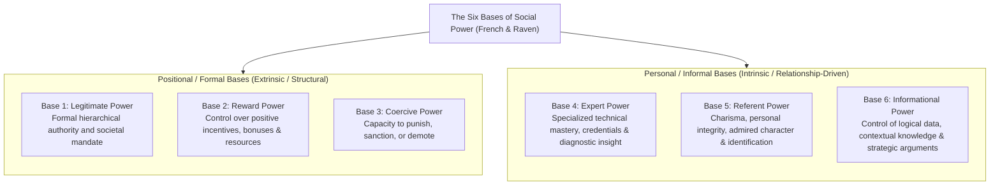
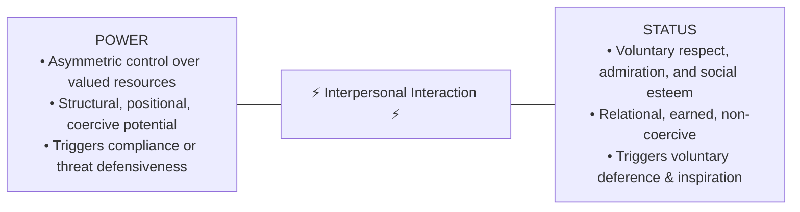

## 📐 Universal Definition & Conceptual Core

First formulated by social psychologists **John R. P. French Jr. and Bertram Raven** (1959, expanded by Raven in 1965), the **Bases of Social Power** framework provides the canonical taxonomy of how individuals influence others in social and organizational systems.

Power is defined as **the potential ability of an agent ($O$) to influence the beliefs, attitudes, or behavior of a target person ($P$)**. French and Raven partitioned power into two fundamental categories spanning six distinct bases:

---

## 🏛️ Analysis of the Six Power Bases

| Power Base              | Foundation & Mechanism                                                                                                             | Subordinate Behavioral Reaction                                                                            | Durability & Enterprise Risk                                                                                                                                                                       |
| :---------------------- | :--------------------------------------------------------------------------------------------------------------------------------- | :--------------------------------------------------------------------------------------------------------- | :------------------------------------------------------------------------------------------------------------------------------------------------------------------------------------------------- |
| **Legitimate Power**    | The target's internalized belief that the agent has the formal, organizational right to prescribe behavior based on title or role. | **Compliance**: Follows instructions because _"it's company policy"_.                                      | Evaporates immediately if title or rank is stripped away; ineffective for inspiring creative innovation.                                                                                           |
| **Reward Power**        | The perceived ability of the agent to provide tangible or intangible positive outcomes (raises, bonuses, coveted assignments).     | **Calculated Compliance**: Follows orders as long as rewards are attractive and forthcoming.               | Subject to diminishing marginal returns; creates mercenary loyalty and metric gaming.                                                                                                              |
| **Coercive Power**      | The perceived ability of the agent to administer negative sanctions, disciplinary actions, termination, or social isolation.       | **Resistance / Fear**: Hidden resentment, sabotage, minimal compliance, high anxiety.                      | Destroys [[concepts/psychological-safety                                                                   \| Psychological Safety]]; breeds toxic cover-ups and catastrophic voluntary attrition. |
| **Expert Power**        | The target's perception that the agent possesses superior knowledge, specialized skills, or technical problem-solving ability.     | **Internalization**: The target accepts the recommendation because they believe it is objectively correct. | Highly durable across organizations; independent of formal title or hierarchical rank.                                                                                                             |
| **Referent Power**      | Influence derived from the target's desire to identify with, emulate, or be accepted by the agent due to admiration and character. | **Commitment**: Enthusiastic, voluntary alignment and high discretionary effort.                           | **Highest-signal leadership power**: Cultivates enduring loyalty, cultural resonance, and moral authority.                                                                                         |
| **Informational Power** | Persuasion derived from the logical presentation of information, data, or arguments that change the target's understanding.        | **Cognitive Persuasion**: Convinced by the evidence and reasoning presented.                               | Independent of personal relationship; easily shared and decentralized across modern knowledge teams.                                                                                               |

---

## ⚖️ Power vs. Status in Organizational Hierarchies

Executives often conflate **Power** with **Status**, but industrial sociology establishes that they represent fundamentally distinct social forces:

$$\mathbf{\text{Effective Influence}} = \underbrace{\mathbf{\text{Power}}}_{\text{Control Over Resources}} + \underbrace{\mathbf{\text{Status}}}_{\text{Voluntary Respect \& Prestige}}$$

- **High Power, Low Status (The Destructive Executive)**: When a leader commands formal authority and budget control but lacks peer respect or technical credibility, subordinates perceive them as illegitimate. The leader overcompensates with coercive power, triggering organizational resistance and political factionalism.
- **The Asymmetry of Status Loss**: Research proves individuals are willing to sacrifice significantly more resources and engage in higher deception to **prevent losing status** than to acquire equivalent status gains.

---

## 🏛️ Multi-Disciplinary Lenses Across the MBA Curriculum

### 1. Power, Politics & SOE Governance (MK 1 Week 07)

- In [[courses/mk1-organizational-behavior-managing-people/week-07/index|MK 1 Week 07]], French & Raven's power bases explain how state-owned enterprise (BUMN) leaders balance ministerial **personnel power** (sovereign legitimate and coercive power) with personal **referent and expert power** to overcome bureaucratic inertia (_asal bapak senang_).

### 2. Cross-Curricular Leadership & Negotiation (MK 5)

- In negotiation and strategic decision-making, distinguishing an opponent's legitimate authority from their BATNA and informational leverage dictates concession strategies.

---

## 🔗 Contributing Sessions & References

- Master Lecture: [[courses/mk1-organizational-behavior-managing-people/week-07/index|MK 1 Week 07: Power, Politics & Governance in State-Owned Enterprises]]
- Foundational Reading: [[courses/mk1-organizational-behavior-managing-people/week-07/reading-personnel-power-governing-soes|Reading: Personnel Power: Governing State-Owned Enterprises (Leutert & Vortherms)]]
- Related Concepts:
  - [[concepts/leadership-ambidexterity|Leadership Ambidexterity]]
  - [[concepts/values-congruence|Values Congruence & Executive Friction]]
  - [[concepts/psychological-safety|Psychological Safety in Teams]]
- Directory: [[concepts/index|Knowledge Matrix]]
