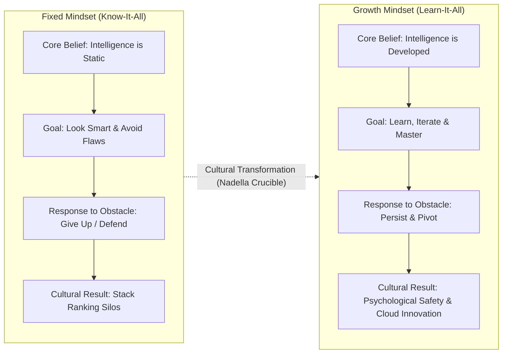

## 📐 Universal Mechanism & Theoretical Core

**Growth Mindset** defines the fundamental belief that human intelligence, executive capabilities, and behavioral talents are not fixed, static endowments, but dynamic capacities that can be systematically developed through deliberate effort, feedback integration, and continuous learning.

Developed by Stanford psychologist **Dr. Carol S. Dweck** (2006, _Mindset: The New Psychology of Success_), this psychological paradigm bifurcates into two distinct operating models:

1. **Fixed Mindset (_The Know-It-All Paradigm_)**: The foundational belief that competence is an innate, predetermined trait. In executive settings, individuals with a fixed mindset perceive mistakes as humiliating indictments of capability, avoid challenging assignments to preserve their image of effortless brilliance, and perceive critical feedback as a personal identity threat.
2. **Growth Mindset (_The Learn-It-All Paradigm_)**: The foundational belief that intellectual and leadership competence expands through deliberate practice, experimentation, and critical introspection. Individuals and organizations operating in this regime treat setbacks as diagnostic data, seek out rigorous challenges, and actively solicit difficult feedback to drive skill acquisition.

Mathematically and behaviorally, the mindset paradigm alters how effort and failure are discounted across an executive's career trajectory:

$$\text{Fixed Mindset: } \text{Effort} = \text{Indicator of Inadequacy} \quad \Longrightarrow \quad \text{Defensiveness} \ \vert \ \text{Risk Aversion}$$

$$\text{Growth Mindset: } \text{Failure} = \text{Diagnostic Feedback} \quad \Longrightarrow \quad \Delta \text{Competence} = f(\text{Deliberate Effort}, \text{Feedback Iteration})$$

Where an executive with a fixed mindset caps compounding competence at their baseline talent threshold ($\lim_{t \to \infty} \text{Competence}(t) = \text{Talent}_0$), a growth mindset enables non-linear exponential compounding through repeated feedback absorption:

$$\text{Competence}(t) = \text{Talent}_0 \cdot e^{\gamma \cdot \text{Iteration}(t)}, \quad \gamma > 0$$

---

## 🏛️ Multi-Disciplinary Lenses Across the MBA Curriculum

### 1. Organizational Behavior, Leadership & Culture (MK 1)

- **Primary Source**: Dr. Carol S. Dweck (2006); Herminia Ibarra, Aneeta Rattan, and Kathleen O'Connor (London Business School, 2018, _Satya Nadella at Microsoft: Instilling a Growth Mindset_).
- **The Microsoft Transformation Case**: Upon succeeding Steve Ballmer in February 2014, Satya Nadella identified that Microsoft's existential threat was not technological obsolescence, but a rigid, arrogant internal culture poisoned by Ballmer's toxic **stack-ranking system** (the 1–5 forced distribution bell curve). Stack-ranking incentivized talented engineers to sabotage peers, avoid entering high-risk projects with top performers, and protect legacy Windows desktop monopolies.
- **The "Learn-It-All" Doctrine**: Nadella replaced corporate hubris with a simple cultural imperative borrowed from Dweck:
  > _"The learn-it-all will always do better than the know-it-all, even if the know-it-all starts with much more innate capability."_
- **Managerial Levers Deployed**:
  1. _Abolishing Forced Ranking_: Replacing percentile quotas with qualitative growth dialogues and impact-based collaboration metrics.
  2. _Reframing Leadership as Empathy_: Treating customer empathy and listening as core engineering disciplines rather than soft skills.
  3. _Unifying Cross-Silo Collaboration_: Aligning the entire enterprise around Azure and the commercial cloud, turning competing business divisions into a cooperative ecosystem.

### 2. Executive Career Trajectories & The Feedback Crucible (Rabuan Executive Series)

- **Primary Source**: [[entities/ric-roi|Dr. Ric Roi]] (IMD Executive Education, _Making an Impact, Making a Career_).
- **The Tough Feedback Crucible**: In [[rabuan/2026-10-14-ric-roi-impact-career|Rabuan 02]], Dr. Ric Roi highlights that executive career derailment rarely occurs due to lack of raw technical IQ, but rather due to defensive reactions when receiving unvarnished 360-degree feedback:
  - _Fixed-Mindset Derailment_: Executives with a fixed mindset rationalize negative upward feedback, blame institutional politics, or retaliate against dissenters, hardening their blind spots.
  - _Growth-Mindset Breakthrough_: High-potential leaders treat discomforting evaluations as a "diagnostic gift," neutralizing ego defensiveness to rewrite behavioral defaults.

### 3. Problem Solving, Decision Making & Innovation (MK 5)

- **Primary Mechanism**: De-biasing strategic decision-making. Fixed mindset cultures suffer acute confirmation bias and escalation of commitment to failing courses of action (sunk-cost fallacy) because abandoning an initiative is viewed as a personal confession of incompetence. A growth mindset decouples personal self-worth from project outcomes, enabling rapid hypothesis falsification and decisive operational pivoting.

---

## ⚖️ Cross-Functional Boardroom Tensions

- **Quarterly Earnings Pressure vs. Learning Velocity**: Wall Street and capital markets demand predictable quarterly earnings per share (EPS). In a high-growth environment, experimentation entails variance and transient failure. Leaders must actively insulate exploration teams from immediate short-term margin penalties while holding them to rigorous hypothesis-validation milestones.
- **The "False Growth Mindset" Hazard**: Dr. Dweck observed that many corporate leaders misinterpret growth mindset as merely "having an open mind" or "praising raw effort regardless of output." A genuine growth mindset demands praise for _effective strategy search and feedback assimilation_, strictly paired with unyielding accountability for performance standards.

---

## 🚀 Action Learning Project (ALP) BUMN Application

> [!TIP] Instilling Growth Mindsets in Indonesian State-Owned Enterprises (BUMN)
> In Indonesian state-owned enterprises, the cultural default has historically been anchored in administrative risk aversion, hierarchical deference (_asal bapak senang_), and compliance-driven decision-making where making zero errors is rewarded above achieving transformational outcomes:
>
> 1. **Transforming the AKHLAK Cultural Blueprint**: The _Amanah, Kompeten, Harmonis, Loyal, Adaptif, Kolaboratif_ (AKHLAK) values framework initiated by the Ministry of BUMN relies intrinsically on shifting from a fixed mindset (_Kompeten_ defined as pedigree or credentials) to a growth mindset (_Kompeten_ defined as continuous upskilling, agile pivoting, and cross-BUMN collaboration).
> 2. **Overcoming Fear of Legal Scrutiny (KPK/BPK Shielding)**: BUMN directors frequently express reluctance to innovate because commercial failure risks being misconstrued as state financial loss (_kerugian negara_). Instilling enterprise growth mindset requires clear corporate governance boundaries that distinguish between fraudulent malfeasance and legitimate, documented commercial experimentation.
> 3. **Digital Banking Agility (Bank Mandiri & BRI)**: Shifting traditional credit analysts and branch branch managers into digital product squads (e.g., Mandiri Livin' and Kopra) requires unlearning legacy status hierarchies in favor of data-driven sprint retrospectives.

---

## 🔗 Contributing Sessions & References

- **Master Course Hub**: [[courses/mk1-organizational-behavior-managing-people/index|MK 1: Organizational Behaviour & Managing People]]
- **Master Weekly Lecture**: [[courses/mk1-organizational-behavior-managing-people/week-04/index|Week 04: Leadership & Influence]]
- **Dedicated Case Dossier**: [[courses/mk1-organizational-behavior-managing-people/week-04/case-satya-nadella-microsoft|Case Dossier: Satya Nadella at Microsoft: Instilling a Growth Mindset]]
- **F9 Assignment Analysis**: [[courses/mk1-organizational-behavior-managing-people/week-04/assignment-post-leadership-transformation|F9 Post-Class Debrief: Leadership Transformation]]
- **Plenary Keynote**: [[rabuan/2026-10-14-ric-roi-impact-career|Rabuan 02: Making an Impact, Making a Career (Dr. Ric Roi)]]
- **Foundational Theorist Profile**: [[entities/ric-roi|Dr. Ric Roi]]
- **Complementary Dynamic**: [[concepts/leadership-ambidexterity|Leadership Ambidexterity]]
- **Knowledge Matrix Hub**: [[concepts/index|Knowledge Matrix]]
