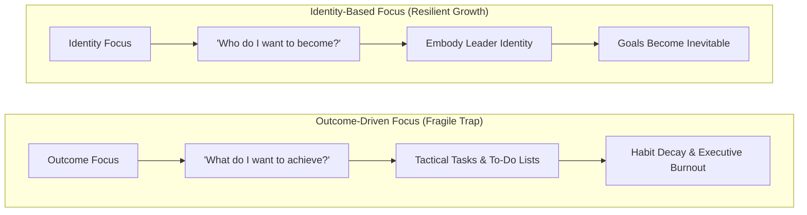

## 📐 Universal Mechanism: From Outcomes to Identity

**Identity-Based Living** is the strategic framework that grounds execution and behavioral change not in transient goals, but in the deliberate cultivation of core professional and personal identity.

$$\text{Strategy without identity is just a glorified to-do list.}$$

Traditional management and goal-setting models focus almost exclusively on **outcomes** (_"What do I want to achieve this quarter?"_ or _"What revenue target must I hit?"_). However, behavioral science demonstrates that outcome-based ambition without identity evolution produces regression to old habits as soon as external pressure abates.

### The Shift in Strategic Inquiry

The fundamental question that transforms executive trajectory is not:

> _"What do I want to achieve?"_

It is:

> $$\mathbf{\text{"Who do I want to become?"}}$$

When a leader embodies the identity of an intentional, values-aligned strategist, their day-to-day decisions, boundary management, and rigorous prioritization become natural behavioral expressions rather than daily acts of willpower.

---

## 🏛️ Multi-Disciplinary Lenses Across the MBA Curriculum

### 1. Organizational Behaviour & Leadership Transition (MK 1)

- **Primary Source**: SBM ITB Module 1 (_Strategizing Your Life_).
- **Core Mechanism**: In professional transitions (e.g. moving from functional technical expert to enterprise executive), leaders who cling to their old identity (_"I am the best financial analyst in the room"_) micromanage and bottleneck teams. Scaling leadership requires letting go of tactical identities to adopt the identity of a developmental coach and enterprise steward.
- _Discussed in_: [[courses/mk1-organizational-behavior-managing-people/week-01/index|MK 1 Week 01 (Strategizing Your Life)]].

### 2. Behavioral Decision Science & Cognitive Consistency (MK 5)

- **Primary Mechanism**: Mitigating Cognitive Dissonance & Commitment Escalation.
- **Core Insight**: Human beings possess a deep psychological drive for self-consistency. When an action is framed as an expression of _who you are_ rather than _a task you must complete_, resistance plummets. Negotiators anchored in an identity of principled fairness avoid both pushover concessions and toxic hubris.

### 3. State-Owned Enterprise Stewardship (Rabuan Plenary)

- **BUMN Executive Reality**: In bureaucratic environments, treating public service as a transactional job breeds risk aversion and compliance theater. Adopting the identity of a national steward (aligned with the AKHLAK mandate) empowers executives to take calculated, ethical risks for long-term sovereign value.

---

## 🚀 Action Learning Project (ALP) Application

> [!TIP] ALP Team Charter Callout
> During **ALP Sprint 1**, establish not just a project timeline, but a **Team Identity Charter**:
> Instead of asking _"What grade do we want on this consulting deliverable?"_, ask: _"What kind of executive advisory team do we need to become for our BUMN partner?"_ Let team norms flow from that chosen identity.

---

## 🔗 Contributing Sessions & References

- **MK 1 Lecture**: [[courses/mk1-organizational-behavior-managing-people/week-01/index|MK 1 Week 01: Strategizing Your Life]]
- **Core Pillars**:
  - [[concepts/self-awareness|The Self-Awareness Triad]]
  - [[concepts/values-congruence|Values Congruence & Executive Friction]]
  - [[concepts/purpose-to-impact|Purpose-to-Impact Action Planning]]
- **Hub**: [[concepts/index|Knowledge Matrix]]
