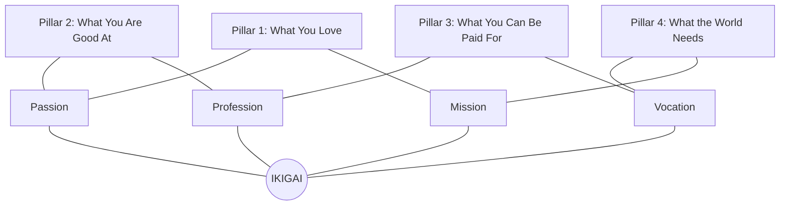

## 📐 Universal Definition & Conceptual Core

Originating from Japan's classical Heian period (794–1185), **Ikigai** (生きがい, formed from _iki_, meaning "life" or "alive", and _gai_, meaning "worth" or "benefit") translates roughly as **"a reason for being"**.

In modern management strategy and executive leadership, Ikigai represents the optimal convergence of four vital dimensions:

$$\mathbf{IKIGAI} = \text{Love (Passion)} \;\cap\; \text{Skill (Vocation)} \;\cap\; \text{World's Need (Mission)} \;\cap\; \text{Economic Sustainability (Profession)}$$

### The Incomplete Quadrants (The Psychological Cost):

- **Love + Skill, but No Pay**: Great passion, but economically unsustainable.
- **Skill + Pay, but No Love**: Comfortable corporate existence, but persistent inner emptiness.
- **Pay + World Need, but No Skill**: Noble calling, but constant anxiety and operational incompetence.
- **Love + World Need, but No Pay**: Philanthropic zeal, but financial vulnerability.

---

## 🏛️ Multi-Disciplinary Lenses Across the MBA Curriculum

### 1. Leadership & Personal Strategy Lens (MK 1)

- **Primary Source**: Alex Liu (World Economic Forum / Kearney) & SBM ITB Module 1.
- **Core Insight**: In volatile, ambiguous business environments, executives without Ikigai suffer from the **"Purpose Gap"**—the disconnect between declared corporate mission and actual daily behavior. Research indicates non-financial CEO ousters rose **4.75x** due to culture and governance failures.
- _Discussed in_: [[courses/mk1-organizational-behavior-managing-people/week-01/index|MK 1 Week 01 (Strategizing Your Life)]].

### 2. Marketing & Customer Value Creation Lens (MK 3)

- **Primary Mechanism**: Customer-Centric Purpose & [[concepts/index|Jobs to Be Done (JTBD)]].
- **Core Insight**: Enterprise Ikigai occurs when a company's unique technological capabilities align with profound unmet customer jobs, creating a distinct, uncopyable brand positioning.

### 3. Executive Stewardship in BUMNs (Rabuan Plenary)

- **Public Sector Dimension**: State-owned enterprise executives balance commercial profitability with national developmental mandates. Ikigai provides the psychological anchor to navigate regulatory and political cross-pressures.

---

## 🚀 Action Learning Project (ALP) Application

> [!TIP] ALP Capstone Alignment
> During **ALP Stage 1 (Chartering & Problem Definition)**, align your consulting team's project charter with the partner BUMN's institutional Ikigai: What does the enterprise uniquely excel at, and where does national strategic necessity demand urgent transformation?

---

## 🔗 Contributing Sessions & References

- **MK 1 Lecture**: [[courses/mk1-organizational-behavior-managing-people/week-01/index|MK 1 Week 01: Strategizing Your Life]]
- **Related Framework**: [[concepts/purpose-to-impact|Purpose-to-Impact Planning]]
- **Theorist Profile**: [[entities/nick-craig-scott-snook|Nick Craig & Scott Snook]]
- **Hub**: [[concepts/index|Knowledge Matrix]]
