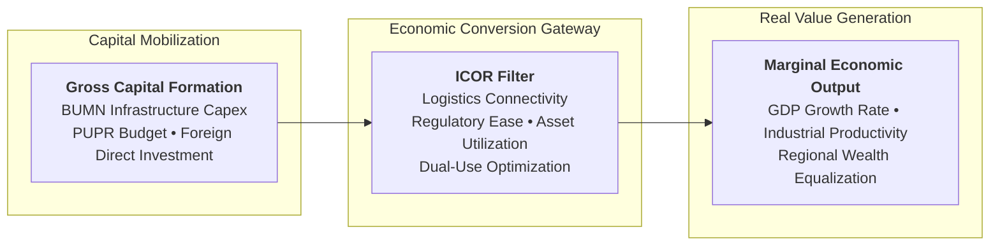
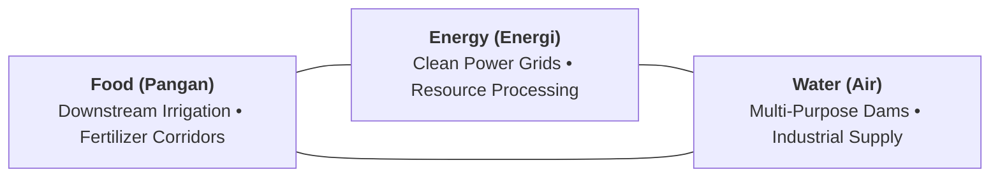
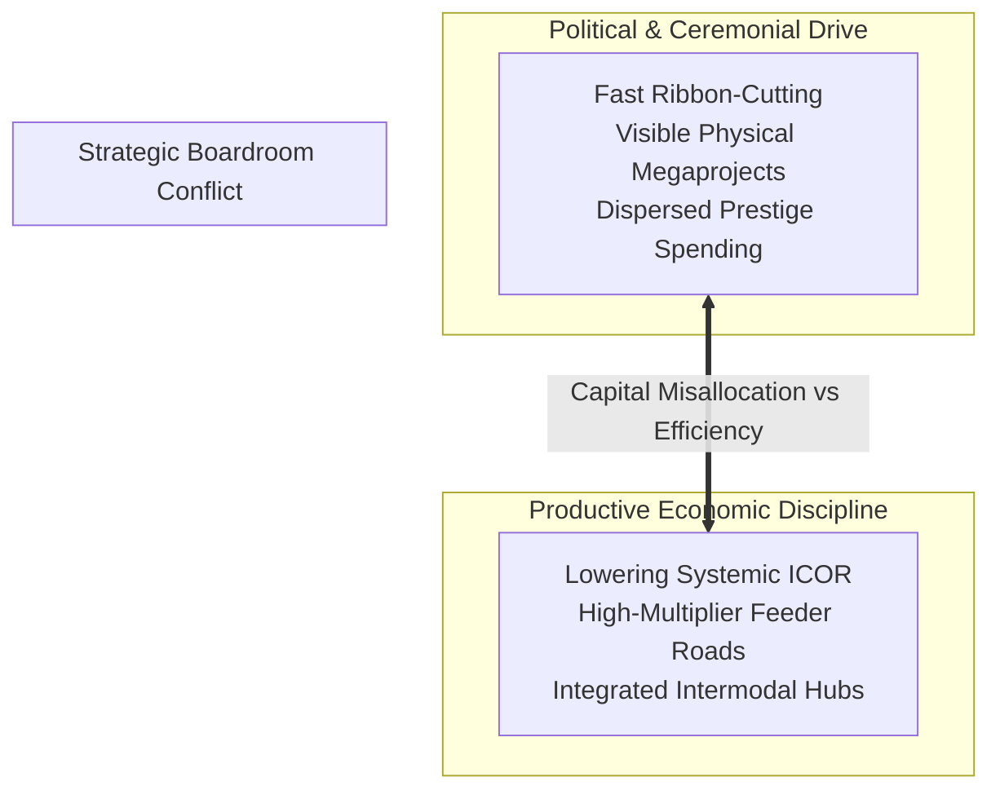

## 💡 First-Principles Intuition & Conceptual Core

Every nation and industrial conglomerate faces the exact same constraint: capital is scarce, while infrastructure and expansion demands are virtually infinite. When a government or state-owned enterprise (BUMN) invests hundreds of trillions of rupiah into toll roads, deep-water ports, transmission grids, and industrial estates, the critical strategic question is not merely _"Did we build it on time?"_ but rather:

$$\mathbf{\text{\ldquo How many rupiahs of capital investment are required to generate one additional rupiah of economic output?\rdquo}}$$

Consider an everyday enterprise analogy: Imagine a commercial bakery. If the owner invests Rp 50 million in an automated dough mixer that increases annual sales by Rp 25 million, the ratio of capital added to additional output generated is $50 / 25 = 2.0$. If another bakery owner spends Rp 200 million on an imported, gold-trimmed mixer that produces the exact same Rp 25 million in extra revenue, their ratio is $200 / 25 = 8.0$.

The second bakery has an **Incremental Capital Output Ratio (ICOR)** four times higher, signifying severe capital inefficiency: it burns excessive capital to achieve identical real-world economic gains.

The **Incremental Capital Output Ratio (ICOR)** is the macroeconomic compass that evaluates the marginal efficiency of capital allocation. In emerging economies undergoing massive state-driven infrastructure mobilization—such as Indonesia under the [[entities/danantara|Danantara]] sovereign investment umbrella—a high ICOR signals structural friction: high logistics leakage, bureaucratic delays, misallocated prestige assets, or unintegrated logistics chains that fail to stimulate secondary manufacturing ecosystems.

---

### 🔑 Prerequisite Concepts & Jargon Decoder

- **Gross Fixed Capital Formation (GFCF / PMTB)**: The net increase in physical assets (infrastructure, factories, machinery, ports) within an economy during an accounting period.
- **Marginal Product of Capital (MPK)**: The additional output produced by deploying one additional unit of capital, holding labor and technology constant. Mathematically, ICOR is the direct inverse of MPK ($\text{ICOR} \approx 1/\text{MPK}$).
- **Capital Drag**: The phenomenon where expensive infrastructure assets remain underutilized (e.g., an airport built without access roads or an industrial port without rail links), locking up state capital without generating commercial traffic.
- **Dual-Use Infrastructure**: Designing civil infrastructure assets to simultaneously serve commercial logistics and secondary national utility corridors (e.g., embedding optical fiber pipelines, water transmission lines, and high-voltage transmission inside toll-road rights-of-way).

---

## 📐 Mathematical Formulation & Structural Mechanics

The classical Harrod-Domar macroeconomic identity defines ICOR through the relationship between aggregate investment and marginal output expansion:

$$\text{ICOR} = \frac{\Delta K}{\Delta Y} = \frac{I_t}{\Delta Y_t}$$

Dividing both the numerator and denominator by nominal output ($Y_t$):

$$\text{ICOR} = \frac{\frac{I_t}{Y_t}}{\frac{\Delta Y_t}{Y_t}} = \frac{s}{g}$$

Where:

- $I_t$: Gross aggregate investment expenditure in period $t$.
- $Y_t$: Aggregate gross domestic product (GDP) in period $t$.
- $s = \frac{I_t}{Y_t}$: Aggregate investment rate (investment-to-GDP ratio).
- $g = \frac{\Delta Y_t}{Y_t}$: Real economic growth rate.

Rearranging the identity reveals the required investment rate to hit a national growth target:

$$s = \text{ICOR} \times g$$

### ⚙️ The Strategic Dilemma: Indonesia's 8% Growth Equation

| Economic Metric                    |          High-ICOR Trap (Historical Baseline)          | Structural Reform Target (Efficient Peer Model) |
| :--------------------------------- | :----------------------------------------------------: | :---------------------------------------------: |
| **National Target Growth ($g$)**   |                        **8.0%**                        |                    **8.0%**                     |
| **National ICOR Benchmark**        |                     **6.5 – 6.8**                      |                  **4.0 – 4.5**                  |
| **Required Investment Rate ($s$)** |      $8.0\% \times 6.8 = \mathbf{54.4\%}$ of GDP       |   $8.0\% \times 4.2 = \mathbf{33.6\%}$ of GDP   |
| **Capital Feasibility**            | **Macroeconomically Impossible** (induces debt crisis) | **Feasible** (funded by domestic savings + FDI) |
| **Regional Peer Comparison**       |             Indonesia historical: ~6.5–6.8             |       Vietnam: ~3.8–4.2 • India: ~4.2–4.5       |

> [!IMPORTANT] The Policy Takeaway & Full-Corpus Census Evidence
> In an exhaustive census of the P3MD Batch I Soedirman cohort ($N=381$), **57.2% ($n=218$)** of emerging executives specifically highlighted ICOR as their primary strategic takeaway. To achieve Indonesia's target of 8% sustainable GDP growth, the nation cannot simply double its debt or infrastructure capex; it **must lower its ICOR**. A high ICOR means capital is being swallowed by friction, delays, and disconnected planning. Lowering ICOR from 6.8 to 4.2 cuts the required capital investment by more than Rp 3,000 trillion annually for the exact same economic output!

---

## 🌾 The Food, Energy, Water (FEW) Nexus & Multi-Utility Asset Optimization

Infrastructure efficiency in emerging economies is heavily dictated by the **FEW Nexus (Food, Energy, Water)**:

1. **Integrated Dam & Reservoir Yields**: A single civil asset that combines flood control, irrigation channels, and hydroelectric turbines generates multiple output streams ($\Delta Y$) against a single capital base ($I$), driving the project's marginal ICOR down significantly compared to single-purpose assets.
2. **Alternative Financing via KPBU**: Relieving sovereign debt capacity by deploying Public-Private Partnerships (_Kerjasama Pemerintah dan Badan Usaha_ / KPBU) conditions state availability payments (_AP_) on proven asset availability and operating throughput, preventing public capital lockup.

---

## 🏛️ Multi-Disciplinary Lenses Across the MBA Curriculum

### 1. Macroeconomics & National Governance (Rabuan Plenary)

- **Primary Mechanism**: National infrastructure prioritization led by Kementerian PU and [[entities/danantara|Danantara]].
- **Core Insight**: As emphasized by [[entities/syamsul-bachri-yusuf|Dipl.-Ing. Syamsul Bachri Yusuf]], infrastructure cannot be judged solely by ribbon-cutting ceremonies or kilometers of concrete poured. The real test is whether assets lower logistics costs, connect agricultural hinterlands to deep-sea export terminals, and survive climate disruptions.
- _Discussed in_: [[rabuan/2026-09-23-syamsul-infrastruktur|Rabuan: Nation in Motion — Infrastruktur sebagai Penggerak Pertumbuhan]].

### 2. Capital Strategy & Corporate Finance (MK 2)

- **Primary Mechanism**: Return on Invested Capital (ROIC) vs. Weighted Average Cost of Capital ([[concepts/weighted-average-cost-of-capital|WACC]]).
- **Core Insight**: At the micro-enterprise level, ICOR manifests as the marginal capital expenditure efficiency. When BUMNs fund projects yielding cash returns below WACC, they experience corporate-level ICOR bloat, destroying shareholder equity and requiring state bailouts (_penyertaan modal negara_ / PMN).
- _Discussed in_: [[courses/mk2-financial-management-strategy/index|MK 2: Financial Management & Strategy]].

### 3. Operations & Supply Chain Management (MK 4)

- **Primary Mechanism**: Bottleneck management, throughput efficiency, and [[concepts/littles-law|Little's Law]].
- **Core Insight**: Physical infrastructure only converts into GDP if operational cycle times drop. An express highway terminating at a congested, non-automated port gate (such as [[entities/pt-pelabuhan-indonesia|Pelindo]] terminal gates) destroys the economic multiplier, inflating the regional ICOR.
- _Discussed in_: [[courses/mk4-operations-supply-chain-management/index|MK 4: Operations & Supply Chain Management]].

---

## ⚖️ Cross-Functional Boardroom Tensions

- **Speed vs. Integration**: Political leadership often rewards physical completion milestones before connectivity infrastructure (water, electrical grids, digital fiber) is ready, creating idle capital.
- **Single-Purpose vs. Dual-Use Mandate**: State enterprise operators (such as [[entities/pt-jasa-marga|PT Jasa Marga]]) must balance commercial toll revenues against national integration corridors that embed utility lines and regional SME rest-area hubs.

---

## 🚀 Action Learning Project (ALP) Application

> [!TIP] ALP Capstone Guidance for BUMN Consulting Teams
> When evaluating capital expenditure proposals for your sponsor BUMN:
>
> 1. **Compute Marginal Capital Productivity**: Calculate the ratio of proposed project capex to incremental divisional operating income (EBITDA). If the project's micro-ICOR exceeds the industry benchmark by $>30\%$, identify operational bottlenecks.
> 2. **Audit Connectivity Prerequisites**: Verify that secondary feeder networks, regulatory permits, and supply chain inputs are synchronized with project completion to avoid idle gestation periods.
> 3. **Explore Multi-Tenant Monetization**: Evaluate whether infrastructure rights-of-way can be monetized via telecommunications conduits, renewable solar canopies, or water pipeline concessions.

---

## 🔗 Contributing Sessions & References

- **Rabuan Plenary Notes**:
  - [[rabuan/2026-09-23-syamsul-infrastruktur|Rabuan: Nation in Motion — Infrastruktur Penggerak Pertumbuhan]] (Dipl.-Ing. Syamsul Bachri Yusuf)
  - [[rabuan/2026-09-23-sahala-financial-discipline|Rabuan: Memimpin dengan Financial Discipline]] (Sahala Tua Paulus Situmorang)
- **Entity Profiles**:
  - [[entities/syamsul-bachri-yusuf|Dipl.-Ing. Syamsul Bachri Yusuf, M.Si. (Han)]]
  - [[entities/pt-jasa-marga|PT Jasa Marga (Persero) Tbk]]
  - [[entities/danantara|Danantara Indonesia]]
- **Knowledge Matrix Directory**:
  - Return to **[[concepts/index|Knowledge Matrix (Master Concept Index)]]**
