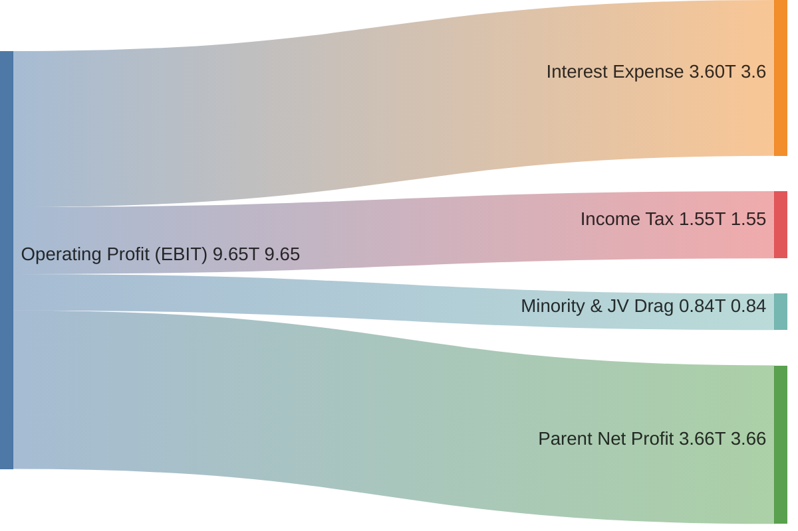

## 💡 First-Principles Intuition & Conceptual Core

Imagine a real-estate developer who owns a fully occupied, cash-generating flagship shopping mall in downtown Jakarta, alongside several half-built regional malls funded by expensive bank loans. Even though the flagship mall generates high operating profits before interest, crushing interest payments on the new construction sites eat most of the net cash—leaving almost nothing for dividends or finishing new corridors. Instead of borrowing even more debt or dumping unfinished sites at a loss, the developer sells a **35% minority stake** in the mature, predictable flagship mall to long-term pension/sovereign investors, uses that upfront equity cash to retire high-interest construction debt, and redeploys the balance into high-potential corridors.

In sovereign infrastructure management, this mechanism is **Infrastructure Asset Recycling** paired with **Two-Speed Concession Portfolio Management**. As demonstrated in **[[rabuan/2026-11-25-jasa-marga-biref7|Business Immersion BIREF7: PT Jasa Marga (Persero) Tbk]]**, massive state infrastructure operators frequently look extraordinarily profitable at the **EBITDA** line yet experience shrinking bottom-line profit for parent shareholders because debt-financed construction assets and low-occupancy frontier corridors drag down earnings conversion. Sustaining enterprise value therefore requires recycling mature equity, shifting from pure physical build-out (_Infra-Structure_) to customer journey monetization (_Infra-Culture_), and closing digital retention leaks.

### 🔑 Prerequisite Concepts & Jargon Decoder

| Operational / Financial Term                      | Plain-English Definition                                                                                                                            | Empirical Anchor (BIREF7 PT Jasa Marga)                                                                                  |
| :------------------------------------------------ | :-------------------------------------------------------------------------------------------------------------------------------------------------- | :----------------------------------------------------------------------------------------------------------------------- |
| **BOT Concession Lifecycle (30–50 Years)**        | Legal right to build, finance, and operate a public toll road for a fixed term before handing ownership back to the State.                          | _"The State Owns the Road, Jasa Marga Owns the Concession"_ under Ministry of Public Works (PU) & BPJT.                  |
| **EBITDA Margin vs. Parent Net Income**           | Operating cash profitability before interest, taxes, and depreciation vs. final net profit remaining for parent equity holders.                     | FY2025 EBITDA margin hit **67.0%** (Rp13.27T), yet parent net profit fell **19.3%** to **Rp3.66T**.                      |
| **Volume-to-Capacity Ratio ($V/C$)**              | Traffic volume divided by physical road design capacity; $V/C \ge 0.85$ signals severe saturation, while $V/C < 0.10$ signals under-utilization.    | **Two-Speed Network**: Jakarta–Tangerang $V/C \approx 0.94$ vs. Balikpapan–Samarinda & Manado–Bitung $0.04\text{–}0.05$. |
| **Asset Recycling (Partial Equity Divestment)**   | Monetizing minority equity stakes in stabilized brownfield concessions (or via DINFRA/sovereign funds) to deleverage and fund selective growth.     | Divested **35% of PT Jasamarga Transjawa Tol (JTT)** in 2024 for **Rp15.75 trillion** to cut debt drag.                  |
| **Thin-Owner Subsidiary Model**                   | Holding structure where individual concession companies hold rights cleanly while specialized shared-service subsidiaries run ops and maintenance.  | 14 BUJT "thin owners" served by **JMTO** (operator), **JMTM** (maintenance), and **JMRB** (rest-area/corridor).          |
| **Digital Adoption Funnel (Downloads $\to$ DAU)** | Retention cascade measuring how many app downloaders convert into Monthly Active Users (MAU) and Daily Active Users (DAU).                          | Travoy: **1.36M downloads** $\rightarrow$ **126,602 MAU (9.3%)** $\rightarrow$ **12,463 DAU (0.9% DL / ~0.4% tx)**.      |
| **Infra-Structure $\to$ Infra-Culture**           | Strategic pivot from measuring kilometers of asphalt built to monetizing the daily travel experience, rest-area dwell time, and digital ecosystems. | Aimed at unlocking higher-margin growth beyond **92%–95% toll-tariff** revenue dependence.                               |

---

## 📐 Universal Mechanism & Mathematical Architecture

To diagnose whether strong operational infrastructure assets actually create wealth for parent shareholders, analysts measure the **Earnings Conversion Ratio ($\eta_{\text{earn}}$)**:

$$\text{Earnings Conversion Ratio } (\eta_{\text{earn}}) = \frac{\text{Net Profit Attributable to Parent}}{\text{Operating Profit (EBIT)}}$$

### ⚙️ Mechanics & Structural Anatomy:

- **Numerator (Parent Net Profit)**: Represents the residual economic value genuinely accruing to the parent corporation (and sovereign shareholders like [[entities/danantara|Danantara]]) after paying debt holders, tax authorities, and joint-venture minority partners.
- **Denominator (Operating Profit / EBIT)**: Captures core earning power across toll gates and corridor assets prior to financing structure. When debt-financed Assets Under Construction (AUC) and early-stage loss-making concessions swell, interest expense acts as a heavy siphon between EBIT and parent net profit.

In FY2025, Jasa Marga's operating profit of **Rp9.65 trillion** yielded only **Rp3.66 trillion** in parent net profit ($\eta_{\text{earn}} \approx 37.9\%$) because **Rp3.60 trillion** in interest (on **Rp76.9 trillion** of interest-bearing debt, including **Rp31.7 trillion** of non-revenue assets under construction) and **Rp1.55 trillion** in taxes absorbed the majority of operating earnings:



### 🧮 10-Second Micro-Numerical Toy Example

Suppose a toll-road holding company earns **Rp100B in EBIT**, pays **Rp40B in interest** on construction debt, and pays **Rp20B in taxes/minority shares**:

- **Before Asset Recycling**: Parent Net Profit = $100 - 40 - 20 = \text{Rp40B}$, so $\eta_{\text{earn}} = 40/100 = 40\%$.
- **After Recycling 35% of Mature Equity**: Upfront equity proceeds retire half the debt, slashing annual interest from **Rp40B to Rp20B**. Assuming stable EBIT and Rp15B minority/tax allocation, Parent Net Profit jumps to $100 - 20 - 15 = \text{Rp65B}$, lifting earnings conversion to **65%** while eliminating refinancing fragility.

### 🗺️ Two-Speed Concession Portfolio Matrix

Managing a mixed national toll network requires distinct capital and operational playbooks across four portfolio quadrants:

```mermaid
quadrantChart
    title Two-Speed Toll Concession Matrix
    x-axis Low Occupancy (V/C) --> High Occupancy (V/C)
    y-axis Low Debt Drag --> High Debt Drag
    quadrant-1 Recycle & Monetize
    quadrant-2 Cash Cow & Infra-Culture
    quadrant-3 Selective Brownfield
    quadrant-4 Frontier PSO Drag
    "Dalam Kota Jakarta": [0.88, 0.25]
    "Jakarta-Tangerang": [0.94, 0.30]
    "Trans-Java Mature (JTT)": [0.78, 0.72]
    "Balikpapan-Samarinda": [0.08, 0.82]
    "Manado-Bitung": [0.06, 0.85]
    "New Greenfield Spoke": [0.22, 0.75]
```

---

## 🏛️ Multi-Disciplinary Lenses Across the MBA Curriculum

### 1. Financial Management & Capital Structure (MK 2)

- **Breaking the Leverage-Expansion Loop**: High EBITDA margins (67%) mask balance-sheet fragility when greenfield concessions sit in multi-year ramp-up phases. Shifting CapEx priority from greenfield build-outs toward selective **brownfield acquisitions** and **DINFRA / partial equity recycling** preserves investment-grade WACC and dividend capacity.
- _Cross-Link_: [[courses/mk2-financial-management-strategy/index|MK 2: Financial Management & Strategy]] & [[concepts/weighted-average-cost-of-capital|Weighted Average Cost of Capital (WACC)]].

### 2. Marketing & Customer Ecosystem Monetization (MK 3)

- **Closing the Digital Funnel & Dwell-Time Monetization**: When physical lanes reach $V/C > 0.90$ and core traffic grows only $+0.35\%$, revenue expansion shifts to the **5%–8% non-toll slice**: converting rest areas from brief transit stops into commercial destinations (_higher dwell time & basket spend_) and transforming digital apps (Travoy) from seasonal _mudik_ utilities into daily commuter habits.
- _Cross-Link_: [[courses/mk3-marketing-management/index|MK 3: Marketing Management]] & [[concepts/digital-marketing-funnel|Digital Marketing Funnel & Platform Ecosystem]].

### 3. Operations & Lifecycle Asset Preservation (MK 4)

- **Squeezing Physical Capacity & Heavy-Axle Governance**: With night-only maintenance windows (22:00–05:00 WIB) on corridors operating since 1978, **ODOL (Over Dimension Over Load)** freight trucks inflicting $4\times\text{–}13\times$ pavement damage erode maintenance budgets (Rp1.5T/year overlay) unless paired with automated Weigh-in-Motion (WIM) enforcement and real-time command centers (JMTC).
- _Cross-Link_: [[courses/mk4-operations-supply-chain-management/index|MK 4: Operations & Supply Chain Management]] & [[concepts/capacity-cushion|Capacity Cushion]].

---

## ⚖️ Cross-Functional Boardroom Tensions

- **Engineering Mandate vs. Financial Hurdle Rate**: Public infrastructure ministries demand immediate regional connectivity in low-traffic frontier provinces (**PSO mandate**), creating structural tension with corporate finance teams accountable for parent net profit conversion and shareholder ROE (**commercial mandate**).
- **App Downloads vs. Daily Active Habits**: Digital teams celebrate gross download milestones (1.36M+), while commercial and operations leaders confront <1% daily transaction penetration unless frictionless RFID clearance (_Travoy Go_) delivers an irresistible daily time advantage.

---

## 🚀 Action Learning Project (ALP) Application

> [!TIP] ALP Capstone Alignment
> Across capital-intensive BUMN hosts (ports, toll roads, energy terminals, railways, and smelters), ALP syndicates should never stop their financial diagnosis at Revenue or EBITDA margin. Always audit **EBIT-to-Parent-Net-Income conversion**, segment mature vs. frontier asset utilization ($V/C$), test **asset recycling** options for deleveraging, and measure digital transformation by **DAU/MAU retention** rather than cumulative downloads.

---

## 🔗 Contributing Sessions & References

- **Originating Immersion**: [[rabuan/2026-11-25-jasa-marga-biref7|Business Immersion BIREF7: PT Jasa Marga (Persero) Tbk — Infra-Culture & Asset Recycling]]
- **Host Enterprise & Plenary Bridges**:
  - [[entities/pt-jasa-marga|PT Jasa Marga (Persero) Tbk]]
  - [[entities/danantara|BPI Danantara]]
  - [[rabuan/2026-09-23-syamsul-infrastruktur|Rabuan 2026-09-23: Nation in Motion — Infrastruktur sebagai Penggerak Pertumbuhan]]
  - [[rabuan/2026-09-23-sahala-financial-discipline|Rabuan 2026-09-23: Memimpin dengan Financial Discipline]]
  - [[concepts/pso-commercial-duality|Public Service Obligation (PSO) vs Commercial Viability Duality]]
  - [[concepts/incremental-capital-output-ratio|Incremental Capital Output Ratio (ICOR)]]
- Return to **[[concepts/index|Knowledge Matrix]]**
