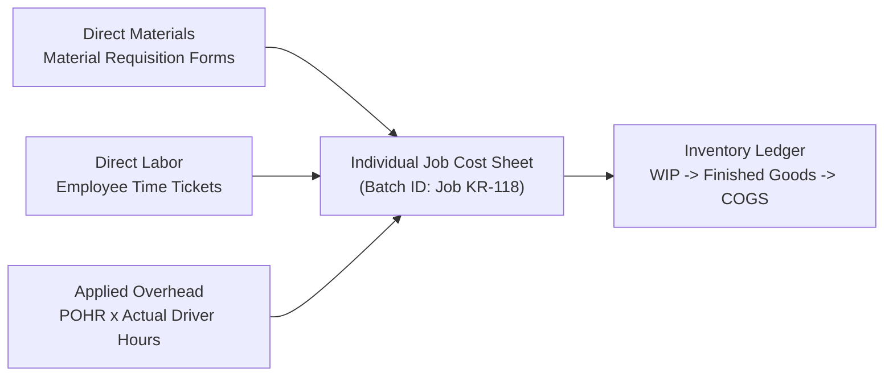

## 📐 Universal Mechanism & Operational Architecture

**Job-Order Costing** is a cost accounting methodology deployed when an enterprise manufactures products or delivers services in distinct, customized batches or client contracts. Unlike continuous process costing (which averages costs across millions of identical units, such as oil refining or flour milling), job costing traces direct materials, direct labor, and allocated overhead to individual job cost sheets.

---

## 🔢 Mathematical & Accounting Mechanics

### 1. Predetermined Overhead Rate (POHR)

Because indirect manufacturing overhead (utilities, supervisor salaries, factory rent, equipment depreciation) fluctuates unpredictably and cannot be measured until after period close, overhead is applied using a normalized rate established at the start of the fiscal year:

$$\mathbf{\text{POHR} = \frac{\text{Estimated Total Manufacturing Overhead Cost for the Period}}{\text{Estimated Total Allocation Base for the Period}}}$$

$$\mathbf{\text{Applied Overhead} = \text{POHR} \times \text{Actual Allocation Base Consumed by Job}}$$

### 2. Overhead Variance Accounting

At the close of the fiscal year, actual overhead incurred is reconciled against total overhead applied across all active jobs:

$$\mathbf{\text{Overhead Variance} = \text{Actual Overhead Incurred} - \text{Applied Overhead}}$$

- **Underapplied Overhead ($\text{Actual} > \text{Applied}$)**: Costs were under-allocated during production. The debit variance is closed to **Cost of Goods Sold (COGS)**, increasing cost and reducing operating profit.
- **Overapplied Overhead ($\text{Actual} < \text{Applied}$)**: Costs were over-allocated during production. The credit variance is deducted from **COGS**, decreasing cost and increasing operating profit.

---

## 🏢 Managerial Applications & Friction Points

| Operational Challenge             | Job Costing Trap                                                                            | Executive Governance Solution                                              |
| :-------------------------------- | :------------------------------------------------------------------------------------------ | :------------------------------------------------------------------------- |
| **Plantwide Rate Bias**           | Applying a single plantwide rate distorts costs between labor-heavy and machine-heavy jobs. | Implement **departmental overhead rates** with activity-specific drivers.  |
| **Idle Capacity Penalization**    | Spreading fixed factory overhead over low seasonal volume spikes unit costs.                | Calculate POHR using **practical capacity** rather than expected volume.   |
| **Custom vs Standard Distortion** | Small custom orders absorb disproportionate engineering and setup time.                     | Transition to **Activity-Based Costing (ABC)** for indirect support pools. |

---

## 🔗 Curricular Bridges

- Master Course Note: [[courses/mk2-financial-management-strategy/week-04/index|MK2 Week 04: Management Accounting Fundamentals]]
- Empirical Case Study: [[courses/mk2-financial-management-strategy/week-04/case-nusantara-craftworks|Nusantara CraftWorks Job Costing Case]]
- Advanced Cost System: [[concepts/activity-based-costing|Activity-Based Costing Framework]]
