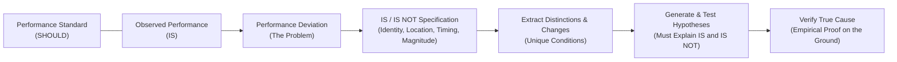
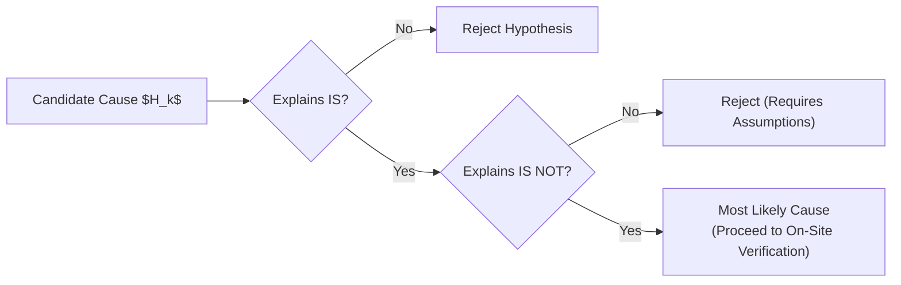

## 🧭 Executive Overview

**Kepner-Tregoe Problem Analysis (KT PA)** is a rational diagnostic methodology formulated by Charles H. Kepner and Benjamin B. Tregoe in _The New Rational Manager_ (1981, 1997). The framework operates on an empirical premise: **a problem is an unexplained deviation between expected standard performance (SHOULD) and observed actual performance (IS)**.

Unlike unstructured brainstorming or trial-and-error troubleshooting, KT PA enforces systematic boundary logic. By contrasting where the deviation manifests against closely related conditions where the deviation could theoretically appear but does not (_IS NOT_), analysts isolate distinctive characteristics and recent changes. These distinctions reveal the verified true cause rather than mere correlations.

---

## 🏛️ The Four Rational Processes of Kepner-Tregoe

Kepner-Tregoe contextualizes problem resolution within four distinct cognitive processes, preventing managers from prescribing solutions before verifying root causes:

| Rational Process                     | Core Question Addressed        | Primary Analytical Focus                                                                                                    | Output Deliverable                                             |
| :----------------------------------- | :----------------------------- | :-------------------------------------------------------------------------------------------------------------------------- | :------------------------------------------------------------- |
| **Situation Appraisal (SA)**         | _What is going on?_            | Separation, prioritization, and assignment of complex concerns based on Timing, Trend, and Impact (TTI).                    | Prioritized action matrix routing items to PA, DA, or PPA.     |
| **Problem Analysis (PA)**            | _Why did this happen?_         | Finding the unknown physical or procedural cause of a past or present operational deviation.                                | Verified root cause grounded in empirical distinction.         |
| **Decision Analysis (DA)**           | _Which course should we take?_ | Evaluating viable alternatives against mandatory (MUST) and desirable (WANT) criteria.                                      | Selected course of action with balanced risk profiles.         |
| **Potential Problem Analysis (PPA)** | _What lies ahead?_             | Preempting future operational risks, identifying possible trigger causes, and engineering preventive/contingent safeguards. | Action plan with preventive controls and contingency triggers. |

---

## 🔍 The IS / IS NOT Diagnostic Matrix

The cornerstone of KT PA is the specification matrix across four diagnostic dimensions: **Identity (What)**, **Location (Where)**, **Timing (When)**, and **Magnitude (Extent)**.

| Diagnostic Dimension          | IS (Observed Deviation)                                       | IS NOT (Close Plausible Alternative)                                    | Distinction (What is unique to IS?)                      | Relevant Change (What changed in or around the distinction?) |
| :---------------------------- | :------------------------------------------------------------ | :---------------------------------------------------------------------- | :------------------------------------------------------- | :----------------------------------------------------------- |
| **WHAT: Object**              | Which specific asset, SKU, or unit is defective?              | What similar assets/SKUs could be defective but are operating normally? | Physical characteristics, materials, design revision.    | Supplier change, formula alteration, maintenance.            |
| **WHAT: Defect**              | What specific symptom or failure mode is occurring?           | What other malfunction could have occurred but was not observed?        | Failure signature (e.g., scoring vs. fracture).          | Operating pressure, operator skill, chemical batch.          |
| **WHERE: Geographic**         | Where geographically or facility-wide is the defect observed? | Where else in the network could it occur but is absent?                 | Environmental differences, climate, storage conditions.  | Logistics rerouting, warehouse HVAC adjustment.              |
| **WHERE: Location on Object** | Where physically on the asset is the defect concentrated?     | Where else on the asset could the defect appear?                        | Structural stress zones, contact points, exposure areas. | Tooling wear, friction point, uneven heat distribution.      |
| **WHEN: First Observed**      | When in calendar time was the deviation first detected?       | When could it have been detected prior to that date?                    | Shift schedule, batch changeover, seasonal onset.        | Raw material delivery date, software patch deployment.       |
| **WHEN: Operating Cycle**     | At what exact stage in the process does the problem occur?    | At what prior or subsequent process step could it manifest?             | Machine cycle phase, thermal soak period, packaging.     | Line speed increase, sensor bypass, cool-down time.          |
| **EXTENT: Quantity**          | How many units, lines, or clients are affected?               | How many units could be affected under full propagation?                | Containment boundary, failure density.                   | Capacity surge, workload threshold crossing.                 |
| **EXTENT: Trend**             | Is the frequency increasing, decreasing, or cyclical?         | What pattern could have manifested (e.g., continuous)?                  | Periodic triggers vs. persistent failure.                | Shift rotation, ambient weekend shutdown.                    |

---

## ⚙️ Mathematical & Logical Testing of Causes

A candidate hypothesis qualifies as a **plausible cause** only if it fully explains both sides of the specification ledger without requiring unsupported auxiliary assumptions.

$$\text{Plausibility}(H_k) = \prod_{i=1}^{m} \mathbb{I}\left( H_k \text{ explains } \text{IS}_i \land \text{IS NOT}_i \right)$$

Where $\mathbb{I}$ is an indicator function evaluating to $1$ if hypothesis $H_k$ accounts for the empirical contrast, and $0$ if a contradiction emerges.

### Distinction vs. Verified True Cause

Kepner and Tregoe establish a strict epistemic boundary: **a hypothesis derived from an IS / IS NOT matrix is merely the most likely cause, never the verified true cause**. True cause verification requires:

1. **Physical confirmation**: Direct mechanical, chemical, or operational inspection proving the mechanism exists.
2. **Reverse testing (Turn On / Turn Off)**: Recreating the deviation by applying the distinct change, and eliminating the deviation by restoring prior baseline conditions.

---

## 💼 Cross-Curricular Application & Real-World Synthesis

- **[[courses/mk5-decision-making-negotiation/week-03/index|MK5 Week 03 (Kepner-Tregoe Problem Analysis)]]**: Application to the **Pasar Kita** supply chain fulfillment breakdown and the classic **Exxon Valdez**, **Oh, Nuts!**, and **Ragin' Cajun Chicken** case studies.
- **[[concepts/toyota-production-system#jidoka|Toyota Production System (Jidoka & 5 Whys)]]**: KT PA complements Lean root-cause protocols by establishing empirical boundary conditions before executing iterative causal drill-downs.
- **[[concepts/service-blueprinting|Service Blueprinting]]**: Isolating fail points and execution bottlenecks along backstage processes and line of visibility deviations.
- **[[courses/mk5-decision-making-negotiation/mid/index|Mid-Term Examination Synthesis]]**: Situation Appraisal (SA) and Problem Analysis (PA) form mandatory foundational sections of executive diagnostic submissions.
