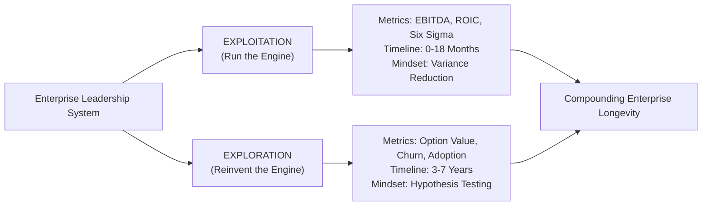

## 📐 Universal Mechanism & Theoretical Core

**Leadership Ambidexterity** defines the executive and organizational capability to simultaneously execute two fundamentally opposing strategic imperatives:

1. **Exploitation (Harvesting the Core)**: Optimizing existing operational assets, driving margin efficiency, reducing process variance, and maximizing current-period cash flow.
2. **Exploration (Seeding the Future)**: Experimenting with emergent technologies, pioneering new business models, embracing calculated variance, and creating non-linear future revenue engines.

Mathematically, organizational survival over multi-decade cycles requires balancing exploitation returns with exploration option value:

$$\text{Enterprise Longevity} = \alpha \cdot \text{Cash Flow}_{\text{Core}} + \beta \cdot \sum_{i=1}^{n} \text{Real Option Value}(\text{Venture}_i)$$

Where an organization over-indexing exclusively on exploitation ($\beta \to 0$) experiences structural obsolescence through disruptive innovation (the _Success Trap_), whereas an enterprise over-indexing on unanchored exploration ($\alpha \to 0$) suffers cash exhaustion before commercial scale (the _Failure Trap_).

---

## 🏛️ Multi-Disciplinary Lenses Across the MBA Curriculum

### 1. Organizational Behavior & Executive Trajectories (MK 1 & Rabuan)

- **Primary Source**: [[entities/ric-roi|Dr. Ric Roi]] (IMD C-Suite Leader AMBIDEX Model), James G. March (1991), O'Reilly & Tushman (2004).
- **Core Mechanism**: Individual leaders must develop **cognitive ambidexterity**—the mental agility to switch between rigorous operational review (Level 2/3 front-line execution) and long-range strategic boundary expansion (Level 5 enterprise stewardship).
- **Cultural Shielding**: Structurally isolating exploratory innovation teams from corporate bureaucracy while maintaining senior executive cross-linkage to prevent the "corporate immune system" from starving new ventures.

### 2. Operations & Process Architecture (MK 4)

- **Primary Mechanism**: Reconciling the tension between **[[concepts/littles-law|Little's Law]]** and operational throughput control versus agile discovery.
- **Process Decoupling**: Exploitative production relies on rigid standard operating procedures (SOPs) and poka-yoke fail-safes; exploratory development requires rapid iteration, discovery sprints, and high failure tolerance.

### 3. Capital Strategy & Corporate Finance (MK 2)

- **Primary Mechanism**: Differential hurdle rate governance. Applying standard Discounted Cash Flow (DCF) with high WACC hurdles to nascent disruptive ventures prematurely kills exploration. Ambidextrous firms govern exploration through staged venture-capital milestones and real-options valuation.

---

## ⚖️ Cross-Functional Boardroom Tensions

- **CFO vs. Chief Innovation Officer**: Finance demands predictable quarterly earnings-per-share (EPS) and positive Net Present Value (NPV). Innovation leaders require patient seed capital with asymmetric payoff profiles.
- **Operational BU Chiefs vs. Corporate Venturing**: Legacy business unit heads perceive exploratory internal startups as distractions or threats that cannibalize existing revenue streams and divert high-performing talent.

---

## 🚀 Action Learning Project (ALP) BUMN Application

> [!TIP] Dual Transformation in Indonesian State-Owned Enterprises
> In large Indonesian BUMNs, ambidexterity is mandated by national policy:
>
> 1. **Bank Mandiri**: Optimizing nationwide corporate loan underwriting and branch banking while aggressively expanding **Livin' by Mandiri** (retail digital bank) and **Kopra by Mandiri** (wholesale digital platform).
> 2. **PT Pertamina (Persero)**: Harvesting fossil-fuel refining and retail distribution cash flows to underwrite multi-gigawatt geothermal, biofuels, and green hydrogen ventures.
> 3. **PT Telkom Indonesia**: Executing the **"From Telco to TechCo"** transformation (studied by Dr. Ric Roi at Globe Telecom), shifting from legacy voice/SMS transmission infrastructure to enterprise cloud, hyperscale data centers, and digital B2B solutions.

---

## 🔗 Contributing Sessions & References

- **Rabuan Keynote**: [[rabuan/2026-10-14-ric-roi-impact-career|Rabuan 02: Making an Impact, Making a Career (Dr. Ric Roi)]]
- **Featured Theorist**: [[entities/ric-roi|Dr. Ric Roi]]
- **Related Mechanisms**:
  - [[concepts/talent-density|Talent Density Power Law]]
  - [[concepts/purpose-to-impact|Purpose-to-Impact Planning]]
- **Hub**: [[concepts/index|Knowledge Matrix]]
