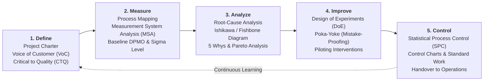
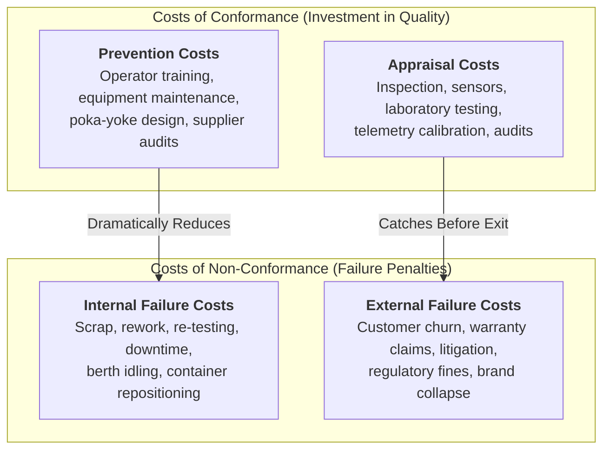

**Lean Six Sigma (LSS)** is a managerial and operational methodology that synthesizes two historically distinct disciplines: **Lean Operations** (developed by Toyota to eliminate non-value-adding waste and optimize velocity) and **Six Sigma** (developed by Motorola and popularized by General Electric to systematically reduce process variation and eliminate defects). Governed by the **DMAIC (Define, Measure, Analyze, Improve, Control)** problem-solving architecture, Lean Six Sigma establishes an empirical standard of near-zero defects—statistically defined as no more than **$3.4\text{ Defects Per Million Opportunities (DPMO)}$**.

---

## 💡 1. Intuition & Everyday Analogy

Imagine an artisanal espresso coffee bar at a busy transit station.

- If the barista takes 7 minutes per cup because coffee cups are stored in a back closet, sugar is across the room, and the milk frother is clogged, the bar suffers from **waste and friction (_Muda_)**. Applying **Lean** rearranges the counter, standardizes barista motions, and cuts service time to 45 seconds.
- However, if out of every 100 lattes served, 15 are scalding hot, 10 are lukewarm, and 8 taste sour because water temperature and grind size fluctuate wildly, customers leave dissatisfied despite fast service. The bar suffers from **process variance**. Applying **Six Sigma** calibrates water temperature to $\pm 0.5^\circ\text{C}$, standardizes bean weight, and guarantees that every cup meets exact customer specifications.

**Lean provides speed and flow; Six Sigma provides precision and repeatability.** Neither alone is sufficient for enterprise operational excellence.

---

## 🔍 2. Prerequisite & Jargon Decoder

| Term                                        | Definitional Meaning in Quality Management                                                                                                                                                                                 | Operational Failure Mode                                                                                                           |
| :------------------------------------------ | :------------------------------------------------------------------------------------------------------------------------------------------------------------------------------------------------------------------------- | :--------------------------------------------------------------------------------------------------------------------------------- |
| **Design Quality vs Conformance Quality**   | **Design Quality** is the inherent feature set meeting customer segment expectations. **Conformance Quality** is the degree to which the operating process consistently meets those design specifications without defect.  | A luxury Mercedes that breaks down every month has high design quality but abysmal conformance quality.                            |
| **Defect Per Million Opportunities (DPMO)** | The standardized metric quantifying defect rate across processes of varying complexity: $\text{DPMO} = \frac{\text{Total Defects}}{\text{Total Units} \times \text{Defect Opportunities per Unit}} \times 10^6$.           | Measuring defects solely as "percentage of units defective," obscuring differences between simple and complex multi-step products. |
| **The $1.5\sigma$ Long-Term Shift**         | Motorola's empirical finding that processes drift over time by roughly $1.5\sigma$. Thus, a $6\sigma$ process specification corresponds to a $4.5\sigma$ area under the standard normal curve, yielding $3.4\text{ DPMO}$. | Assuming static laboratory conditions in real-world factory operations.                                                            |
| **Cost of Quality (CoQ)**                   | The total financial burden of quality, divided into **Conformance Costs** (Prevention + Appraisal) and **Non-Conformance Costs** (Internal Failure + External Failure).                                                    | Starving prevention capex to save short-term opex, triggering multi-billion-dollar product recall disasters.                       |

---

## 🏛️ 3. Structural Anatomy of the DMAIC Cycle

The execution backbone of Lean Six Sigma is the 5-phase **DMAIC** loop:

### The Cost of Quality (CoQ) Economic Equilibrium

Classical quality economics demonstrates that **$1 invested in Prevention eliminates $10 in Appraisal costs and $100 in Failure costs (the 1-10-100 Rule)**.

---

## 🔢 4. Micro-Numerical Toy Example & DPMO Calculation

### Scenario: Container Terminal Gate Inspection

At a port terminal, each inbound container undergoes an inspection across **$4\text{ defect opportunities}$**:

1. Seal integrity verified
2. Container weight within legal tolerance
3. Hazardous material placard matched to manifest
4. RFID transponder registered

During a monthly audit, $N = 25{,}000$ containers passed through the gate. Quality auditors identified $D = 85$ total defects across all four categories.

#### Step 1: Compute Total Opportunities ($O_{\text{total}}$)

$$
O_{\text{total}} = N \times \text{Opportunities per Container} = 25{,}000 \times 4 = 100{,}000\text{ opportunities}
$$

#### Step 2: Compute DPMO

$$
\text{DPMO} = \frac{D}{O_{\text{total}}} \times 1{,}000{,}000 = \frac{85}{100{,}000} \times 1{,}000{,}000 = \mathbf{850\text{ DPMO}}
$$

#### Step 3: Benchmarking Against Sigma Performance

- $3\sigma$ Process: $66{,}807\text{ DPMO}$ ($93.32\%$ yield)
- $4\sigma$ Process: $6{,}210\text{ DPMO}$ ($99.38\%$ yield)
- **Terminal Gate Performance ($\approx 4.6\sigma$)**: $850\text{ DPMO}$ ($99.915\%$ yield)
- $6\sigma$ Standard: $3.4\text{ DPMO}$ ($99.99966\%$ yield)

Conclusion: While $99.9\%$ accuracy appears excellent to casual observers, in a high-volume port processing $1\text{ million}$ containers annually, $850\text{ DPMO}$ translates to **$850$ misidentified or improperly sealed containers**, representing severe customs breaches and safety hazards. Lean Six Sigma drives the systemic root-cause interventions needed to reach $3.4\text{ DPMO}$.

---

## 🔗 Related Knowledge Bridges

- Master Curricular Hub: [[courses/mk4-operations-supply-chain-management/week-09/index|MK4 Week 09: Lean Six Sigma & Quality Management]]
- Case Study Dossier: [[courses/mk4-operations-supply-chain-management/week-09/case-pelindo-lean-six-sigma|Case Study: Pelindo — The Score, the Berth, and the Gate That Is Not Ours]]
- Prior Module: [[courses/mk4-operations-supply-chain-management/week-08/index|Week 08: Lean Operations & Waste Elimination (Muda)]]
- Corporate Entity: [[entities/pt-pelabuhan-indonesia|PT Pelabuhan Indonesia (Persero) Profile]]
- Return to [[concepts/index|Knowledge Matrix (Concepts Hub)]]
