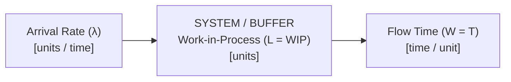
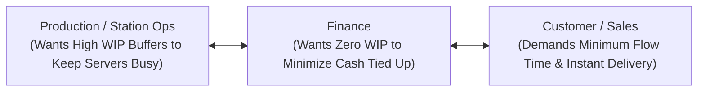

## 📐 Universal Definition & Conceptual Core

**Little's Law** is a fundamental mathematical theorem in operations management, industrial engineering, and queuing theory proven by MIT professor **John D. C. Little** (Operations Research, 1961, _"A Proof for the Queuing Formula: $L = \lambda W$ "_).

The theorem states that under steady-state conditions, the **long-term average number of items or customers in a stationary queueing system ($L$ or $WIP$)** is strictly equal to the **long-term average effective arrival rate or throughput rate ($\lambda$ or $R$)** multiplied by the **average time that an item or customer spends in the system ($W$ or $T$, Flow Time)**:

$$\mathbf{L = \lambda \times W} \quad \iff \quad \mathbf{WIP = \text{Throughput Rate} \times \text{Flow Time}}$$

### The Three Operational Forms

Because the formula consists of three interrelated variables, rearranging it yields three essential management equations:

1. **Calculating Inventory / Queue Size ($L$ or $WIP$)**:
   $$\mathbf{L = \lambda \times W}$$
2. **Calculating Flow Time / Cycle Time ($W$ or $T$)**:
   $$\mathbf{W = \frac{L}{\lambda}} \quad \iff \quad \mathbf{\text{Flow Time} = \frac{\text{Work-in-Process}}{\text{Throughput Rate}}}$$
3. **Calculating Throughput Rate / Capacity Required ($\lambda$ or $R$)**:
   $$\mathbf{\lambda = \frac{L}{W}} \quad \iff \quad \mathbf{\text{Throughput Rate} = \frac{\text{Work-in-Process}}{\text{Flow Time}}}$$

### Operational Invariance: Why Little's Law is Remarkable

Little's Law is one of the most powerful theorems in quantitative management because it holds true **independent of**:

- The statistical probability distribution of arrivals (Poisson, normal, exponential, or deterministic).
- The statistical probability distribution of service times.
- The internal queuing discipline (First-In-First-Out / FIFO, Last-In-First-Out / LIFO, priority routing, or random service).
- The internal complexity or number of sequential workstations within the black box.

As long as the system is **stable** (average arrival rate does not exceed average service capacity, $\lambda < \mu$) and **stationary** (no perpetual accumulation or leakage of units), Little's Law holds with absolute mathematical certainty.

---

## 🧮 Practical Enterprise Applications

### 1. Reducing Customer Waiting Time Without Capital Investment

Consider a hospital emergency department or railway boarding queue:
$$\mathbf{\text{Waiting Time } (W) = \frac{\text{Queue Length } (L)}{\text{Processing Rate } (\lambda)}}$$
To cut patient or passenger waiting time in half, an organization does not necessarily need to double medical staff or turnstiles ($\uparrow \lambda$). Instead, **capping and controlling the volume of people allowed into the waiting buffer ($L$)** directly reduces flow time ($W$).

### 2. Working Capital & Inventory Turns ($MK 2 \iff MK 4$)

In manufacturing and retail supply chains:
$$\mathbf{\text{Inventory Turnover} = \frac{\text{Cost of Goods Sold}}{\text{Average Inventory}} = \frac{\lambda}{L} = \frac{1}{W}}$$
Little's Law proves that **inventory turnover is simply the inverse of flow time**. Cutting the time it takes for raw material to convert into delivered finished goods directly reduces the cash tied up in working capital.

---

## 🚉 Application: Process Analysis & Station Throughput (PT KAI)

In analyzing railway station boarding architectures (such as **PT Kereta Api Indonesia**):

> [!NOTE] The Gambir Gate Queue Arithmetic
> If an on-site customer service registration desk processes registrations at an effective rate of $\lambda = 80 \text{ passengers/hour}$ ($1.33 \text{ passengers/minute}$):
>
> - If during peak holiday travel, $L = 60 \text{ passengers}$ are backed up in the customer service waiting line,
> - The average passenger wait time before even reaching the registration officer is:
>   $$\mathbf{W = \frac{L}{\lambda} = \frac{60 \text{ passengers}}{1.33 \text{ passengers/minute}} = 45 \text{ minutes!}}$$
>
> A passenger experiencing a 45-minute queue at the registration desk will inevitably miss their scheduled train—regardless of whether the automated face-recognition boarding gate operates at **1 second**!

---

## 🏛️ Multi-Disciplinary Lenses Across the MBA Curriculum

### 1. Operations & Supply Chain Management (MK 4)

- **Primary Mechanism**: Line balancing, bottleneck flow analysis, and buffer sizing.
- **Core Insight**: WIP and flow time are directly coupled. In Lean operations (Kanban), controlling WIP is the primary mechanism for driving down cycle times and exposing root-cause quality defects.
- _Discussed in_: [[courses/mk4-operations-supply-chain-management/week-06/index|MK 4 Week 06 (Process Design, Analysis & Little's Law)]].

### 2. Business Analytics & Quantitative Modeling (MK 6)

- **Primary Mechanism**: Discrete event simulation validation and queuing theory verification ($M/M/1$ and $M/M/c$ models).
- **Core Insight**: Serves as the ultimate mathematical sanity check for any stochastic simulation model—if simulated WIP, throughput, and flow time do not satisfy $L = \lambda W$, the model has structural flaws.

### 3. Financial Management & Corporate Strategy (MK 2)

- **Primary Mechanism**: Cash conversion cycle ($CCC$) compression.
- **Core Insight**: Compressing operational flow time ($W$) accelerates cash velocity, reduces balance-sheet working capital lines, and enhances return on invested capital ($ROIC$).

---

## ⚖️ Cross-Functional Boardroom Tensions

1. **Server Utilization vs. Cycle Time**:
   Traditional plant managers maintain large piles of WIP to ensure machines and workers never sit idle (100% utilization). Little's Law demonstrates that high WIP directly inflates flow time ($W = L / \lambda$), causing order lead times to balloon and customer delivery dates to fail.
2. **Batch Sizing vs. Responsiveness**:
   Finance and procurement favor massive production runs to capture purchasing discounts; operations leaders armed with Little's Law show that large batches clog system WIP and stall enterprise agility.

---

## 🚀 Action Learning Project (ALP) Application

> [!TIP] ALP Capstone Alignment: Auditing Operational Velocity in BUMNs
> For P3MD consulting teams auditing partner BUMN operational workflows:
>
> 1. **Measure the Three Coordinates**: For any core process (e.g., loan approval at Bank Mandiri, container dwell time at Pelindo, procurement vendor onboarding at Pertamina), measure empirical $L$ (pending cases), $\lambda$ (completions per day), and $W$ (average days elapsed).
> 2. **Identify Hidden WIP Buildups**: Look for where cases sit idle waiting for sign-offs. Applying Little's Law reveals that eliminating 50% of the active queue ($L$) cuts turnaround time ($W$) in half without buying new software or hiring additional staff.

---

## 🔗 Contributing Sessions & References

- Master Lecture Note: [[courses/mk4-operations-supply-chain-management/week-06/index|MK 4 Week 06: Process Design, Analysis & Little's Law]]
- Case Study: [[courses/mk4-operations-supply-chain-management/week-06/case-kai-gambir-gate|PT Kereta Api Indonesia (Persero): One Second at the Gambir Gate]]
- Theorist Profile: [[entities/richard-b-chase|Richard B. Chase]]
- Related Concepts:
  - [[concepts/service-blueprinting|Service Blueprinting]]
  - [[concepts/customer-order-decoupling-point|Customer Order Decoupling Point]]
  - [[concepts/customer-introduced-variability|Customer-Introduced Variability]]
- Master Hub: [[concepts/index|Knowledge Matrix]]
