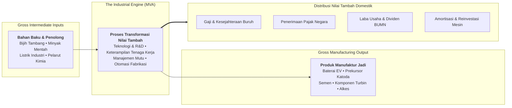

## 💡 First-Principles Intuition & Conceptual Core

Every economy produces goods, but not all goods create sustainable domestic prosperity. When a nation simply extracts natural resources from the earth and ships them abroad, it sells natural capital once. But when a nation builds industrial processing facilities that convert raw earth into engineered components, machinery, and consumer products, it creates **new wealth** that did not exist before.

The critical macroeconomic question for developing sovereign nations is:

$$\mathbf{\text{\ldquo How much net economic value is generated after deducting the physical raw materials and intermediate supplies consumed in production?\rdquo}}$$

Consider an everyday industrial analogy: Imagine an artisanal furniture workshop.

- If the woodcutter chops down a mahogany tree and sells the raw logs for **Rp 2 million**, the economic value generated is minimal.
- If a carpenter buys the raw logs for **Rp 2 million**, purchases glue and varnish for **Rp 500,000** (total raw inputs = Rp 2.5 million), and crafts an intricately carved dining table that sells for **Rp 12 million**, the **Manufacturing Value Added (MVA)** is:
  $$\text{Rp } 12{,}000{,}000 - \text{Rp } 2{,}500{,}000 = \text{Rp } 9{,}500{,}000$$

That Rp 9.5 million of added value does not disappear—it directly funds the carpenter's wages, amortizes the factory's cutting tools, pays municipal taxes, and generates corporate profits.

**Manufacturing Value Added (MVA)** is the universally accepted macroeconomic benchmark (standardized by UNIDO and the World Bank) that measures the net contribution of the manufacturing sector to an economy. It strips away the cost of intermediate purchases, reflecting purely the economic value created through domestic transformation, technological capability, labor wages, and industrial productivity.

---

## 🔍 Prerequisite & Jargon Decoder

To interpret national industrial accounts and corporate balance sheets without confusion, sovereign leaders must distinguish between four core metrics:

| Terminology                                                           | Economic Meaning                                                                                                             | Accounting / Macro Definition                                                                             |
| :-------------------------------------------------------------------- | :--------------------------------------------------------------------------------------------------------------------------- | :-------------------------------------------------------------------------------------------------------- |
| **Gross Industrial Output** (_Nilai Output Bruto_)                    | Total commercial revenue generated from the sale of all manufactured goods at factory-gate prices.                           | $\text{Gross Output} = \text{Sales Revenue} + \Delta\text{Inventories}$                                   |
| **Intermediate Consumption** (_Konsumsi Antara_)                      | The total cost of raw materials, energy, packaging, and outsourced services consumed during production.                      | Excludes capital machinery depreciation; includes only goods and services used up in the operating cycle. |
| **Manufacturing Value Added (MVA)** (_Nilai Tambah Bruto Manufaktur_) | The net wealth created by transforming intermediate inputs into final outputs.                                               | $\text{MVA} = \text{Gross Output} - \text{Intermediate Consumption}$                                      |
| **MVA Intensity** (_Pangsa MVA terhadap PDB_)                         | The percentage of a nation's total Gross Domestic Product (GDP) accounted for by manufacturing value added.                  | $\text{MVA Share} = \frac{\text{MVA}}{\text{Nominal GDP}} \times 100\%$                                   |
| **UNIDO INDSTAT / ISIC Rev. 4**                                       | The international classification standard dividing manufacturing into 23 distinct industrial divisions (divisions 10 to 33). | Ensures rigorous apples-to-apples global comparisons across nations.                                      |

---

## ⚙️ Structural Anatomy of the Mechanism

The mathematical structure of Manufacturing Value Added can be analyzed from two symmetrical angles: the **Production Approach** (what is created) and the **Income Distribution Approach** (who receives the value created).

### 1. The Production Approach

$$\text{MVA} = Y_{\text{gross}} - C_{\text{intermediate}}$$

Where:

- $Y_{\text{gross}}$ is the total monetary value of goods produced (factory-gate price, excluding VAT and transport margins).
- $C_{\text{intermediate}}$ is the cost of all raw goods, operating power, fuels, and operational services consumed.

### 2. The Income Distribution Approach

$$\text{MVA} = W + T_{\text{net}} + D + \Pi_{\text{operating}}$$

Where:

- $W$ = Compensation of employees (salaries, wages, healthcare, and social security).
- $T_{\text{net}}$ = Taxes on production less government subsidies.
- $D$ = Consumption of fixed capital (depreciation and amortization of plant and machinery).
- $\Pi_{\text{operating}}$ = Net operating surplus (corporate operating profits available for reinvestment or dividends).

### 3. The Downstream Value Multiplier (_Multiplier Hilirisasi_)

When a country transitions from raw resource extraction to deep domestic processing, the expansion of MVA is quantified by the downstream multiplier:

$$\text{Multiplier}_{\text{Hilir}} = \frac{\text{MVA}_{\text{Downstream}}}{\text{MVA}_{\text{Raw Ore Extraction}}}$$

When raw nickel laterite ore ($\sim 1.5\%$ Ni) is processed into Mixed Hydroxide Precipitate (MHP), refined nickel sulfate, cathode precursor, and ultimately lithium-ion battery cells, the domestic value addition expands by **15 to 25 times**, permanently capturing capital within the national borders.

---

## 🧮 Micro-Numerical Toy Example: Nickel Downstreaming Facility

Consider a state-owned industrial plant operated under a BUMN holding company producing EV cathode precursors:

1. **Intermediate Purchases ($C_{\text{intermediate}}$)**:
   - Raw nickel ore and mineral feedstock: **USD 30 million**
   - Industrial electric power and process gas: **USD 8 million**
   - Sulfuric acid, liquid reagents, and solvents: **USD 12 million**
   - Total intermediate consumption:
     $$C_{\text{intermediate}} = 30 + 8 + 12 = \mathbf{\text{USD } 50 \text{ million}}$$

2. **Gross Manufacturing Output ($Y_{\text{gross}}$)**:
   - The plant synthesizes and sells 20,000 metric tons of battery-grade precursor:
     $$Y_{\text{gross}} = \mathbf{\text{USD } 120 \text{ million}}$$

3. **Net Manufacturing Value Added Calculation**:
   $$\text{MVA} = 120 - 50 = \mathbf{\text{USD } 70 \text{ million}}$$

4. **Value Allocation Breakdown**:
   - Technical engineering and labor wages ($W$): **USD 25 million**
   - Capital depreciation on precision autoclaves ($D$): **USD 15 million**
   - Corporate and production taxes to the Ministry of Finance ($T_{\text{net}}$): **USD 10 million**
   - Net operating profit for sovereign reinvestment ($\Pi_{\text{operating}}$): **USD 20 million**

**Contrast with Raw Ore Exporting**:  
If the enterprise had simply excavated and exported the raw ore directly:

- Gross export value: USD 35 million
- Heavy machinery diesel and excavation cost: USD 25 million
- **MVA created**: Only **USD 10 million** (primarily low-skill diesel-intensive extraction).
- **The Value-Addition Gain**: Domestic value creation jumped from **USD 10M to USD 70M** (a $7\times$ domestic wealth multiplier).

---

## 🌐 Global & Regional Empirical Benchmarks (World Bank 2025–2026)

In his August 19, 2026 foundation address to the P3MD cohort, Minister of Industry [[entities/agus-gumiwang-kartasasmita|Dr. Agus Gumiwang Kartasasmita]] unveiled the latest global and regional MVA rankings:

### 1. Top 15 World MVA Rankings (USD Billion)

Total global manufacturing value added reached **USD 17,601.08 Billion**. Indonesia holds the **12th position globally**, accounting for **1.57%** of the world's total industrial value addition:

|  Rank  | Country        | Global Region | MVA 2025 (USD Billion) | Share of Global MVA (%) |
| :----: | :------------- | :------------ | :--------------------: | :---------------------: |
|   1    | China          | Asia          |        4,822.73        |         27.40%          |
|   2    | United States  | America       |        2,497.13        |         15.46%          |
|   3    | Germany        | Europe        |         889.63         |          5.05%          |
|   4    | Japan          | Asia          |         788.45         |          4.74%          |
|   5    | India          | Asia          |         532.92         |          3.03%          |
|   6    | South Korea    | Asia          |         513.52         |          2.29%          |
|   7    | Italy          | Europe        |         382.77         |          2.77%          |
|   8    | Mexico         | America       |         366.08         |          2.08%          |
|   9    | Russia         | Europe        |         349.77         |          1.99%          |
|   10   | France         | Europe        |         319.34         |          1.81%          |
|   11   | United Kingdom | Europe        |         307.30         |          1.75%          |
| **12** | **Indonesia**  | **Asia**      |       **275.61**       |        **1.57%**        |
|   13   | Brazil         | America       |         268.40         |          1.52%          |
|   14   | Ireland        | Europe        |         244.84         |          1.39%          |
|   15   | Türkiye        | Europe        |         228.91         |          1.38%          |

> _Source: World Bank & UNIDO International Industrial Statistics, presented by Kementerian Perindustrian RI (2026)._

### 2. ASEAN MVA Leadership (USD Billion)

Within Southeast Asia, Indonesia's industrial output is uncontested, generating **more than double the MVA of second-place Thailand**:

| ASEAN Rank | Country           | MVA 2025 (USD Billion) | Comparative Ratio vs Indonesia |
| :--------: | :---------------- | :--------------------: | :----------------------------: |
|   **1**    | **Indonesia**     |       **275.61**       |  **1.00x (Baseline Leader)**   |
|     2      | Thailand          |         137.01         |     0.50x (Less than half)     |
|     3      | Vietnam           |         126.24         |             0.46x              |
|     4      | Singapore         |         105.25         |             0.38x              |
|     5      | Malaysia          |         104.33         |             0.38x              |
|     6      | Philippines       |         74.67          |             0.27x              |
|     7      | Myanmar           |         20.49          |             0.07x              |
|     8      | Cambodia          |         14.88          |             0.05x              |
|     9      | Laos              |          1.67          |             0.01x              |
|     10     | Brunei Darussalam |          1.49          |             0.01x              |
|     11     | Timor-Leste       |          0.04          |            0.0001x             |

---

## 🏛️ Strategic Imperatives for BUMN & Sovereign Leaders

For future holding directors and asset architects under [[entities/danantara|BPI Danantara]], MVA is not an academic curiosity; it is the ultimate test of state-owned enterprise performance:

1. **Escaping the Premature Deindustrialization Trap**:  
   While raw commodity booms artificially inflate nominal GDP figures, only high-MVA manufacturing generates stable, high-wage formal employment capable of absorbing Indonesia's demographic bonus.
2. **From Extraction to Complex Manufacturing**:  
   BUMNs in mining (MIND ID), energy (Pertamina, PLN), and plantation (PTPN) must not rest on primary resource extraction. Capital expenditure must prioritize chemical cracking, smelting, precision refining, and domestic component fabrication.
3. **Mandatory P3DN & TKDN Enforcement**:  
   State procurement acts as guaranteed domestic demand. By prioritizing high-TKDN certified domestic suppliers, BUMN capex recycles directly into national MVA expansion rather than leaking into foreign industrial centers.
4. **RIPIN 2025–2045 Target**:  
   Indonesia's structural vision requires elevating manufacturing's GDP share from its current ~16.8% to **28% by 2045**, positioning Indonesia as the **7th largest manufacturing powerhouse on Earth**.
