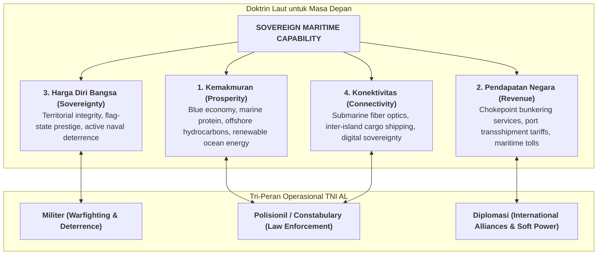
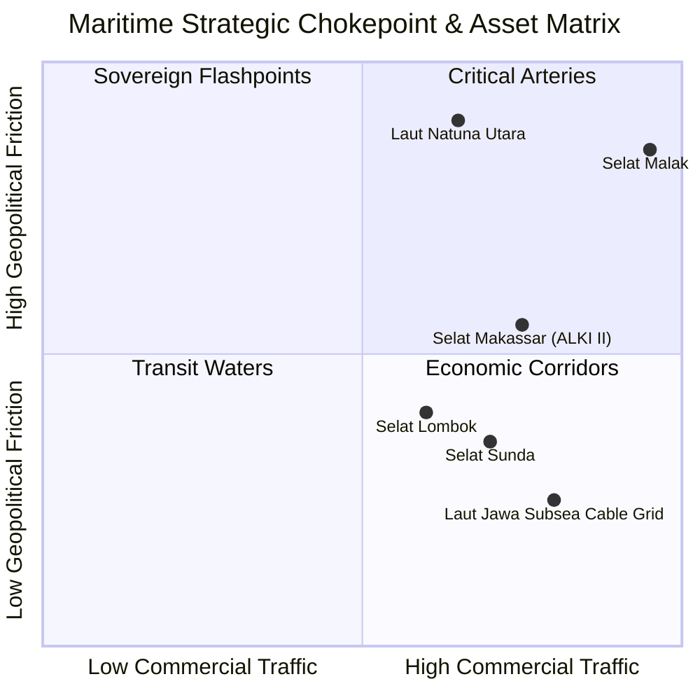

## 1. Executive Summary & Plain-English Intuition

In conventional continental economics, geography is conceptualized as land-mass surrounded by passive bodies of water. For Indonesia—the world’s largest archipelagic state spanning over 17,500 islands, 6.4 million square kilometers of maritime territory, and four of the world’s nine primary naval choke points—this continental paradigm produces dangerous strategic blindness. Water in Indonesia is not a barrier that separates islands; it is the primary national highway that connects economic centers, houses critical energy pipelines and fiber-optic data cables, and serves as the strategic artery through which over $40\%$ of global seaborne commerce transits.

Codified in executive doctrine by [[entities/muhammad-ali|Laksamana TNI Dr. Muhammad Ali, S.E., M.M., M.Tr.Opsla]] (Kepala Staf TNI Angkatan Laut / KSAL), the **Maritime Geostrategy Framework** articulates how archipelagic sovereignty, naval deterrence, and state-owned enterprise (BUMN) logistics intersect. The doctrine bridges military defense and economic statecraft, demonstrating that sovereign wealth funds like [[entities/danantara|Danantara]] and strategic holdings like [[entities/pt-pertamina|Pertamina]] cannot sustain long-term economic compounding without unassailable maritime security and choke-point control.

### Everyday Analogy: The Sprawling Gated Megamall with Four Narrow Gates

Imagine a colossal international megamall located at the junction of four global highways. Millions of shoppers and supply delivery trucks pass through the corridors daily.

- If the mall owners focus solely on cleaning the storefronts and collecting shop rent (domestic commercial focus) while ignoring the four entrance gates, criminal cartels, predatory external security guards, or rival developers will quickly seize control of the bottlenecks.
- Furthermore, the entire electrical wiring and internet connectivity of the mall is buried underneath the hallway tiles. If competitors can sever those cables at will with zero consequences, the mall becomes instant hostage to external leverage.
- Indonesia is that global megamall. The storefronts are domestic industries; the hallways are our internal seas; the four access gates are the **Malacca, Sunda, Lombok, and Makassar straits**; and the floor cables are our submarine telecommunication and oil/gas pipelines. Maritime geostrategy is the integrated discipline of securing the gates, guarding the corridors, and leveraging the traffic to compound sovereign prosperity.

---

## 2. Prerequisite & Jargon Decoder

| Operational Term                             | Strategic & Naval Definition                                                                                                                         | BUMN & Enterprise Supply-Chain Application                                                                                                           |
| :------------------------------------------- | :--------------------------------------------------------------------------------------------------------------------------------------------------- | :--------------------------------------------------------------------------------------------------------------------------------------------------- |
| **SLOC (Sea Lines of Communication)**        | Maritime routes used for commercial trade, naval logistics, and sovereign transit across oceans.                                                     | Essential sea corridors for crude oil intake, fertilizer distribution, and coal barges powering national grids.                                      |
| **Naval Choke Point**                        | A narrow, strategically constrained waterway whose closure or interdiction forces massive detours or halts commercial shipping.                      | Bottlenecks like Malacca, Sunda, and Lombok where supply disruptions dramatically escalate fuel shipping costs and insurance premiums.               |
| **ALKI (Alur Laut Kepulauan Indonesia)**     | Archipelagic sea lanes designated under UNCLOS 1982 for continuous, uninterrupted international passage across Indonesian waters.                    | Regulated corridors (ALKI I, II, III) where foreign vessels transit, requiring active surveillance and port transshipment hubs.                      |
| **Tri-Peran Angkatan Laut (Tri-Role Model)** | The universal tripartite functional roles of sea power: **Military Defense**, **Constabulary Governance**, and **Naval Diplomacy**.                  | Framework for evaluating state capabilities: defending against aggression, policing smuggling/theft, and building international bilateral alliances. |
| **Subsea Critical Infrastructure**           | Undersea fiber-optic telecommunications cables and submarine oil/gas pipelines laid across the ocean floor.                                          | Primary backbone for digital banking (e.g., BRI, Mandiri, BTN) and offshore oil transport (Pertamina, PLN submarine power cables).                   |
| **EEZ (Exclusive Economic Zone)**            | Maritime area extending up to 200 nautical miles from baseline where the sovereign state holds exclusive exploitation rights over natural resources. | Rich fisheries, offshore hydrocarbon basins, and polymetallic nodules powering the blue economy.                                                     |

---

## 3. Structural Anatomy of the Mechanism

### 3.1 The 4 Pillars of "Laut untuk Masa Depan"

The framework organizes national maritime power across four mutually reinforcing dimensions:

1. **Kemakmuran (Prosperity)**: The marine biosphere provides immediate food security (protein reserves) and future energy (offshore oil/gas, tidal and offshore wind power). Exploiting these requires constant constabulary protection against illegal, unreported, and unregulated (IUU) fishing.
2. **Pendapatan Negara (Fiscal Value)**: Hundreds of billions of dollars in global freight transit Indonesian waters annually. Capturing value requires world-class port infrastructure (e.g., Pelindo), fuel bunkering facilities, and maritime vessel repair services.
3. **Harga Diri Bangsa (Sovereign Prestige)**: A maritime nation that cannot defend its own maritime boundaries suffers erosion of diplomatic sovereignty, invite foreign encroachment in resource-rich zones (e.g., North Natuna Sea), and loses international investor confidence.
4. **Konektivitas (Archipelagic Unity)**: The digital economy is physical. Over $95\%$ of Indonesia's inter-island internet traffic flows through submarine fiber-optic cables. Any hostile disruption to subsea cabling paralyses the national financial payment system within minutes.

### 3.2 The Archipelagic Chokepoint Exposure Formula

The strategic exposure of an archipelagic nation to maritime interdiction can be modeled through the **Chokepoint Vulnerability Index ($CVI$)**:

$$CVI = \sum_{k=1}^K w_k \cdot \left[ \frac{T_k}{T_{\text{total}}} \cdot \left(1 - R_k\right) \cdot \left(1 + \Delta D_k\right) \right]$$

Where:

- $w_k$ is the strategic economic weight of chokepoint $k$ (e.g., Malacca, Sunda, Lombok, Makassar).
- $T_k / T_{\text{total}}$ is the proportion of total sovereign domestic shipping volume transiting chokepoint $k$.
- $R_k$ is the redundancy coefficient ($0 \le R_k \le 1$), representing the physical and operational ability of alternative corridors to absorb diverted traffic without throughput collapse.
- $\Delta D_k$ is the percentage detour penalty (extra voyage days, bunker fuel consumption, and insurance surcharges) incurred if chokepoint $k$ is compromised or blockaded.

When $R_k \to 0$ (no operational alternative) and $\Delta D_k$ is high, $CVI$ spikes, indicating that a localized naval or technical incident creates catastrophic macroeconomic stagflation.

---

## 4. Micro-Numerical Toy Example: Rerouting Vulnerability

Suppose Indonesia's domestic refined fuel supply between refineries in East Java/Balikpapan and consumers in Western Java depends on tanker transits through the **Lombok & Sunda Straits**:

- Daily domestic fuel shipment value: $\$100\text{ Million / day}$.
- Total daily tanker fleet: 40 vessels.
- Chokepoint share ($T_{\text{Sunda}} / T_{\text{total}}$): $60\%$ (0.60).
- Alternative routing requires navigating south around Java into heavy Indian Ocean swells, adding **3 additional sailing days** on a baseline 2-day voyage ($\Delta D = 150\% = 1.50$).
- Baseline daily charter and bunker fuel cost per tanker: $\$25,000 / \text{day}$.
- Emergency detour cost per voyage per ship: $3 \times \$25,000 = \$75,000$.
- Fleet detour cost per dispatch cycle (24 ships affected): $24 \times \$75,000 = \$1.8\text{ Million}$.

More critically, the inventory cycle lead time expands from 2 days to 5 days ($+150\%$). By Little's Law ($L = \lambda \cdot W$):

- Working capital locked in transit ($L$) increases from $2 \text{ days} \times \$60\text{M} = \$120\text{ Million}$ to $5 \text{ days} \times \$60\text{M} = \$300\text{ Million}$.
- The enterprise requires an **additional $\$180\text{ Million}$ in cash buffer** merely to keep the supply pipeline filled, while retail gas stations face severe stockouts.

This micro-example proves mathematically that naval defense of domestic straits is not an abstract military expense; it directly hedges working-capital risk and eliminates supply shocks for state-owned enterprises.

---

## 5. Enterprise & Institutional Integration

### Institutional Interfaces in the BUMN Ecosystem:

- **[[entities/pt-pertamina|PT Pertamina Patra Niaga]] & Pertamina International Shipping (PIS)**: Navigating crude carriers and fuel tankers across domestic waters requires seamless coordination with TNI AL maritime command centers for real-time threat intelligence and convoy escort during geopolitical tension.
- **PT Pelabuhan Indonesia (Pelindo)**: Transforming transshipment ports at Kuala Tanjung, Tanjung Priok, and Bitung into dominant regional maritime hubs requires sovereign navigation safety guarantees and streamlined customs-constabulary enforcement.
- **PT Telkom Indonesia Tbk**: Maintaining thousands of kilometers of submarine fiber-optic cables (e.g., Jasuka, IGG, Luwuk-Tutuyan) requires naval hydrographic surveying and active protection against illegal anchor dragging and sabotage.
- **[[entities/danantara|Danantara Asset Management]]**: Allocating sovereign capital toward green maritime logistics, shipyards (PT PAL), and deep-sea mineral exploration requires factoring maritime geopolitical stability into long-term discount rates ($WACC$).

---

## 🔗 Cross-Curricular & Knowledge Graph Bridges

- **Originating Plenary Session**:
  - [[rabuan/2026-11-11-muhammad-ali-kejayaan-maritim|Rabuan: Bersama Menuju Kejayaan Maritim Indonesia]] (Laksamana TNI Dr. Muhammad Ali)
- **Key Architect & Theorist**:
  - [[entities/muhammad-ali|Laksamana TNI Dr. Muhammad Ali, S.E., M.M., M.Tr.Opsla]]
- **Related Foundational Concepts**:
  - [[concepts/crisis-leadership-framework|Crisis Leadership Framework & Tactical Decision Architecture]]
  - [[concepts/pso-commercial-duality|Public Service Obligation (PSO) vs Commercial Duality]]
  - [[concepts/the-integrity-triangle|The Integrity Triangle]]
- **Curriculum Courses**:
  - [[courses/mk1-organizational-behavior-managing-people/index|MK 1: Organizational Behavior]] (Command Under Pressure & Moral Courage)
  - [[courses/mk5-decision-making-negotiation/index|MK 5: Decision Making & Negotiation]] (Multi-Criteria Geopolitical Strategy)
- Return to **[[concepts/index|Core Concepts Matrix]]**
