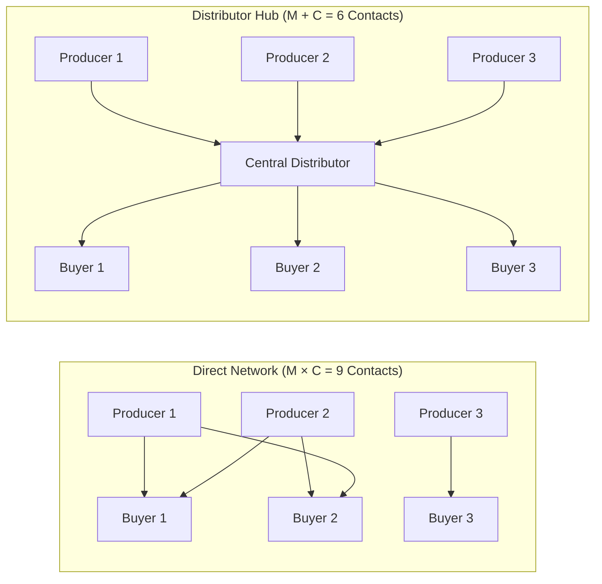
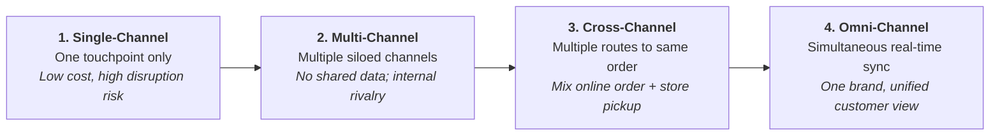

**Marketing Channel Architecture** (the **Place** pillar of the 4Ps) is the interdependent system of producers, wholesalers, retailers, and digital platforms that makes a product or service available for use or consumption by end buyers. Rather than treating distribution as passive logistics, strategic channel design calibrates intermediary count, channel intensity, and online–offline synchronization to maximize customer value while minimizing total transaction and fulfillment costs.

---

## 💡 First-Principles Intuition & Conceptual Core

Imagine three artisanal coffee roasters who each want to sell beans to three neighborhood cafes. Without a distributor, every roaster must negotiate contracts, schedule deliveries, and process invoices with all three cafes separately—creating nine separate commercial handoffs. By introducing a single regional distributor in the middle, each roaster ships once to the distributor, and the distributor delivers once to each cafe, cutting total system contacts from nine down to six.

### 🔑 Prerequisite Concepts & Jargon Decoder

- **Marketing Intermediary (Middleman)**: An independent firm—such as a wholesaler, distributor, broker, or retailer—that sits between producer and end customer to bridge assortment, geography, and timing gaps.
- **Channel Level**: Each layer of intermediaries that performs work in bringing the product and its ownership closer to the final buyer (a zero-level channel is direct-to-consumer; a two-level consumer channel passes through both wholesaler and retailer).
- **Bulk Breaking**: The wholesale function of buying large truckload quantities from manufacturers and splitting them into small, store-ready case sizes.
- **Vertical Marketing System (VMS)**: A unified channel structure where producer, wholesaler, and retailer act as one coordinated system through ownership, contracts, or dominant channel power—eliminating destructive channel conflict.

---

## 📐 Universal Mechanism & Contact-Reduction Math {#channel-levels-and-contact-efficiency}

Intermediaries create economic efficiency by converting a multiplicative all-to-all contact network into an additive hub-and-spoke network:

$$\mathbf{T_{\text{direct}} = M \times C \qquad \text{vs.} \qquad T_{\text{intermediary}} = M + C}$$

### ⚙️ Mechanics & Structural Anatomy

- **Direct Contacts ($M \times C$)**: $M$ manufacturers each transact with $C$ customers independently. Every new producer or customer multiplies total sales calls, invoices, and delivery routes.
- **Intermediary Contacts ($M + C$)**: Routing through one central distributor replaces the product $M \times C$ with the sum $M + C$, because manufacturers only transact with the hub and customers only buy from the hub.
- **10-Second Micro-Example**: With $M = 3$ manufacturers and $C = 3$ customers, direct selling requires $3 \times 3 = \mathbf{9}$ contacts, whereas using one distributor requires only $3 + 3 = \mathbf{6}$ contacts ($33\%$ reduction). At national FMCG scale ($M = 100$ factories, $C = 1{,}000$ stores), direct distribution demands $100{,}000$ links versus just $1{,}100$ links through a distributor—a **$98.9\%$** transaction reduction.

---

## 🎯 Channel Intensity & The Coverage-Control Trade-Off {#channel-intensity}

Once a firm chooses indirect intermediaries, it must decide how many outlets will carry its brand at each level:

| Distribution Intensity     | Strategic Mechanism                                                  | Typical Product Category                                                | Core Managerial Trade-Off                                                     |
| :------------------------- | :------------------------------------------------------------------- | :---------------------------------------------------------------------- | :---------------------------------------------------------------------------- |
| **Intensive Distribution** | Stock product in as many outlets as possible for maximum convenience | FMCG staples, beverages, instant noodles (Indomie, Coca-Cola)           | Maximum volume & reach vs. thin producer margins & weak price/quality control |
| **Selective Distribution** | Use more than one, but fewer than all, willing intermediaries        | Consumer electronics, appliances, specialty retail (ACE Hardware, iBox) | Balanced market coverage vs. curated service standards & brand protection     |
| **Exclusive Distribution** | Grant a single or very few dealers exclusive territorial rights      | Luxury fashion, supercars, bespoke goods (Hermès, Ferrari)              | Maximum brand prestige & margin control vs. severely capped volume            |

---

## 🔄 Evolution from Single-Channel to Omnichannel {#omnichannel-evolution}

Modern enterprises rarely rely on a single route to market. Channel integration evolves across four distinct architectural stages:

- **Multi-Channel Silos**: A customer who buys online receives no recognition in the physical store because inventory, CRM, and KPIs sit in separate departments.
- **Omni-Channel Simultaneity**: Customers use two channels at the same time (e.g., scanning QR reviews on a smartphone while standing in a retail aisle), and one channel actively serves another to bridge online and offline friction.

---

## 🏪 Vertical Marketing Systems & The Retail Mix {#vertical-marketing-systems-and-retail-mix}

To coordinate channel partners as a cohesive **Value Network**, retailers calibrate six interlocking levers known as **The Retail Mix**:

1. **Location**: Store accessibility, foot-traffic density, or free-standing suburban convenience (e.g., Borma Toserba).
2. **Merchandise Assortment**: Breadth (number of categories) versus depth (SKUs per category).
3. **Pricing**: Everyday Low Pricing (EDLP) versus high-low promotional discounting.
4. **Communication Mix**: Catalogs, in-store signage, sales promotions, and social media.
5. **Store Design & Display**: Physical layout, shelf ergonomics, and special promotional endcaps.
6. **Customer Service**: Self-service lean staffing versus high-touch consultative selling.

---

## 🏛️ Multi-Disciplinary Lenses Across the MBA Curriculum

### 1. Marketing Management (MK 3)

- **Primary Mechanism**: Designing customer-centric channels around convenience, delivery speed, and add-on services while balancing [[concepts/customer-perceived-value|Customer Perceived Value (CPV)]] against intermediary margin demands.
- _Discussed in_: [[courses/mk3-marketing-management/week-11/index|MK 3 Week 11: Place (Channel) & Digital Marketing]] and [[courses/mk3-marketing-management/week-11/case-zenxin-organic-digital-retail|Zenxin Organic Case]].

### 2. Operations & Supply Chain Management (MK 4)

- **Primary Mechanism**: Physical channel promises fail without synchronized inventory buffers, cold-chain transit, and [[concepts/customer-order-decoupling-point|Customer Order Decoupling Point (CODP)]] placement under the [[concepts/supply-chain-operations-reference|SCOR Framework]].
- **Core Tension**: Marketing pushes for rapid omnichannel home delivery, while Operations guards against small-basket logistics losses and perishable spoilage.

### 3. Financial Management (MK 2)

- **Primary Mechanism**: Supermarket listings expand top-line revenue but demand steep trade margins and extended accounts receivable cycles, whereas direct-to-consumer e-commerce captures higher gross margin at higher upfront fulfillment cost.

---

## 🔗 Contributing Sessions & References

- Lecture Hub: [[courses/mk3-marketing-management/week-11/index|MK 3 Week 11: Place (Channel) & Digital Marketing]]
- Case Dossier: [[courses/mk3-marketing-management/week-11/case-zenxin-organic-digital-retail|Zenxin Organic — Brick & Mortar to Digital Retail]]
- Hub: [[concepts/index|Knowledge Matrix]]
